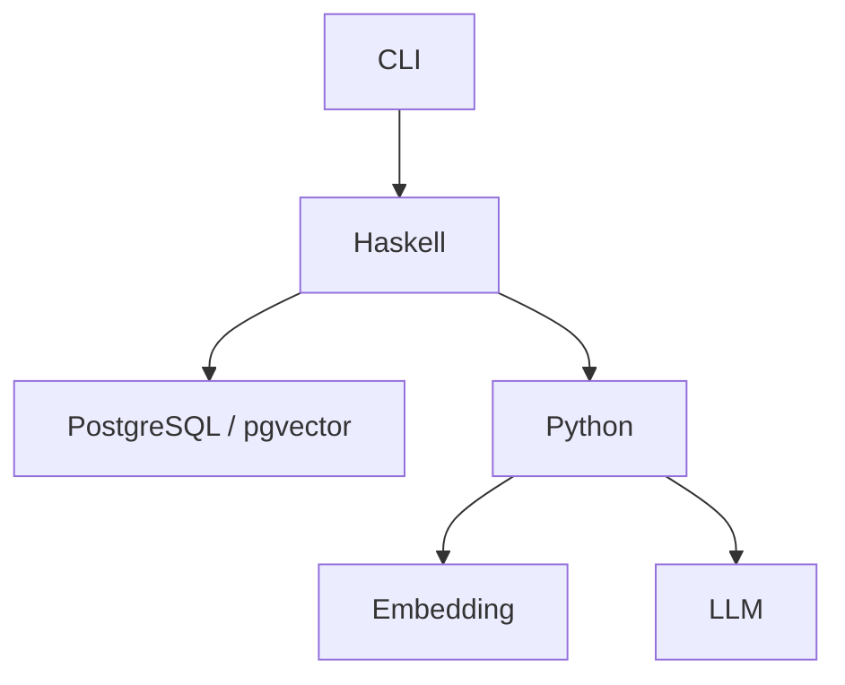

# 基本機能設計

## 全体構成

OtelLensは、文書取り込みと質問応答をCLIから実行する。



## 機能

### 文書取り込み

`otellens ingest PATH` で指定された文書を検索可能な状態にする。

文書取り込みの基本設計は [[文書取り込み基本設計]] に記載する。

### 関連文書検索

質問に関連する文書断片を取得する。

関連文書検索の基本設計は [[関連文書検索基本設計]] に記載する。

### 回答生成

質問と関連する文書断片をもとに回答を生成し、CLIへ表示する。

回答生成の基本設計は [[回答生成基本設計]] に記載する。

## CLI

提供するコマンドは次の2つとする。

```sh
otellens ingest ./corpus
otellens ask "Span StatusをErrorにする条件は？"
```
