# extension.ts と VS Code 接続

`src/extension.ts` は、QuickTreeのCoreとVS Code APIをつなぐ「接続部分」。

今のコードでは、QuickTree内部のTreeを `QuickPick` に表示し、ユーザー操作をCoreへ戻すところまで担当している。

細かいコードを忘れたときは、まずこの図を見る。

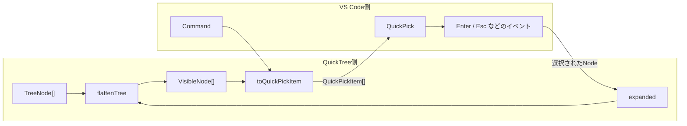

## 一言でいうと

```text
QuickTree Core
    ↓
VisibleNode[]
    ↓
extension.ts が VS Code 用に変換
    ↓
QuickPickItem[]
    ↓
VS Code QuickPick
```

逆方向は、

```text
ユーザーがEnter
    ↓
VS Codeがイベントを通知
    ↓
extension.ts が選択Nodeを取り出す
    ↓
QuickTree Coreへ渡す
```

となる。

つまり `extension.ts` は、

> QuickTreeの値をVS Codeへ渡し、VS CodeのイベントをQuickTreeへ戻す場所

と考える。

## VS Code拡張が動き始めるまで

QuickTreeの画面が突然 `extension.ts` から始まるわけではない。

まずVS Codeが `package.json` を読み、QuickTreeが提供するCommandを知る。

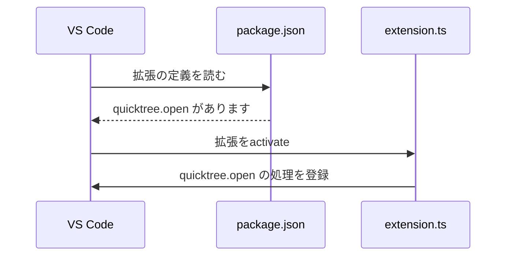

`package.json` 側では、

```text
"quicktree.open"
```

というCommand名を宣言する。

`extension.ts` 側では、

```text
registerCommand("quicktree.open", ...)
```

として、そのCommandが実行されたときの処理を登録する。

役割は違う。

```text
package.json
    ↓
「このCommandがあります」とVS Codeへ宣言

extension.ts
    ↓
「このCommandではこの処理をします」と実装を登録
```

## activate

`activate` はVS Code拡張の入口。

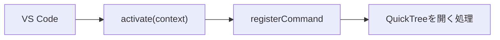

ここで重要なのは、`activate` をQuickTree自身が直接呼んでいないこと。

VS Code側が拡張を有効化するときに呼ぶ。

そのため、

```ts
export const activate = (
  context: vscode.ExtensionContext,
): void => {
```

の `context` もVS Codeから渡される。

## registerCommand

ここからVS Code APIが出てくる。

```ts
vscode.commands.registerCommand(
  "quicktree.open",
  () => {
    // QuickTreeを開く処理
  },
)
```

図にすると、

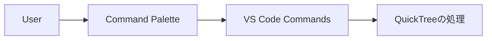

ユーザーがCommand Paletteなどから `QuickTree: Open` を実行すると、登録した関数が呼ばれる。

## createQuickPick

QuickTreeが表示している浮いた一覧は、自前でHTMLを描画しているわけではない。

VS Codeが提供している `QuickPick` を作っている。

```ts
const quickPick =
  vscode.window.createQuickPick<QuickTreeItem>()
```

関係はこう。

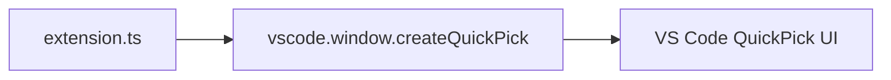

ここで作った `quickPick` は、VS Codeの画面そのものではなく、

> VS Code上のQuickPickを操作するためのオブジェクト

と考えると分かりやすい。

このオブジェクトへ、

```text
title
placeholder
items
```

などを設定し、最後に `show()` すると画面へ出る。

## TreeNode と QuickPickItem の境界

QuickTree CoreはVS Codeの型を知らない。

Coreが扱うのは、

```text
TreeNode
VisibleNode
```

である。

一方、VS CodeのQuickPickが表示できるのは、

```text
QuickPickItem
```

である。

そのため、この間に変換が必要になる。

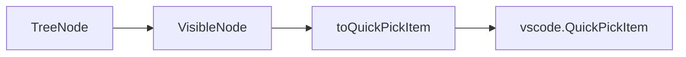

現在は `QuickTreeItem` という型で両者をつないでいる。

```ts
type QuickTreeItem =
  vscode.QuickPickItem & {
    readonly visibleNode: VisibleNode
  }
```

これは、

```text
VS Codeが表示する情報
        +
QuickTree内部のNode情報
```

を1つにしたもの。

例えば画面上では、

```text
▾ src
```

という文字列しか見えない。

しかしEnterされたときは、

```text
srcというNodeのid
branchかleafか
depth
expanded
```

なども必要になる。

そのため、表示用Itemの中へ元の `VisibleNode` を保持している。

## toQuickPickItem

`toQuickPickItem` は、QuickTree側の値をVS Code側の値へ変換する境界。

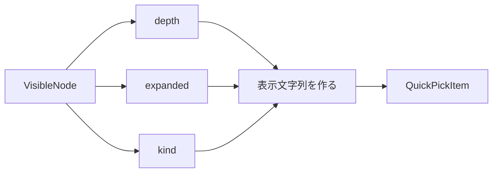

例えば、

```text
VisibleNode
  node.label = "core"
  node.kind = "branch"
  depth = 1
  expanded = false
```

なら、

```text
  ▸ core
```

という `label` を作る。

ここは「Treeの意味」を決めるCoreではなく、

> VS Code上でどう見せるか

を担当する。

## demoTree

現在の `demoTree` はVS Codeとは関係ない。

```ts
const demoTree: ReadonlyArray<TreeNode> = [...]
```

これは動作確認用にQuickTree側で手書きした仮データ。

```text
現在

demoTree
   ↓
Core
   ↓
QuickPick
```

将来はここが、

```text
VS Code workspace.fs
   ↓
Files Source
   ↓
TreeNode[]
   ↓
Core
   ↓
QuickPick
```

になる。

そのため `demoTree` は接続部分の完成形ではなく、Files Sourceができるまでの仮入力。

## render

`render` は「現在のQuickTree状態を、QuickPickへ反映する」処理。

```ts
quickPick.items = flattenTree(
  demoTree,
  expanded,
).map(toQuickPickItem)
```

この1行が、今のコードで最も分かりやすい境界になっている。

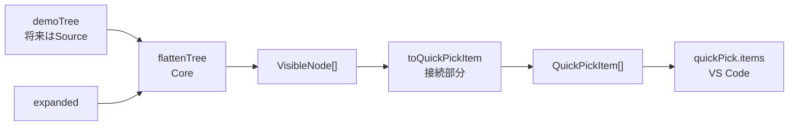

分類すると、

```text
flattenTree
    → QuickTree Core

toQuickPickItem
    → QuickTreeとVS Codeの変換

quickPick.items =
    → VS Code API
```

となる。

## branchでEnterしたとき

ユーザー操作はVS Code側からイベントとして入ってくる。

```ts
quickPick.onDidAccept(() => {
  ...
})
```

`onDidAccept` は、

> QuickPickでユーザーが項目を決定した

ことをVS Codeが通知するイベント。

branchでEnterすると、

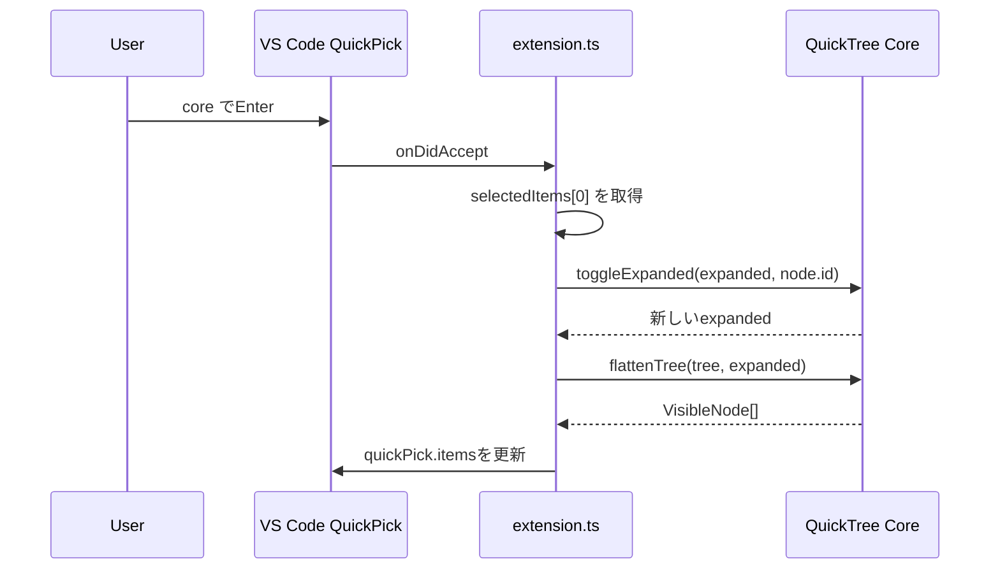

ポイントは、

```text
Enterを検知する       → VS Code
どのNodeか取り出す    → extension.ts
開閉状態を変更する    → Core
一覧を再計算する      → Core
画面を書き換える      → VS Code
```

という責務分担。

## leafでEnterしたとき

現在はまだファイルを開いていない。

```ts
vscode.window.showInformationMessage(
  `Selected: ${node.label}`,
)

quickPick.hide()
```

今は、

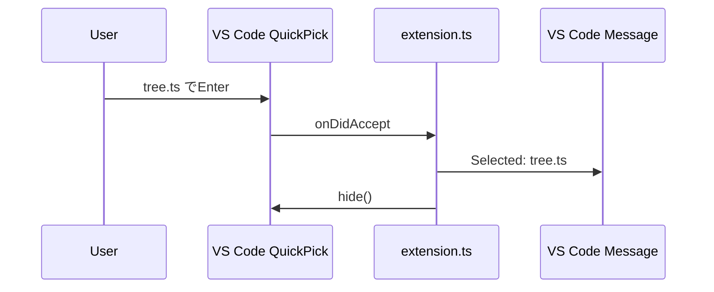

という動作。

将来Files Sourceができると、

```text
leafでEnter
    ↓
Files Sourceへaccept
    ↓
VS Codeでファイルを開く
    ↓
QuickPickを閉じる
```

へ置き換わる予定。

## onDidHide と dispose

QuickPickが閉じられたとき、

```ts
quickPick.onDidHide(() => {
  quickPick.dispose()
})
```

としている。

```text
Esc
または
quickPick.hide()
      ↓
VS Codeが onDidHide を通知
      ↓
dispose()
      ↓
作ったQuickPickを破棄
```

`hide` と `dispose` は少し違う。

```text
hide
  → 画面から隠す

dispose
  → そのQuickPickをもう使わないので後片付けする
```

## context.subscriptions

Command登録も後片付けが必要。

```ts
context.subscriptions.push(openCommand)
```

`registerCommand` が返す `openCommand` は、登録解除できるDisposable。

それを `context.subscriptions` に入れておくと、拡張が終了するときVS Code側がまとめて破棄する。

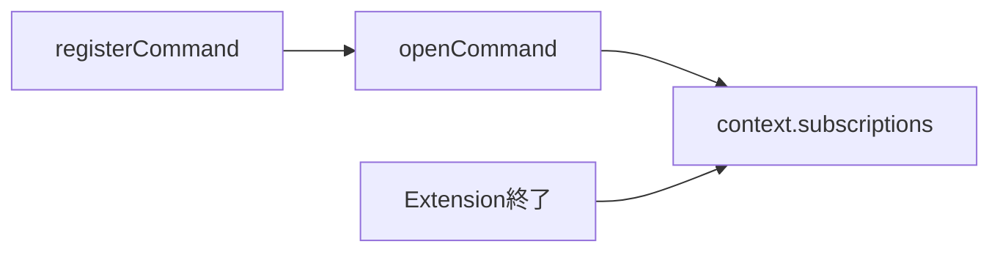

## 今のextension.tsの責務

現在は1ファイルへ色々入っているが、概念上は4つに分けて読むと分かりやすい。

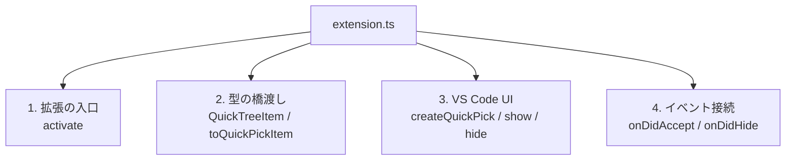

`demoTree` と `expanded` は現在ここに置いているが、最終的にはSourceやStateへ分離していく。

## QuickTree側とVS Code側を見分ける

コードを読むときは、まず `vscode.` が付いているかを見ると分かりやすい。

```text
vscode.commands.registerCommand
vscode.window.createQuickPick
vscode.window.showInformationMessage
vscode.ExtensionContext
vscode.QuickPickItem

        ↓

VS Code API
```

一方、

```text
TreeNode
VisibleNode
flattenTree
toggleExpanded
expanded
demoTree

        ↓

QuickTree側
```

そして、

```text
QuickTreeItem
toQuickPickItem
onDidAccept内の変換処理

        ↓

両者の接続部分
```

と考える。

## 現在の全体フロー

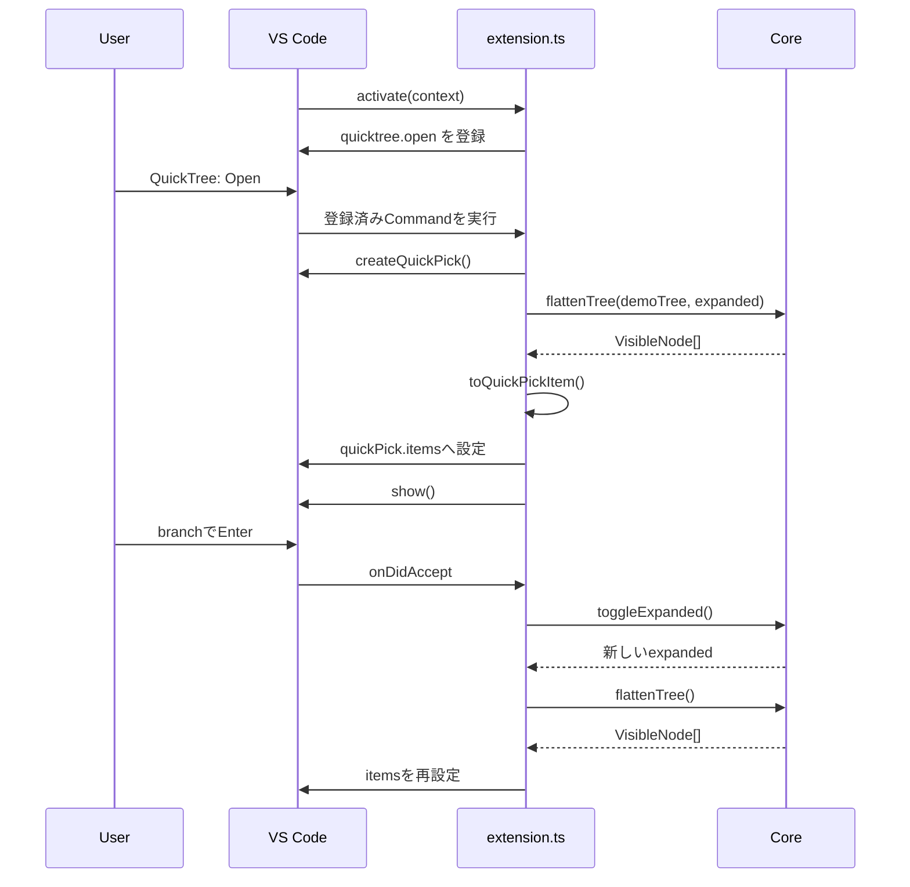

## 将来どう薄くなるか

今は `extension.ts` に仮Treeや状態まであるため少し大きい。

Files Sourceなどが入ると、最終的には次のような位置づけになる。

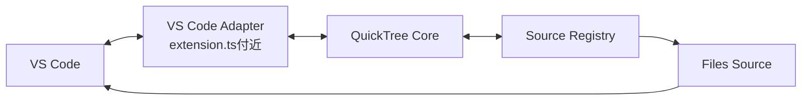

理想は、

> extension.tsは「VS Codeへ登録して各部品をつなぐ」だけ

に近づけること。

具体的なFiles / Git / Outlineの処理を `extension.ts` に増やしていかない。

## 一言で覚える

`extension.ts` は、

> QuickTreeのTreeと状態を、VS CodeのCommand・QuickPick・イベントへ接続する境界

と覚えておけばよい。

特に今のコードでは、この1本が中心。

```text
TreeNode[]
   ↓
flattenTree
   ↓
VisibleNode[]
   ↓
toQuickPickItem
   ↓
QuickPickItem[]
   ↓
VS Code QuickPick
```

逆方向は、

```text
VS CodeのEnterイベント
   ↓
selectedItems
   ↓
VisibleNode
   ↓
toggleExpanded
   ↓
再render
```

この往復が、現在の `extension.ts` の本体。
