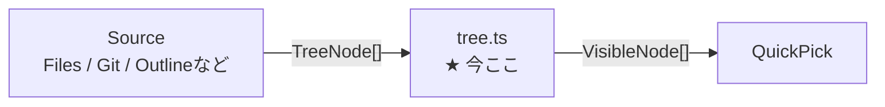
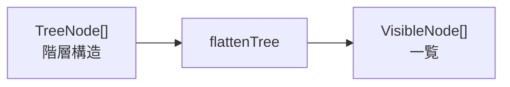
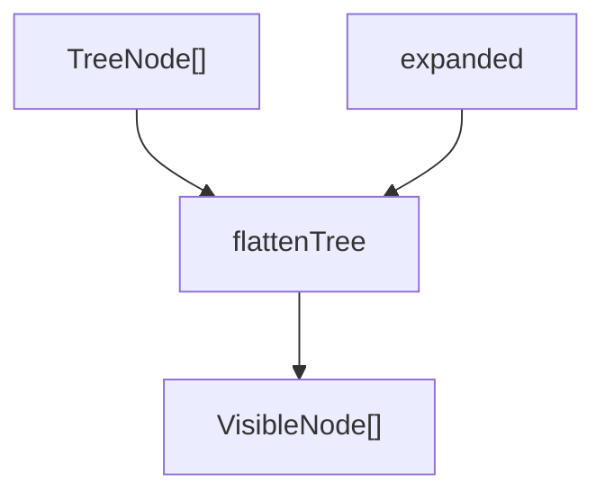
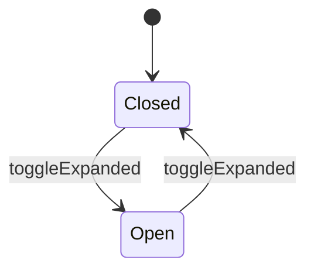

# tree.ts の役割

`src/core/tree.ts` は、QuickTree全体の中で「ツリーそのもの」と「どこまで表示するか」を扱う部品。

VS Codeからファイルを読む処理や、QuickPickを表示する処理はここには置かない。

## 全体のどこか



`tree.ts` はSourceと画面の間にいる。

## TreeNode

`TreeNode` は、QuickTree内部で使う「木の1要素」。

```text
TreeNode

src                  ← branch
├── core             ← branch
│   └── tree.ts      ← leaf
└── extension.ts     ← leaf
```

- `branch`: 子を持てる。フォルダのようなもの
- `leaf`: 末端。ファイルのようなもの

Files Sourceだけの型ではない。

Outlineなら、

```text
Module
├── Type
└── function
```

のようなTreeにも使える。

## expanded

ツリー全部を常に表示すると、折り畳みができない。

そこで「今どのbranchが開いているか」だけを別に持つ。

```text
Tree

src
├── core
│   └── tree.ts
└── extension.ts

expanded

{ "src" }
```

この場合、`src` は開いているが `core` は閉じている。

画面にはこう出る。

```text
▾ src
  ▸ core
    extension.ts
```

`expanded` に `src/core` も入ると、

```text
▾ src
  ▾ core
      tree.ts
    extension.ts
```

になる。

## VisibleNode

`TreeNode` は階層構造だが、QuickPickは基本的に上から下へ並ぶ一覧。

そのため、画面に並べるための情報へ変換する。



`VisibleNode` は、

- どのNodeか
- 何段目か
- 展開中か

を持つ。

`depth` があるので、

```text
depth 0: src
depth 1:   core
depth 2:     tree.ts
```

のようにインデントして表示できる。

## flattenTree

一番大事な関数。

役割は、

> Treeと展開状態を受け取って、「今画面に出すNodeの一覧」を返す

こと。



例えば、

```text
Tree

src
├── core
│   └── tree.ts
└── extension.ts
package.json
```

展開状態が、

```text
{ "src" }
```

なら結果は、

```text
src
  core
  extension.ts
package.json
```

`core` の中身はまだ返さない。

## toggleExpanded

役割は単純。

選択したbranchが、

- 閉じていたら開く
- 開いていたら閉じる

だけ。



元の `expanded` を直接書き換えず、新しいSetを返す。

```text
古いexpanded
     │
     ▼
toggleExpanded
     │
     ▼
新しいexpanded
```

この形にしておくと、処理が追いやすくテストもしやすい。

## コードを読む順番

次にこのファイルを見たときは、上から全部理解しようとしなくてよい。

```text
1. TreeNode
   ↓
   ツリーの1要素

2. VisibleNode
   ↓
   画面に出すための1要素

3. flattenTree
   ↓
   Tree → 表示一覧

4. toggleExpanded
   ↓
   開閉状態を反転
```

## コメント付きコード

```ts
// ツリー内のNodeを一意に識別するID。
// Files Sourceならパス、Outline Sourceならsymbolを識別できる値などを想定する。
export type NodeId = string

// QuickTree内部で共通して扱う「ツリーの1要素」。
// branchは子を持てる要素、leafは末端要素。
export type TreeNode = Readonly<{
  id: NodeId
  label: string
  kind: "branch" | "leaf"
  children?: ReadonlyArray<TreeNode>
}>

// TreeNodeをQuickPickへ並べるための表示用情報。
// depthはインデント量、expandedはbranchが開いているかを表す。
export type VisibleNode = Readonly<{
  node: TreeNode
  depth: number
  expanded: boolean
}>

// 階層構造のTreeを、現在の展開状態に応じて
// QuickPickへ上から順に並べられる一次元の一覧へ変換する。
export const flattenTree = (
  tree: ReadonlyArray<TreeNode>,
  expanded: ReadonlySet<NodeId>,
  depth = 0,
): ReadonlyArray<VisibleNode> =>
  tree.flatMap((node) => {
    // branchかつexpandedにIDが含まれていれば、現在開いているNode。
    const isExpanded =
      node.kind === "branch" && expanded.has(node.id)

    // 自分自身は必ず表示候補へ入れる。
    const current: VisibleNode = {
      node,
      depth,
      expanded: isExpanded,
    }

    // 閉じているNode、または子を持たないNodeなら、
    // 自分だけ返して子は表示しない。
    if (
      !isExpanded ||
      node.children === undefined
    ) {
      return [current]
    }

    // 開いているbranchなら、
    // 自分の直後に子Nodeを再帰的に並べる。
    return [
      current,
      ...flattenTree(
        node.children,
        expanded,
        depth + 1,
      ),
    ]
  })

// 指定したNodeの展開状態を反転する。
// 元のSetは変更せず、新しいSetを返す。
export const toggleExpanded = (
  expanded: ReadonlySet<NodeId>,
  id: NodeId,
): ReadonlySet<NodeId> => {
  const next = new Set(expanded)

  if (next.has(id)) {
    // 開いているなら閉じる。
    next.delete(id)
  } else {
    // 閉じているなら開く。
    next.add(id)
  }

  return next
}
```

## 一言で覚える

`tree.ts` は、

> 「ツリー構造」と「開閉状態」から、QuickPickに今見せる一覧を作る部品

と覚えておけば十分。
