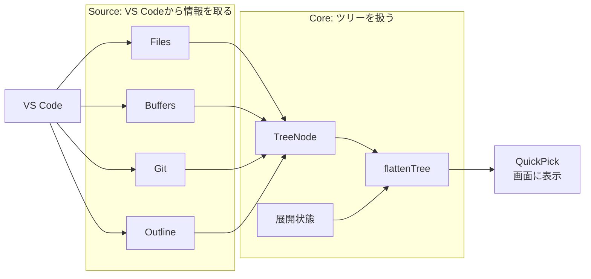
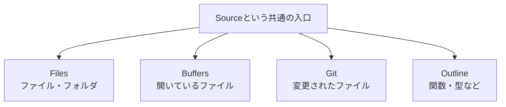
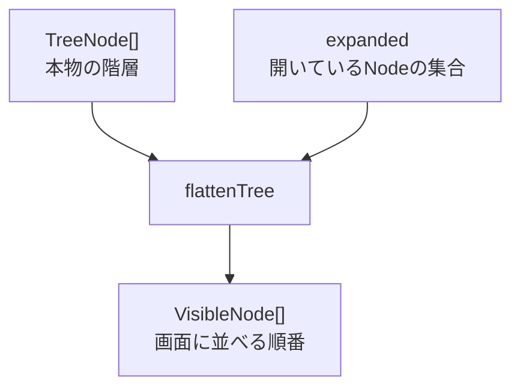
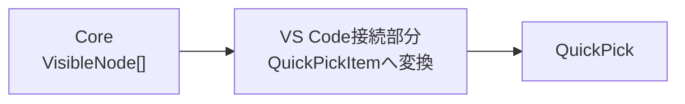
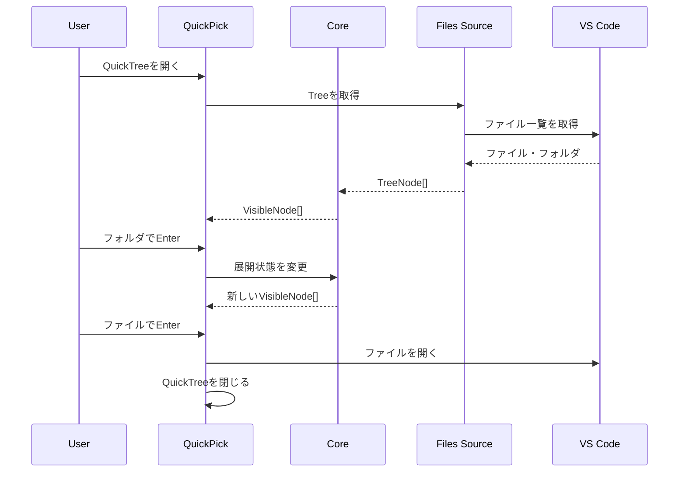

# QuickTree 全体像

QuickTreeは、VS Codeが持っている情報を「共通のツリー」に変換し、QuickPickへ表示する拡張。

細かい実装を忘れたときは、まずこの図を見る。



## すごく大ざっぱに言うと

```text
VS Codeの情報
      ↓
Source
      ↓
共通のTree
      ↓
Core
      ↓
QuickPickに表示
```

QuickTree自身が、ファイル解析やGit解析などを全部行うわけではない。

VS Codeがすでに持っている情報を受け取り、QuickTree用の共通Treeへ変換して表示する。

## Source

Sourceは「何をツリーとして見せるか」を担当する。



Coreは、FilesやGitなどの違いをなるべく知らない。

どのSourceも最終的には、だいたい次のような共通Treeを返す。

```text
TreeNode
├── TreeNode
│   ├── TreeNode
│   └── TreeNode
└── TreeNode
```

そのため、将来Sourceを増やしてもCoreを直さず追加できる形を目指す。

## Core

CoreはQuickTreeの「ツリーをどう扱うか」を担当する。

今作っている `src/core/tree.ts` はここ。



例えば内部Treeがこうだったとする。

```text
src
├── core
│   ├── tree.ts
│   └── source.ts
└── extension.ts
```

`src` と `core` が展開中なら、`flattenTree` はQuickPickに並べられる形へ変換する。

```text
src
  core
    tree.ts
    source.ts
  extension.ts
```

重要なのは、CoreはVS Codeの画面を直接触らないこと。

Coreは「値を受け取り、値を返す」処理を中心にする。

## VS Codeとの接続部分

Coreが作った `VisibleNode[]` を、そのままではQuickPickに表示できない。

そこでVS Codeとの接続部分が変換する。



ここではじめてVS Code APIが出てくる。

## ファイルを選ぶまで



## 今いる場所

現在は、まだSourceやVS Codeとの接続より前。

```text
[これから]
Files Source
     ↓
     ↓
[今ここ]
TreeNode
flattenTree
toggleExpanded
     ↓
     ↓
[これから]
QuickPickへの変換
     ↓
QuickPick表示
```

最初にCoreを作る理由は、VS Codeと切り離して動きを理解・テストしやすくするため。

## 覚えておくこと

QuickTreeを見失ったら、次の1行だけ思い出せばよい。

```text
SourceでTreeを作る → Coreで表示形へ変換する → QuickPickへ渡す
```
