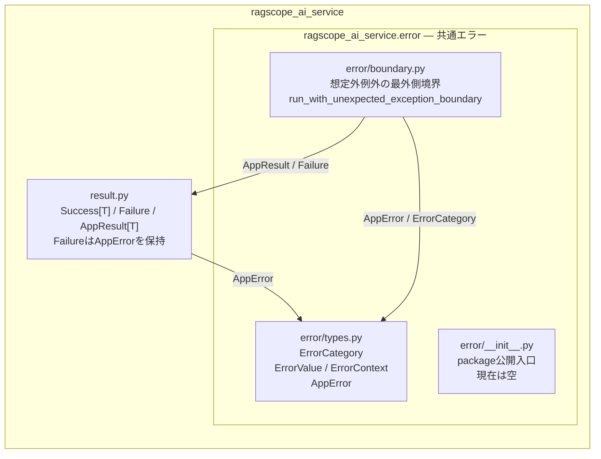

# AI推論サービス構成図

`ragscope_ai_service`の共通エラー周辺のmodule依存を示す。

`code`の意味は機能側が決め、`cause`は内部原因を保持する。最外側境界では`AppResult[T]`をそのまま通し、漏れた`Exception`だけを`internal.unexpected`の`Failure(AppError)`へ変換し、元例外はその`cause`のみに保持する。
