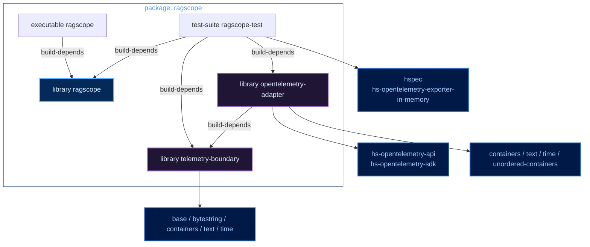
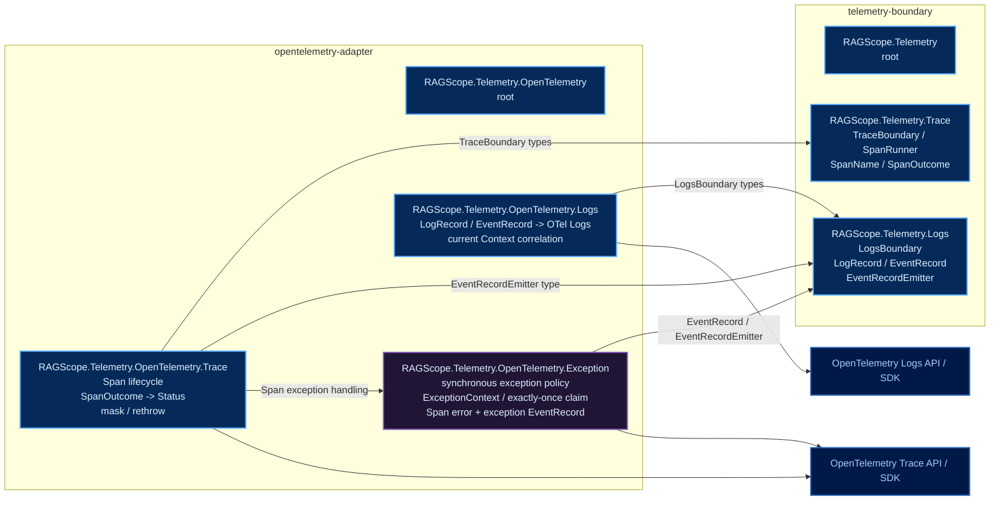
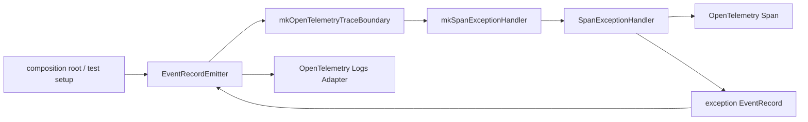
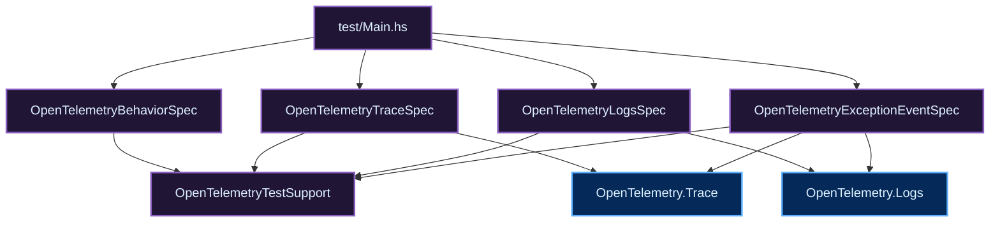

# RAGScopeアプリケーション Haskellライブラリ・モジュールマップ

正本は `takashit16833/RAGScope` の `ragscope-app/ragscope.cabal` と実際のHaskellコードとする。このノートはそれらを追従する準正本として保守し、差異がある場合は正本を優先する。

現在の確認基準は `RS-0024/exception-event-once`。`RAGScope.Telemetry.OpenTelemetry.Exception` は今回のリファクタで採用する構成として確定しており、正本コードへの反映対象である。

## Cabal component

凡例: 公開library / module = 青、非公開library / module = 紫、別package / 外部package = 濃青。

`library ragscope` は現在Facade用componentだけがあり、`exposed-modules` はまだ持たない。`executable ragscope` の `Main.hs` も現在は最小stubである。

## Production module

凡例: 公開library / module = 青、非公開library / module = 紫、別package / 外部package = 濃青。

`RAGScope.Telemetry.OpenTelemetry.Exception` は `opentelemetry-adapter` 内部moduleとし、公開Adapter APIにはしない。`ragscope.cabal` では `other-modules` に置く。

`Trace` はSpan lifecycleを担当し、exception固有の `ExceptionContext`、exactly-once claim、exception EventRecord schemaは `Exception` が担当する。`Trace` から `Logs` への依存は `mkOpenTelemetryTraceBoundary` が受け取る `EventRecordEmitter` の型に限定する。

## exception処理の依存

`EventRecordEmitter` は `mkOpenTelemetryTraceBoundary` で受け取り、`mkSpanExceptionHandler` へ一度渡してcaptureする。`runOpenTelemetrySpan`、exception捕捉、claim、EventRecord生成の各段へEmitterをparameter threadingしない。

## test-suite module

凡例: 公開library / module = 青、非公開library / module = 紫。

- `OpenTelemetryTraceSpec`: TraceBoundary単体のresult、Span Status、Context、同期/非同期exception、action exactly-once。
- `OpenTelemetryLogsSpec`: LogRecord / EventRecord変換、timestamp、current Trace Contextとの相関。
- `OpenTelemetryExceptionEventSpec`: Trace × Logsの統合。nested Spanで全SpanをErrorにしつつexception EventRecordを1件だけ記録し、first-escape Spanへ相関させる。
