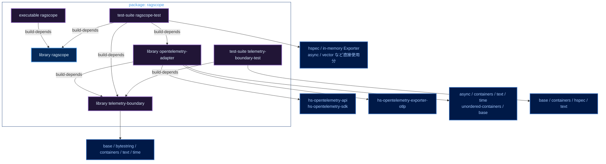
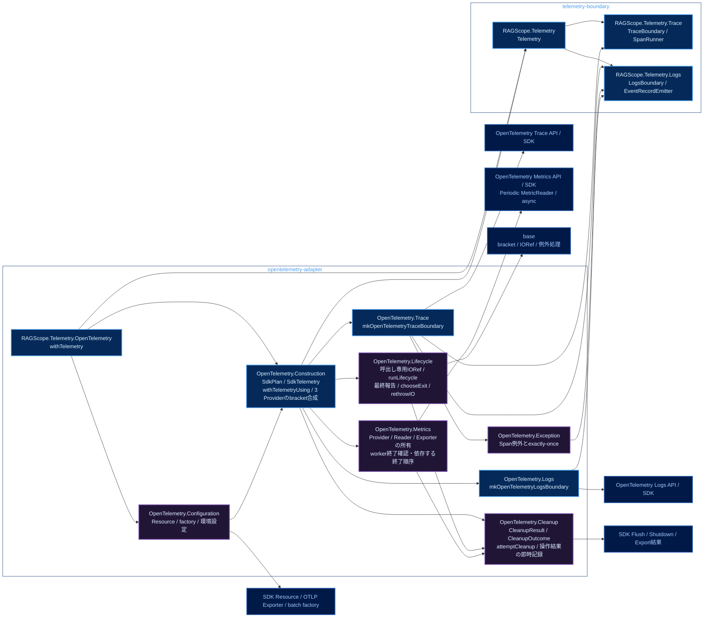
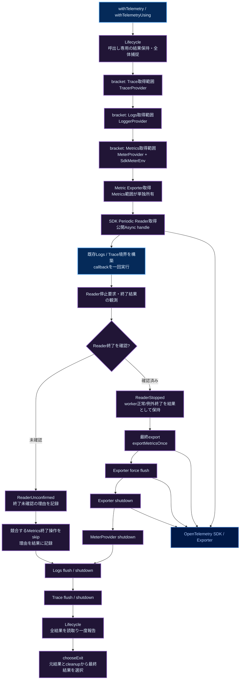
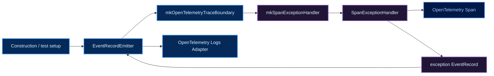

# RAGScopeアプリケーション Haskellライブラリ・モジュールマップ

対象: **RS-0024 subtask「OpenTelemetry SDKライフサイクルとMetrics基盤を実装する」完了時の構成**。図はlibrary境界・module責務・呼び出し経路を俯瞰するためのもの。仕様と実際の依存の正本は`takashit16833/RAGScope`の対象branchにある`ragscope-app/ragscope.cabal`、コード、テストであり、食い違う場合はそちらを優先する。実装判断と検証手順は[[RS-0024 SDKライフサイクルとMetrics基盤 実装計画]]に記載する。

図中の矢印は、特記がなければ**矢印元が矢印先へ依存する方向**。配色は[[Mermaid図の色分けルール]]に従う。

## Cabal componentとpackage依存



凡例: 青＝公開library、紫＝package内の非公開libraryおよびcomponent、濃青＝外部package。`visibility: private`でも`exposed-modules`は別componentからimport可能な範囲を定める。`other-modules`はそのcomponentの内部実装。

`telemetry-boundary`にOpenTelemetry API/SDK依存を追加しない。`opentelemetry-adapter`はReaderのAsync handle操作用の`async`と、通常OTLP factoryを直接importするための`hs-opentelemetry-exporter-otlp`を直接依存に持つ。テストが直接importする`async`/`vector`等もテストcomponentに宣言する。`telemetry-boundary-test`はSDK非依存のまま。

## Production moduleと静的なimport方向



凡例: 青＝`exposed-modules`、紫＝`other-modules`、濃青＝外部library/API。図内の`OpenTelemetry.*`は`RAGScope.Telemetry.OpenTelemetry.*`の略記。ただし外部SDK nodeはOpenTelemetry packageの実moduleを指す。

### 公開APIと利用者

```haskell
-- telemetry-boundary / RAGScope.Telemetry
-- 機能処理に渡せるSDK非依存の束。実際のUseCaseには必要な操作のみを渡す。
data Telemetry = Telemetry
  { telemetryTrace :: TraceBoundary
  , telemetryLogs  :: LogsBoundary
  }

-- opentelemetry-adapter / RAGScope.Telemetry.OpenTelemetry
withTelemetry :: (Telemetry -> IO a) -> IO a

-- opentelemetry-adapter / OpenTelemetry.Construction
-- 構築と標準計装の接続だけがMeterProviderを参照する。
data SdkTelemetry = SdkTelemetry
  { sdkTelemetry     :: Telemetry
  , sdkMeterProvider :: MeterProvider
  }

-- 構築入口の設計上の形。型・設定項目の正確な定義は正本の実コードで確認する。
withTelemetryUsing
  :: SdkPlan
  -> (LifecycleReport -> IO ())
  -> (SdkTelemetry -> IO a)
  -> IO a
```

`Telemetry`にはSDK型を入れず、`SdkTelemetry`をUseCaseへ配らない。Trace/Logsは既存`mkOpenTelemetryTraceBoundary`、`mkOpenTelemetryLogsBoundary`を使う。`Construction`はProviderから境界への組み立てと3 Providerの`bracket`合成を担当する。`Lifecycle`は一回の呼出しだけに閉じる非公開`IORef [CleanupOutcome]`、取得/use全体の捕捉、終了後の一度だけの報告、純粋な`chooseExit`による最終判断を担当する。`Cleanup`は個別のSDK操作が返す値/例外を`attemptCleanup`で捕捉し、その場で内部の記録関数へ渡す。`Metrics`はReader停止結果とExporter/Providerの依存する終了順序を担当する。`Cleanup`は資源を取得せず、`Lifecycle`はReaderの具象型を知らない。通常構成とテスト構成は共通の`withTelemetryUsing`を通す。

`Lifecycle`から`Cleanup`へは依存するが逆方向には依存しない。`Construction`が`Lifecycle`の記録関数を各releaseへ渡す。`telemetry-boundary`と`opentelemetry-adapter`間の依存方向はCabalの`build-depends`で制約できるが、Adapter内のmodule間import方向はCabalだけでは禁止できない。

## 取得・利用・解放の流れ



凡例: 青＝公開入口/利用操作、紫＝Adapter内の資源管理、濃青＝外部SDK。この図だけは矢印が呼び出し・実行順を示す。通常の利用終了経路を示し、取得失敗時にはその時点で取得済みの資源のreleaseへ移る。`ReaderStopped`と`ReaderUnconfirmed`は終了確認の状態を示す設計上の名前であり、型の正確な定義はコードで確認する。

取得順はTrace→Logs→Metrics、解放順はMetrics→Logs→Trace。Logs取得失敗ならTraceをcleanupし、Metrics取得失敗ならLogs→Traceをcleanupする。Trace/Logs内のExporter・Processor、Metrics内のProvider・Exporter・Readerを段階取得する途中で失敗した場合も、取得済み資源を解放してから外側の`bracket`へ伝える。`bracket`が保護するのは取得が成功して返った資源であるため、取得関数内部での失敗には`bracketOnError`等を用いる。所有権移譲後に同じ資源を二重shutdownしない。

`Cleanup`の`attemptCleanup`はflush/export/shutdownごとのSDK戻り値または`ExceptionWithContext`を`CleanupOutcome`へ変換し、内部の`record :: CleanupOutcome -> IO ()`へ即時記録して後続の終了処理を続行する。`Lifecycle`は呼出し専用の非公開`IORef [CleanupOutcome]`を保持し、元の取得/use結果とcleanup結果を分離して扱う。記録関数はネットワークやTelemetryログ、任意のreporterを呼ばず、lifecycle threadからだけ書き込む。全release試行後に結果を読み、独立診断先への一度だけの報告結果も含め、純粋な`chooseExit`で最終結果を決める。元の例外は`rethrowIO`で文脈を保つ。元の成功値や`Left FeatureFailure`をTelemetryの通常の終了失敗で書き換えず、reporterの同期失敗も機能結果へ伝播させない。Telemetryへ再帰報告しない。

MeterProviderの`metricExporter`は`Nothing`とし、ExporterをProvider/Readerで二重所有しない。Readerの`stopPeriodicMetricReader`は使わず公開Async handleを停止する。`async 2.2.6`の`cancel`はworkerの終了を待つため、workerが応答しなければ`poll`に到達できないことがある。**Reader終了を確認できた場合のみ**最終export・Exporter flush/shutdown・MeterProvider shutdownを順番に試みる。停止要求または待機が中断された場合は終了結果を確認し、未確認なら競合するMetrics終了操作を理由付きでskipして独立したLogs/Traceのcleanupへ進む。`waitCatch`/`poll`の`Left AsyncCancelled`はReader workerの終了結果であり、lifecycle threadで捕捉した`SomeAsyncException`と区別する。workerの意図的なcancelだけで`chooseExit`の中断候補にしない。有限時間での停止や損失ゼロは保証しない。SDKのdelta集約では収集が値をリセットし得るため、最終export前に素の`forceFlushMeterProvider`を呼ばず、通常はcumulative集約を使う。

## exception処理の依存



凡例: 青＝公開された構築点/境界/Adapter、紫＝Adapter内部の例外処理、濃青＝SDK Span。`EventRecordEmitter`は`mkOpenTelemetryTraceBoundary`で受け取り、`mkSpanExceptionHandler`へ一度渡してcaptureする。`runOpenTelemetrySpan`、exception捕捉、claim、EventRecord生成の各段へEmitterをparameter threadingしない。lifecycleの終了例外はこの機能例外の記録経路へ再帰させない。
