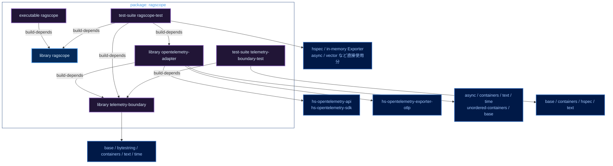
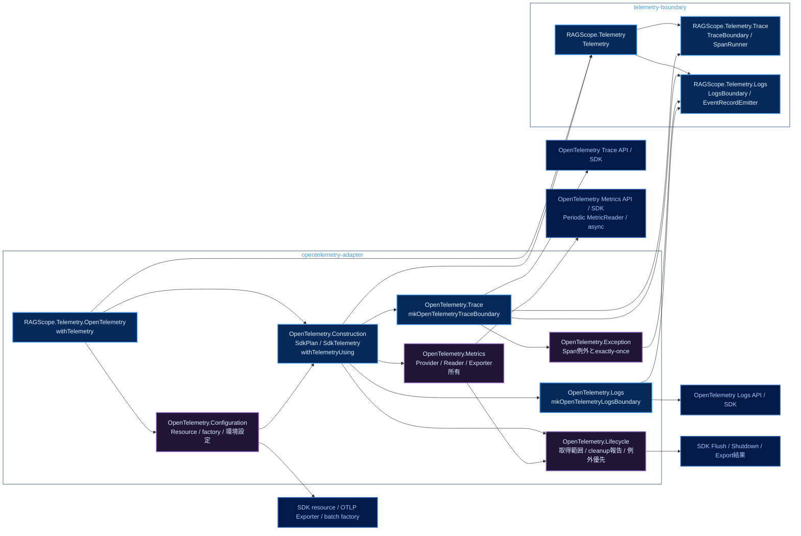
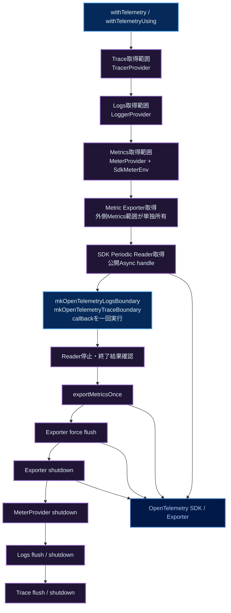
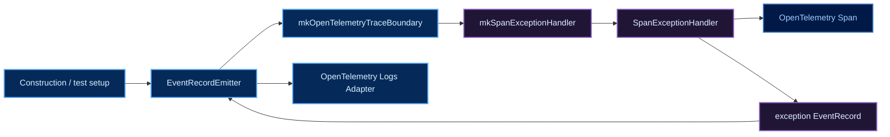

# RAGScopeアプリケーション Haskellライブラリ・モジュールマップ

対象: **RS-0024 subtask「OpenTelemetry SDKライフサイクルとMetrics基盤を実装する」完了時の構成**。図はlibrary境界・module責務・呼び出し経路を俯瞰するためのもの。仕様と実際の依存の正本は`takashit16833/RAGScope`の対象branchにある`ragscope-app/ragscope.cabal`、コード、テストであり、食い違う場合はそちらを優先する。実装判断と検証手順は[[RS-0024 SDKライフサイクルとMetrics基盤 実装計画]]に記載する。

図中の矢印は、特記がなければ**矢印元が矢印先へ依存する方向**。配色は[[Mermaid図の色分けルール]]に従う。

## Cabal componentとpackage依存



凡例: 青＝公開library、紫＝package内の非公開libraryおよびcomponent、濃青＝外部package。`visibility: private`でも`exposed-modules`は別componentからimport可能な範囲を定める。`other-modules`はそのcomponentの内部実装。

`telemetry-boundary`にOpenTelemetry API/SDK依存を追加しない。`opentelemetry-adapter`は`async`と、通常OTLP factoryを直接importするための`hs-opentelemetry-exporter-otlp`を直接依存に持つ。テストが直接importする`async`/`vector`等もテストcomponentに宣言する。`telemetry-boundary-test`はSDK非依存のまま。

## Production moduleと静的なimport方向



凡例: 青＝`exposed-modules`、紫＝`other-modules`、濃青＝外部library/API。図内の`OpenTelemetry.*`は`RAGScope.Telemetry.OpenTelemetry.*`の略記。ただし外部SDK nodeはOpenTelemetry packageの実moduleを指す。

### 公開APIと利用者

```haskell
-- telemetry-boundary / RAGScope.Telemetry
-- 機能処理に渡せるSDK非依存の束。実際のUseCaseには必要な操作のみを渡す。
data Telemetry = Telemetry
  { telemetryTrace :: TraceBoundary
  , telemetryLogs  :: LogsBoundary
  }

-- opentelemetry-adapter / RAGScope.Telemetry.OpenTelemetry
withTelemetry :: (Telemetry -> IO a) -> IO a

-- opentelemetry-adapter / OpenTelemetry.Construction
-- 構築と標準計装の接続だけがMeterProviderを参照する。
data SdkTelemetry = SdkTelemetry
  { sdkTelemetry     :: Telemetry
  , sdkMeterProvider :: MeterProvider
  }
withTelemetryUsing :: SdkPlan -> (SdkTelemetry -> IO a) -> IO a
```

`Telemetry`にはSDK型を入れず、`SdkTelemetry`をUseCaseへ配らない。Trace/Logsは既存`mkOpenTelemetryTraceBoundary`、`mkOpenTelemetryLogsBoundary`を使う。`Construction`はProviderから境界への組み立てと3 Providerの取得範囲を担当し、`Lifecycle`はReaderなどの具象型を知らない。`Metrics`はReader停止確認とExporterへの依存順序を担当する。通常構成とテスト構成は共通の`withTelemetryUsing`を通す。

## 取得・利用・解放の流れ



凡例: 青＝公開入口/利用操作、紫＝Adapter内の資源管理、濃青＝外部SDK。この図だけは矢印が呼び出し・実行順を示す。

取得順はTrace→Logs→Metrics、解放順はMetrics→Logs→Trace。Logs取得失敗ならTraceをcleanupし、Metrics取得失敗ならLogs→Traceをcleanupする。Metrics内のExporter/Reader取得失敗も、取得済みのExporter/Providerを保護する。flush/export/shutdown失敗は結果または例外として収集して後続終了を続行し、機能の成功値を変更しない。元例外と非同期中断の優先関係は実装計画の定義に従う。

MeterProviderの`metricExporter`は`Nothing`とし、ExporterをProvider/Readerで二重所有しない。Readerの`stopPeriodicMetricReader`は使わず公開Async handleを停止し、外側が最終export・flush・shutdownを別々に呼ぶ。SDKのdelta集約では収集が値をリセットし得るため、最終export前に素の`forceFlushMeterProvider`を呼ばない。通常はcumulative集約を使う。

## exception処理の依存



凡例: 青＝公開された構築点/境界/Adapter、紫＝Adapter内部の例外処理、濃青＝SDK Span。`EventRecordEmitter`は`mkOpenTelemetryTraceBoundary`で受け取り、`mkSpanExceptionHandler`へ一度渡してcaptureする。`runOpenTelemetrySpan`、exception捕捉、claim、EventRecord生成の各段へEmitterをparameter threadingしない。lifecycleの終了例外はこの機能例外の記録経路へ再帰させない。
