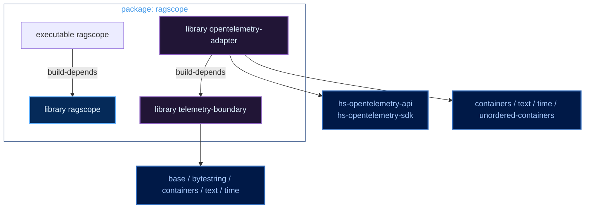
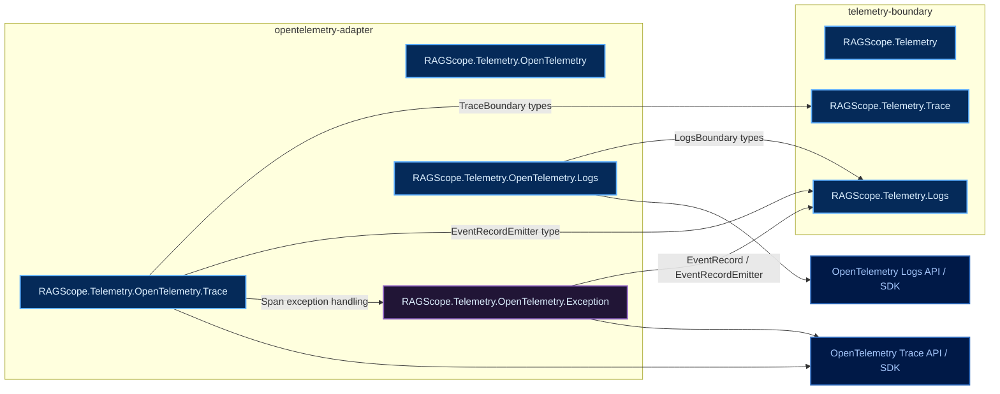
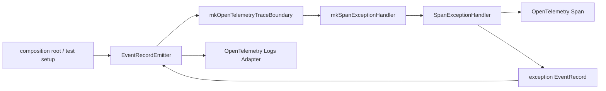

# RAGScopeアプリケーション Haskellライブラリ・モジュールマップ

正本は `takashit16833/RAGScope` の `ragscope-app/ragscope.cabal` と実際のHaskellコードとする。このノートはそれらを追従する準正本として保守し、差異がある場合は正本を優先する。

## Cabal component

## Production module

## exception処理の依存

`EventRecordEmitter` は `mkOpenTelemetryTraceBoundary` で受け取り、`mkSpanExceptionHandler` へ一度渡してcaptureする。`runOpenTelemetrySpan`、exception捕捉、claim、EventRecord生成の各段へEmitterをparameter threadingしない。
