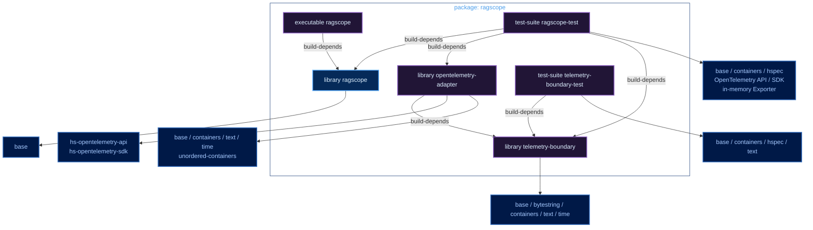
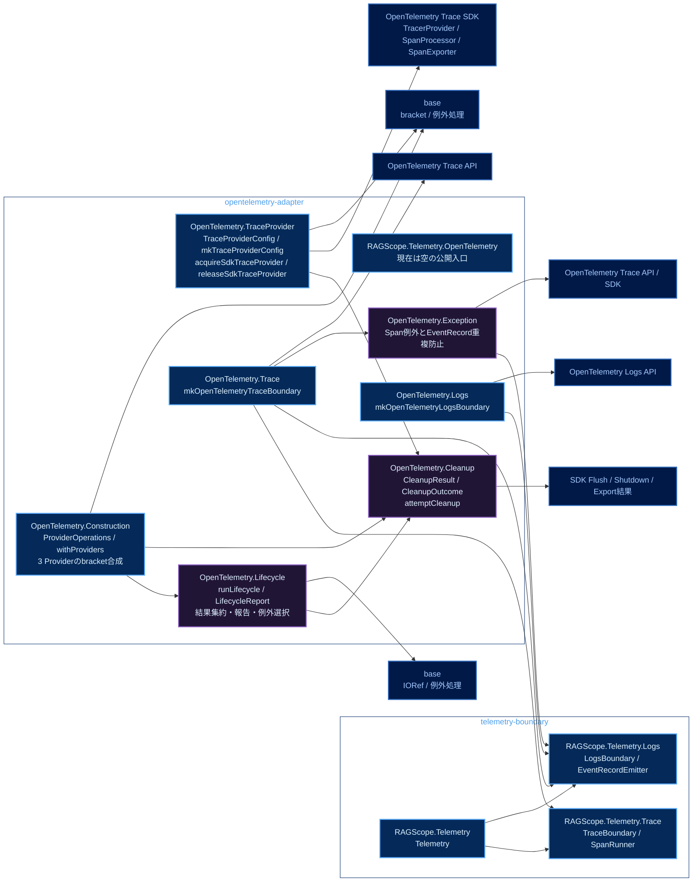
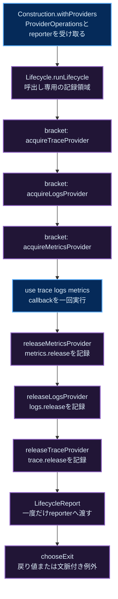
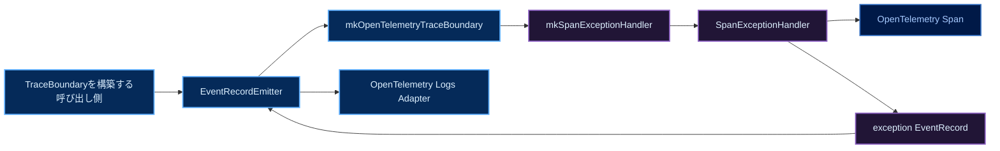

# RAGScopeアプリケーション Haskellライブラリ・モジュールマップ

対象: **RS-0024作業branch `RS-0024/sdk-lifecycle-metrics` の構成を基にした、TraceProvider追加後の完成図**（実装確認commit: [`4213fdef`](https://github.com/takashit16833/RAGScope/commit/4213fdef9088db56c62e4e5fa0d9ff902259c63a)）。library境界、module責務、import方向、取得・解放の経路を俯瞰するための作業用Noteであり、仕様・実装・正式進捗の正本ではない。正確な実装は正本リポジトリの[ragscope.cabal](https://github.com/takashit16833/RAGScope/blob/RS-0024/sdk-lifecycle-metrics/ragscope-app/ragscope.cabal)、コード、テスト、Ticketを確認する。今後の写経計画は[[RS-0024 SDKライフサイクルとMetrics基盤 実装計画]]を参照する。

図の矢印は、特記がなければ**矢印元が矢印先をimportまたは依存する方向**。配色は[[Mermaid図の色分けルール]]に従う。

## Cabal componentとpackage依存



凡例: 青＝公開library、紫＝package内の非公開libraryおよびcomponent、濃青＝外部package。`visibility: private`でも`exposed-modules`は別componentからimportできるmoduleを定め、`other-modules`はcomponent内部のmoduleを定める。

現行`opentelemetry-adapter`に`hs-opentelemetry-exporter-otlp`や`async`の直接依存はまだない。`telemetry-boundary`にもOpenTelemetry API/SDKへの依存はない。外部依存を追加する場合は、実際にimportするcomponentの`build-depends`を正本で確認する。

## moduleと静的なimport方向（TraceProvider追加後の完成図）



凡例: 青＝`exposed-modules`、紫＝`other-modules`、濃青＝外部library/API。図中の`OpenTelemetry.*`は`RAGScope.Telemetry.OpenTelemetry.*`の略記（外部APIのnodeを除く）。矢印は静的importのみを示す。`TraceProvider`の取得・解放関数は`ProviderOperations`へ注入するため、`Construction`から`TraceProvider`へのimport矢印はない。`OpenTelemetry`ルートは空の公開moduleで、`Construction`は`Trace`・`Logs`の境界構築関数を直接呼ばない。

### 公開APIと責務

```haskell
-- telemetry-boundary / RAGScope.Telemetry
-- SDK非依存。UseCaseには必要な操作だけを渡す。
data Telemetry = Telemetry
  { telemetryTrace :: TraceBoundary
  , telemetryLogs :: LogsBoundary
  }

-- opentelemetry-adapter / OpenTelemetry.Construction
-- 具体的なProvider型や取得・解放関数は呼び出し側から注入する。
data ProviderOperations trace logs metrics = ProviderOperations
  { acquireTraceProvider :: (CleanupOutcome -> IO ()) -> IO trace
  , releaseTraceProvider :: (CleanupOutcome -> IO ()) -> trace -> IO ()
  , acquireLogsProvider :: (CleanupOutcome -> IO ()) -> IO logs
  , releaseLogsProvider :: (CleanupOutcome -> IO ()) -> logs -> IO ()
  , acquireMetricsProvider :: (CleanupOutcome -> IO ()) -> IO metrics
  , releaseMetricsProvider :: (CleanupOutcome -> IO ()) -> metrics -> IO ()
  }

withProviders
  :: ProviderOperations trace logs metrics
  -> (LifecycleReport -> IO ())
  -> (trace -> logs -> metrics -> IO a)
  -> IO a
```

`Construction`は`ProviderOperations`の6つの関数を使ってTrace→Logs→Metricsを取得し、`bracket`を3段に重ねる。解放側は`releaseSafely`から`attemptCleanup`を呼び、`metrics.release`、`logs.release`、`trace.release`という操作識別名で結果を記録する。取得関数が返す前に取得した内部資源のrollbackと、release関数の個別SDK操作の継続は、それぞれ注入側の契約であり、`Construction`には具象SDK処理はない。

`Lifecycle`の`runLifecycle`は呼出しごとに`IORef [CleanupOutcome]`を作り、取得・利用・解放の結果を捕捉して`LifecycleReport`を一度報告する。`chooseExit`は元の結果・cleanup中断・報告中断の優先順位を選び、元の例外は`rethrowIO`で文脈を保つ。機能処理が返した`Left`は通常の戻り値である。同期cleanup失敗・同期reporter失敗だけで元の成功値や例外を変更しない。

`Cleanup`の`captureCleanup`はSDKの`FlushResult`、`ShutdownResult`、`ExportResult`を包む`CleanupResult`または例外を`CleanupOutcome`に保持し、`attemptCleanup`が記録関数を即時呼び出す。記録関数は呼出し内部の操作であり、ネットワーク送信やTelemetryログへ再帰させない。`Cleanup`から`Lifecycle`へは依存せず、資源取得も担当しない。

`Trace`の`mkOpenTelemetryTraceBoundary :: TracerProvider -> EventRecordEmitter -> TraceBoundary`と`Logs`の`mkOpenTelemetryLogsBoundary :: LoggerProvider -> LogsBoundary`は実装済み。ただしProviderの実取得と、これらを組み立ててアプリケーションへ渡す`withTelemetry`は未実装。`Telemetry`にSDKの`MeterProvider`を追加した状態でもない。Adapter間のimport方向は同じlibrary内なのでCabalの`build-depends`だけでは禁止できない。

## 現在の取得・利用・解放の流れ



この図だけは実行順を示す。取得順はTrace→Logs→Metrics、解放順はMetrics→Logs→Trace。Logs取得失敗時は取得済みTraceだけ、Metrics取得失敗時はLogs→Traceを解放する。途中取得したExporter/Processor/Readerのrollbackは`ProviderOperations`の各取得関数に要求されるが、**SDK資源を取得する実装はまだない**。1つの解放関数が例外を投げても外側の`bracket`で残りのProviderを解放し、結果を記録する。個別のflush・shutdown等を独立して実行・記録する具体処理は、各release関数の実装時に接続する。

`cleanupOutcomeName`は操作識別名であり成功・失敗を含めない。例えば`metrics.exporter.rollback`はrollback操作の識別名で、結果は`cleanupOutcomeResult`に記録する。テストの`IORef [String]`にある`metrics.exporter.rollback.attempted`などはTelemetryのEventRecordではなく、実行順を検証する専用履歴である。SDK取得・解放そのものをInvocationのroot Spanにはしない。

## テストと未実装の接続

`OpenTelemetryLifecycleSpec.hs`は`Construction`の公開APIから、取得順と逆順解放、後段の取得失敗、解放例外後の継続、元の例外と中断の優先順位、`Left`値、reporter同期例外、部分取得rollback結果の保持の8件を検証する。テストでは`ProviderOperations () () ()`へ実行履歴と失敗を注入しており、実SDKのProvider・Exporter・Processorを取得していない。引き継ぎ時にユーザーが確認した実行結果は`cabal build all`成功、`cabal test all`計34 examples・0 failures。これはこのNoteの更新後の再実行結果ではない。

今後、実際のSDK Provider取得、Processor/Exporterの所有と二重shutdown防止、flush・shutdown、部分取得rollback、Metrics Reader停止・結果確認、通常構成の`withTelemetry`接続を実装する。`Configuration`、`Metrics`、`SdkPlan`、`SdkTelemetry`、`withTelemetryUsing`も現行コードにはない。予定と検討の詳細は実装計画Noteを参照し、実装の採否や仕様は正本に従う。

## exception処理の依存



凡例: 青＝公開された構築点・境界・Adapter、紫＝内部の例外処理、濃青＝SDK Span。この図は例外観測の値・呼出し経路を示す。`EventRecordEmitter`は`mkOpenTelemetryTraceBoundary`に渡し、`mkSpanExceptionHandler`で一度捕捉する。例外処理の各段階でEmitterを渡し続けない。SDKライフサイクルのcleanup失敗をこの機能例外の記録経路へ再帰させない。