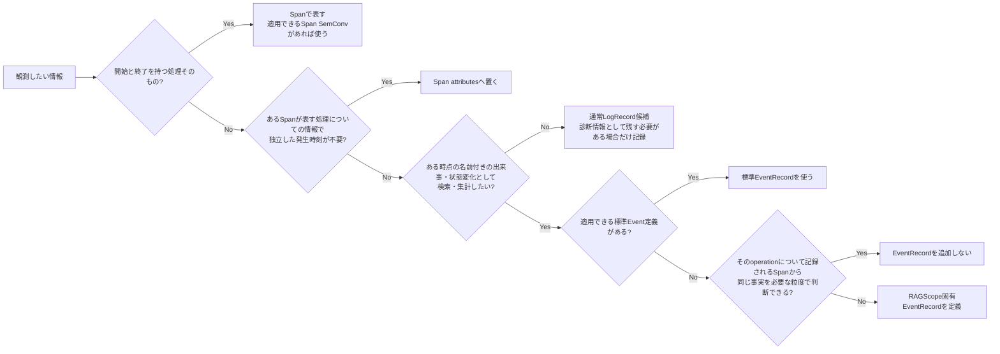

# RS-0023 Logs設計メモ

> [!note]
> これはRS-0023を正本へ反映する前にレビューするための**Workbench上の設計ドラフト**であり、RAGScopeの正本ではない。
> Observability全体は[[RS-0023 Observability設計メモ]]、Trace側の失敗時表現は[[RS-0023 Trace設計メモ]]を参照する。
> このノートで使うOpenTelemetry用語とRAGScope / RS-0023側の用語は[[RS-0023 Observability用語メモ]]を参照する。

## このノートが答える問い

> **RAGScopeでは何をLogに残し、何をSpanに任せるか？**

このノートでは、OpenTelemetry Logsの`LogRecord` / `EventRecord`とTraceのSpanの役割を整理したうえで、RAGScopeがどの出来事をLogsへ記録するかをレビューする。

エラー型で表す失敗、想定外の同期Exception、retry / fallback時に`EventRecord`を記録する条件も扱う。

## 要するに

Logsの基盤にはOpenTelemetry Logsを使う。

OpenTelemetryでは、**`Event`という同じ語がLogsとTraceの両方に出てくる**。この2つは保存されるsignalもデータ構造も別である。

| このドラフトでの呼び方 | 属するsignal | OpenTelemetry上の形 | RAGScopeのローカル環境で主に見る場所 |
|---|---|---|---|
| 通常LogRecord | Logs | `EventName`を持たない`LogRecord` | Loki / Grafana |
| `EventRecord` | Logs | 非空の`EventName`を持つ`LogRecord` | Loki / Grafana |
| Span Event | Traces | Spanに付属するtimestamp付きのSpan Event | Tempo / Grafana |

`EventRecord`と通常LogRecordは、どちらもOpenTelemetry Logsの`LogRecord`である。このRS-0023ドラフトでは、`EventName`を持たない`LogRecord`を`EventRecord`と区別するときに**通常LogRecord**と呼ぶ。通常LogRecordはOpenTelemetryの正式用語ではない。

このノートでは混同を避けるため、**Logs側の名前付きの出来事は`EventRecord`、`EventName`を持たないログは通常LogRecord、Trace側の出来事はSpan Eventと書く**。OpenTelemetry仕様の名称を引用するときだけ、必要に応じて単独の「Event」という原語を併記する。

> [!important] RAGScopeのEvent記録方針
> **RAGScopeが新規に記録するEventはOpenTelemetry Logsの`EventRecord`として記録し、RAGScope固有のSpan Eventは定義・記録しない。**
> OpenTelemetryがSpan Event APIを非推奨化し、新しいコードではEventを現在のSpanに関連付けたLogsとして記録することを推奨しているためである。SDKや既存instrumentationが互換性のためSpan Eventを生成すること自体は、この方針の対象外とする。同じ出来事を`EventRecord`とSpan Eventへ重複記録しない。

RAGScopeでは、観測したい情報を次のように分ける。

- **開始と終了を持つ処理そのもの**はSpanで表す。
- **そのSpanを見るときに「この処理はどんな処理だったか」を説明する情報で、独立した発生時刻を持たせる必要がないもの**はSpan attributesへ置く。例えば、1回のGenAI operationで使用したmodelやoperationの種類のように、「途中のある時点で起きた出来事」ではなく、その1回のoperationに付く値が該当する。
- **ある時点で起きた、名前を付けて後から検索・集計したい出来事や状態変化**をLogsへ残す場合は`EventRecord`として扱う。
- **名前付きの出来事として検索・集計する必要はないが、障害調査やデバッグで人が確認するために残したい診断情報**は通常LogRecord候補になる。通常LogRecordもattributesを持てるため、`EventRecord`との違いは「構造化されているか」ではなく、非空の`EventName`を持つ名前付きの出来事として定義するかどうかである。この共通設計では個別の診断メッセージまでは定義しない。

`EventRecord`として記録したい出来事について、OpenTelemetryが適用できる具体的なEvent Semantic Conventionをすでに定義している場合は、その定義を使う。標準Event定義がない場合でも、同じ事実がそのoperationについて記録されるSpanから分かるなら`EventRecord`を重ねない。それでも名前付きの出来事として残す必要がある場合だけ、RAGScope固有`EventRecord`を定義する。

エラー型で表す失敗が発生したという事実だけでは`EventRecord`を自動生成しない。一方、想定外の同期Exceptionがoperation境界から外へ投げられる場合は、Semantic conventions for exceptions in logsに従うLogs側のException `EventRecord`を1件記録する。

## Semantic Conventionは何を決めるものか

Semantic Conventionは、Span、Metric、Log、`EventRecord`などについて、OpenTelemetryが標準の名前、attributes、記録条件などを定める規約である。**Semantic ConventionそのものがSpanや`EventRecord`の代わりになるわけではない。**

Semantic conventions for eventsは、`EventRecord`候補を一覧にしたカタログではない。ある情報をEventとして定義するかどうかの判断基準と、Eventを定義する場合に`EventName`、発生時刻、既定severity、attributes、`Body`などをどう定めるかという共通ルールを示す。

具体的な出来事については、その出来事が属する領域のSemantic Conventionに適用できるEvent定義があるかを確認する。例えばExceptionをLogsの`EventRecord`として記録する場合はSemantic conventions for exceptions in logsに従う。

そのため、このノートでは「SemConvで表現できるか」という曖昧な言い方を使わず、対象を分けて判断する。

- 開始と終了を持つ処理そのものを観測する場合は、そのoperationに適用できるSpan Semantic Conventionがあるか確認する。
- ある時点の名前付きの出来事を`EventRecord`として記録する場合は、その出来事に適用できる具体的なEvent Semantic Conventionがあるか確認する。
- 適用できる標準定義がある場合は、RAGScope独自の同義Spanや`EventRecord`を重ねない。

例えば、HTTP requestという処理はHTTP SpanのSemantic Conventionで観測する。一方、Exceptionというある時点の出来事をLogsへ記録する場合はExceptionのEvent定義を使う。どちらもSemantic Conventionを使うが、片方はoperationを表すSpan、もう片方はある時点の出来事を表す`EventRecord`である。

## Span / `EventRecord` / 通常LogRecordをどう分担するか

判断軸は次のとおりである。

**「標準Event定義がないならRAGScope固有`EventRecord`を出す」という設計ではない。** 標準Event定義がない場合は、その出来事を新しい`EventRecord`として残さなくても、すでにそのoperationを観測するために記録されるSpanの名前、attributes、Status、親子関係などから同じ事実を判断できないか確認する。

### 判断例

> [!note]
> 以下は判断基準を説明するための例であり、ここで新しいRAGScope固有Span、`EventRecord`、通常LogRecordの具体定義を採用するものではない。

**Span attributesへ置く例**

1回のGenAI operationについて、使用したmodelやoperationの種類を記録するとする。これらは「この1回の処理はどんな処理だったか」を説明する値であり、「途中のある時点でmodelが選ばれた」という出来事自体を観測する必要がないなら、そのSpanのattributesとして扱う。

**Spanから同じ事実が分かるため`EventRecord`を追加しない例**

retryによってHTTP requestを3回送信し、HTTP計装によって各requestが別のHTTP client Spanとして記録されるとする。「HTTP requestが3回行われた」という事実だけを知りたいなら、その3つのSpanから確認できるため、同じ「retryを試行した」という事実を表す`EventRecord`を重ねる必要はない。

**Spanだけでは出来事の意味を判断できない例**

ある処理Aのあとに処理BのSpanが記録されていても、それだけでは「最初からAの次にBを実行する処理だった」のか、「Aの失敗を受けてfallbackとしてBを選択した」のかを区別できない場合がある。後者の**fallbackを選択したという状態変化そのもの**を後から検索・集計する必要があるなら、RAGScope固有`EventRecord`の候補になる。

**通常LogRecord候補の例**

AI推論サービスから受け取った応答の解析過程を調査するために、人が読む診断メッセージを残したいが、そのメッセージを特定の`EventName`を持つ出来事として横断検索・集計する必要はない場合は、通常LogRecord候補になる。attributesを付けても通常LogRecordのままであり、非空の`EventName`を持たせてEventとして定義したときに`EventRecord`になる。

つまり、Logsは「処理があったこと」を何でも記録する場所ではない。Spanと同じ事実を重ねず、**Spanでは分からない名前付きの出来事は必要な場合に`EventRecord`として、名前付きEventにする必要のない診断情報は必要な場合に通常LogRecordとして残す**。

## retry / timeoutの`EventRecord`をどう扱うか

retryやtimeoutという**種類だけ**を理由に、複数のUseCaseや内部処理で同じRAGScope固有`EventRecord`定義を共有しない。

同じ`EventName`を複数のUseCaseや内部処理で使えば横断検索・集計しやすくなり、同じ意味・記録条件・attributesを1つの定義として共有できる。しかし、OpenTelemetryでは同じ`EventName`を使うなら、その名前で記録されるすべての`EventRecord`に同じ構造・意味の定義が適用できる必要がある。

そのため、「retryである」「timeoutである」という分類だけでは、同じRAGScope固有`EventRecord`定義を共有する理由にならない。例えば、retryについても次は別の出来事である。

- retryを選択した
- 次の試行を開始した
- これ以上retryしないと決定した

試行、所要時間、最終的な失敗などを、そのoperationについて記録されるSpanや適用するSemantic Conventionから確認できるなら、同じ情報を`EventRecord`へ重複して記録しない。

一方、retryを選択した、fallbackへ切り替えた、これ以上retryしないと決定した、などの**ある時点の状態変化**を後から識別する必要があり、そのoperationについて記録されるSpanの名前、attributes、Status、親子関係などからはその状態変化を必要な粒度で判断できない場合は、その状態変化をRAGScope固有`EventRecord`として記録する候補になる。

RAGScope固有`EventRecord`をあらかじめ横断的に列挙しない。複数のUseCaseまたは内部処理で、`EventRecord`が表す出来事、記録条件、`EventName`、attributesを同じ定義として共有する必要が実際に生じた場合だけ、同じRAGScope固有`EventRecord`定義を共有する。

## RAGScope固有`EventRecord`をどう定義するか

RAGScope固有`EventRecord`が必要な場合は、`EventName`を持つOpenTelemetry `EventRecord`として記録する。

RAGScope固有`EventRecord`は、その出来事を定義するUseCaseまたは内部処理の設計で定義する。その設計では、次を決める。

- `EventRecord`が表す出来事または状態変化
- `EventRecord`を記録する条件
- `EventName`
- `EventRecord`の発生時刻が何の時点を指すか
- 既定severity
- `EventRecord`固有attributes
- 失敗、または処理の成功・失敗という結果を表す`EventRecord`では、`error.type`をどの条件で要求するかと、対応するエラー型の値からどの低カーディナリティ値へ変換するか

RAGScope固有`EventRecord`の`EventName`には`ragscope.*` namespaceを使う。ID、試行番号、対象名など実行ごとに変わる値は`EventName`へ埋め込まず、attributesへ置く。

## Trace / Spanとの関連付け

`EventRecord`を現在のTrace / Spanへ関連付けるときは、`EventRecord`の基になるOpenTelemetry `LogRecord`が持つTrace Contextを使う。
RAGScope独自の`trace_id` / `span_id` attributesは追加しない。

これは、OpenTelemetryがすでに持つ関連付けと同じ情報を、RAGScope独自属性として二重管理しないためである。

## severityとBody

`EventRecord`のseverityにはOpenTelemetry `SeverityNumber`の意味体系を使う。RAGScope独自のログレベル体系は設けない。
各`EventRecord`の既定severityは、その`EventRecord`を定義するUseCaseまたは内部処理の設計で決める。

severityからSpan Status、RAGScopeアプリケーションの最終結果、保存状態を導出しない。
OpenTelemetryのseverity体系を使うことと、UseCaseや内部処理の公開型へ`hs-opentelemetry`固有型を含めることは別の問題である。

すべての`EventRecord`へ同じ構造を持たせる共通`payload`は設けない。`EventRecord`固有の機械可読情報はattributesへ置く。
`Body`をどう使うかは、個別`EventRecord`または適用するSemantic Conventionを決める時点で判断する。

## 失敗1件ごとに`EventRecord`を出すわけではない

RAGScope全体の失敗理由の扱いは[[RS-0023 Observability設計メモ]]に従う。
契約上想定される失敗は、そのUseCaseまたは内部処理に対応するエラー型で表す。

**エラー型で表す失敗が発生しただけでは`EventRecord`を生成しない。**

たとえば途中で失敗が発生しても、retryやfallbackによって最終的に回復するなら、「失敗が一度起きた」という事実だけを理由に`EventRecord`を追加しない。
必要な状態変化をそのoperationについて記録されるSpanから判断できない場合だけ、その出来事を表す`EventRecord`を定義する。

Logs設計が担当するのは、RAGScope固有`EventRecord`に失敗情報が必要な場合、その`EventRecord`が表すUseCaseまたは内部処理に対応するエラー型の値を`EventRecord`の`error.type`へ変換する規則である。

各エラー型とは別に、RAGScope全体で使う共通のエラー分類は設けない。共通のエラー分類を置かなくても現在要求は成立し、追加すると各エラー型との対応規則を別に維持する必要があるためである。

RAGScopeアプリケーション / AI推論サービス間で共有する失敗コードが必要になった場合は、その通信Contractで定義する。Logs用の共通エラー分類として先に定義しない。

## `error.type`を`EventRecord`でどう扱うか

失敗を表す`EventRecord`、または処理の成功・失敗という結果を表すRAGScope固有`EventRecord`を定義する場合は、2026-09-06時点のSemantic conventions for eventsの指針に従って`error.type`を`EventRecord`定義へ含める。

その`EventRecord`について、`error.type`を`Required`、`Conditionally Required`、`Recommended`のどれとして扱うかも定義する。

エラー型の値が持つ詳細値や原因を`error.type`へ押し込まない。`error.type`には、その`EventRecord`が表すerrorの種類として予測可能で低カーディナリティな値を使う。

同じエラー型で表す失敗をRAGScope固有Spanと失敗を表す`EventRecord`の両方で表す必要がある場合は、同じ失敗理由から矛盾する`error.type`を生成しない。

Semantic conventions for eventsはDevelopmentであるため、実装時に対象バージョンを再確認し、2026-09-06時点の細部をRAGScope独自の恒久契約として固定しない。

## 想定外の同期ExceptionはLogs側のException `EventRecord`を1件記録する

RAGScopeが追跡するoperationの境界から想定外の同期Exceptionが外へ投げられる場合は、Semantic conventions for exceptions in logsに従ってLogs側のException `EventRecord`を1件記録する。

同じExceptionをUseCase / handler / entry Spanなど伝播経路の各層で重複記録しない。下位のHTTP / DB / GenAI計装などが同じExceptionをすでに記録している場合は、RAGScope上位層では同じException `EventRecord`を追加しない。

2026-09-06時点のSemantic conventions for exceptions in logsでは、主なattributesは次の扱いである。

| attribute | requirement |
|---|---|
| `exception.type` | `exception.message`がない場合はRequired。ある場合はRecommended |
| `exception.message` | `exception.type`がない場合はRequired。ある場合はRecommended |
| `exception.stacktrace` | Recommended |

`exception.message`は機密情報を含み得る。OpenTelemetryがattributeを定義していることと、RAGScopeがその値を記録してよいことは別である。
Semantic Conventionを超えて「どの値を記録してよいか」というRAGScope固有のデータ取扱規則は、この共通Logs設計で推測して補わない。正本で具体的な規則が定義された場合はそれに従う。

### `hs-opentelemetry`の既定Exception記録との重複

`hs-opentelemetry`の`inSpan`は、既定ではoperation境界から外へ投げられたExceptionをSpan EventとしてSpanに記録する。
RAGScopeが手動計装したSpanでSDK既定のExceptionを表すSpan EventとLogs側のException `EventRecord`が同じExceptionを重複記録する場合は、OpenTelemetry AdapterでSDK既定のException記録を抑える。

具体的に`ExceptionHandler`を使うか、Spanの開始・終了処理を別の方法で扱うかはAdapter実装時に決める。Adapterでの補正は、採用するSDKの既定挙動とこのLogs設計が一致しない場合だけ行う。

Span側のStatus / `error.type` / 再送出は[[RS-0023 Trace設計メモ]]で扱う。

## `error.type`と`exception.type`は何が違うか

どちらも失敗に関係する文字列だが、表す対象が違う。

| 属性 | 表すもの |
|---|---|
| `error.type` | operationまたは`EventRecord`が、どの種類のerrorで失敗・終了したか |
| `exception.type` | 実際に記録したExceptionの型 |

RAGScope固有Spanの最終失敗では、対応するエラー型の値からSpanの`error.type`へ変換する。
失敗や成功・失敗の結果を表すRAGScope固有`EventRecord`では、対応するエラー型の値からその`EventRecord`の`error.type`へ変換する。
Logs側のException `EventRecord`では、実際に発生したExceptionの型を`exception.type`へ記録する。

エラー型で表す失敗は実行時に発生したExceptionとは限らないため、その失敗を表すために`exception.type`を合成しない。

想定外の同期Exceptionによってoperationが失敗した場合は、Logs側のException `EventRecord`の`exception.type`へそのException型を記録する。対応するSpanの`error.type`へException型を設定する場合は、OpenTelemetryの`error.type`規則に従いcanonical class nameを使う。これは2つの属性が同じ契約だからではなく、同じExceptionがoperationの失敗原因だからである。

## OpenTelemetryへ任せるログ処理

RAGScope側では、OpenTelemetryと同じ責務を持つ別のログ処理基盤を作らない。

| 機構 | 方針 | 理由 |
|---|---|---|
| RAGScope独自`LogRecord` | 設けない | Logsの記録単位にはOpenTelemetry `LogRecord`を使う |
| OpenTelemetryとは別のログ処理基盤 | 設けない | Processor / Exporter、batching、flush / shutdownはOpenTelemetry SDKへ委ねる |
| OpenTelemetryとは別のログ送信経路 | 設けない | Log転送はOpenTelemetryのProcessor / Exporter経路へ委ねる |
| `LogRecord`とは別のTrace Context管理 | 設けない | `LogRecord`自身が持つTrace Contextを使う |

RAGScope側で定義するのは、RAGScope固有`EventRecord`が表す意味、記録条件、`EventName`、attributes、severityと、必要な場合に対応するエラー型の値から`EventRecord`の`error.type`へ変換する規則である。

## Semantic Conventionsのstability

2026-09-06時点では、このLogs設計が参照する規約のstabilityは次のように異なる。

| 対象 | stability | 扱い |
|---|---|---|
| `error.type`属性 | Stable | operationまたは`EventRecord`がどの種類のerrorを表すかを記録する標準属性として利用する |
| Semantic conventions for events | Development | RAGScope固有`EventRecord`を設計する指針として利用し、実装時に対象バージョンを再確認する |
| Recording errors | Development | RAGScope固有Span / Metricでerrorを記録する指針として利用する |
| Semantic conventions for exceptions in logs | Stable（個別節にDevelopmentあり） | Logs側Exception `EventRecord`の基本表現と各attributeのrequirement levelに従う |
| GenAI Semantic Conventions | Development | 適用できるGenAIの標準`EventRecord` / attributesがある場合に優先し、現在仕様をRAGScope独自契約へ固定しない |

## このLogs共通設計では決めないこと

| 項目 | 具体化する時点 |
|---|---|
| `Body`の具体内容 | 個別`EventRecord` / 適用SemConvを決める時 |
| RAGScope固有`EventRecord`の`EventName` / attributes / severity | その`EventRecord`が表す出来事を定義するUseCaseまたは内部処理の設計で決める時 |
| RAGScope固有`EventRecord`の`error.type`値とrequirement level | その`EventRecord`が表す出来事を定義するUseCaseまたは内部処理の設計で決める時。実装時に対象バージョンのSemConvを再確認する |
| Exception attributesについてSemConvを超えて設けるRAGScope固有のデータ取扱規則 | その規則を必要とする要求・正本が具体化した時 |
| API / CLIで利用者へ返す失敗表現 | API / CLI設計・Contract |
| 実験・評価データモデルへ保存するerror | 実験・評価の設計 / データモデル |
| RAGScopeアプリケーション / AI推論サービス間の失敗時の応答 / 失敗コード | AI通信方式・Contract設計時 |
| ExperimentとTelemetryの関連付け | Experimentをどの単位で実行・追跡するかを定義する時 |
| AdapterのException処理実装 | Adapter実装時 |

## 参考

- [[RS-0023 Observability用語メモ]]
- [OpenTelemetry — Logs Data Model](https://opentelemetry.io/docs/specs/otel/logs/data-model/)
- [OpenTelemetry — Logs API](https://opentelemetry.io/docs/specs/otel/logs/api/)
- [OpenTelemetry — Trace API](https://opentelemetry.io/docs/specs/otel/trace/api/)
- [OpenTelemetry — Deprecating Span Events API](https://opentelemetry.io/blog/2026/deprecating-span-events/)
- [OpenTelemetry — Semantic conventions for events](https://opentelemetry.io/docs/specs/semconv/general/events/)
- [OpenTelemetry — General semantic conventions](https://opentelemetry.io/docs/specs/semconv/general/)
- [OpenTelemetry — Naming](https://opentelemetry.io/docs/specs/semconv/general/naming/)
- [OpenTelemetry — Recording errors](https://opentelemetry.io/docs/specs/semconv/general/recording-errors/)
- [OpenTelemetry — `error.type`](https://opentelemetry.io/docs/specs/semconv/registry/attributes/error/)
- [OpenTelemetry — Semantic conventions for exceptions in logs](https://opentelemetry.io/docs/specs/semconv/exceptions/exceptions-logs/)
- [hs-opentelemetry](https://github.com/iand675/hs-opentelemetry)
