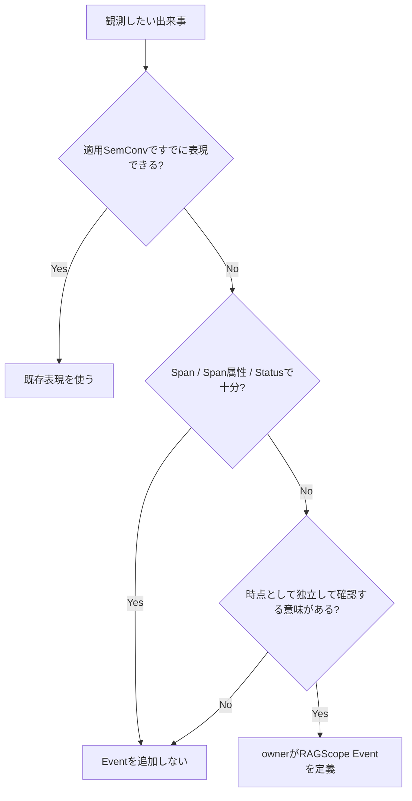

# RS-0023 Logs設計メモ

> [!note]
> これはRS-0023を考えるための**Workbench上の検討メモ**であり、RAGScopeの正本ではない。
> Observability全体は[[RS-0023 Observability設計メモ]]、Trace側は[[RS-0023 Trace設計メモ]]を参照する。

## 30秒で見る

| 論点 | 状態 | 決定 |
|---|---|---|
| Logs基盤 | ✅ | OpenTelemetry Logs / Semantic Conventionsを土台にする |
| RAGScope独自LogRecord / Runtime / Sink | ✅ | 作らない |
| 構造化Event | ✅ | `EventName`を持つOTel `LogRecord`として表現 |
| Event追加 | ✅ | SemConv / Spanで不足する意味のある時点だけ |
| typed failure | ✅ | failure発生だけではLogを自動生成しない |
| Exception | ✅ | Exception Logを1件。重複記録しない |
| TraceId / SpanId | ✅ | RAGScope独自属性へ複製しない |
| severity | ✅ | OTel `SeverityNumber`の意味体系を使う |
| 共通`payload` | ✅ | 作らない |
| `Body`の具体利用 | 個別設計で決定 | 個別Event / SemConvで決める |

## Eventを作る判断フロー

retryやtimeoutという**種類だけ**を理由に共通Eventを作らない。
attempt、duration、最終失敗などがSpanや既存SemConvで十分追跡できるならEventを重複させない。
retryを選択した、fallbackへ切り替えた、これ以上retryしないと決定したなど、Spanだけでは失われる状態変化を後から独立して確認する必要がある場合はEvent候補になる。

## ✅ Logs共通ルール

| 項目 | 方針 |
|---|---|
| 期間を持つ処理 | Span |
| operation全体を説明する値 | Span attributes |
| 意味のある時点の出来事 | Event |
| Event表現 | `EventName`を持つOTel `LogRecord` |
| Event owner | feature / UseCase / operation |
| EventName namespace | RAGScope固有Eventは`ragscope.*` |
| dynamic値 | EventNameへ埋め込まずattributesへ置く |
| Trace / Span correlation | OTel `LogRecord`自身のTrace Contextを使う |
| TraceId / SpanId | RAGScope独自属性として追加しない |
| severity | OTel `SeverityNumber`の意味体系を使う |
| Span Statusとの関係 | severityからSpan Statusを導出しない |
| 共通`payload` | 設けない |
| `Body` | 具体Event / 適用SemConvを決める時点で判断 |
| Semantic Conventions | Eventでも適用可能なConventionを優先 |

Eventを定義するownerは次を決める。

- Eventが表す出来事
- 記録条件
- `EventName`
- 発生時刻が指す時点
- 既定severity
- Event固有attributes

全Eventを先に共通型へ列挙しない。
複数featureで実際に同じEvent定義を共有する必要が生じた場合だけ共通化を検討する。

## ✅ failure / Exception

| ケース | Logs側の扱い |
|---|---|
| typed failure | failure発生だけではLogRecordを生成しない |
| retry / fallback後に回復 | failure発生だけではEventを生成しない |
| Spanだけでは失われる意味のある出来事 | ownerがEventを定義する |
| unexpected同期Exceptionがescape | Exception Logs SemConvでException Logを1件記録 |
| 同じExceptionが下位instrumentationで記録済み | RAGScope上位層では重複記録しない |

Exception Logでは`exception.type`、`exception.message`、取得できる場合は`exception.stacktrace`を記録する。
Span側のStatus / `error.type` / rethrowは[[RS-0023 Trace設計メモ]]を参照する。

## 作り直さない旧Logging基盤

| 旧RS-0022 | 今回 |
|---|---|
| RAGScope独自LogRecord | 作らない |
| Logging Runtime | 作らない |
| 独自Sink | 作らない |
| Logging専用ContextへTrace Contextを手動注入 | 作らない |
| OTelと並行する独自ログ転送基盤 | 作らない |

RAGScope側で所有するのは、Eventの意味、EventName、attributes、failureとの関係などRAGScope固有の表現である。

## 現時点で採用しない / 保留

| 項目 | 状態 | 理由 / 具体化時点 |
|---|---|---|
| typed failure → Logの共通自動変換 | 採用しない | Span StatusとEvent Logは別責務 |
| Exception Span Eventを主表現にする | 採用しない | 現在のException Logs SemConvを優先 |
| 全RAGScope Eventを列挙する共通`LogSpec` | 採用しない | 複数featureで共有が必要になった時だけ検討 |
| 旧ログ契約の共通`payload` | 採用しない | Event固有の機械可読情報はattributesで表現 |
| `Body`の具体内容 | 保留 | 個別Event / 適用SemConvを決める時 |
| feature固有EventName / attributes / severity | 保留 | 対象feature設計時 |
| ExperimentとTelemetryの関連付け | 保留 | 実験実行境界が具体化した時 |
| AdapterのException処理実装 | 保留 | Adapter実装時 |

> [!important]
> 「採用しない」は将来も不要という意味ではない。必要な要求が正本で追加された場合は再評価する。

## 正本反映時に確認する点

現在のADR-0005は、同じ失敗をSpanと構造化ログの両方へ記録する場合に同じ`error_type`値を使うとしている。

OpenTelemetryのException Logは`exception.type`を標準属性として使用するため、正本反映時は次の関係が明確になるよう見直す。

| signal | 属性 |
|---|---|
| Span | `error.type` |
| Exception Log | `exception.type` |

同じ失敗クラスを表す値の**意味は一致**させるが、同じ属性名を両signalへ重複して置くことは要求しない。
このWorkbench上の判断だけで現在のADRを変更したことにはしない。

## 詳細

> [!info]- Semantic Conventions / EventName
> 対象の出来事に適用可能なOpenTelemetry Semantic Conventionが存在する場合は、そのEventName、attributes、severity等の定義を優先する。
> 同じ意味のRAGScope独自Eventや独自attributeを重複して定義しない。
>
> RAGScope固有Eventが必要な場合は、OpenTelemetryのnamespaceと衝突しない`ragscope.*`をEventNameのnamespaceとして使用する。
> ID、attempt番号、対象名など実行ごとに変化する値をEventNameへ埋め込まず、attributesとして持たせる。
>
> Semantic Conventionごとにstabilityが異なるため、Developmentの規約を含む現在仕様の細部をRAGScope独自の恒久契約として固定しない。
> 実装時に採用するOpenTelemetry / instrumentation versionと対象Conventionのstabilityを確認する。

> [!info]- Trace Contextを独自属性として複製しない
> Eventを現在のTrace / Spanへ関連付けるために、RAGScope独自の`trace_id` / `span_id`属性を追加しない。
> OpenTelemetry `LogRecord`自身が持つTrace Contextとの関連付けを使用する。
>
> 旧RS-0022のように、Logging専用ContextへTrace Contextを手動注入する仕組みも作らない。

> [!info]- severity
> RAGScope独自の`debug` / `info` / `warn` / `error` / `fatal`という別のLog Level契約は新設計では維持しない。
> Eventの重要度はOpenTelemetry `SeverityNumber`の意味体系に従い、各Eventのownerが既定severityを決める。
>
> これはUseCaseやfeatureへ`hs-opentelemetry`固有型を直接渡すことを意味しない。
> SDK型を境界の外へ漏らすかどうかと、Telemetry上のseverity体系をOpenTelemetryへ合わせることは別問題である。
>
> severityからSpan Status、Applicationの最終結果、保存状態を導出しない。

> [!info]- unexpected同期Exceptionと`hs-opentelemetry`
> RAGScopeが所有するoperation境界からunexpectedな同期Exceptionがescapeする場合は、Logs側ではOpenTelemetryのException Logs Semantic Conventionを使用し、Exception Logを1件記録する。
>
> 同じExceptionをUseCase / handler / rootなど伝播経路の各層で重複記録しない。
> 下位のHTTP / DB / GenAI instrumentationなどが同じExceptionをすでに所有・記録している場合は、RAGScope上位層が同じException Logを追加しない。
>
> `hs-opentelemetry`の`inSpan`は、既定ではescapeしたExceptionをSpanのException Eventとして記録する。
> 一方、現在のOpenTelemetry Semantic ConventionsではExceptionをLogsとして記録する方向へ移行しているため、RAGScopeが所有するmanual SpanではSDKの既定挙動をそのままRAGScope契約にしない。
>
> 必要な場合はOpenTelemetry Adapterで既定のException記録を抑え、RAGScopeが採用するException Log + Span Status / `error.type`へ写像する。
> 具体的に`ExceptionHandler`を使うか、Span lifecycleを別の方法で扱うかはAdapter実装時に決める。
>
> 採用する`hs-opentelemetry`の将来versionが現在のException Logs Semantic Conventionを直接扱い、RAGScope固有Adapterでの補正が不要になった場合はAdapter内部の実装を簡略化する。

## 参考

- [OpenTelemetry — Logs Data Model](https://opentelemetry.io/docs/specs/otel/logs/data-model/)
- [OpenTelemetry — Events](https://opentelemetry.io/docs/specs/semconv/general/events/)
- [OpenTelemetry — Naming](https://opentelemetry.io/docs/specs/semconv/general/naming/)
- [OpenTelemetry — Recording errors](https://opentelemetry.io/docs/specs/semconv/general/recording-errors/)
- [OpenTelemetry — Exceptions in Logs](https://opentelemetry.io/docs/specs/semconv/exceptions/exceptions-logs/)
- [hs-opentelemetry](https://github.com/iand675/hs-opentelemetry)
