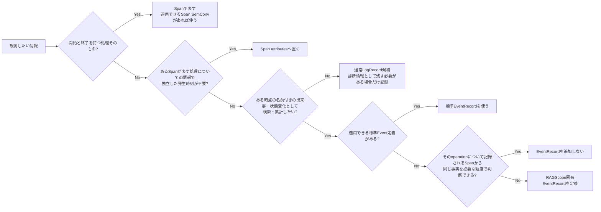

# RS-0023 Logs設計メモ

> [!note]
> これはRS-0023を正本へ反映する前にレビューするための**Workbench上の設計ドラフト**であり、RAGScopeの正本ではない。
> Observability全体は[[RS-0023 Observability設計メモ]]、Trace側の失敗時表現は[[RS-0023 Trace設計メモ]]を参照する。
> このノートで使うOpenTelemetry用語とRAGScope / RS-0023側の用語は[[RS-0023 Observability用語メモ]]を参照する。

## このノートが答える問い

> **RAGScopeでは何をLogに残し、何をSpanに任せるか？**

このノートでは、RAGScopeがどの出来事をLogsへ記録し、どの情報をSpanへ任せるかをレビューする。
エラー型で表す失敗、想定外の同期Exception、retry / fallback時に`EventRecord`を記録する条件も扱う。

## 要するに

Logsの基盤にはOpenTelemetry Logsを使う。

RAGScopeが新規に記録するEventはOpenTelemetry Logsの`EventRecord`として記録し、RAGScope固有のSpan Eventは定義・記録しない。Eventの記録先をLogsへ一本化し、同じ出来事を`EventRecord`とSpan Eventへ重複記録しない。

RAGScopeでは、観測したい情報を次のように分ける。

- **開始と終了を持つ処理そのもの**はSpanで表す。
- **そのSpanが表す処理についての情報で、独立した発生時刻を持たせる必要がないもの**はSpan attributesへ置く。
- **ある時点で起きた、名前を付けて後から検索・集計したい出来事や状態変化**をLogsへ残す場合は`EventRecord`として扱う。
- **名前付きの出来事として検索・集計する必要はないが、障害調査やデバッグで人が確認するために残したい診断情報**は通常LogRecord候補とする。この共通設計では個別の診断メッセージまでは定義しない。

適用できるEvent Semantic Conventionがある場合はその定義を使う。標準Event定義がない場合でも、同じ事実がそのoperationについて記録されるSpanから分かるなら`EventRecord`を重ねない。それでも名前付きの出来事として残す必要がある場合だけ、RAGScope固有`EventRecord`を定義する。

エラー型で表す失敗が発生したという事実だけでは`EventRecord`を自動生成しない。一方、想定外の同期Exceptionがoperation境界から外へ投げられる場合は、Semantic conventions for exceptions in logsに従うLogs側のException `EventRecord`を1件記録する。

## Span / `EventRecord` / 通常LogRecordをどう分担するか

判断軸は次のとおりである。

Logsは「処理があったこと」を何でも記録する場所ではない。Spanと同じ事実を重ねず、Spanでは分からない名前付きの出来事は必要な場合に`EventRecord`として、名前付きEventにする必要のない診断情報は必要な場合に通常LogRecordとして残す。

## retry / timeoutの`EventRecord`をどう扱うか

retryやtimeoutという種類だけを理由に、複数のUseCaseや内部処理で同じRAGScope固有`EventRecord`定義を共有しない。

RAGScope固有`EventRecord`を複数のUseCaseまたは内部処理で共有するのは、`EventRecord`が表す出来事、記録条件、`EventName`、attributesを同じ定義として共有する必要がある場合だけとする。

## RAGScope固有`EventRecord`をどう定義するか

RAGScope固有`EventRecord`が必要な場合は、`EventName`を持つOpenTelemetry `EventRecord`として記録する。

RAGScope固有`EventRecord`は、その出来事を定義するUseCaseまたは内部処理の設計で定義する。その設計では、次を決める。

- `EventRecord`が表す出来事または状態変化
- `EventRecord`を記録する条件
- `EventName`
- `EventRecord`の発生時刻が何の時点を指すか
- 既定severity
- `EventRecord`固有attributes
- 失敗、または処理の成功・失敗という結果を表す`EventRecord`では、対応するエラー型の値から`error.type`へ変換する規則

RAGScope固有`EventRecord`の`EventName`には`ragscope.*` namespaceを使う。ID、試行番号、対象名など実行ごとに変わる値は`EventName`へ埋め込まず、attributesへ置く。

## Trace / Spanとの関連付け

`EventRecord`を現在のTrace / Spanへ関連付けるときは、`EventRecord`の基になるOpenTelemetry `LogRecord`が持つTrace Contextを使い、同じ識別情報をRAGScope側で重複管理しない。

## severityとBody

`EventRecord`のseverityにはOpenTelemetry `SeverityNumber`を使う。
各`EventRecord`の既定severityは、その`EventRecord`を定義するUseCaseまたは内部処理の設計で決める。

severityからSpan Status、RAGScopeアプリケーションの最終結果、保存状態を導出しない。
OpenTelemetryのseverity体系を使うことと、UseCaseや内部処理の公開型へ`hs-opentelemetry`固有型を含めることは別の問題である。

`EventRecord`固有の機械可読情報はattributesへ置く。
`Body`をどう使うかは、個別`EventRecord`または適用するSemantic Conventionを決める時点で判断する。

## 失敗と`EventRecord`

RAGScope全体の失敗理由の扱いは[[RS-0023 Observability設計メモ]]に従う。
契約上想定される失敗は、そのUseCaseまたは内部処理に対応するエラー型で表す。

エラー型で表す失敗が発生しただけでは`EventRecord`を生成しない。失敗に伴う状態変化を`EventRecord`として記録するかは、前述のSpan / `EventRecord` / 通常LogRecordの分担規則で判断する。

RAGScope固有`EventRecord`に失敗情報が必要な場合は、その`EventRecord`が表すUseCaseまたは内部処理に対応するエラー型の値から`error.type`へ変換する。変換時にエラー型の値が持つ原因・詳細値を失わない。

同じ失敗をRAGScope固有Spanと`EventRecord`の両方で表す場合は、同じ失敗理由から矛盾する`error.type`を生成しない。
エラー型で表す失敗は実行時に発生したExceptionとは限らないため、その失敗を表すために`exception.type`を合成しない。

## 想定外の同期Exception

RAGScopeが追跡するoperationの境界から想定外の同期Exceptionが外へ投げられる場合は、Semantic conventions for exceptions in logsに従ってLogs側のException `EventRecord`を1件記録する。

同じExceptionをUseCase / handler / entry Spanなど伝播経路の各層で重複記録しない。下位のHTTP / DB / GenAI計装などが同じExceptionをすでに記録している場合は、RAGScope上位層では同じException `EventRecord`を追加しない。

`exception.message`などExceptionの詳細値を記録してよいかは、Semantic Conventionとは別にRAGScopeのデータ取扱規則で決める。この共通Logs設計では、その規則を推測して補わない。

### `hs-opentelemetry`の既定Exception記録との重複

`hs-opentelemetry`の`inSpan`は、既定ではoperation境界から外へ投げられたExceptionをSpan EventとしてSpanに記録する。
RAGScopeが手動計装したSpanでSDK既定のExceptionを表すSpan EventとLogs側のException `EventRecord`が同じExceptionを重複記録する場合は、OpenTelemetry AdapterでSDK既定のException記録を抑える。

Span側のStatus / `error.type` / 再送出は[[RS-0023 Trace設計メモ]]で扱う。

## OpenTelemetryへ任せるログ処理

Logsの記録単位にはOpenTelemetry `LogRecord`を使う。Processor / Exporter、batching、flush / shutdown、Log転送、Trace Context管理にはOpenTelemetryの機構を使う。

RAGScope側で定義するのは、RAGScope固有`EventRecord`が表す意味、記録条件、`EventName`、attributes、severityと、必要な場合に対応するエラー型の値から`EventRecord`の`error.type`へ変換する規則である。

## このLogs共通設計では決めないこと

| 項目 | 具体化する時点 |
|---|---|
| `Body`の具体内容 | 個別`EventRecord` / 適用SemConvを決める時 |
| RAGScope固有`EventRecord`の`EventName` / attributes / severity | その`EventRecord`が表す出来事を定義するUseCaseまたは内部処理の設計で決める時 |
| RAGScope固有`EventRecord`の`error.type`値 | 対応するエラー型を具体化する時 |
| Exceptionの詳細値についてSemConvを超えて設けるRAGScope固有のデータ取扱規則 | その規則を必要とする要求・正本が具体化した時 |
| API / CLIで利用者へ返す失敗表現 | API / CLI設計・Contract |
| 実験・評価データモデルへ保存するerror | 実験・評価の設計 / データモデル |
| RAGScopeアプリケーション / AI推論サービス間の失敗時の応答 / 失敗コード | AI通信方式・Contract設計時 |
| ExperimentとTelemetryの関連付け | Experimentをどの単位で実行・追跡するかを定義する時 |
| AdapterのException処理実装 | Adapter実装時 |

## 参考

- [[RS-0023 Observability用語メモ]]
- [OpenTelemetry — Logs Data Model](https://opentelemetry.io/docs/specs/otel/logs/data-model/)
- [OpenTelemetry — Logs API](https://opentelemetry.io/docs/specs/otel/logs/api/)
- [OpenTelemetry — Trace API](https://opentelemetry.io/docs/specs/otel/trace/api/)
- [OpenTelemetry — Deprecating Span Events API](https://opentelemetry.io/blog/2026/deprecating-span-events/)
- [OpenTelemetry — Semantic conventions for events](https://opentelemetry.io/docs/specs/semconv/general/events/)
- [OpenTelemetry — General semantic conventions](https://opentelemetry.io/docs/specs/semconv/general/)
- [OpenTelemetry — Naming](https://opentelemetry.io/docs/specs/semconv/general/naming/)
- [OpenTelemetry — Recording errors](https://opentelemetry.io/docs/specs/semconv/general/recording-errors/)
- [OpenTelemetry — `error.type`](https://opentelemetry.io/docs/specs/semconv/registry/attributes/error/)
- [OpenTelemetry — Semantic conventions for exceptions in logs](https://opentelemetry.io/docs/specs/semconv/exceptions/exceptions-logs/)
- [hs-opentelemetry](https://github.com/iand675/hs-opentelemetry)