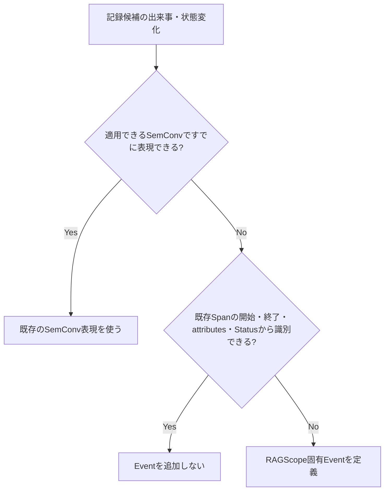

# RS-0023 Logs設計メモ

> [!note]
> これはRS-0023を正本へ反映する前にレビューするための**Workbench上の設計ドラフト**であり、RAGScopeの正本ではない。
> Observability全体は[[RS-0023 Observability設計メモ]]、Trace側の用語と失敗時のSpan表現は[[RS-0023 Trace設計メモ]]を参照する。

## このノートでレビューすること

このノートは**上から順に読むレビュー用ドラフト**である。
RAGScopeがどの出来事をLog Eventとして記録し、そのEventをOpenTelemetryの`LogRecord`でどう表すかをレビューする。typed failure、unexpected同期Exception、retry / fallback時にLogを出す条件もここで扱う。

## このノートで使う用語

Trace、Span、operation、Span Status、Trace Context、UseCase、内部処理、typed failure、unexpected同期Exceptionは[[RS-0023 Trace設計メモ]]の定義に従う。

| 用語 | 意味 |
|---|---|
| `LogRecord` | OpenTelemetry Logsで1件のログを表すデータ |
| Event | ある時点で発生した出来事または状態変化を表すLog Event |
| `EventName` | Eventの種類を識別する名前。実行ごとに変わる値は含めない |
| attributes | Eventに付随する機械可読な値 |
| `Body` | `LogRecord`のbody。具体的な利用方法は個別Eventまたは適用SemConvで決める |
| `SeverityNumber` | OpenTelemetryが定義するseverityの数値体系 |
| Exception Log | Exceptions in Logs Semantic Conventionに従ってExceptionを記録する`LogRecord` |
| requirement level | Semantic Conventionが属性の扱いを`Required`、`Conditionally Required`、`Recommended`などで示す区分。このノートでは、OpenTelemetryの規則を参照するときに使う |

## まず結論

- Logsの基盤にはOpenTelemetry Logsと、対象のEventへ適用できるSemantic Conventionsを使う。
- RAGScope固有Eventは、適用できるSemantic Conventionと、既存Spanの開始・終了・attributes・Statusだけでは、後から必要な出来事または状態変化を識別できない場合にだけ定義する。
- typed failureが発生したという事実だけではLogを自動生成しない。RAGScopeが追跡するoperationの境界からunexpected同期Exceptionが外へ投げられる場合はException Logを1件記録し、同じExceptionを複数の層で重複記録しない。
- RAGScope全体のfailure modelは[[RS-0023 Observability設計メモ#失敗情報をAPI・保存データ・Telemetryへどう変換するか]]に従う。Logs設計では、RAGScope固有Eventに失敗情報が必要な場合に、そのEventが表すUseCaseまたは内部処理に対応するtyped failureを`error.type`へどう変換するかだけを扱う。RAGScope全体で共有する独立した`error_type` taxonomyは設けない。
- 失敗を表すEvent、または処理の成功・失敗という結果を表すEventをRAGScope独自に定義する場合は、2026-09-06時点のGeneral Events guidanceに従って`error.type`をEvent定義へ含める。さらに、そのEventについて`error.type`を`Required`、`Conditionally Required`、`Recommended`のどれとして扱うかを定める。General EventsはDevelopmentなので、実装時に対象versionを再確認する。
- `error.type`は「そのoperationまたはEventがどの種類のerrorを表すか」をTelemetryへ記録する属性である。Exception Logの`exception.type`は、実際に発生したruntime Exceptionの型を表す。2つは別の契約として扱う。
- RAGScope独自の`LogRecord`、Logging Runtime、Sink、Logging専用Context、OpenTelemetryと並行してLogを転送する別基盤は設けない。
- LogをTrace / Spanへ関連付けるときはOpenTelemetry `LogRecord`自身が持つTrace Contextを使う。RAGScope独自の`trace_id` / `span_id`属性は追加しない。
- EventのseverityにはOpenTelemetry `SeverityNumber`の意味体系を使う。すべてのEventへ同じ構造を持たせる共通`payload`は設けない。
- OTLPとは別にRAGScopeが独自定義する共通ログJSON契約と、RAGScopeが所有するログ保存用SQLite表現は維持しない。外部転送にはOTLP等のOpenTelemetry経路を使い、console / handle exporterの表示形式を新しいRAGScope JSON契約にはしない。

## いつLog Eventを出すか

retryやtimeoutという**種類だけ**を理由に共通Eventを作らない。attempt、duration、最終失敗などをSpanや既存Semantic Conventionから確認できる場合は、同じ情報をEventへ重複して記録しない。

一方、retryを選択した、fallbackへ切り替えた、これ以上retryしないと決定した、などの状態変化を既存Spanの開始・終了・attributes・Statusから後で識別できない場合は、その状態変化をEventとして記録する候補になる。

## Log Eventをどう表現するか

| 項目 | 方針 |
|---|---|
| 期間を持つ処理 | Spanで表す |
| operation全体を説明する値 | Span attributesへ記録する |
| ある時点の出来事・状態変化 | Eventで表す |
| Event表現 | `EventName`を持つOpenTelemetry `LogRecord`を使う |
| Event定義 | そのEventが表す出来事を定義するUseCaseまたは内部処理の設計で決める |
| EventName namespace | RAGScope固有Eventは`ragscope.*`を使う |
| 実行ごとに変化する値 | EventNameへ埋め込まずattributesへ記録する |
| 失敗、または処理の成功・失敗という結果を表すEvent | 適用できるSemantic Conventionを優先する。RAGScope固有Eventを定義する場合は、2026-09-06時点のGeneral Events guidanceに従って`error.type`をEvent定義へ含め、そのEventでのrequirement levelを決める |
| Trace / Spanとの関連付け | OpenTelemetry `LogRecord`自身が持つTrace Contextを使う |
| TraceId / SpanId | RAGScope独自属性として追加しない |
| severity | OpenTelemetry `SeverityNumber`の意味体系を使う |
| Span Statusとの関係 | severityからSpan Statusを導出しない |
| 共通`payload` | 設けない |
| `Body` | 個別Eventまたは適用するSemantic Conventionを決める時点で判断する |
| Semantic Conventions | Eventでも適用できるConventionを優先する |

RAGScope固有Eventを定義する設計では、次を決める。

- Eventが表す出来事または状態変化
- Eventを記録する条件
- `EventName`
- Eventの発生時刻が何の時点を指すか
- 既定severity
- Event固有attributes
- 失敗、または処理の成功・失敗という結果を表すEventでは、`error.type`をどの条件で要求するかと、typed failureからどの低カーディナリティ値へ変換するか

General EventsはDevelopmentなので、Event定義を実装する時点で対象versionのguidanceを再確認する。2026-09-06時点の細部をRAGScope独自の恒久契約として固定しない。

全Eventを先に共通型へ列挙しない。複数のUseCaseまたは内部処理で、Eventが表す出来事、記録条件、`EventName`、attributesを同じ定義として共有する必要が実際に生じた場合だけ共通化を検討する。

## typed failureをLog向けの`error.type`へどう変換するか

RAGScope全体でのfailureの意味、API / CLI向けの変換、実験・評価結果へ保存するための変換は[[RS-0023 Observability設計メモ#失敗情報をAPI・保存データ・Telemetryへどう変換するか]]で扱う。このLogs設計は、それらを再定義しない。

Logs設計が担当するのは、RAGScope固有Eventに失敗情報が必要な場合に、そのEventが表すUseCaseまたは内部処理に対応するtyped failureから、そのEventの`error.type`へ変換する規則である。OpenTelemetryに`error.type`が存在すること自体を理由にRAGScope共通`error_type`を廃止するわけではない。共通taxonomyを置かなければ成立しない現在要求を確認できず、共通taxonomyを追加するとtyped failureとの対応規則を別に維持する必要が生じるため、RAGScope全体で共有する独立した`error_type` taxonomyは設けない。

Application / AI推論サービス間で共有するfailure codeが通信契約として必要になった場合は、その通信Contractで定義する。Logs用の共通`error_type`として先に定義しない。

## failure / Exception時にどうLogを出すか

| ケース | Logs側の扱い |
|---|---|
| typed failureが発生 | failureが発生したという事実だけでは`LogRecord`を生成しない |
| retry / fallbackで最終的に回復 | 途中でfailureが発生したという事実だけではEventを生成しない |
| Spanから識別できない出来事・状態変化がある | そのEventが表す出来事を定義するUseCaseまたは内部処理の設計でEventを定義する。失敗、または処理の成功・失敗という結果を表すRAGScope固有Eventなら、2026-09-06時点のGeneral Events guidanceに従って`error.type`をEvent定義へ含め、そのEventでのrequirement levelを決める |
| unexpected同期Exceptionがoperation境界から外へ投げられる | Exceptions in Logs Semantic Conventionに従ってException Logを1件記録する |
| 同じExceptionが下位の計装ですでに記録されている | RAGScope上位層では同じException Logを追加しない |

Exception Logのattributesは、実装時に適用するExceptions in Logs Semantic Conventionのrequirement levelに従う。2026-09-06時点では次のとおりである。

| attribute | requirement |
|---|---|
| `exception.type` | `exception.message`がない場合はRequired。`exception.message`がある場合はRecommended |
| `exception.message` | `exception.type`がない場合はRequired。`exception.type`がある場合はRecommended |
| `exception.stacktrace` | Recommended |

OpenTelemetryが`exception.message`を属性として定義していても、そのmessageへ機密情報や入力値などが含まれる場合にRAGScopeが記録してよいかは別の問題である。`exception.message`はsensitive informationを含み得るため、Semantic Conventionを超えて「どの値を記録してよいか」というRAGScope固有のデータ取扱規則はこの共通Logs設計で補完しない。正本で具体的な規則が定義された場合は、その規則に従う。

Span側のStatus / `error.type` / rethrowは[[RS-0023 Trace設計メモ]]を参照する。

## RAGScopeで独自に設けないLogging機構

| 機構 | 方針 | 理由 |
|---|---|---|
| RAGScope独自`LogRecord` | 設けない | Logの記録単位にはOpenTelemetry `LogRecord`を使う |
| Logging Runtime | 設けない | Processor / Exporter、batching、flush / shutdownなどはOpenTelemetry SDKへ委ねる |
| 独自Sink | 設けない | Log転送はOpenTelemetryのProcessor / Exporter経路へ委ねる |
| Logging専用ContextへのTrace Context手動注入 | 設けない | OpenTelemetry `LogRecord`自身が持つTrace Contextとの関連付けを使う |
| OpenTelemetryと並行する独自ログ転送基盤 | 設けない | 同じLogを別経路で運ぶ基盤をRAGScopeで重複して保守しない |

RAGScope側で定義するのは、RAGScope固有Eventが表す意味、記録条件、`EventName`、attributes、severityと、必要な場合にtyped failureからEventの`error.type`へ変換する規則である。

## JSON / SQLiteをどう扱うか

現在の正本には、RAGScope独自`LogEvent`を、OTLPとは別にRAGScopeが定義した共通ログ出力形式へ変換する設計がある。その出力形式としてJSON表現、JSON Schema、SQLite表現も定義されている。

RS-0023ではLogsの記録単位をOpenTelemetry `LogRecord`へ置き換え、Processor / Exporterと外部転送をOpenTelemetryへ委ねる。このため、OpenTelemetryの経路と並行してRAGScope独自の共通ログ外部表現を維持しない。

| 現在の仕組み | RS-0023での判断 | 理由 |
|---|---|---|
| OTLPとは別にRAGScopeが定義する共通ログ外部表現 | 維持しない | OpenTelemetry `LogRecord`をRAGScope独自の外部モデルへもう一度変換してから送る経路を作らない |
| 共通ログJSON表現 / JSON Schema | 維持しない | 外部転送にはOTLP等のOpenTelemetry経路を使う。console / handle exporterの表示形式もRAGScopeの外部JSON契約にしない |
| 共通ログSQLite表現 | 維持しない | RAGScope本体がログ保存用SQLite Schemaを所有する要求を確認できない。ログの保存・検索・retentionは、採用するTelemetry backend側の責務として扱う |
| ローカルでのログ確認 | 維持する | 要求上必要。OpenTelemetry SDKのconsole / handle exporter、必要ならローカルCollectorで確認する |

JSONやSQLiteという形式自体を禁止するわけではない。将来、OpenTelemetryの転送・backendとは別に、RAGScopeが安定したログファイル形式を外部へ提供する要求や、RAGScope自身がSQLiteへ保存したログをqueryする要求が追加された場合は、その具体的な要求を基準に外部表現を新たに設計する。

この判断は、実験結果、評価データ、RAGScopeのドメインデータなど、**ログ以外のJSON / SQLite利用を変更するものではない**。
また、既存のJSON / SQLite投影Experimentは当時の設計に対して実際に行った検証記録なので、過去の結果として残す。RS-0023反映後の現在設計の根拠や必須Contractとしては使用しない。

### 正本へ反映するときの影響

RS-0023の正本反映では、次を少なくとも確認対象とする。ここでは正本の変更内容を重複して確定するのではなく、今回の判断が影響する正本を整理する。

| 対象 | 必要な扱い |
|---|---|
| `システムアーキテクチャ.md` | 共通`error_type`をAPI / CLI失敗表現へつなぐ現在記述と、Observability責務を新しいfailure modelへ整合させる |
| `design/README.md` | `error_type`を共通契約として案内する索引を新しい設計構成へ整合させる |
| `design/logging/README.md` | `error_type`と独自外部表現を前提にしたlogging設計索引を更新する |
| `実行追跡・構造化ログ契約設計.md` | OpenTelemetry `LogRecord` / Trace Contextと、typed failureからTelemetryへ記録する値への変換を前提とする現在設計へ置き換える |
| `構造化ログ外部表現共通設計.md` | OTLPとは別の共通ログ外部表現を維持しないため、現在設計から外す |
| `構造化ログJSON表現設計.md` | 共通ログJSON契約を維持しないため、現在設計から外す |
| `構造化ログSQLite表現設計.md` | RAGScope所有のログSQLite表現を維持しないため、現在設計から外す |
| ADR-0005 / 後続ADR | 1 Invocation = 1独立Trace、共通`error_type`廃止、独自JSON / SQLiteログ契約廃止などの重要判断を、文書管理規約に従う粒度で記録する。RS-0023全体の後続ADRでADR-0005をsupersedeする構成も候補として正本反映時に判断する |
| `contracts/logging/v1/log-event.schema.json`とfixture | 共通ログJSON Contractを維持しないため、現在Contractから外す |
| 現在のHaskell logging実装とSchema適合テスト | OpenTelemetry利用境界 / Adapterへ移行する後続実装で置き換える |
| AI推論サービスの後続logging実装 | 独自共通JSON / Sinkを実装する前提を外し、OpenTelemetry Python SDKを前提に再編する |
| v0.0 Milestone / error-logging Epic | `error_type`、独自JSON Contract等を成果物としている現在計画を新しいObservability設計へ整合させる |
| RS-0022を含む関連する未完了Ticket | `error_type`、独自JSON / Sink / Schema等を前提とする完了条件を再評価する |
| `error_type`を現在契約として参照するその他の機能設計・正本 | UseCaseまたはそのUseCaseを構成する内部処理に対応するtyped failureと、各出力先への変換へ整合させる。具体的なfailureの意味は、そのUseCaseまたは内部処理を定義する設計に残す |
| 完了済みTicket / JSON・SQLite投影Experiment | 当時の作業・検証履歴として書き換えず、現在仕様の正本としては参照しない |

この変更は複数の現在設計・Contract・Milestoneへ影響し、旧設計からObservabilityの責務分担を変える重要判断である。Workbenchでは検討結果と影響範囲を保持し、正本では現在設計を`design/`、重要判断の背景・選択肢・影響をADR、移行作業をTicketへ分けて反映する。

## このLogs共通設計で設けないもの

| 項目 | 方針 | 理由 |
|---|---|---|
| typed failureが発生したら自動的にLogを作る共通変換 | 設けない | Span Statusを決める規則と、Eventを記録する規則は別に判断する |
| RAGScope共通`error_type` taxonomy | 設けない | UseCaseまたはそのUseCaseを構成する内部処理に対応するtyped failureを失敗理由の元情報とし、各出力先で必要な表現へ変換できるため。共通taxonomyを置かなければ成立しない現在要求を確認できず、置くとtyped failureとの二重管理になる |
| Exception Span EventをExceptionの主表現にする規則 | 設けない | このドラフトではExceptions in Logs Semantic Conventionに従うException Logを主表現として使う |
| 全RAGScope Eventを列挙する共通`LogSpec` | 設けない | Eventは、そのEventが表す出来事を定義するUseCaseまたは内部処理の設計で必要なものだけ定義する |
| 共通`payload` | 設けない | Event固有の機械可読情報はattributesで表現する |

## このLogs共通設計では決めないこと

| 項目 | 具体化する時点 |
|---|---|
| `Body`の具体内容 | 個別Event / 適用SemConvを決める時 |
| RAGScope固有EventのEventName / attributes / severity | そのEventを定義する時 |
| RAGScope固有Eventの`error.type`値と、そのEventで`error.type`をどのrequirement levelにするか | そのEventを定義する時。実装時に対象versionのSemConvを再確認する |
| Exception attributesについてSemConvを超えて設けるRAGScope固有のデータ取扱規則 | その規則を必要とする要求・正本が具体化した時 |
| API / CLIで利用者へ返すfailure表現 | API / CLI設計・Contract |
| 実験・評価データモデルへ保存するerror | 実験・評価の設計 / データモデル |
| Application / AI推論サービス間のfailure response / code | AI通信方式・Contract設計時 |
| ExperimentとTelemetryの関連付け | 実験実行境界が具体化した時 |
| AdapterのException処理実装 | Adapter実装時 |

## `error.type`と`exception.type`の違い

`error.type`と`exception.type`は、どちらも文字列で失敗に関係する情報を持つが、表す対象が異なる。

| 対象 | 属性 | 意味 |
|---|---|---|
| RAGScope固有Spanが表すoperationが最終的に失敗 | `error.type` | そのoperationがどの種類のerrorで終了したか |
| 失敗、または処理の成功・失敗という結果を表すRAGScope固有Event | `error.type` | そのEventが表すerrorの種類。2026-09-06時点のGeneral Events guidanceに従ってEvent定義へ含め、そのEventでのrequirement levelを決める |
| Exception Log | `exception.type` | 実際に記録したruntime Exceptionの型 |

HTTP、Database、GenAIなど、適用するSemantic Conventionが`error.type`の値を定める場合は、その規則を優先する。
RAGScope固有Spanが表すoperationの最終失敗については[[RS-0023 Trace設計メモ#成功・失敗をどう表すか]]に従う。RAGScope固有Eventが失敗、または処理の成功・失敗という結果を表す場合は、2026-09-06時点のGeneral Events guidanceに従って`error.type`をEvent定義へ含め、そのEventでのrequirement levelとtyped failureからの変換を定める。

同じtyped failureをRAGScope固有Spanとfailure Eventの両方で表す必要がある場合は、同じ失敗理由から矛盾する`error.type`を生成しない。typed failureが持つ詳細値や原因情報そのものを`error.type`へ押し込まず、元のfailureが保持する情報は失わない。

typed failureはruntime Exceptionとは限らないため、typed failureを表すために`exception.type`を合成しない。unexpected同期Exceptionによってoperationが失敗した場合は、Exception Logの`exception.type`へそのExceptionの型を記録する。対応するSpanの`error.type`にも、そのException型がそのoperationの失敗分類として適切であればcanonical class nameを使用できる。これは2つの属性が同じ契約だからではなく、同じExceptionがoperationの失敗原因だからである。

## Semantic Conventionsのstability

2026-09-06時点では、このLogs設計が参照する規約のstabilityは次のように異なる。

| 対象 | stability | 扱い |
|---|---|---|
| `error.type`属性 | Stable | operationまたはEventがどの種類のerrorを表すかをTelemetryへ記録する標準属性として利用する。RAGScopeのfailure modelそのものにはしない |
| General Events | Development | RAGScope固有Eventを設計する際のguidanceとして利用し、実装時に対象versionを再確認する。現在のEvent細部をRAGScope独自の恒久契約へコピーしない |
| General Recording Errors | Development | RAGScope固有Span / Metricでerrorを記録する際のguidanceとして利用し、実装時に対象versionを再確認する |
| Exceptions in Logs | Stable（個別節にDevelopmentあり） | Exception Logの基本表現と各attributeのrequirement levelに従う。event name / severity等のDevelopment部分は実装時に再確認する |
| GenAI Semantic Conventions | Development | 適用できるGenAI Event / attributesがある場合に優先するが、現在仕様をRAGScope独自契約へ固定しない |

## 判断理由・実装上の注意

> [!info]- Semantic Conventions / EventName
> Eventが表す出来事に適用できるOpenTelemetry Semantic Conventionが存在する場合は、そのEventName、attributes、severity等の定義を優先する。同じ意味のRAGScope独自Eventや独自attributeを重複して定義しない。
>
> RAGScope固有Eventが必要な場合は、OpenTelemetryのnamespaceと衝突しない`ragscope.*`をEventNameのnamespaceとして使用する。ID、attempt番号、対象名など実行ごとに変化する値をEventNameへ埋め込まず、attributesとして持たせる。
>
> 失敗、または処理の成功・失敗という結果を表すRAGScope固有Eventを定義する場合は、2026-09-06時点のGeneral Events guidanceに従って`error.type`をEvent定義へ含め、そのEventでのrequirement levelを決める。General EventsはDevelopmentなので、この規則の細部は実装時に対象versionを再確認する。
>
> Semantic Conventionごとにstabilityが異なるため、Developmentの規約を含む現在仕様の細部をRAGScope独自の恒久契約として固定しない。実装時に採用するOpenTelemetry / instrumentation versionと対象Conventionのstabilityを確認する。

> [!info]- Trace Contextを独自属性として複製しない
> Eventを現在のTrace / Spanへ関連付けるために、RAGScope独自の`trace_id` / `span_id`属性を追加しない。OpenTelemetry `LogRecord`自身が持つTrace Contextとの関連付けを使用する。

> [!info]- severity
> RAGScope独自のLog Level契約は設けず、Eventの重要度はOpenTelemetry `SeverityNumber`の意味体系に従う。各Eventの既定severityは、そのEventを定義する設計で決める。
>
> OpenTelemetryのseverity体系を使うことは、UseCaseまたは内部処理を実装するコードへ`hs-opentelemetry`固有型を直接渡すことを意味しない。UseCaseまたは内部処理が公開・受け渡しする型へSDK固有型を含めるかどうかと、Telemetryへ記録するseverityの意味体系をOpenTelemetryへ合わせることは別の問題である。
>
> severityからSpan Status、Applicationの最終結果、保存状態を導出しない。

> [!info]- unexpected同期Exceptionと`hs-opentelemetry`
> RAGScopeが追跡するoperationの境界からunexpectedな同期Exceptionが外へ投げられる場合は、Logs側ではOpenTelemetryのExceptions in Logs Semantic Conventionを使用し、Exception Logを1件記録する。
>
> 同じExceptionをUseCase / handler / entry Spanなど伝播経路の各層で重複記録しない。下位のHTTP / DB / GenAI計装などが同じExceptionをすでに記録している場合は、RAGScope上位層が同じException Logを追加しない。
>
> Exception attributesは、実装時に適用するExceptions in Logs Semantic Conventionのrequirement levelに従う。`exception.message`はsensitive informationを含み得るため、OpenTelemetryの規則を超えてRAGScopeがどの値を記録してよいかはこのノートで先に決めない。
>
> `hs-opentelemetry`の`inSpan`は、既定ではoperation境界から外へ投げられたExceptionをSpanのException Eventとして記録する。このドラフトではException Logを主表現とするため、RAGScopeが作成するmanual SpanでSDK既定のException EventとException Logが同じExceptionを重複記録する場合は、OpenTelemetry AdapterでSDK既定のException記録を抑える。
>
> 具体的に`ExceptionHandler`を使うか、Span lifecycleを別の方法で扱うかはAdapter実装時に決める。Adapterでの補正は、採用するSDKの既定挙動とこのLogs設計が一致しない場合だけ行う。

## 参考

- [OpenTelemetry — Logs Data Model](https://opentelemetry.io/docs/specs/otel/logs/data-model/)
- [OpenTelemetry — Events](https://opentelemetry.io/docs/specs/semconv/general/events/)
- [OpenTelemetry — Naming](https://opentelemetry.io/docs/specs/semconv/general/naming/)
- [OpenTelemetry — Recording errors](https://opentelemetry.io/docs/specs/semconv/general/recording-errors/)
- [OpenTelemetry — `error.type`](https://opentelemetry.io/docs/specs/semconv/registry/attributes/error/)
- [OpenTelemetry — Exceptions in Logs](https://opentelemetry.io/docs/specs/semconv/exceptions/exceptions-logs/)
- [hs-opentelemetry](https://github.com/iand675/hs-opentelemetry)
