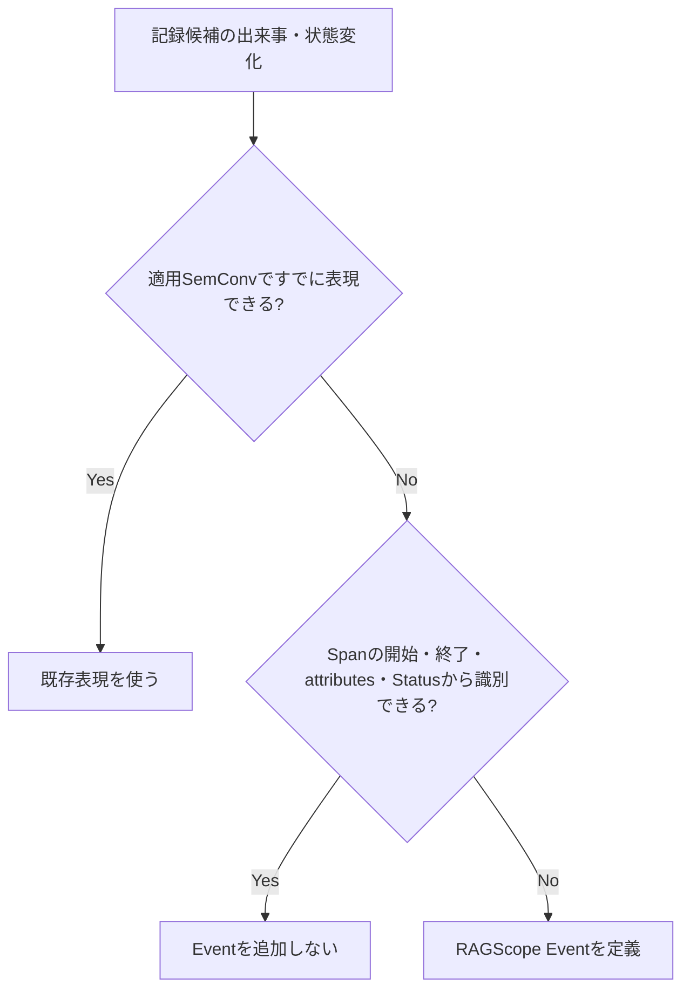

# RS-0023 Logs設計メモ

> [!note]
> これはRS-0023を正本へ反映する前にレビューするための**Workbench上の設計ドラフト**であり、RAGScopeの正本ではない。
> Observability全体は[[RS-0023 Observability設計メモ]]、Trace側の用語と失敗時のSpan表現は[[RS-0023 Trace設計メモ]]を参照する。

## このノートでレビューすること

このノートは**上から順に読むレビュー用ドラフト**である。
RAGScopeがいつLog Eventを出し、どのような`LogRecord`として表現し、failure / Exception時にどう扱うかをレビューする。

## このノートで使う用語

Trace、Span、operation、Span Status、Trace Context、typed failure、unexpected同期Exceptionは[[RS-0023 Trace設計メモ]]の定義に従う。

| 用語 | 意味 |
|---|---|
| `LogRecord` | OpenTelemetry Logsで1件のログを表すデータ |
| Event | ある時点で発生した出来事または状態変化を表すLog Event |
| `EventName` | Eventの種類を識別する名前。実行ごとに変わる値は含めない |
| attributes | Eventに付随する機械可読な値 |
| `Body` | `LogRecord`のbody。具体的な利用方法は個別Eventまたは適用SemConvで決める |
| `SeverityNumber` | OpenTelemetryが定義するseverityの数値体系 |
| Exception Log | Exception Logs Semantic Conventionに従ってExceptionを記録する`LogRecord` |

## まず結論

- Logsの基盤にはOpenTelemetry Logs / Semantic Conventionsを使う。
- RAGScope固有Eventは、適用SemConvとSpanの開始・終了・attributes・Statusだけでは、後から必要な出来事または状態変化を識別できない場合に定義する。
- typed failureが発生したことだけではLogを自動生成しない。unexpected同期Exceptionがoperation境界からescapeする場合はException Logを1件記録し、同じExceptionを重複記録しない。
- Telemetry上の失敗分類には適用可能なOpenTelemetryの`error.type`を使い、それと並行するRAGScope共通`error_type`契約は設けない。Exception Logの`exception.type`はruntime Exceptionの型を表す別の属性として扱う。
- RAGScope独自の`LogRecord`、Logging Runtime、Sink、Logging専用Context、OTelと並行するログ転送基盤は設けない。
- Trace / Spanとの関連付けにはOpenTelemetry `LogRecord`自身のTrace Contextを使い、RAGScope独自の`trace_id` / `span_id`属性を追加しない。
- severityはOpenTelemetry `SeverityNumber`の意味体系を使い、共通`payload`は設けない。
- RAGScope共通のnon-OTLPログJSON契約とSQLiteログ表現は維持しない。外部転送にはOTLP等のOpenTelemetry経路を使い、ローカル確認用出力を新しいRAGScope JSON契約にはしない。

## いつLog Eventを出すか

retryやtimeoutという**種類だけ**を理由に共通Eventを作らない。
attempt、duration、最終失敗などをSpanや既存SemConvから確認できる場合はEventを重複させない。

一方、retryを選択した、fallbackへ切り替えた、これ以上retryしないと決定した、などの状態変化をSpanの開始・終了・attributes・Statusから後で識別できない場合はEventとして記録する候補になる。

## Log Eventをどう表現するか

| 項目 | 方針 |
|---|---|
| 期間を持つ処理 | Span |
| operation全体を説明する値 | Span attributes |
| ある時点の出来事・状態変化 | Event |
| Event表現 | `EventName`を持つOTel `LogRecord` |
| Event定義 | その出来事が属するUseCaseまたは対象処理を定義する設計で決める |
| EventName namespace | RAGScope固有Eventは`ragscope.*` |
| dynamic値 | EventNameへ埋め込まずattributesへ置く |
| failureを表すEvent | 適用SemConvに従い、RAGScope固有Eventでは`error.type`で失敗クラスを表す |
| Trace / Span correlation | OTel `LogRecord`自身のTrace Contextを使う |
| TraceId / SpanId | RAGScope独自属性として追加しない |
| severity | OTel `SeverityNumber`の意味体系を使う |
| Span Statusとの関係 | severityからSpan Statusを導出しない |
| 共通`payload` | 設けない |
| `Body` | 具体Event / 適用SemConvを決める時点で判断 |
| Semantic Conventions | Eventでも適用可能なConventionを優先 |

RAGScope固有Eventを定義する設計では、次を決める。

- Eventが表す出来事または状態変化
- 記録条件
- `EventName`
- 発生時刻が指す時点
- 既定severity
- Event固有attributes
- Eventがfailureまたは成功/失敗を持つoperation outcomeを表す場合は、`error.type`を付ける条件と安定した低カーディナリティの値

全Eventを先に共通型へ列挙しない。
複数の対象機能でEventが表す出来事、記録条件、`EventName`、attributesを同じ定義として共有する必要が生じた場合だけ共通化を検討する。

## failure / Exception時にどうLogを出すか

| ケース | Logs側の扱い |
|---|---|
| typed failure | failure発生だけではLogRecordを生成しない |
| retry / fallback後に回復 | failure発生だけではEventを生成しない |
| Spanから識別できない出来事・状態変化 | その出来事が属するUseCaseまたは対象処理の設計でEventを定義する。failureを表すRAGScope固有Eventなら`error.type`で失敗クラスを表す |
| unexpected同期Exceptionがescape | Exception Logs SemConvでException Logを1件記録 |
| 同じExceptionが下位の計装で記録済み | RAGScope上位層では重複記録しない |

Exception Logでは`exception.type`、`exception.message`、取得できる場合は`exception.stacktrace`を記録する。
Span側のStatus / `error.type` / rethrowは[[RS-0023 Trace設計メモ]]を参照する。

## RAGScopeで独自に設けないLogging機構

| 機構 | 方針 | 理由 |
|---|---|---|
| RAGScope独自`LogRecord` | 設けない | Logの記録単位にはOpenTelemetry `LogRecord`を使う |
| Logging Runtime | 設けない | Processor / Exporter、batching、flush / shutdownなどはOpenTelemetry SDKへ委ねる |
| 独自Sink | 設けない | Log転送はOpenTelemetryのProcessor / Exporter経路へ委ねる |
| Logging専用ContextへのTrace Context手動注入 | 設けない | OpenTelemetry `LogRecord`自身のTrace Context関連付けを使う |
| OTelと並行する独自ログ転送基盤 | 設けない | 同じLogを別経路で運ぶ基盤をRAGScopeで重複して保守しない |

RAGScope側で定義するのは、RAGScope固有Eventの意味、記録条件、`EventName`、attributes、severity、failureとの関係である。

## JSON / SQLiteをどう扱うか

現在の正本には、RAGScope独自`LogEvent`をnon-OTLPの外部形式へ投影するための共通外部表現、JSON表現、JSON Schema、SQLite表現がある。
RS-0023ではLogsの記録単位をOpenTelemetry `LogRecord`へ置き換え、Processor / Exporterと外部転送をOpenTelemetryへ委ねるため、この独自外部表現層を並行して維持しない。

| 現在の仕組み | RS-0023ドラフトでの扱い | 理由 |
|---|---|---|
| RAGScope共通non-OTLP外部表現 | 維持しない | `LogRecord`をRAGScope独自外部モデルへ再投影してから送る経路を作らない |
| 共通ログJSON表現 / JSON Schema | 維持しない | 外部転送の契約にはOTLP等のOpenTelemetry経路を使う。console / handle exporterの表示形式もRAGScope契約にしない |
| 共通ログSQLite表現 | 維持しない | RAGScope本体がログ保存用SQLite Schemaを所有する要求を確認できない。保存・検索・retentionは採用するTelemetry backend側の責務として扱う |
| ローカルでのログ確認 | 維持する | 要求上必要。OpenTelemetry SDKのconsole / handle exporter、必要ならローカルCollectorで確認する |

JSONやSQLiteという形式自体を禁止するわけではない。将来、OpenTelemetryの転送・backendとは別に、RAGScopeが安定したnon-OTLPログファイル契約を外部へ提供する要求や、RAGScope自身がSQLiteログをqueryする要求が追加された場合は、その要求を基準に外部表現を新たに設計する。

この判断は、実験結果、評価データ、RAGScopeのドメインデータなど、**ログ以外のJSON / SQLite利用を変更するものではない**。
また、既存のJSON / SQLite投影Experimentは当時の設計に対して実際に行った検証記録なので、過去の結果として残せる。RS-0023反映後の現在設計の根拠や必須Contractとしては使用しない。

### 正本へ反映するときの影響

| 対象 | 必要な扱い |
|---|---|
| `実行追跡・構造化ログ契約設計.md` | OTel `LogRecord` / Trace Contextを前提とする現在設計へ置き換える |
| `構造化ログ外部表現共通設計.md` | non-OTLP共通外部表現を維持しないため、現在設計から外す |
| `構造化ログJSON表現設計.md` | 共通ログJSON契約を維持しないため、現在設計から外す |
| `構造化ログSQLite表現設計.md` | RAGScope所有のログSQLite表現を維持しないため、現在設計から外す |
| `contracts/logging/v1/log-event.schema.json`とfixture | 共通ログJSON Contractを維持しないため、現在Contractから外す |
| 現在のHaskell logging実装とSchema適合テスト | OpenTelemetry利用境界 / Adapterへ移行する後続実装で置き換える |
| AI推論サービスの後続logging実装 | 独自共通JSON / Sinkを実装する前提を外し、OpenTelemetry Python SDKを前提に再編する |
| v0.0 Milestoneと未完了の関連Ticket | 独自JSON / SQLite / `error_type`等を前提とする完了条件を新しいObservability設計へ合わせる |
| 完了済みTicket / JSON・SQLite投影Experiment | 当時の作業・検証履歴として書き換えず、現在仕様の正本としては参照しない |

## このLogs共通設計で設けないもの

| 項目 | 方針 | 理由 |
|---|---|---|
| typed failure → Logの共通自動変換 | 設けない | Span StatusとEvent Logは別の規則で決める |
| RAGScope共通`error_type` | 設けない | Telemetry上の失敗分類にはOpenTelemetryの`error.type`を使い、同じ意味の分類体系を並行して持たない |
| Exception Span EventをExceptionの主表現にする規則 | 設けない | このドラフトではException Logs Semantic Conventionを主表現として使う |
| 全RAGScope Eventを列挙する共通`LogSpec` | 設けない | Eventは対象のUseCaseまたは処理を定義する設計で必要なものだけ定義する |
| 共通`payload` | 設けない | Event固有の機械可読情報はattributesで表現する |

## このLogs共通設計では決めないこと

| 項目 | 具体化する時点 |
|---|---|
| `Body`の具体内容 | 個別Event / 適用SemConvを決める時 |
| 対象機能固有EventName / attributes / severity | 対象機能の設計時 |
| 対象機能固有の`error.type`値 | 対象operation / Eventの設計時 |
| ExperimentとTelemetryの関連付け | 実験実行境界が具体化した時 |
| AdapterのException処理実装 | Adapter実装時 |

## failure分類と`error.type` / `exception.type`

`error.type`と`exception.type`は、どちらも文字列で失敗に関係する情報を持つが、同じ契約ではない。

| 対象 | 属性 | 意味 |
|---|---|---|
| 失敗したRAGScope固有Span | `error.type` | operationが最終的にどのクラスのエラーで終了したか |
| failureを表すRAGScope固有Event | `error.type` | Eventが表すfailureのクラス |
| Exception Log | `exception.type` | 記録したruntime Exceptionの型 |

HTTP、Database、GenAIなど適用するSemantic Conventionが`error.type`の値を定める場合は、その規則を優先する。
RAGScope固有Span / Eventで`error.type`を定義する場合は、対象operationまたはEventの設計で、予測可能かつ低カーディナリティの値を定める。

同じtyped failureをRAGScope固有Spanとfailure Eventの両方で表す必要がある場合は、両方の`error.type`に同じ分類値を使う。typed failureの詳細値や原因情報そのものを`error.type`へ押し込まず、元のfailureが保持する情報は失わない。

typed failureはruntime Exceptionとは限らないため、typed failureを表すために`exception.type`を合成しない。
unexpected同期Exceptionによってoperationが失敗した場合は、Exception Logの`exception.type`にはそのExceptionの型を記録し、対応するSpanの`error.type`にもそのException型が適切な失敗分類であれば同じcanonical class nameを使用できる。これは2つの属性が同じ契約だからではなく、同じExceptionがoperationの失敗原因だからである。

このドラフトでは、Telemetry上の失敗分類のためにOpenTelemetryの`error.type`とは別のRAGScope共通`error_type`を維持しない。要求は処理状態・エラー・ログから失敗を識別できることを求めているが、OpenTelemetryと並行する別の分類名を要求していない。`error.type`はOpenTelemetryの共通属性として失敗クラスを表現できるため、同じ意味の分類体系を二重に持たない。

一方、UseCaseや対象機能が保持するtyped failureの型・値・詳細情報はTelemetry分類とは別の責務であり、`error.type`へ置き換えない。

> [!warning]
> 現在の正本ADR-0005、実行追跡・構造化ログ契約設計、v0.0 Milestone、外部表現設計、Contract / Schema、後続Ticketには、RAGScope共通の論理`error_type`や独自ログ外部表現を前提にした定義がある。
> RS-0023を正本へ反映する際は、このノートの「正本へ反映するときの影響」に沿って、現在設計と未完了作業を新しいObservability設計へ整合させる。

## 判断理由・実装上の注意

> [!info]- Semantic Conventions / EventName
> 対象の出来事に適用可能なOpenTelemetry Semantic Conventionが存在する場合は、そのEventName、attributes、severity等の定義を優先する。
> 同じ意味のRAGScope独自Eventや独自attributeを重複して定義しない。
>
> RAGScope固有Eventが必要な場合は、OpenTelemetryのnamespaceと衝突しない`ragscope.*`をEventNameのnamespaceとして使用する。
> ID、attempt番号、対象名など実行ごとに変化する値をEventNameへ埋め込まず、attributesとして持たせる。
>
> Semantic Conventionごとにstabilityが異なるため、Developmentの規約を含む現在仕様の細部をRAGScope独自の恒久契約として固定しない。
> 実装時に採用するOpenTelemetry / instrumentation versionと対象Conventionのstabilityを確認する。

> [!info]- Trace Contextを独自属性として複製しない
> Eventを現在のTrace / Spanへ関連付けるために、RAGScope独自の`trace_id` / `span_id`属性を追加しない。
> OpenTelemetry `LogRecord`自身が持つTrace Contextとの関連付けを使用する。

> [!info]- severity
> RAGScope独自のLog Level契約は設けず、Eventの重要度はOpenTelemetry `SeverityNumber`の意味体系に従う。
> 各Eventの既定severityは、そのEventを定義する設計で決める。
>
> これはUseCaseや対象機能へ`hs-opentelemetry`固有型を直接渡すことを意味しない。
> SDK型を境界の外へ漏らすかどうかと、Telemetry上のseverity体系をOpenTelemetryへ合わせることは別問題である。
>
> severityからSpan Status、Applicationの最終結果、保存状態を導出しない。

> [!info]- unexpected同期Exceptionと`hs-opentelemetry`
> RAGScopeが追跡するoperation境界からunexpectedな同期Exceptionがescapeする場合は、Logs側ではOpenTelemetryのException Logs Semantic Conventionを使用し、Exception Logを1件記録する。
>
> 同じExceptionをUseCase / handler / entry Spanなど伝播経路の各層で重複記録しない。
> 下位のHTTP / DB / GenAI計装などが同じExceptionをすでに記録している場合は、RAGScope上位層が同じException Logを追加しない。
>
> `hs-opentelemetry`の`inSpan`は、既定ではescapeしたExceptionをSpanのException Eventとして記録する。
> このドラフトではException Logを主表現とするため、RAGScopeが作成するmanual SpanでSDK既定のException EventとException Logが重複する場合は、OpenTelemetry Adapterで既定のException記録を抑える。
>
> 具体的に`ExceptionHandler`を使うか、Span lifecycleを別の方法で扱うかはAdapter実装時に決める。
> Adapterでの補正は、採用するSDKの既定挙動とこのLogs設計が一致しない場合だけ行う。

## 参考

- [OpenTelemetry — Logs Data Model](https://opentelemetry.io/docs/specs/otel/logs/data-model/)
- [OpenTelemetry — Events](https://opentelemetry.io/docs/specs/semconv/general/events/)
- [OpenTelemetry — Naming](https://opentelemetry.io/docs/specs/semconv/general/naming/)
- [OpenTelemetry — Recording errors](https://opentelemetry.io/docs/specs/semconv/general/recording-errors/)
- [OpenTelemetry — `error.type`](https://opentelemetry.io/docs/specs/semconv/registry/attributes/error/)
- [OpenTelemetry — Exceptions in Logs](https://opentelemetry.io/docs/specs/semconv/exceptions/exceptions-logs/)
- [hs-opentelemetry](https://github.com/iand675/hs-opentelemetry)