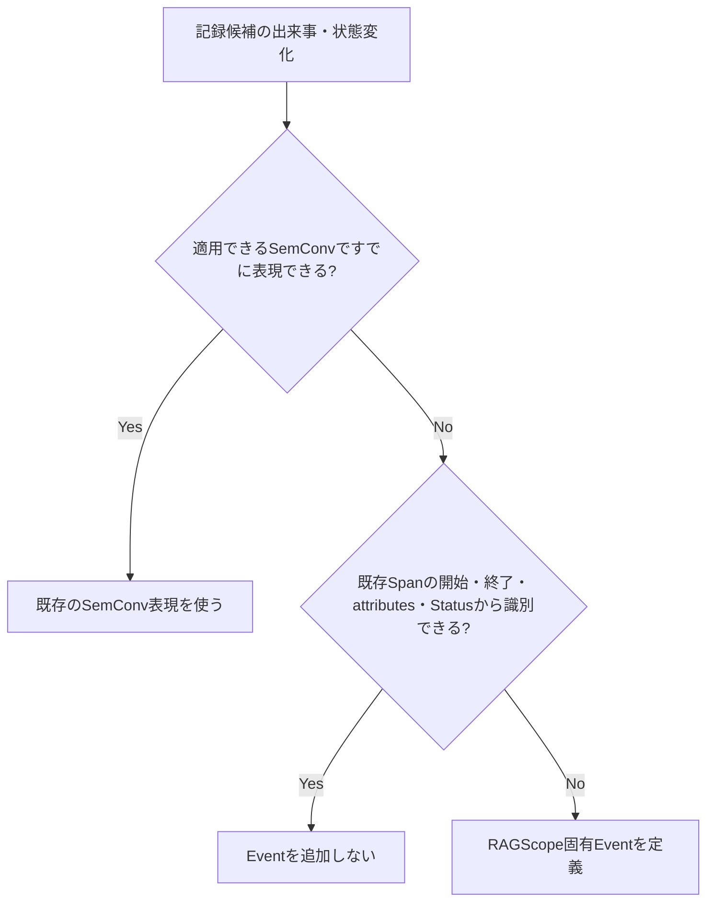

# RS-0023 Logs設計メモ

> [!note]
> これはRS-0023を正本へ反映する前にレビューするための**Workbench上の設計ドラフト**であり、RAGScopeの正本ではない。
> Observability全体は[[RS-0023 Observability設計メモ]]、Trace側の失敗時表現は[[RS-0023 Trace設計メモ]]を参照する。
> このノートで使うOpenTelemetry用語とRAGScope / RS-0023側の用語は[[RS-0023 Observability用語メモ]]を参照する。

## このノートが答える問い

> **RAGScopeでは何をLogに残し、何をSpanに任せるか？**

このノートでは、RAGScopeがどの出来事をEventとして記録し、そのEventをOpenTelemetry `EventRecord`でどう表すかをレビューする。エラー型で表す失敗、想定外の同期Exception、retry / fallback時にEventを出す条件も扱う。

## 要するに

Logsの基盤にはOpenTelemetry Logsを使う。

RAGScope固有Eventを作るのは、**適用できるSemantic Conventionや既存Spanだけでは、後から必要な出来事・状態変化を識別できない場合**である。

したがって、期間を持つ処理や最終結果をSpanですでに表現できるなら、同じ事実をEventへ重複させない。

エラー型で表す失敗が発生したという事実だけでもEventは自動生成しない。一方、想定外の同期Exceptionがoperation境界から外へ投げられる場合は、Semantic conventions for exceptions in logsに従うException Eventを1件記録する。

## いつEventを出すか

判断軸は次のとおりである。

retryやtimeoutという**種類だけ**を理由に共通Eventを作らない。
試行、所要時間、最終的な失敗などをSpanや既存Semantic Conventionから確認できるなら、同じ情報をEventへ重複して記録しない。

一方、retryを選択した、fallbackへ切り替えた、これ以上retryしないと決定した、などの状態変化をSpanから後で識別できない場合は、その状態変化をEventとして記録する候補になる。

つまり、Logsは「処理があったこと」を何でも記録する場所ではない。**Spanでは残らない、ある時点の意味ある出来事を残す**ために使う。

## SpanとEventをどう分担するか

まず、何をSpanに置き、何をEventに置くかを分ける。

- **期間を持つ処理**はSpanで表す。
- **operation全体を説明する値**はSpan attributesへ記録する。
- **ある時点で起きた出来事・状態変化**はEvent候補になる。
- 適用できるSemantic Conventionがある場合は、そのEvent / attributes / severity等を優先する。

RAGScope固有Eventが必要な場合は、`EventName`を持つOpenTelemetry `EventRecord`として記録する。

RAGScope固有Eventは、その出来事を定義するUseCaseまたは内部処理の設計で定義する。その設計では、次を決める。

- Eventが表す出来事または状態変化
- Eventを記録する条件
- `EventName`
- Eventの発生時刻が何の時点を指すか
- 既定severity
- Event固有attributes
- 失敗、または処理の成功・失敗という結果を表すEventでは、`error.type`をどの条件で要求するかと、対応するエラー型の値からどの低カーディナリティ値へ変換するか

RAGScope固有Eventの`EventName`には`ragscope.*` namespaceを使う。ID、試行番号、対象名など実行ごとに変わる値は`EventName`へ埋め込まず、attributesへ置く。

全Eventを先に共通型へ列挙しない。複数のUseCaseまたは内部処理で、Eventが表す出来事、記録条件、`EventName`、attributesを同じ定義として共有する必要が実際に生じた場合だけ共通化を検討する。

## Trace / Spanとの関連付け

Eventを現在のTrace / Spanへ関連付けるときは、`EventRecord`の基になるOpenTelemetry `LogRecord`が持つTrace Contextを使う。
RAGScope独自の`trace_id` / `span_id` attributesは追加しない。

これは、OpenTelemetryがすでに持つ関連付けと同じ情報を、RAGScope独自属性として二重管理しないためである。

## severityとBody

EventのseverityにはOpenTelemetry `SeverityNumber`の意味体系を使う。RAGScope独自のログレベル体系は設けない。
各Eventの既定severityは、そのEventを定義するUseCaseまたは内部処理の設計で決める。

severityからSpan Status、RAGScopeアプリケーションの最終結果、保存状態を導出しない。
OpenTelemetryのseverity体系を使うことと、UseCaseや内部処理の公開型へ`hs-opentelemetry`固有型を含めることは別の問題である。

すべてのEventへ同じ構造を持たせる共通`payload`は設けない。Event固有の機械可読情報はattributesへ置く。
`Body`をどう使うかは、個別Eventまたは適用するSemantic Conventionを決める時点で判断する。

## 失敗1件ごとにEventを出すわけではない

RAGScope全体の失敗理由の扱いは[[RS-0023 Observability設計メモ]]に従う。
契約上想定される失敗は、そのUseCaseまたは内部処理に対応するエラー型で表す。

**エラー型で表す失敗が発生しただけではEventを生成しない。**

たとえば途中で失敗が発生しても、retryやfallbackによって最終的に回復するなら、「失敗が一度起きた」という事実だけを理由にEventを追加しない。
必要な状態変化をSpanから識別できない場合だけ、その出来事を表すEventを定義する。

Logs設計が担当するのは、RAGScope固有Eventに失敗情報が必要な場合、そのEventが表すUseCaseまたは内部処理に対応するエラー型の値をEventの`error.type`へ変換する規則である。

各エラー型とは別に、RAGScope全体で使う共通のエラー分類は設けない。共通のエラー分類を置かなくても現在要求は成立し、追加すると各エラー型との対応規則を別に維持する必要があるためである。

RAGScopeアプリケーション / AI推論サービス間で共有する失敗コードが必要になった場合は、その通信Contractで定義する。Logs用の共通エラー分類として先に定義しない。

## `error.type`をEventでどう扱うか

失敗を表すEvent、または処理の成功・失敗という結果を表すRAGScope固有Eventを定義する場合は、2026-09-06時点のSemantic conventions for eventsの指針に従って`error.type`をEvent定義へ含める。

そのEventについて、`error.type`を`Required`、`Conditionally Required`、`Recommended`のどれとして扱うかも定義する。

エラー型の値が持つ詳細値や原因を`error.type`へ押し込まない。`error.type`には、そのEventが表すerrorの種類として予測可能で低カーディナリティな値を使う。

同じエラー型で表す失敗をRAGScope固有Spanと失敗を表すEventの両方で表す必要がある場合は、同じ失敗理由から矛盾する`error.type`を生成しない。

Semantic conventions for eventsはDevelopmentであるため、実装時に対象バージョンを再確認し、2026-09-06時点の細部をRAGScope独自の恒久契約として固定しない。

## 想定外の同期ExceptionはException Eventを1件記録する

RAGScopeが追跡するoperationの境界から想定外の同期Exceptionが外へ投げられる場合は、Semantic conventions for exceptions in logsに従ってException Eventを1件記録する。

同じExceptionをUseCase / handler / entry Spanなど伝播経路の各層で重複記録しない。下位のHTTP / DB / GenAI計装などが同じExceptionをすでに記録している場合は、RAGScope上位層では同じException Eventを追加しない。

2026-09-06時点のSemantic conventions for exceptions in logsでは、主なattributesは次の扱いである。

| attribute | requirement |
|---|---|
| `exception.type` | `exception.message`がない場合はRequired。ある場合はRecommended |
| `exception.message` | `exception.type`がない場合はRequired。ある場合はRecommended |
| `exception.stacktrace` | Recommended |

`exception.message`は機密情報を含み得る。OpenTelemetryがattributeを定義していることと、RAGScopeがその値を記録してよいことは別である。
Semantic Conventionを超えて「どの値を記録してよいか」というRAGScope固有のデータ取扱規則は、この共通Logs設計で推測して補わない。正本で具体的な規則が定義された場合はそれに従う。

### `hs-opentelemetry`の既定Exception記録との重複

`hs-opentelemetry`の`inSpan`は、既定ではoperation境界から外へ投げられたExceptionをSpanのException Eventとして記録する。
このドラフトではLogsのException Eventを主表現とするため、RAGScopeが手動計装したSpanでSDK既定のSpan上のException EventとLogsのException Eventが同じExceptionを重複記録する場合は、OpenTelemetry AdapterでSDK既定のException記録を抑える。

具体的に`ExceptionHandler`を使うか、Spanの開始・終了処理を別の方法で扱うかはAdapter実装時に決める。Adapterでの補正は、採用するSDKの既定挙動とこのLogs設計が一致しない場合だけ行う。

Span側のStatus / `error.type` / 再送出は[[RS-0023 Trace設計メモ]]で扱う。

## `error.type`と`exception.type`は何が違うか

どちらも失敗に関係する文字列だが、表す対象が違う。

| 属性 | 表すもの |
|---|---|
| `error.type` | operationまたはEventが、どの種類のerrorで失敗・終了したか |
| `exception.type` | 実際に記録したExceptionの型 |

RAGScope固有Spanの最終失敗では、対応するエラー型の値からSpanの`error.type`へ変換する。
失敗や成功・失敗の結果を表すRAGScope固有Eventでは、対応するエラー型の値からそのEventの`error.type`へ変換する。
Exception Eventでは、実際に発生したExceptionの型を`exception.type`へ記録する。

エラー型で表す失敗は実行時に発生したExceptionとは限らないため、その失敗を表すために`exception.type`を合成しない。

想定外の同期Exceptionによってoperationが失敗した場合は、Exception Eventの`exception.type`へそのException型を記録する。対応するSpanの`error.type`へException型を設定する場合は、OpenTelemetryの`error.type`規則に従いcanonical class nameを使う。これは2つの属性が同じ契約だからではなく、同じExceptionがoperationの失敗原因だからである。

## OpenTelemetryへ任せるログ処理

RAGScope側では、OpenTelemetryと同じ責務を持つ別のログ処理基盤を作らない。

| 機構 | 方針 | 理由 |
|---|---|---|
| RAGScope独自`LogRecord` | 設けない | Logsの記録単位にはOpenTelemetry `LogRecord`を使う |
| OpenTelemetryとは別のログ処理基盤 | 設けない | Processor / Exporter、batching、flush / shutdownはOpenTelemetry SDKへ委ねる |
| OpenTelemetryとは別のログ送信経路 | 設けない | Log転送はOpenTelemetryのProcessor / Exporter経路へ委ねる |
| `LogRecord`とは別のTrace Context管理 | 設けない | `LogRecord`自身が持つTrace Contextを使う |

RAGScope側で定義するのは、RAGScope固有Eventが表す意味、記録条件、`EventName`、attributes、severityと、必要な場合に対応するエラー型の値からEventの`error.type`へ変換する規則である。

## Semantic Conventionsのstability

2026-09-06時点では、このLogs設計が参照する規約のstabilityは次のように異なる。

| 対象 | stability | 扱い |
|---|---|---|
| `error.type`属性 | Stable | operationまたはEventがどの種類のerrorを表すかを記録する標準属性として利用する |
| Semantic conventions for events | Development | RAGScope固有Eventを設計する指針として利用し、実装時に対象バージョンを再確認する |
| Recording errors | Development | RAGScope固有Span / Metricでerrorを記録する指針として利用する |
| Semantic conventions for exceptions in logs | Stable（個別節にDevelopmentあり） | Exception Eventの基本表現と各attributeのrequirement levelに従う |
| GenAI Semantic Conventions | Development | 適用できるGenAI Event / attributesがある場合に優先し、現在仕様をRAGScope独自契約へ固定しない |

## このLogs共通設計では決めないこと

| 項目 | 具体化する時点 |
|---|---|
| `Body`の具体内容 | 個別Event / 適用SemConvを決める時 |
| RAGScope固有Eventの`EventName` / attributes / severity | そのEventが表す出来事を定義するUseCaseまたは内部処理の設計で決める時 |
| RAGScope固有Eventの`error.type`値とrequirement level | そのEventが表す出来事を定義するUseCaseまたは内部処理の設計で決める時。実装時に対象バージョンのSemConvを再確認する |
| Exception attributesについてSemConvを超えて設けるRAGScope固有のデータ取扱規則 | その規則を必要とする要求・正本が具体化した時 |
| API / CLIで利用者へ返す失敗表現 | API / CLI設計・Contract |
| 実験・評価データモデルへ保存するerror | 実験・評価の設計 / データモデル |
| RAGScopeアプリケーション / AI推論サービス間の失敗時の応答 / 失敗コード | AI通信方式・Contract設計時 |
| ExperimentとTelemetryの関連付け | Experimentをどの単位で実行・追跡するかを定義する時 |
| AdapterのException処理実装 | Adapter実装時 |

## 参考

- [[RS-0023 Observability用語メモ]]
- [OpenTelemetry — Logs Data Model](https://opentelemetry.io/docs/specs/otel/logs/data-model/)
- [OpenTelemetry — Semantic conventions for events](https://opentelemetry.io/docs/specs/semconv/general/events/)
- [OpenTelemetry — Naming](https://opentelemetry.io/docs/specs/semconv/general/naming/)
- [OpenTelemetry — Recording errors](https://opentelemetry.io/docs/specs/semconv/general/recording-errors/)
- [OpenTelemetry — `error.type`](https://opentelemetry.io/docs/specs/semconv/registry/attributes/error/)
- [OpenTelemetry — Semantic conventions for exceptions in logs](https://opentelemetry.io/docs/specs/semconv/exceptions/exceptions-logs/)
- [hs-opentelemetry](https://github.com/iand675/hs-opentelemetry)