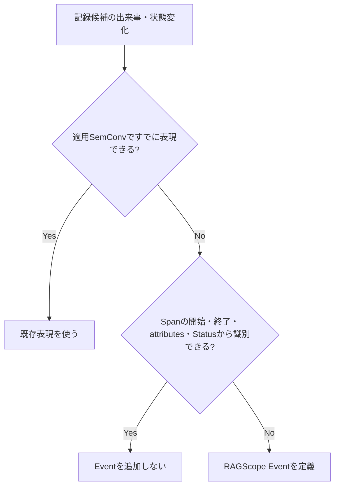

# RS-0023 Logs設計メモ

> [!note]
> これはRS-0023を正本へ反映する前にレビューするための**Workbench上の設計ドラフト**であり、RAGScopeの正本ではない。
> Observability全体は[[RS-0023 Observability設計メモ]]、Trace側の用語と失敗時のSpan表現は[[RS-0023 Trace設計メモ]]を参照する。

## このノートでレビューすること

このノートは**上から順に読むレビュー用ドラフト**である。
RAGScopeがいつLog Eventを出し、どのような`LogRecord`として表現し、failure / Exception時にどう扱うかをレビューする。

## このノートで使う用語

Trace、Span、operation、Span Status、Trace Context、typed failure、unexpected同期Exceptionは[[RS-0023 Trace設計メモ]]の定義に従う。

| 用語 | 意味 |
|---|---|
| `LogRecord` | OpenTelemetry Logsで1件のログを表すデータ |
| Event | ある時点で発生した出来事または状態変化を表すLog Event |
| `EventName` | Eventの種類を識別する名前。実行ごとに変わる値は含めない |
| attributes | Eventに付随する機械可読な値 |
| `Body` | `LogRecord`のbody。具体的な利用方法は個別Eventまたは適用SemConvで決める |
| `SeverityNumber` | OpenTelemetryが定義するseverityの数値体系 |
| Exception Log | Exception Logs Semantic Conventionに従ってExceptionを記録する`LogRecord` |

## まず結論

- Logsの基盤にはOpenTelemetry Logs / Semantic Conventionsを使う。
- RAGScope固有Eventは、適用SemConvとSpanの開始・終了・attributes・Statusだけでは、後から必要な出来事または状態変化を識別できない場合に定義する。
- typed failureが発生したことだけではLogを自動生成しない。unexpected同期Exceptionがoperation境界からescapeする場合はException Logを1件記録し、同じExceptionを重複記録しない。
- feature / UseCase固有のtyped failureをRAGScopeの失敗意味の正本とし、Telemetryでは対象operation / Eventの規則に従って`error.type`へmappingする。RAGScope全体で共有する独立した`error_type` taxonomyは設けない。
- failureまたはsuccess / failure outcomeを表すRAGScope固有Eventを定義する場合は、current General Events guidanceに従って`error.type`をEvent定義へ含め、そのEventでrequirement levelを定める。General EventsはDevelopmentなので、実装時に対象versionを再確認する。
- `error.type`はTelemetry boundaryの失敗分類、Exception Logの`exception.type`はruntime Exceptionの型であり、同じ契約として扱わない。
- RAGScope独自の`LogRecord`、Logging Runtime、Sink、Logging専用Context、OTelと並行するログ転送基盤は設けない。
- Trace / Spanとの関連付けにはOpenTelemetry `LogRecord`自身のTrace Contextを使い、RAGScope独自の`trace_id` / `span_id`属性を追加しない。
- severityはOpenTelemetry `SeverityNumber`の意味体系を使い、共通`payload`は設けない。
- RAGScope共通のnon-OTLPログJSON契約とSQLiteログ表現は維持しない。外部転送にはOTLP等のOpenTelemetry経路を使い、ローカル確認用出力を新しいRAGScope JSON契約にはしない。

## いつLog Eventを出すか



retryやtimeoutという**種類だけ**を理由に共通Eventを作らない。
attempt、duration、最終失敗などをSpanや既存SemConvから確認できる場合はEventを重複させない。

一方、retryを選択した、fallbackへ切り替えた、これ以上retryしないと決定した、などの状態変化をSpanの開始・終了・attributes・Statusから後で識別できない場合はEventとして記録する候補になる。

## Log Eventをどう表現するか

| 項目 | 方針 |
|---|---|
| 期間を持つ処理 | Span |
| operation全体を説明する値 | Span attributes |
| ある時点の出来事・状態変化 | Event |
| Event表現 | `EventName`を持つOTel `LogRecord` |
| Event定義 | その出来事が属するUseCaseまたは対象処理を定義する設計で決める |
| EventName namespace | RAGScope固有Eventは`ragscope.*` |
| dynamic値 | EventNameへ埋め込まずattributesへ置く |
| failure / outcomeを表すEvent | 適用SemConvを優先する。RAGScope固有Eventがfailureまたはsuccess / failure outcomeを表す場合は、current General Events guidanceに従って`error.type`をEvent定義へ含め、そのEventでrequirement levelを定める |
| Trace / Span correlation | OTel `LogRecord`自身のTrace Contextを使う |
| TraceId / SpanId | RAGScope独自属性として追加しない |
| severity | OTel `SeverityNumber`の意味体系を使う |
| Span Statusとの関係 | severityからSpan Statusを導出しない |
| 共通`payload` | 設けない |
| `Body` | 具体Event / 適用SemConvを決める時点で判断 |
| Semantic Conventions | Eventでも適用可能なConventionを優先 |

RAGScope固有Eventを定義する設計では、次を決める。

- Eventが表す出来事または状態変化
- 記録条件
- `EventName`
- 発生時刻が指す時点
- 既定severity
- Event固有attributes
- Eventがfailureまたはsuccess / failure outcomeを表す場合は、current General Events guidanceに従い`error.type`をEvent定義へ含め、そのEventにおけるrequirement levelと、typed failureから予測可能で低カーディナリティな値へのmappingを定める

General EventsはDevelopmentなので、Event定義を実装する時点で対象versionのguidanceを再確認し、現在の細部をRAGScope独自の恒久契約として固定しない。

全Eventを先に共通型へ列挙しない。
複数の対象機能でEventが表す出来事、記録条件、`EventName`、attributesを同じ定義として共有する必要が生じた場合だけ共通化を検討する。

## failureの正本と各boundaryへのmapping

RAGScopeのfailure意味は、failureを定義するfeature / UseCaseの設計とtyped failureが所有する。API / CLI、実験結果などへ保存するerror、Telemetryはそれぞれ別のboundary表現であり、Logs設計がそれらの共通taxonomyを所有しない。

```text
UseCase / feature固有 typed failure
        ├─→ interface mapping
        │      └─ API response / CLI stderr・exit status
        ├─→ persistence mapping
        │      └─ 実験・評価データモデル上のerror
        └─→ telemetry mapping
               └─ 適用SemConv / RAGScope固有Span・Eventのerror.type
```

RAGScope全体で共有する独立した`error_type` taxonomyを設けない理由は、OpenTelemetryに`error.type`が存在すること自体ではない。現在要求には、feature / UseCase固有typed failureと各boundaryのmappingの間に共通taxonomyを置かなければ成立しない制約を確認できない。一方で共通`error_type`を置くと、typed failureとの対応規則を追加で維持し、interface / persistence / Observabilityを同じ分類粒度へ不要に結合する。

Application / AI推論サービス間で共有するfailure codeが通信契約として必要になった場合は、その通信Contractで定義する。Logsの共通`error_type`として先に定義しない。

## failure / Exception時にどうLogを出すか

| ケース | Logs側の扱い |
|---|---|
| typed failure | failure発生だけではLogRecordを生成しない |
| retry / fallback後に回復 | failure発生だけではEventを生成しない |
| Spanから識別できない出来事・状態変化 | その出来事が属するUseCaseまたは対象処理の設計でEventを定義する。failureまたはsuccess / failure outcomeを表すRAGScope固有Eventなら、current General Events guidanceに従って`error.type`をEvent定義へ含め、そのEventでrequirement levelを定める |
| unexpected同期Exceptionがescape | Exception Logs SemConvでException Logを1件記録 |
| 同じExceptionが下位の計装で記録済み | RAGScope上位層では重複記録しない |

Exception Logのattributesは、実装時に適用するExceptions in Logs Semantic Conventionのrequirement levelに従う。2026-09-06時点では`exception.type`と`exception.message`はいずれもConditionally Requiredで、一方が存在する場合の他方はRecommended、`exception.stacktrace`はRecommendedである。`exception.message`はsensitive informationを含み得るため、SemConv以上にどの値を記録してよいかというRAGScope固有のデータ取扱規則はこの共通Logs設計で補完せず、正本で具体化された規則がある場合はそれに従う。
Span側のStatus / `error.type` / rethrowは[[RS-0023 Trace設計メモ]]を参照する。

## RAGScopeで独自に設けないLogging機構

| 機構 | 方針 | 理由 |
|---|---|---|
| RAGScope独自`LogRecord` | 設けない | Logの記録単位にはOpenTelemetry `LogRecord`を使う |
| Logging Runtime | 設けない | Processor / Exporter、batching、flush / shutdownなどはOpenTelemetry SDKへ委ねる |
| 独自Sink | 設けない | Log転送はOpenTelemetryのProcessor / Exporter経路へ委ねる |
| Logging専用ContextへのTrace Context手動注入 | 設けない | OpenTelemetry `LogRecord`自身のTrace Context関連付けを使う |
| OTelと並行する独自ログ転送基盤 | 設けない | 同じLogを別経路で運ぶ基盤をRAGScopeで重複して保守しない |

RAGScope側で定義するのは、RAGScope固有Eventの意味、記録条件、`EventName`、attributes、severity、typed failureからTelemetry表現へのmappingである。

## JSON / SQLiteをどう扱うか

現在の正本には、RAGScope独自`LogEvent`をnon-OTLPの外部形式へ投影するための共通外部表現、JSON表現、JSON Schema、SQLite表現がある。
RS-0023ではLogsの記録単位をOpenTelemetry `LogRecord`へ置き換え、Processor / Exporterと外部転送をOpenTelemetryへ委ねるため、この独自外部表現層を並行して維持しない。

| 現在の仕組み | RS-0023での判断 | 理由 |
|---|---|---|
| RAGScope共通non-OTLP外部表現 | 維持しない | `LogRecord`をRAGScope独自外部モデルへ再投影してから送る経路を作らない |
| 共通ログJSON表現 / JSON Schema | 維持しない | 外部転送の契約にはOTLP等のOpenTelemetry経路を使う。console / handle exporterの表示形式もRAGScope契約にしない |
| 共通ログSQLite表現 | 維持しない | RAGScope本体がログ保存用SQLite Schemaを所有する要求を確認できない。保存・検索・retentionは採用するTelemetry backend側の責務として扱う |
| ローカルでのログ確認 | 維持する | 要求上必要。OpenTelemetry SDKのconsole / handle exporter、必要ならローカルCollectorで確認する |

JSONやSQLiteという形式自体を禁止するわけではない。将来、OpenTelemetryの転送・backendとは別に、RAGScopeが安定したnon-OTLPログファイル契約を外部へ提供する要求や、RAGScope自身がSQLiteログをqueryする要求が追加された場合は、その要求を基準に外部表現を新たに設計する。

この判断は、実験結果、評価データ、RAGScopeのドメインデータなど、**ログ以外のJSON / SQLite利用を変更するものではない**。
また、既存のJSON / SQLite投影Experimentは当時の設計に対して実際に行った検証記録なので、過去の結果として残す。RS-0023反映後の現在設計の根拠や必須Contractとしては使用しない。

### 正本へ反映するときの影響

RS-0023の正本反映では、次を少なくとも確認対象とする。ここでは正本の変更内容を重複して確定するのではなく、今回の判断が影響する正本を整理する。

| 対象 | 必要な扱い |
|---|---|
| `システムアーキテクチャ.md` | 共通`error_type`をAPI / CLI失敗表現へつなぐ現在記述と、Observability責務を新しいfailure modelへ整合させる |
| `design/README.md` | `error_type`を共通契約として案内する索引を新しい設計構成へ整合させる |
| `design/logging/README.md` | `error_type`と独自外部表現を前提にしたlogging設計索引を更新する |
| `実行追跡・構造化ログ契約設計.md` | OTel `LogRecord` / Trace Contextとtyped failureからTelemetryへのmappingを前提とする現在設計へ置き換える |
| `構造化ログ外部表現共通設計.md` | non-OTLP共通外部表現を維持しないため、現在設計から外す |
| `構造化ログJSON表現設計.md` | 共通ログJSON契約を維持しないため、現在設計から外す |
| `構造化ログSQLite表現設計.md` | RAGScope所有のログSQLite表現を維持しないため、現在設計から外す |
| ADR-0005 / 後続ADR | 1 Invocation = 1独立Trace、共通`error_type`廃止、独自JSON / SQLiteログ契約廃止などの重要判断を、文書管理規約に従う粒度で記録する。RS-0023全体の後続ADRでADR-0005をsupersedeする構成も候補として正本反映時に判断する |
| `contracts/logging/v1/log-event.schema.json`とfixture | 共通ログJSON Contractを維持しないため、現在Contractから外す |
| 現在のHaskell logging実装とSchema適合テスト | OpenTelemetry利用境界 / Adapterへ移行する後続実装で置き換える |
| AI推論サービスの後続logging実装 | 独自共通JSON / Sinkを実装する前提を外し、OpenTelemetry Python SDKを前提に再編する |
| v0.0 Milestone / error-logging Epic | `error_type`、独自JSON Contract等を成果物としている現在計画を新しいObservability設計へ整合させる |
| RS-0022を含む関連する未完了Ticket | `error_type`、独自JSON / Sink / Schema等を前提とする完了条件を再評価する |
| `error_type`を現在契約として参照するその他の機能設計・正本 | feature / UseCase固有typed failureと各boundary mappingへ整合させる。具体的なfailure意味は対象機能側に残す |
| 完了済みTicket / JSON・SQLite投影Experiment | 当時の作業・検証履歴として書き換えず、現在仕様の正本としては参照しない |

この変更は複数の現在設計・Contract・Milestoneへ影響し、旧設計からObservabilityの責務分担を変える重要判断である。Workbenchでは検討結果と影響範囲を保持し、正本では現在設計を`design/`、重要判断の背景・選択肢・影響をADR、移行作業をTicketへ分けて反映する。

## このLogs共通設計で設けないもの

| 項目 | 方針 | 理由 |
|---|---|---|
| typed failure → Logの共通自動変換 | 設けない | Span StatusとEvent Logは別の規則で決める |
| RAGScope共通`error_type` taxonomy | 設けない | feature / UseCase固有typed failureを失敗意味の正本とし、各boundaryで必要な表現へmappingできるため。共通taxonomyを置かなければ成立しない現在要求を確認できず、置くとtyped failureとの二重管理になる |
| Exception Span EventをExceptionの主表現にする規則 | 設けない | このドラフトではException Logs Semantic Conventionを主表現として使う |
| 全RAGScope Eventを列挙する共通`LogSpec` | 設けない | Eventは対象のUseCaseまたは処理を定義する設計で必要なものだけ定義する |
| 共通`payload` | 設けない | Event固有の機械可読情報はattributesで表現する |

## このLogs共通設計では決めないこと

| 項目 | 具体化する時点 |
|---|---|
| `Body`の具体内容 | 個別Event / 適用SemConvを決める時 |
| 対象機能固有EventName / attributes / severity | 対象機能の設計時 |
| 対象機能固有の`error.type`値とEventでのrequirement level | 対象operation / Eventの設計時。実装時に対象versionのSemConvを再確認する |
| Exception attributesについてSemConvを超えて設けるRAGScope固有のデータ取扱規則 | その規則を必要とする要求・正本が具体化した時 |
| API / CLIで利用者へ返すfailure表現 | 各interface設計 / Contract |
| 実験・評価データモデルへ保存するerror | 実験・評価機能設計 / データモデル |
| Application / AI推論サービス間のfailure response / code | AI通信方式・Contract設計時 |
| ExperimentとTelemetryの関連付け | 実験実行境界が具体化した時 |
| AdapterのException処理実装 | Adapter実装時 |

## failure分類と`error.type` / `exception.type`

`error.type`と`exception.type`は、どちらも文字列で失敗に関係する情報を持つが、同じ契約ではない。

| 対象 | 属性 | 意味 |
|---|---|---|
| 失敗したRAGScope固有Span | `error.type` | operationが最終的にどのクラスのエラーで終了したか |
| failure / outcomeを表すRAGScope固有Event | `error.type` | Eventが表すfailureのクラス。current General Events guidanceに従いEvent定義へ含め、そのEventでrequirement levelを定める |
| Exception Log | `exception.type` | 記録したruntime Exceptionの型 |

HTTP、Database、GenAIなど適用するSemantic Conventionが`error.type`の値を定める場合は、その規則を優先する。
RAGScope固有Spanがfinal failureで終了する場合はcurrent General Recording Errors guidanceに従い、対象operationのtyped failureから予測可能かつ低カーディナリティの`error.type`へmappingする。RAGScope固有Eventがfailureまたはsuccess / failure outcomeを表す場合はcurrent General Events guidanceに従って`error.type`をEvent定義へ含め、そのEventでrequirement levelとmappingを定める。

同じtyped failureをRAGScope固有Spanとfailure Eventの両方で表す必要がある場合は、同じ失敗意味から矛盾するTelemetry分類を生成しない。typed failureの詳細値や原因情報そのものを`error.type`へ押し込まず、元のfailureが保持する情報は失わない。

typed failureはruntime Exceptionとは限らないため、typed failureを表すために`exception.type`を合成しない。
unexpected同期Exceptionによってoperationが失敗した場合は、Exception Logの`exception.type`にはそのExceptionの型を記録し、対応するSpanの`error.type`にもそのException型が適切な失敗分類であればcanonical class nameを使用できる。これは2つの属性が同じ契約だからではなく、同じExceptionがoperationの失敗原因だからである。

## Semantic Conventionsのstability

2026-09-06時点では、このLogs設計が参照する規約のstabilityは次のように異なる。

| 対象 | stability | 扱い |
|---|---|---|
| `error.type`属性 | Stable | Telemetry上の失敗分類に利用する。RAGScopeのfailure modelそのものにはしない |
| General Events | Development | RAGScope固有Eventを設計する際にcurrent guidanceとして利用し、実装時に対象versionを再確認する。現在のEvent細部をRAGScope独自の恒久契約へコピーしない |
| General Recording Errors | Development | RAGScope固有Span / Metricのerror記録guidanceとして利用し、実装時に対象versionを再確認する |
| Exceptions in Logs | Stable（個別節にDevelopmentあり） | Exception Logの基本表現と各attributeのrequirement levelに従う。event name / severity等のDevelopment部分は実装時に再確認する |
| GenAI Semantic Conventions | Development | 適用可能なGenAI Event / attributesがある場合に優先するが、現在仕様をRAGScope独自契約へ固定しない |

## 判断理由・実装上の注意

> [!info]- Semantic Conventions / EventName
> 対象の出来事に適用可能なOpenTelemetry Semantic Conventionが存在する場合は、そのEventName、attributes、severity等の定義を優先する。
> 同じ意味のRAGScope独自Eventや独自attributeを重複して定義しない。
>
> RAGScope固有Eventが必要な場合は、OpenTelemetryのnamespaceと衝突しない`ragscope.*`をEventNameのnamespaceとして使用する。
> ID、attempt番号、対象名など実行ごとに変化する値をEventNameへ埋め込まず、attributesとして持たせる。
>
> failureまたはsuccess / failure outcomeを表すRAGScope固有Eventを定義する場合は、current General Events guidanceに従って`error.type`をEvent定義へ含め、そのEventでrequirement levelを定める。General EventsはDevelopmentなので、この規則の細部は実装時に対象versionを再確認する。
>
> Semantic Conventionごとにstabilityが異なるため、Developmentの規約を含む現在仕様の細部をRAGScope独自の恒久契約として固定しない。
> 実装時に採用するOpenTelemetry / instrumentation versionと対象Conventionのstabilityを確認する。

> [!info]- Trace Contextを独自属性として複製しない
> Eventを現在のTrace / Spanへ関連付けるために、RAGScope独自の`trace_id` / `span_id`属性を追加しない。
> OpenTelemetry `LogRecord`自身が持つTrace Contextとの関連付けを使用する。

> [!info]- severity
> RAGScope独自のLog Level契約は設けず、Eventの重要度はOpenTelemetry `SeverityNumber`の意味体系に従う。
> 各Eventの既定severityは、そのEventを定義する設計で決める。
>
> これはUseCaseや対象機能へ`hs-opentelemetry`固有型を直接渡すことを意味しない。
> SDK型を境界の外へ漏らすかどうかと、Telemetry上のseverity体系をOpenTelemetryへ合わせることは別問題である。
>
> severityからSpan Status、Applicationの最終結果、保存状態を導出しない。

> [!info]- unexpected同期Exceptionと`hs-opentelemetry`
> RAGScopeが追跡するoperation境界からunexpectedな同期Exceptionがescapeする場合は、Logs側ではOpenTelemetryのException Logs Semantic Conventionを使用し、Exception Logを1件記録する。
>
> 同じExceptionをUseCase / handler / entry Spanなど伝播経路の各層で重複記録しない。
> 下位のHTTP / DB / GenAI計装などが同じExceptionをすでに記録している場合は、RAGScope上位層が同じException Logを追加しない。
>
> Exception attributesは、実装時に適用するExceptions in Logs SemConvのrequirement levelに従う。`exception.message`はsensitive informationを含み得るため、SemConvを超えるRAGScope固有の記録可否をこのノートで先に決めない。
>
> `hs-opentelemetry`の`inSpan`は、既定ではescapeしたExceptionをSpanのException Eventとして記録する。
> このドラフトではException Logを主表現とするため、RAGScopeが作成するmanual SpanでSDK既定のException EventとException Logが重複する場合は、OpenTelemetry Adapterで既定のException記録を抑える。
>
> 具体的に`ExceptionHandler`を使うか、Span lifecycleを別の方法で扱うかはAdapter実装時に決める。
> Adapterでの補正は、採用するSDKの既定挙動とこのLogs設計が一致しない場合だけ行う。

## 参考

- [OpenTelemetry — Logs Data Model](https://opentelemetry.io/docs/specs/otel/logs/data-model/)
- [OpenTelemetry — Events](https://opentelemetry.io/docs/specs/semconv/general/events/)
- [OpenTelemetry — Naming](https://opentelemetry.io/docs/specs/semconv/general/naming/)
- [OpenTelemetry — Recording errors](https://opentelemetry.io/docs/specs/semconv/general/recording-errors/)
- [OpenTelemetry — `error.type`](https://opentelemetry.io/docs/specs/semconv/registry/attributes/error/)
- [OpenTelemetry — Exceptions in Logs](https://opentelemetry.io/docs/specs/semconv/exceptions/exceptions-logs/)
- [hs-opentelemetry](https://github.com/iand675/hs-opentelemetry)
