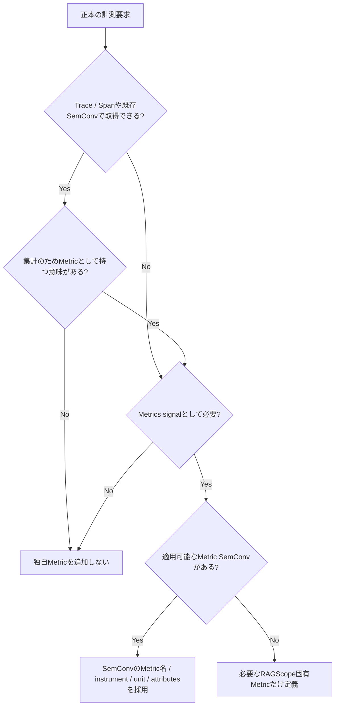

# RS-0023 Metrics設計メモ

> [!note]
> これはRS-0023を考えるための**Workbench上の検討メモ**であり、RAGScopeの正本ではない。
> Observability全体の共通方針と、Metrics後に決めるTelemetry利用境界 / package / 外部構成は[[RS-0023 Observability設計メモ]]を参照する。

## 30秒で見る

| 項目 | 状態 |
|---|---|
| 正本の計測要求 | ✅ 確認済み |
| Metric化する値 | 🚧 未決定 |
| instrument | 🚧 未決定 |
| Metric名 / unit / attributes | 🚧 未決定 |
| OTel Semantic Conventionsとの対応 | 🚧 これから確認 |
| RAGScope Application / AI推論サービスのowner | 🚧 未決定 |

このノートでは**Metricの意味と表現を決めるところまで**扱う。
Telemetry利用境界、package / module、Collector / backend構成は全体像ノートで扱う。

## 正本から確認済みの計測要求

| 計測対象 | 要求として確認済み | 既存signal / SemConvの確認対象 | Metric化 |
|---|---|---|---|
| 検索の処理時間 | ✅ | Span duration等で満たせるか確認 | 🚧 未決定 |
| rerankingの処理時間 | ✅ | Span / 適用可能なSemConvを確認 | 🚧 未決定 |
| 回答生成の処理時間 | ✅ | Span / 適用可能なGenAI SemConvを確認 | 🚧 未決定 |
| TTFT | ✅ | 適用可能なGenAI SemConvを確認 | 🚧 未決定 |
| 生成token数 | ✅ | 適用可能なGenAI SemConvを確認 | 🚧 未決定 |

> [!important]
> 上表は**計測要求が確認済み**という意味であり、各値についてOpenTelemetry Metricを新設すると決めたものではない。

## Metricを追加する判断フロー

## ✅ すでに決まっている共通制約

| 制約 | 方針 |
|---|---|
| Semantic Conventions | 適用可能なOTel ConventionをRAGScope独自Metricより優先 |
| SDK境界 | OpenTelemetry SDK固有型をUseCaseへ直接漏らさない |
| 重複計測 | Span等で取れる値を理由なく独自Metricへ重複させない |
| 高cardinality属性 | 実験ID、文書IDなどを安易にMetric attributesへ入れない |
| 自動 / 手動計装 | Metricの意味を決めた後の実装論点として判断 |

現時点ではMetrics固有のinstrument、Metric名、unit、attributesはまだ決めていない。

## 🚧 次に確認すること

| 論点 | 確認内容 |
|---|---|
| 処理時間 | 検索 / reranking / 回答生成をSpan durationで満たせるか、別Metricが必要か |
| TTFT | 適用可能なGenAI Semantic Conventionに対応表現があるか |
| token usage | 適用可能なGenAI Semantic Conventionに対応Metricがあるか |
| operation duration | 適用可能なGenAI Semantic Conventionに対応Metricがあるか |
| owner | RAGScope Application側 / AI推論サービス側のどちらが各値を所有するか |
| Spanとの重複 | 同じ値をSpanとMetricで持つ場合に集計上の意味があるか |
| success / failure集計 | 既存の`error.type`等のSemConvとどう整合するか |

## 検討順序

1. 各計測要求をTrace / Spanまたは既存Semantic Conventionsで取得できるか確認する
2. Metrics signalとして追加で保持する必要がある値を特定する
3. 適用可能なMetric Semantic Conventionがあれば、そのMetric名・instrument・unit・attributesを採用する
4. RAGScope固有Metricが必要な場合だけ、意味・instrument・unit・attributes・記録条件を定義する
5. attributesのcardinalityを確認する
6. 自動計装 / 手動計装は最後に判断する

## 参考

- [[RS-0023 Observability設計メモ]]
- [[RS-0023 Trace設計メモ]]
- [[RS-0023 Logs設計メモ]]
