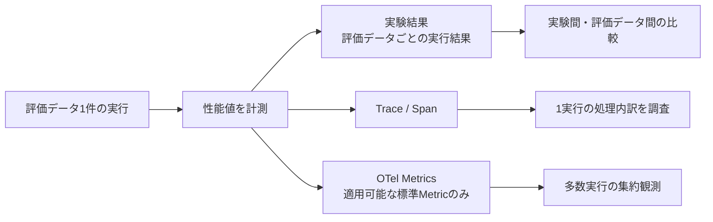
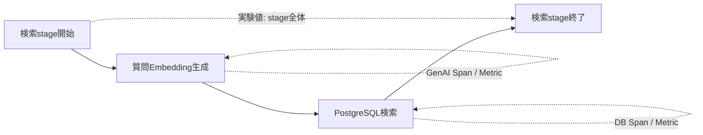
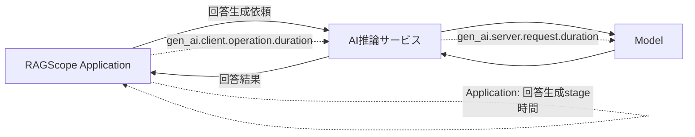
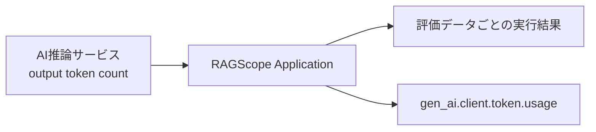

# RS-0023 Metrics設計メモ

> [!note]
> これはRS-0023を考えるための**Workbench上の検討メモ**であり、RAGScopeの正本ではない。
> Observability全体の共通方針と、Metrics後に決めるTelemetry利用境界 / package / 外部構成は[[RS-0023 Observability設計メモ]]を参照する。

## 30秒で見る

| 論点 | 状態 | 決定 |
|---|---|---|
| 性能値とOTel Metrics | ✅ | 別責務。Metricを実験結果の保存先にしない |
| 検索stage時間 | ✅ | 実験結果へ保存 + Traceで内訳確認。RAGScope固有Metricは作らない |
| reranking stage時間 | ✅ | 実験結果へ保存 + Traceで内訳確認。現時点で専用Metricは作らない |
| 回答生成stage時間 | ✅ | Applicationから見たstage時間を実験結果へ保存する |
| GenAI operation時間 | ✅ | 適用可能な標準GenAI Metricsを利用する |
| TTFT | ✅ | AI推論サービス側の`gen_ai.server.time_to_first_token`を標準Metricとして利用する |
| token usage | ✅ | 適用可能なら`gen_ai.client.token.usage`を利用する |
| DB operation時間 | ✅ | `db.client.operation.duration`を利用する |
| RAGScope固有Metric | 追加しない | 現時点では追加しない |
| Metric attributes | ✅ | 実験ID・文書ID等のhigh-cardinality値を入れない |
| GenAI SemConv | 注意 | Development。現在名をRAGScope独自の恒久契約として固定しない |

**正本が要求する性能値は実験結果として保持する。OpenTelemetry Metricsは、多数の実行を集約して観測する意味がある標準Metricだけを追加で使う。**

## 性能値とTelemetryの関係

> [!important]
> `REQ-NF-PERF-001` / `REQ-NF-PERF-002`は、性能値を**実験結果 / 評価データごとの実行結果から取得できること**を要求している。
> OTel Metricを出力したことだけではこの要求を満たさない。
> Metricの集約値から個別の実験結果を復元する設計にも，不要に依存しない。

## ✅ 正本要求との対応

| 正本要求 | 必要な値 | 保存・確認の主経路 | OTel Metric |
|---|---|---|---|
| `REQ-NF-PERF-001` | 検索処理時間 | 実験結果 + Span | 独自Metricなし |
| `REQ-NF-PERF-001` / `REQ-EVAL-004` | reranking処理時間 | 実験結果 + Span | 独自Metricなし |
| `REQ-NF-PERF-001` / `REQ-NF-PERF-002` | 回答生成時間 | 実験結果 + Span | GenAI標準Metricを併用 |
| `REQ-NF-PERF-002` | TTFT | 実験結果 | `gen_ai.server.time_to_first_token` |
| `REQ-NF-PERF-002` | 生成token数 | 実験結果 | `gen_ai.client.token.usage`を適用可能なら使用 |
| `REQ-EVAL-007` | 処理時間 / 成功率 / timeout率等 | 実験結果を集計 | Telemetry側は適用SemConvがある値だけ利用 |

`REQ-NF-PERF-003`のCPU / GPU、メモリ、デバイス、`dtype`等は**性能比較条件を実験結果へ記録する要求**であり、このノートでApplication固有Metricへ変換しない。
Runtime / host / accelerator MetricsをObservabilityとして追加するかは、外部構成と実際の運用上の観測要求を確認して後続で判断する。

## ✅ 処理時間の扱い

### 検索

現在正本のdense検索UseCaseは、質問Embedding生成とPostgreSQLのexact vector searchを含む複数処理から構成される。
そのため、DB MetricやGenAI Metricのどれか1つをRAGScopeの「検索処理時間」と同一視しない。

| 観測 | 方針 |
|---|---|
| 実験比較用の検索時間 | RAGScope Applicationが検索stage全体を計測し、実験結果へ保存する |
| Embedding時間 | 適用可能なGenAI Span / Metricで観測する |
| PostgreSQL時間 | DB Spanと`db.client.operation.duration`で観測する |
| `ragscope.search.duration` | 作らない |

### reranking

RAGScope Applicationは検索候補をAI推論サービスへ渡し、並べ替え済み結果を受け取る。
したがって、Applicationから見たreranking stage全体の時間と、AI推論サービス内部のモデル計算時間を分けて扱う。

現時点で確認したGenAI Semantic Conventionsには、RAGScopeのreranking stageへそのまま適用できる専用Metricを確認できていない。
このため、実験比較に必要なstage時間は実験結果へ保存し、`ragscope.reranking.duration`のような独自Metricは先に固定しない。
対象feature実装時に、その時点のGenAI Semantic Conventionsを再確認する。

### 回答生成

回答生成では境界の異なる時間を混同しない。

| 時間 | 意味 | 扱い |
|---|---|---|
| 回答生成stage時間 | Applicationが回答生成処理を開始してから結果を得るまでのRAGScope側stage | 実験結果へ保存 |
| `gen_ai.client.operation.duration` | GenAI client operationの所要時間 | 適用可能なら標準Metric |
| `gen_ai.server.request.duration` | AI推論サービス側request処理時間 | 適用可能なら標準Metric |

同じ「回答生成時間」に見えても境界が異なるため、片方からもう片方を導出しない。

## ✅ TTFT

OpenTelemetry GenAI Semantic Conventionsには、AI serverが最初のtokenを生成するまでを表す`gen_ai.server.time_to_first_token`がある。
これはRAGScopeの`REQ-NF-PERF-002`にある「最初のトークンが得られるまでの時間」に最も直接対応する標準Metricである。

一方、client側の`gen_ai.client.operation.time_to_first_chunk`は、streaming responseの**最初のchunkを受信するまで**を表す。
最初のtoken生成時間とは境界が異なるため、TTFTの代替として同一視しない。

| 項目 | 方針 |
|---|---|
| TTFTの計測owner | AI推論サービス |
| 実験結果 | 評価データごとの実行結果から取得できる形で保持する |
| OTel Metric | `gen_ai.server.time_to_first_token` |
| `gen_ai.client.operation.time_to_first_chunk` | streaming採用時のclient観測値として別に扱う |

> [!info]- Applicationへの受け渡し
> 正本要求を満たすには、TTFTをTelemetry backendから後で引き戻すのではなく、実験処理が取得できる値としてApplicationへ渡せる必要がある。
> ただし、AI推論サービスからApplicationへどの通信Contractで返すかは現在の正本では具体化されていないため、このノートではフィールド名や通信表現まで決めない。

## ✅ 生成token数

GenAI Semantic Conventionsには`gen_ai.client.token.usage`があり、input / output token数をHistogramで記録できる。
countを効率よく取得できる場合に使用し、取得できない値をTelemetryのためだけに不正確に推定しない。

RAGScopeでは生成token数を評価データ単位で比較するため、**正確なoutput token countを実験結果へ保持する経路が主**である。
その上で、Application側のGenAI client instrumentationから標準Metricを利用できる場合は`gen_ai.client.token.usage`を併用する。

## ✅ Metric attributes

Metricは集約して利用するため、attributesへ実行ごとに増える値を安易に入れない。

| 値 | Metric attribute |
|---|---|
| 実験ID | 入れない |
| 評価データID | 入れない |
| 文書ID / 文書チャンクID | 入れない |
| TraceId / SpanId | RAGScope独自属性として入れない |
| SemConvが要求 / 推奨する低cardinality属性 | 適用SemConvに従う |
| RAGScope独自属性 | 集約上の具体的用途が確認できた場合だけ検討 |

個別実行の識別はTraceと実験結果が担当し、Metric attributesに実験識別を持ち込まない。

## 現時点でRAGScope固有Metricを追加しない

正本の性能要求を照合した結果、現時点でMetrics signalにしか置けないRAGScope固有の性能値は確認できていない。

- 個別実行の性能値は実験結果へ保存できる
- 1回の詳細な所要時間と内訳はSpanで確認できる
- DB / GenAIには適用可能な標準Metricが存在する
- 検索 / reranking stageへ独自Metricを追加しなければ成立しない集約要求は現在確認できない

したがって、**RS-0023の共通設計ではRAGScope固有Metricを0個とする**。
feature固有の集約要求が後から具体化し、Trace / 実験結果 / 標準Metricでは満たせないことが確認された場合だけ、そのownerが独自Metricを定義する。

## Semantic Conventionsのstability（注意）

2026-09-06確認時点では、OpenTelemetry core Semantic Conventionsは1.44.0で、GenAI Semantic Conventionsは別リポジトリのDevelopment規約として管理されている。
確認したGenAI manifestは`gen-ai-dev/1.42.0-dev`で、core Semantic Conventions 1.44.0へ依存している。

このため、`gen_ai.*`の現在のMetric名・attributesを**RAGScope独自の恒久契約へコピーしない**。
実装時には、採用するOpenTelemetry / instrumentation versionと対象Conventionのstabilityを再確認する。

現在確認した代表的なGenAI Metrics:

| Metric | instrument | unit | stability |
|---|---|---|---|
| `gen_ai.client.operation.duration` | Histogram | `s` | Development |
| `gen_ai.client.token.usage` | Histogram | `{token}` | Development |
| `gen_ai.client.operation.time_to_first_chunk` | Histogram | `s` | Development |
| `gen_ai.server.request.duration` | Histogram | `s` | Development |
| `gen_ai.server.time_to_first_token` | Histogram | `s` | Development |
| `gen_ai.server.time_per_output_token` | Histogram | `s` | Development |

## 後続で具体化すること

| 論点 | 状態 / 時点 |
|---|---|
| 回答生成stageの厳密な開始・終了点 | 対象feature設計で固定する |
| TTFT / output token countをAI推論サービスから返すContract | AI通信方式・Contract設計時 |
| rerankingのSemConv対応 | 対象feature実装時に現行SemConvを再確認 |
| Metricsの具体的な計装方法 | Telemetry利用境界 / Adapter設計時 |
| standard Metricsをどこまで自動計装するか | instrumentation選定時 |
| Runtime / host / accelerator Metrics | 外部構成と運用上の観測要求を決める時 |
| Collector / backend側のaggregation / retention | 外部構成設計時 |

Metricsの意味と表現はここまでで一旦固める。
次は[[RS-0023 Observability設計メモ]]へ戻り、**Telemetry利用境界 → package / module → 外部構成**の順に検討する。

## 参考

- [[RS-0023 Observability設計メモ]]
- [[RS-0023 Trace設計メモ]]
- [[RS-0023 Logs設計メモ]]
- [OpenTelemetry Semantic Conventions](https://opentelemetry.io/docs/specs/semconv/)
- [OpenTelemetry GenAI Semantic Conventions](https://github.com/open-telemetry/semantic-conventions-genai)
- [OpenTelemetry Database metrics](https://opentelemetry.io/docs/specs/semconv/database/database-metrics/)
- [hs-opentelemetry](https://github.com/iand675/hs-opentelemetry)