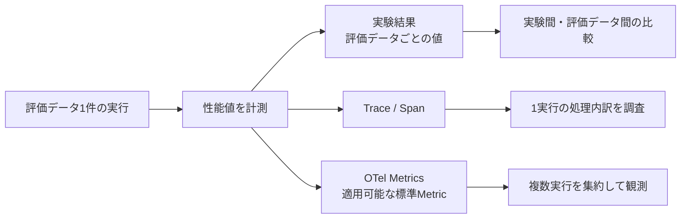
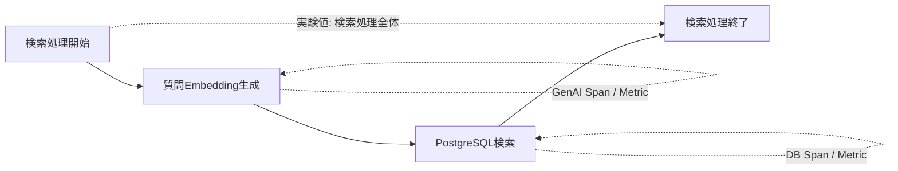
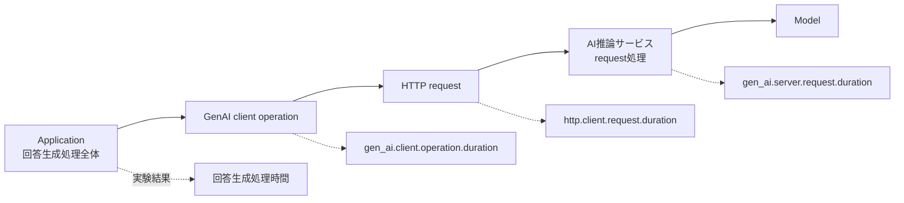
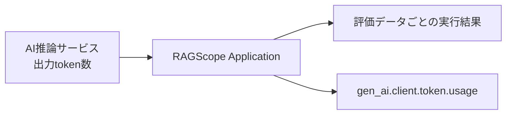

# RS-0023 Metrics設計メモ

> [!note]
> これはRS-0023を正本へ反映する前にレビューするための**Workbench上の設計ドラフト**であり、RAGScopeの正本ではない。
> Observability全体の共通方針と、Metrics共通設計の外側にあるTelemetry利用境界 / package構成 / 外部構成は[[RS-0023 Observability設計メモ]]を参照する。
> このノートで使うOpenTelemetry用語とRAGScope / RS-0023側の用語は[[RS-0023 Observability用語メモ]]を参照する。

## このノートが答える問い

> **評価データ1件ごとの性能値と、複数実行を集約するOpenTelemetry Metricsをどう使い分けるか？**

このノートでは、検索 / reranking / 回答生成 / TTFT / token数 / DB時間を、実験結果・Trace / Span・OpenTelemetry Metricsのどこで計測・保存・観測するかをレビューする。

## 要するに

役割は次の3つに分ける。

- **実験結果**: 評価データ1件ごとの性能値を残し、実験間・評価データ間で比較する。
- **Trace / Span**: 1回の実行で、どの処理にどれだけ時間がかかったかを調べる。
- **OpenTelemetry Metrics**: 複数回の実行を集約して観測する。

OpenTelemetry Metricを出したことだけでは、正本が求める評価データごとの性能値保存を満たさない。
個別の実験結果をMetricの集約値から復元する構造にはしない。

## 正本要求をどう満たすか

`REQ-NF-PERF-001` / `REQ-NF-PERF-002`は、性能値を**実験結果 / 評価データごとの実行結果から取得できること**を要求している。
そのため、実験比較に必要な値は実験結果へ保存する。

| 正本要求 | 必要な値 | 保存・確認の主経路 | OTel Metric |
|---|---|---|---|
| `REQ-NF-PERF-001` | 検索処理時間 | 実験結果 + Span | 独自Metricなし |
| `REQ-NF-PERF-001` / `REQ-EVAL-004` | reranking処理時間 | 実験結果 + Span | 独自Metricなし |
| `REQ-NF-PERF-001` / `REQ-NF-PERF-002` | 回答生成時間 | 実験結果 + Span | GenAI / HTTP標準Metricを内訳観測に併用 |
| `REQ-NF-PERF-002` | TTFT | 実験結果 | `gen_ai.server.time_to_first_token`を適用可能なら使用 |
| `REQ-NF-PERF-002` | 生成token数 | 実験結果 | `gen_ai.client.token.usage`を適用可能なら使用 |
| `REQ-EVAL-007` | 処理時間 / 成功率 / timeout率等 | 実験結果を集計 | Telemetry側は適用SemConvがある値だけ利用 |

`REQ-NF-PERF-003`はCPU / GPU、メモリ、デバイス、`dtype`等を性能比較条件として実験結果へ記録することを要求している。この要求を満たすためだけに、これらをRAGScope Application独自Metricへしない。

runtime / host / acceleratorのMetricsをObservabilityとして追加するかは、外部構成と、どの集約・比較・監視で利用するかが定義された時点で判断する。

## 検索時間をどう扱うか

現在正本のdense検索UseCaseは、質問Embedding生成とPostgreSQLのexact vector searchを含む複数処理から構成される。
したがって、DB MetricやGenAI Metricのどれか1つをRAGScopeの「検索処理時間」と同一視しない。

実験比較用の検索時間は、RAGScope Applicationが検索処理全体を計測して実験結果へ保存する。

Embedding生成の論理的な依頼全体は、適用可能なGenAI embeddings client Span / Metricで観測する。
その中で実際に行うHTTP requestは、HTTP計装を行う場合にHTTP client Span / `http.client.request.duration`で別に観測する。
PostgreSQL operationはDB Spanと`db.client.operation.duration`で観測する。

Embedding operation全体とHTTP requestは同じ時間の別名ではない。一方から他方を導出しない。
検索処理全体を集約する`ragscope.search.duration`のような独自Metricは設けない。

## reranking時間をどう扱うか

RAGScope Applicationは検索候補をAI推論サービスへ渡し、並べ替え済み結果を受け取る。

そのため、次の2つは別の時間である。

- Applicationがrerankingを依頼して結果を受け取るまでの処理全体
- AI推論サービス内部でモデルがreranking計算を行う時間

現時点で確認したGenAI Semantic Conventionsには、RAGScopeのreranking処理全体へそのまま適用できる専用Metricを確認できていない。

実験比較に必要なreranking処理時間は実験結果へ保存し、`ragscope.reranking.duration`のような独自Metricは設けない。
rerankingを実装する時点で、その時点のGenAI Semantic Conventionsを再確認する。

## 回答生成時間をどう扱うか

回答生成では、次の4つを別の測定対象として扱う。

1. RAGScope Applicationが回答生成処理を開始してから結果を得るまでの処理全体
2. ApplicationからモデルまたはGenAIサービスへ行う論理的なGenAI client operation
3. そのGenAI処理の中でAI推論サービスへ送るHTTP request
4. AI推論サービス側でrequestを受けて処理する時間

回答生成処理全体の時間は実験結果へ保存する。

`gen_ai.client.operation.duration`はGenAIへの論理的な依頼全体、`http.client.request.duration`はその中で行われる1回のHTTP request、`gen_ai.server.request.duration`はAI推論サービス側でrequestを処理する時間を表す。

`gen_ai.client.operation.duration`にはHTTP通信時間が含まれる場合があるが、それでもHTTP requestの時間と同じ値ではない。一方から他方を導出しない。AI推論サービス側の値もApplication側の観測値から導出しない。

## TTFTをどう扱うか

現在のOpenTelemetry GenAI Semantic Conventionsには、AI推論サービスが最初のtokenを生成するまでを表す`gen_ai.server.time_to_first_token`がある。
RAGScopeで適用できる場合は、`REQ-NF-PERF-002`にあるTTFTを複数実行で集約観測する標準Metricとして利用する。

一方、client側の`gen_ai.client.operation.time_to_first_chunk`は、streaming responseの**最初のchunkを受信するまで**を表す。
TTFTとは開始点・終了点が異なるため、同じ値として扱わない。

RAGScopeの実験結果では、AI推論サービス側で計測したTTFTを評価データごとの実行結果から取得できる形で保持する。
Telemetryの保存・集約先だけへTTFTを送り、後から取得して実験結果を補完する構造にはしない。

そのため、AI推論サービス側で計測したTTFTをApplicationへ渡せる必要がある。ただし、どの通信Contractで返すかは現在の正本で具体化されていないため、このノートではフィールド名や通信表現まで決めない。

## 生成token数をどう扱うか

GenAI Semantic Conventionsには`gen_ai.client.token.usage`があり、input / output token数をHistogramで記録できる。
ApplicationがAI推論サービスの応答などから正確なtoken数を取得できる場合に利用する。Telemetryのためだけに取得できない値を推定しない。

RAGScopeでは生成token数を評価データ単位で比較するため、**正確な出力token数を実験結果へ保持する経路が主**である。

その上で、AI推論サービスから返された出力token数をApplication側で取得でき、GenAI client operationの標準Metricへ記録できる場合は`gen_ai.client.token.usage`を併用する。

## Metric attributesに何を入れるか

Metricは複数の観測値を同じ属性集合で集約するため、実行や対象ごとに値の種類が増える識別子をattributesへ入れない。

実験ID、評価データID、文書ID、文書チャンクIDはMetric attributesへ入れない。
TraceId / SpanIdもRAGScope独自attributeとして追加しない。

適用するSemantic Conventionが要求・推奨する低カーディナリティのattributesは、そのConventionに従う。
RAGScope独自attributeは、どの集計・比較・監視で使うかを特定できた場合だけ検討する。

個別実行の識別はTraceと実験結果が担当し、Metric attributesへ実験識別を持ち込まない。

## RAGScope固有Metricを追加するか

正本の性能要求を照合した結果、現時点では「RAGScope独自Metricとして持たなければ要求を満たせない性能値」は確認できていない。

- 個別実行の性能値は実験結果へ保存できる。
- 1回の詳細な所要時間と内訳はSpanで確認できる。
- DB / HTTP / GenAIには適用可能な標準Metricがある。
- 検索 / rerankingについて、独自Metricで集約しなければ成立しない要求を現在確認できない。

したがって、**RS-0023の共通設計ではRAGScope独自Metricを新たに定義しない（0個）**。

UseCaseまたは内部処理について必要な集約・比較・監視が具体化し、Trace / 実験結果 / 標準Metricではその用途を満たせないことが確認された場合だけ、そのUseCaseまたは内部処理を定義する設計で独自Metricを定義する。

## Semantic Conventionsのstability

2026-09-06確認時点で、OpenTelemetry core Semantic Conventionsの最新リリースは1.44.0である。GenAI Semantic Conventionsは専用リポジトリへ分離され、現在もDevelopmentとして管理されている。

そのため、`gen_ai.*`の現在のMetric名・attributesを**RAGScope独自の恒久契約へコピーしない**。
実装時には、採用するOpenTelemetry / instrumentationバージョンと対象Conventionのstabilityを再確認する。

このノートで参照する代表的なMetricsは次のとおりである。

| Metric | instrument | unit | stability |
|---|---|---|---|
| `http.client.request.duration` | Histogram | `s` | Stable |
| `db.client.operation.duration` | Histogram | `s` | Stable |
| `gen_ai.client.operation.duration` | Histogram | `s` | Development |
| `gen_ai.client.token.usage` | Histogram | `{token}` | Development |
| `gen_ai.client.operation.time_to_first_chunk` | Histogram | `s` | Development |
| `gen_ai.server.request.duration` | Histogram | `s` | Development |
| `gen_ai.server.time_to_first_token` | Histogram | `s` | Development |
| `gen_ai.server.time_per_output_token` | Histogram | `s` | Development |

HTTP / Databaseの文書全体にはstabilityが混在するため、「HTTPまたはDatabaseだからすべてStable」とは扱わない。このノートで採用候補としている`http.client.request.duration`と`db.client.operation.duration`はStableであり、GenAI Metricsとはstabilityが異なる。

## このMetrics共通設計では決めないこと

| 論点 | 具体化する時点 |
|---|---|
| 回答生成処理時間の厳密な開始・終了点 | 回答生成を定義する設計時 |
| TTFT / 出力token数をAI推論サービスから返すContract | AI通信方式・Contract設計時 |
| rerankingのSemConv対応 | reranking実装時に現行SemConvを再確認 |
| Metricsの具体的な計装方法 | Telemetry利用境界 / Adapter設計時 |
| 標準Metricsをどこまで自動計装するか | 計装方法の選定時 |
| runtime / host / acceleratorのMetrics | 外部構成と必要な集約・比較・監視を定める時 |
| Collector / 保存・集約先での集約 / 保持期間 | 外部構成設計時 |

## 参考

- [[RS-0023 Observability用語メモ]]
- [[RS-0023 Observability設計メモ]]
- [[RS-0023 Trace設計メモ]]
- [[RS-0023 Logs設計メモ]]
- [OpenTelemetry Semantic Conventions](https://opentelemetry.io/docs/specs/semconv/)
- [OpenTelemetry GenAI Semantic Conventions](https://github.com/open-telemetry/semantic-conventions-genai)
- [OpenTelemetry HTTP metrics](https://opentelemetry.io/docs/specs/semconv/http/http-metrics/)
- [OpenTelemetry Database metrics](https://opentelemetry.io/docs/specs/semconv/db/database-metrics/)
- [hs-opentelemetry](https://github.com/iand675/hs-opentelemetry)
