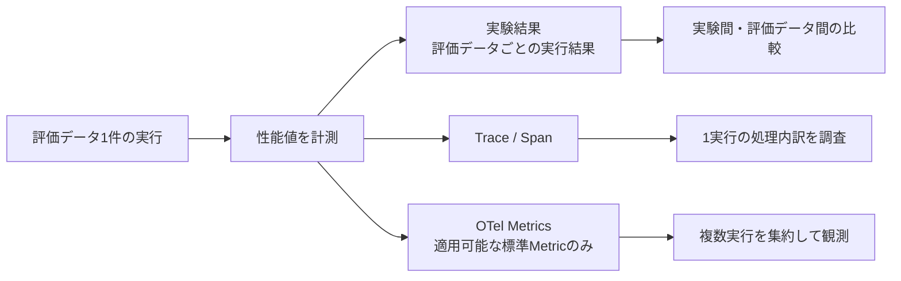
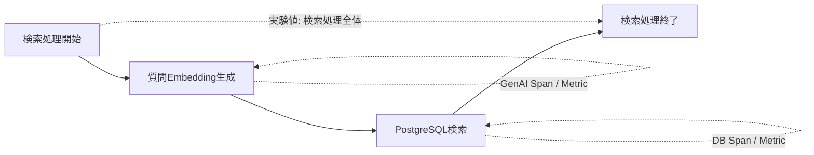
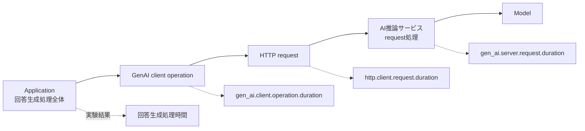
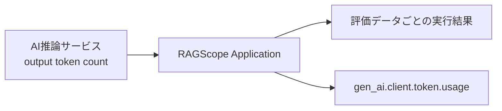

# RS-0023 Metrics設計メモ

> [!note]
> これはRS-0023を正本へ反映する前にレビューするための**Workbench上の設計ドラフト**であり、RAGScopeの正本ではない。
> Observability全体の共通方針と、Metrics共通設計の外側にあるTelemetry利用境界 / package / 外部構成は[[RS-0023 Observability設計メモ]]を参照する。

## このノートでレビューすること

このノートは**上から順に読むレビュー用ドラフト**である。
正本が要求する評価データごとの性能値とOpenTelemetry Metricsをどう分け、検索 / reranking / 回答生成 / TTFT / token数 / DB時間をどこで計測・保存・観測するかをレビューする。

## このノートで使う用語

| 用語 | 意味 |
|---|---|
| Metric | OpenTelemetry Metricsで複数の観測値を集約して扱うための計測データ |
| TTFT | Time To First Token。このノートでは、AI推論サービスが生成を開始してから最初のtokenを生成するまでの時間を指す。clientが最初のresponse chunkを受信するまでの時間とは区別する |
| GenAI operation | OpenTelemetry GenAI Semantic Conventionsが定義する、ApplicationからモデルまたはGenAIサービスへ行う論理的な依頼 |
| high-cardinality属性 | 実行や対象ごとに値の種類が増えやすく、Metricの集約系列を増加させる属性 |

## まず結論

- 正本が要求する評価データごとの性能値は実験結果へ保存し、OpenTelemetry Metricを個別実行値の保存先にしない。
- 検索、reranking、回答生成の処理全体の時間は実験結果へ保存し、Trace / Spanで1実行の内訳を確認する。検索 / reranking用のRAGScope固有Metricは設けない。
- DB / HTTP / GenAIについて適用可能な標準Metricがある場合は利用する。
- GenAI client operationの所要時間と、そのGenAI処理の中で行われるHTTP requestの所要時間は同じ値として扱わない。**両方を計装する場合**は、GenAIへの論理的な依頼全体と、その依頼を運ぶHTTP通信を別々に観測する。
- TTFTと生成token数は、評価データごとの実行結果から取得できる値として保持する。その上で、同じ値を集約観測できる標準GenAI Metricが適用できる場合は併用する。
- この共通設計ではRAGScope独自Metricを新たに定義しない（0個）。Metric attributesへ実験ID・評価データID・文書IDなどのhigh-cardinality値を入れない。
- このノートで採用候補としているHTTP / Database MetricはStable、現在参照するGenAI MetricsはDevelopmentである。OpenTelemetry Metrics signal全体を一括して同じstabilityとは扱わない。

## 性能値とTelemetryをどう分けるか

> [!important]
> `REQ-NF-PERF-001` / `REQ-NF-PERF-002`は、性能値を**実験結果 / 評価データごとの実行結果から取得できること**を要求している。
> OTel Metricを出力したことだけではこの要求を満たさない。
> 個別の実験結果をMetricの集約値から復元する構造にはしない。

## 正本要求をどう満たすか

| 正本要求 | 必要な値 | 保存・確認の主経路 | OTel Metric |
|---|---|---|---|
| `REQ-NF-PERF-001` | 検索処理時間 | 実験結果 + Span | 独自Metricなし |
| `REQ-NF-PERF-001` / `REQ-EVAL-004` | reranking処理時間 | 実験結果 + Span | 独自Metricなし |
| `REQ-NF-PERF-001` / `REQ-NF-PERF-002` | 回答生成時間 | 実験結果 + Span | GenAI / HTTP標準Metricを内訳観測に併用 |
| `REQ-NF-PERF-002` | TTFT | 実験結果 | `gen_ai.server.time_to_first_token`を適用可能なら使用 |
| `REQ-NF-PERF-002` | 生成token数 | 実験結果 | `gen_ai.client.token.usage`を適用可能なら使用 |
| `REQ-EVAL-007` | 処理時間 / 成功率 / timeout率等 | 実験結果を集計 | Telemetry側は適用SemConvがある値だけ利用 |

`REQ-NF-PERF-003`は、CPU / GPU、メモリ、デバイス、`dtype`等を性能比較条件として実験結果へ記録することを要求している。この要求を満たすためだけに、これらの値をRAGScope Application独自のMetricとして記録することはしない。
Runtime / host / accelerator MetricsをObservabilityとして追加するかは、外部構成と、どの集計・比較・監視で利用するかが定義された時点で判断する。

## 各処理時間をどう扱うか

### 検索

現在正本のdense検索UseCaseは、質問Embedding生成とPostgreSQLのexact vector searchを含む複数処理から構成される。
そのため、DB MetricやGenAI Metricのどれか1つをRAGScopeの「検索処理時間」と同一視しない。

| 観測 | 方針 |
|---|---|
| 実験比較用の検索時間 | RAGScope Applicationが検索処理全体を計測し、実験結果へ保存する |
| Applicationから見たEmbedding生成の論理処理時間 | 適用可能なGenAI embeddings client Span / Metricで、Embedding生成の論理的な依頼全体を観測する |
| Embedding生成のために行うHTTP通信時間 | HTTP計装を行う場合はHTTP client Span / `http.client.request.duration`で、そのHTTP requestだけの所要時間を別に観測する |
| PostgreSQL時間 | DB Spanと`db.client.operation.duration`で観測する |
| `ragscope.search.duration` | 設けない |

EmbeddingのGenAI client operationはEmbedding生成の論理的な依頼全体を表し、HTTP requestはその依頼の中で行われる通信だけを表す。両方を計装する場合のSpan関係は[[RS-0023 Trace設計メモ#RAGScopeの1回の実行はTrace上どう見えるか]]に従い、HTTP requestの時間をEmbedding operation全体の時間とはみなさない。

### reranking

RAGScope Applicationは検索候補をAI推論サービスへ渡し、並べ替え済み結果を受け取る。
したがって、Applicationがrerankingを依頼して結果を受け取るまでの処理全体の時間と、AI推論サービス内部でモデルがreranking計算を行う時間を分けて扱う。

現時点で確認したGenAI Semantic Conventionsには、RAGScopeのreranking処理全体へそのまま適用できる専用Metricを確認できていない。
このため、実験比較に必要なreranking処理時間は実験結果へ保存し、`ragscope.reranking.duration`のような独自Metricは設けない。
rerankingを実装する時点で、その時点のGenAI Semantic Conventionsを再確認する。

### 回答生成

回答生成では、次の4つを別の測定対象として扱う。

1. RAGScope Applicationが回答生成処理を開始してから結果を得るまでの処理全体
2. ApplicationからモデルまたはGenAIサービスへ行う論理的なGenAI client operation
3. そのGenAI処理の中でAI推論サービスへ送るHTTP request
4. AI推論サービス側でrequestを受けて処理する時間

下図は**各層を計装する場合**の測定境界を示す。

| 時間 | 意味 | 扱い |
|---|---|---|
| 回答生成処理時間 | Applicationが回答生成処理を開始してから結果を得るまでの時間 | 実験結果へ保存 |
| `gen_ai.client.operation.duration` | ApplicationからモデルまたはGenAIサービスへ行う論理的な依頼全体の所要時間 | 適用可能でGenAI client operationを計装する場合の標準Metric |
| `http.client.request.duration` | AI推論サービスへ送る1回のHTTP requestの所要時間 | HTTP計装を行う場合の標準Metric |
| `gen_ai.server.request.duration` | AI推論サービスがGenAI requestを受けて処理する時間 | 適用可能でserver側GenAI Metricを計装する場合の標準Metric |

`gen_ai.client.operation.duration`には、そのGenAI処理のために行うHTTP通信時間が含まれる場合がある。一方、`http.client.request.duration`が測るのは1回のHTTP requestだけである。このため、2つを同じ時間の別名として扱わず、一方の値から他方の値を導出しない。AI推論サービス側の`gen_ai.server.request.duration`も、Application側で観測した値から導出しない。

## TTFTをどう扱うか

現在のOpenTelemetry GenAI Semantic Conventionsには、AI serverが最初のtokenを生成するまでを表す`gen_ai.server.time_to_first_token`がある。
RAGScopeでこれを計装できる場合は、`REQ-NF-PERF-002`にあるTTFTを複数実行で集約観測する標準Metricとして利用する。

一方、client側の`gen_ai.client.operation.time_to_first_chunk`は、streaming responseの**最初のchunkを受信するまで**を表す。
AI推論サービスが最初のtokenを生成するまでの時間とは開始点・終了点が異なるため、同じ値として扱わない。

| 項目 | 方針 |
|---|---|
| TTFTの計測 | AI推論サービス側で最初のtoken生成までの時間を計測する |
| 実験結果 | 評価データごとの実行結果から取得できる形で保持する |
| OTel Metric | `gen_ai.server.time_to_first_token`を適用可能なら利用する |
| `gen_ai.client.operation.time_to_first_chunk` | streaming採用時に、clientが最初のresponse chunkを受信するまでの別の観測値として扱う |

> [!info]- Applicationへの受け渡し
> 正本要求を満たすため、TTFTをTelemetry backendだけへ記録し、後から取得して実験結果を補完する構造にはしない。実験処理が評価データごとのTTFTを取得できるよう、AI推論サービス側で計測した値をApplicationへ渡せる必要がある。
> AI推論サービスからApplicationへどの通信Contractで返すかは現在の正本では具体化されていないため、このノートではフィールド名や通信表現まで決めない。

## 生成token数をどう扱うか

GenAI Semantic Conventionsには`gen_ai.client.token.usage`があり、input / output token数をHistogramで記録できる。
ApplicationがAI推論サービスの応答などから正確なtoken数を取得できる場合に使用し、取得できない値をTelemetryのためだけに推定しない。

RAGScopeでは生成token数を評価データ単位で比較するため、**正確なoutput token countを実験結果へ保持する経路が主**である。
その上で、AI推論サービスから返されたcountをApplication側で取得でき、GenAI client operationの標準Metricへ記録できる場合は`gen_ai.client.token.usage`を併用する。

## Metric attributesに何を入れるか

Metricは複数の観測値を同じ属性集合で集約するため、実行や対象ごとに値の種類が増える識別子をattributesへ入れない。

| 値 | Metric attribute |
|---|---|
| 実験ID | 入れない |
| 評価データID | 入れない |
| 文書ID / 文書チャンクID | 入れない |
| TraceId / SpanId | RAGScope独自属性として入れない |
| SemConvが要求 / 推奨する低cardinality属性 | 適用SemConvに従う |
| RAGScope独自属性 | どの集計・比較・監視で使用するかを特定できた場合だけ検討 |

個別実行の識別はTraceと実験結果が担当し、Metric attributesに実験識別を持ち込まない。

## RAGScope固有Metricを追加するか

正本の性能要求を照合した結果、現時点では「RAGScope独自Metricとして持たなければ要求を満たせない性能値」は確認できていない。

- 個別実行の性能値は実験結果へ保存できる
- 1回の詳細な所要時間と内訳はSpanで確認できる
- DB / HTTP / GenAIには適用可能な標準Metricが存在する
- 検索 / rerankingについて、独自Metricで集約しなければ成立しない要求を現在確認できない

したがって、**RS-0023の共通設計ではRAGScope独自Metricを新たに定義しない（0個）**。
UseCaseまたはそのUseCaseを構成する内部処理について、必要な集約・比較・監視が具体化し、Trace / 実験結果 / 標準Metricではその用途を満たせないことが確認された場合だけ、そのUseCaseまたは内部処理を定義する設計で独自Metricを定義する。

## Semantic Conventionsのstability

2026-09-06確認時点で、OpenTelemetry core Semantic Conventionsの最新releaseは1.44.0である。GenAI Semantic Conventionsは専用リポジトリへ分離され、現在もDevelopmentとして管理されている。

このため、`gen_ai.*`の現在のMetric名・attributesを**RAGScope独自の恒久契約へコピーしない**。
実装時には、採用するOpenTelemetry / instrumentation versionと対象Conventionのstabilityを再確認する。

このノートで参照する代表的なMetricsは次のとおりである。

| Metric | instrument | unit | stability |
|---|---|---|---|
| `http.client.request.duration` | Histogram | `s` | Stable |
| `db.client.operation.duration` | Histogram | `s` | Stable |
| `gen_ai.client.operation.duration` | Histogram | `s` | Development |
| `gen_ai.client.token.usage` | Histogram | `{token}` | Development |
| `gen_ai.client.operation.time_to_first_chunk` | Histogram | `s` | Development |
| `gen_ai.server.request.duration` | Histogram | `s` | Development |
| `gen_ai.server.time_to_first_token` | Histogram | `s` | Development |
| `gen_ai.server.time_per_output_token` | Histogram | `s` | Development |

HTTP / Databaseの文書全体にはMixedなstabilityの項目も存在するため、「HTTPまたはDatabaseだからすべてStable」とは扱わない。このノートで採用候補としている`http.client.request.duration`と`db.client.operation.duration`はStableであり、GenAI Metricsとはstabilityが異なる。

## このMetrics共通設計では決めないこと

| 論点 | 具体化する時点 |
|---|---|
| 回答生成処理時間の厳密な開始・終了点 | 回答生成を定義する設計時 |
| TTFT / output token countをAI推論サービスから返すContract | AI通信方式・Contract設計時 |
| rerankingのSemConv対応 | reranking実装時に現行SemConvを再確認 |
| Metricsの具体的な計装方法 | Telemetry利用境界 / Adapter設計時 |
| standard Metricsをどこまで自動計装するか | 計装方法の選定時 |
| Runtime / host / accelerator Metrics | 外部構成と、必要な集約・比較・監視を定める時 |
| Collector / backend側のaggregation / retention | 外部構成設計時 |

## 参考

- [[RS-0023 Observability設計メモ]]
- [[RS-0023 Trace設計メモ]]
- [[RS-0023 Logs設計メモ]]
- [OpenTelemetry Semantic Conventions](https://opentelemetry.io/docs/specs/semconv/)
- [OpenTelemetry GenAI Semantic Conventions](https://github.com/open-telemetry/semantic-conventions-genai)
- [OpenTelemetry HTTP metrics](https://opentelemetry.io/docs/specs/semconv/http/http-metrics/)
- [OpenTelemetry Database metrics](https://opentelemetry.io/docs/specs/semconv/db/database-metrics/)
- [hs-opentelemetry](https://github.com/iand675/hs-opentelemetry)
