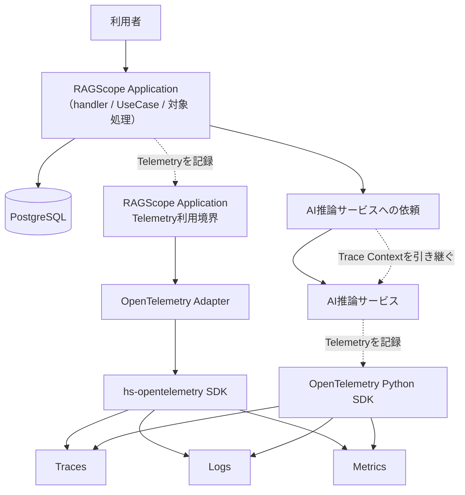
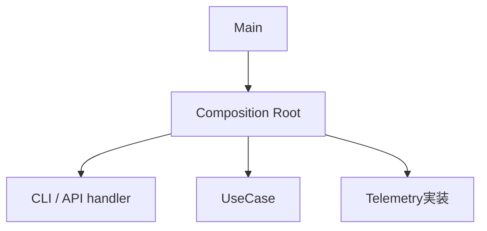

# RS-0023 Observability設計メモ

> [!note]
> これはRS-0023を正本へ反映する前にレビューするための**Workbench上の設計ドラフト**であり、RAGScopeの正本ではない。
> 現在の正本にあるUseCase境界とRAGScope Application / AI推論サービス / DBの責務を前提に、RS-0023で検討したObservability設計を扱う。
> このノートで「決定」とする内容はRS-0023の検討結果であり、現在仕様として有効になるのは正本リポジトリへ責務に応じて反映した後である。

## このノートでレビューすること

このノートは**上から順に読むレビュー用ドラフト**であり、後から引くリファレンスを目的としない。
ここではObservabilityの全体像、Trace / Logs / Metricsに共通する基本方針、OpenTelemetryの利用方針、RAGScopeへの組み込み方をレビューする。
Trace / Logs / Metrics固有の判断は、それぞれの設計メモでレビューする。

| ノート | レビューする内容 |
|---|---|
| このノート | Observability全体像、共通方針、OpenTelemetryの利用方針、RAGScopeへの組み込み方 |
| [[RS-0023 Trace設計メモ]] | RAGScopeの1回の実行をどうTrace / Spanとして追跡するか |
| [[RS-0023 Logs設計メモ]] | RAGScopeがいつ、何をLog Eventとして出すか |
| [[RS-0023 Metrics設計メモ]] | 性能値とOTel Metricsをどう分け、何をMetricとして観測するか |

## まず結論

- **Trace — RS-0023で決定。** RAGScopeは、CLIまたはAPIから1回呼び出されて処理が完了するまでを1 Invocationとして扱い、Invocationごとに独立したTraceを開始する。APIへのリクエストにTrace Contextが含まれていても、そのContextをRAGScopeのentry Spanの親として使用しない。また、外部のTraceとRAGScopeのTraceを関連付けるSpan Linkも、現在はその関連付けを必要とする要求がないため作成しない。RAGScope ApplicationからAI推論サービスを呼び出すときはTrace Contextを引き継ぎ、同じTraceを継続する。詳細は[[RS-0023 Trace設計メモ]]を参照する。
- **Failure — RS-0023で決定。** 各featureまたはUseCaseが定義するtyped failureを、RAGScopeにおける失敗理由の元情報とする。API / CLIへ返す失敗情報、実験・評価結果へ保存する失敗情報、Telemetryへ記録する失敗情報は、それぞれこのtyped failureから用途に応じて変換する。RAGScope全体で共有する独立した`error_type` taxonomyは設けない。
- **Logs — RS-0023で決定。** OpenTelemetry Logsと適用可能なSemantic Conventionsをログ記録の基盤として使う。Spanですでに表現できる情報をLog Eventへ機械的に重複させない。OTLPとは別にRAGScopeが独自定義する共通ログJSON契約と、RAGScopeが所有するログ保存用SQLite表現は維持しない。詳細は[[RS-0023 Logs設計メモ]]を参照する。
- **Metrics — RS-0023で決定。** 評価データごとの性能値は実験結果へ保存する。複数実行を集約して観測する用途では、対象処理へ適用できるOpenTelemetryの標準Metricを利用する。詳細は[[RS-0023 Metrics設計メモ]]を参照する。
- **OpenTelemetry採用可能性 — 主要能力を確認済み。** RAGScope ApplicationとAI推論サービスの両方で、Trace / Logsの記録、Trace Contextの引き継ぎ、Telemetryのexportに必要なSDK能力を確認した。RAGScope固有のGHC / Cabal / Python環境で依存解決できるかは、実装着手前に最小構成で確認する。

## 全体像

この図では、1 InvocationでRAGScope Applicationが外部のDB / AI推論サービスを利用する関係と、RAGScope ApplicationとAI推論サービスがOpenTelemetryを通じてTelemetryを記録する関係を俯瞰する。Composition Rootは実行に必要な部品を構築・接続する**構築時**の責務であり、1 Invocationの実行フローではないため、この図には含めない。



この図はApplication内部のhandler / UseCase境界やSpanの包含関係までは表さない。それらは後述の「RAGScopeへどう組み込むか」と[[RS-0023 Trace設計メモ]]で具体化する。自動計装 / 手動計装の選択、Application側のTelemetry利用境界が公開する具体API、AI推論サービス側でOpenTelemetry Python SDKをどのmoduleから利用するかも、この図では決めない。

Collector / Tempo / Lokiなどのproduction向け外部構成は、このノートでは採用を決めない。

## Observabilityの基本方針

このドラフトでは、OpenTelemetryで扱うTrace / Logs / Metricsをまとめて**signal**と呼ぶ。

TelemetryはRAGScopeで実際に行われた処理を観測し、その結果をTrace / Logs / Metricsとして記録する。
retry / timeout / fallbackなどApplicationの処理内容や制御方針そのものをTelemetryへ移さない。

| 論点 | 決定 |
|---|---|
| Telemetryの責務 | RAGScopeで実際に行われた処理をTrace / Logs / Metricsとして観測する |
| Application制御との関係 | retry / timeout / fallback / 処理順序はRAGScope Applicationが制御し、具体的な条件は対象処理の機能設計で定める。Telemetryは、その制御の結果として実際に行われた処理を記録する |
| Trace / Logs / Metricsの関係 | 同じ事実を機械的に重複させず、各signalで後から確認する内容に応じて使い分ける |
| Telemetry基盤自身の失敗 | Exporter / Processor / Collectorへの送信が失敗しても、RAGScope Application本体の処理結果を変更しない |

Trace / Logs / Metricsそれぞれの具体的な役割と表現は、各設計メモで定義する。

## 失敗情報をAPI・保存データ・Telemetryへどう変換するか

RAGScopeで処理の失敗理由を表す元情報は、その失敗が発生するfeatureまたはUseCaseが定義するtyped failureが持つ。API / CLIへ返す情報、実験・評価結果へ保存する情報、Telemetryへ記録する情報は用途が異なるため、必ずしも同じ分類名や同じ粒度にそろえない。

```text
UseCase / featureが定義するtyped failure
        ├─→ API / CLI向けに変換
        │      └─ API response / CLI stderr・exit status
        ├─→ 実験・評価結果へ保存する形に変換
        │      └─ 実験・評価データモデル上のerror
        └─→ Telemetryへ記録する形に変換
               └─ 適用するSemantic Convention / RAGScope固有Span・Eventのerror.type
```

RAGScope全体で共有する独立した`error_type` taxonomyは設けない。現在要求では、typed failureと各出力先の間に共通taxonomyを置かなければAPI / CLI、保存error、Telemetryが成立しない制約を確認できない。一方で共通`error_type`を置くと、各featureのtyped failureから共通taxonomyへの変換と、共通taxonomyからAPI / CLI・保存error・Telemetryへの変換を別々に維持する必要が生じる。これはfeature / interface / persistence / Observabilityを1つの分類体系へ不要に結合する。

Application / AI推論サービス間で共有するfailure codeが通信契約として実際に必要になった場合は、その通信方式を定義するContractで扱う。RAGScope全体の共通`error_type`として先に定義しない。

OpenTelemetryの`error.type`は、Telemetryへ記録する「そのoperationがどの種類のerrorで失敗したか」を表す属性である。RAGScopeのtyped failureそのものを置き換える型ではない。HTTP、Database、GenAIなど、適用するSemantic ConventionがSpanやMetricの`error.type`を定めている場合はその規則に従う。RAGScope固有Spanが表すoperationの最終失敗については[[RS-0023 Trace設計メモ]]、RAGScope固有Eventの`error.type`については[[RS-0023 Logs設計メモ]]で、2026-09-06時点のGeneral Recording Errors / General Events guidanceに沿って定める。これらのguidanceはDevelopmentであるため、実装時に対象versionを再確認し、現在の細部をRAGScope独自の恒久契約として複製しない。

## OpenTelemetryをどう利用するか

RAGScopeはOpenTelemetryをObservabilityの基盤として利用する。ただし、UseCaseやfeatureのmoduleからOpenTelemetry SDKを直接importする構造にはしない。Application側はRAGScopeが定義するTelemetry利用境界を通じてTelemetryを記録する。

| 論点 | 決定 |
|---|---|
| Application側のSDK境界 | UseCaseやfeatureのmoduleからOpenTelemetry SDKを直接importしない。RAGScope側コードはTelemetry利用境界を呼び出し、その外側のAdapterがOpenTelemetry SDKと接続する。AI推論サービス側の具体的なmodule境界はPython実装時に決める |
| Haskell SDK | `hs-opentelemetry` 1.xを第一候補として採用する |
| Python SDK | OpenTelemetry Python API / SDKを採用する。LogsはDevelopmentであることを前提にversionとSDK固有APIを実装境界内へ閉じる |
| SDK固有型 | OpenTelemetry SDK固有の型を、UseCaseやfeatureが公開・受け渡しする型へ含めない |
| OpenTelemetry基盤へ委ねる処理 | Trace Contextの引き継ぎにはPropagator / instrumentation等のOpenTelemetry基盤を利用する。Processor / Exporter、batching、flush / shutdown、送信にはSDKの機構を利用する。これらと同等の基盤処理をRAGScopeで別実装しない |
| Semantic Conventions | 対象処理へ適用できるConventionがある場合は、そのSpan名・属性・Event・Metric等をRAGScope独自表現より優先する |

### Haskell / Python実装で必要な能力を利用できるか

RS-0023で必要なのは、RAGScope ApplicationとAI推論サービスの両方でTrace / Logsを記録でき、ApplicationからAI推論サービスへTrace Contextを引き継げること、さらにProcessor / Exporter経由の送信失敗をApplication本体の処理結果から分離できることである。

2026-09-06時点で確認した実装能力は次のとおりである。

| 対象 | 確認した能力 | stability / 互換性 |
|---|---|---|
| `hs-opentelemetry` 1.x | Traces / Metrics / Logs、W3C Trace Context Propagator、Log / Span Processor、OTLP exporter、handle / in-memory exporter | SDK 1.0.0.0。upstreamはGHC 9.12を対象に含めるが、`proto-lens`は`allow-newer`利用の注記あり |
| OpenTelemetry Python | Traces / Metrics / Logs、Context propagation、`LoggerProvider`、`BatchLogRecordProcessor`、OTLP exporter、console exporter | Traces / MetricsはStable、LogsはDevelopment。Python 3.10以上をサポート |

現時点では、RAGScopeが必要とするTrace / Logs / Context連携を成立させられない具体的なSDK制約は確認できていない。このため、OpenTelemetry Logs採用判断を撤回する根拠はない。

一方、次の2点はRAGScope固有環境でまだ実測していない。

- RAGScope ApplicationのGHC 9.12.4 / `base ^>=4.21.2.0`と`hs-opentelemetry` 1.x / OTLP exporterを組み合わせたCabal依存解決とビルド。upstreamではGHC 9.12対応に`proto-lens`の`allow-newer`注記があるため、実装着手前に最小の依存解決・ビルド確認を行う
- AI推論サービスのPythonプロジェクトとPython versionは正本上まだ実装されていないため、OpenTelemetry Python SDKの具体versionとの依存解決。Python LogsがDevelopmentであるため、実装時にversionを固定し、利用APIとOTLP Logs exportを最小確認する

これらは採用前提を覆す事実がまだ見つかっていないという意味であり、**RAGScope環境でビルド確認済みという意味ではない**。解消できない依存衝突または必要動作の不足が実測された場合は、SDK採用判断を見直す。

このHaskell / Python固有の採用可能性調査はWorkbenchでは検討材料として保持する。正本へ反映する際は、複数コンポーネントに共通するObservability設計へGHC / Cabal / Python packageなどの実装固有情報をそのまま移さず、各コンポーネントの設計・Ticket・コード・テストなど責務に応じた正本へ分離する。

OpenTelemetry SDK相当をRAGScopeで独自実装すると、Context管理、batching、Processor / Exporter、flush / shutdown、export失敗処理など、RAGScope固有ではない責務までRAGScopeが保守することになるため採用しない。

### Semantic Conventionsを優先する

Span名、属性、Event、Metric名などのTelemetry表現をRAGScope独自に定義する前に、対象へ適用できるOpenTelemetry Semantic Conventionsが存在するか確認する。

適用できるConventionが存在する場合は、Span名、Span Kind、属性、Event、Metric名・instrument・unitなど、そのConventionで定義されている表現を優先する。HTTP、Database、CLI、Exceptionなどについて、既存Conventionと同じ意味を持つRAGScope独自表現を重複して作らない。

RAGScope独自のTelemetry表現は、UseCase、Invocation、実験、評価データなど、既存Conventionだけでは表現できないRAGScope固有の意味に限定する。独自属性が必要な場合も、まず既存属性を再利用できないか確認し、OpenTelemetryが使用するnamespaceと衝突する属性は作らない。

Semantic Conventionごとにstabilityが異なるため、実装時には使用するOpenTelemetry / instrumentationのバージョンと対象Conventionのstabilityを確認する。

2026-09-06時点で、このドラフトが直接参照する主な規約のstabilityは次のとおりである。

| 対象 | stability | このドラフトでの扱い |
|---|---|---|
| `error.type`属性 | Stable | operationがどの種類のerrorで失敗したかをTelemetryへ記録する標準属性として使う。RAGScopeのtyped failureそのものにはしない |
| HTTP client / server Span | Stable | API / HTTP通信へ適用する |
| SQL / PostgreSQL database client Span | Stable | PostgreSQL operationへ適用する |
| `http.client.request.duration` | Stable | HTTP requestの所要時間を集約観測する標準Metricとして利用する |
| `db.client.operation.duration` | Stable | DB operationの所要時間を集約観測する標準Metricとして利用する |
| CLI Execution Span | Development | CLI entry Spanへ適用するが、現在の細部をRAGScope独自の恒久契約へコピーしない |
| General Recording Errors | Development | RAGScope固有operationが失敗したときのSpan Status / `error.type`を決める際のguidanceとして利用し、実装時に対象versionを再確認する |
| General Events | Development | RAGScope固有Eventを定義する際のguidanceとして利用し、実装時に対象versionを再確認する |
| Exceptions in Logs | Stable（個別節にDevelopmentあり） | Exception Logの基本表現に利用し、Developmentなevent name / severity等は実装時に再確認する |
| GenAI Semantic Conventions | Development | GenAIへの論理的な依頼を表すSpanやMetricへ適用できる場合に利用し、現在の名称や属性をRAGScope独自契約として固定しない |

## RAGScopeへどう組み込むか

Composition Root・handler・Invocation・UseCaseは同じ階層の処理ステップではない。
Observabilityを組み込む位置を理解するため、**構築時**と**1 Invocationの実行時**を分ける。

| 概念 | 境界 |
|---|---|
| Composition Root | 実行に必要なUseCase、handler、Telemetry実装などの依存を構築・接続する |
| handler | CLI / APIから受け取った入力をUseCaseへ渡す値へ変換し、UseCaseを呼び出し、その結果をCLI表示またはHTTP responseへ変換する1つの境界処理 |
| Invocation | RAGScopeがCLI / APIなどを通じて外部から1回呼び出され、その処理が完了するまでの実行範囲。Traceでは**1 Invocation = 1独立Trace**として追跡する |
| UseCase | RAGScope ApplicationがUseCaseを呼び出してから、Applicationへ制御が戻るまで |
| Telemetry利用境界 | UseCaseやfeatureのmoduleがOpenTelemetry SDKを直接importせずにTelemetryを記録するために呼び出すRAGScope側の境界。具体APIはこのノートでは決めない |

### handler

`handler`は、CLI / APIとUseCaseの間の**1つの境界処理**を指す。CLI / APIから受け取った入力をUseCaseへ渡す値へ変換してUseCaseを呼び出し、UseCaseから制御が戻った後は、その結果をCLI表示やHTTP responseなどへ変換する。入力側handlerと出力側handlerが別々に存在するのではなく、1つのhandler実行の中でUseCase呼び出しの前後にこれらの処理がある。UseCaseそのものはhandlerに含めない。

### 構築時

Composition Rootは1回の利用者処理を構成する実行ステップではなく、実行に必要な部品を構築・接続する。
APIサーバーのような長時間動作するプロセスでは、Composition Rootで一度構築したhandlerやUseCaseを複数のInvocationから利用できる。



実装上のmodule/function名として`Bootstrap`を使うかは、package / module設計時に決める。

### 1 Invocationの実行時

UseCaseから呼び出されるEmbedding生成、DB検索などはUseCaseを構成する内部処理である。
AI推論サービス側の処理はRAGScope Applicationから引き継いだTrace Contextを使って同じTraceに参加できるが、RAGScope Application側のUseCaseそのものではない。
プロセス起動時の構築やTelemetry送信はInvocation / UseCaseとは別の処理である。

Trace境界をこの形にする理由と、APIへのリクエストにTrace Contextが含まれている場合の扱いは[[RS-0023 Trace設計メモ]]を参照する。

## ローカル実行でTelemetryをどう確認するか

RAGScope本体のObservability設計とproduction backend選定を分離するため、ローカル確認では永続backendを必須にしない。

| 確認したいこと | 方法 |
|---|---|
| 単一コンポーネントのSpan / Log / Metricが生成されること | Haskellはhandle exporter、Pythonはconsole exporterを使い、ローカル出力で確認する |
| RAGScope Application → AI推論サービスのTrace Context伝播 | 両コンポーネントを同じOTLP endpointへ送り、必要な場合はローカルOpenTelemetry Collectorのdebug exporterでTraceId / 親子関係を確認する |
| Processor / Exporter失敗時にApplication結果が変わらないこと | テスト用または失敗するExporter / Processor境界で自動テストする |

console / handle exporterの出力形式はデバッグ用であり、RAGScopeの外部JSON契約として扱わない。OpenTelemetry標準でもstdout exporterの具体出力形式は標準化されていない。

ローカルCollectorは複数コンポーネントのTelemetryを同じ受信先で確認するための開発用手段であり、RAGScope ApplicationまたはAI推論サービスの機能責務には含めない。Tempo / Loki等のbackend、production Collector構成、retentionは別の外部構成設計で決める。

## Telemetry基盤自身が失敗した場合

Exporter、Processor、Collectorへの送信などTelemetry基盤自身の失敗は、Application本体の結果を変更しない。
UseCaseが成功している場合、Telemetry exportに失敗してもUseCase成功のままとする。

Telemetry基盤の診断には、まず採用するOpenTelemetry SDKが提供するerror handling / internal diagnosticsを使用する。SDKの診断機能では満たせない具体的な診断要求が確認された場合だけ、RAGScope側の補助経路を検討する。

Telemetryの欠落をApplication処理失敗として扱う要求が追加された場合は、この判断を見直す。

## 正本へ反映するときの責務分離

Workbenchには今回の検討結果、確認した根拠、実装前に再確認する事項を残す。正本へ反映するときは、WorkbenchのNoteをそのまま正本化せず、情報の責務を次のように分ける。

| 情報 | 正本反映時の配置 |
|---|---|
| 現在採用するTrace / Logs / Metricsの責務・境界・契約と、理解に必要な最小限の理由 | `design/`の関係する設計書 |
| 1 Invocation = 1独立Trace、共通`error_type`廃止、独自JSON / SQLiteログ契約廃止など、複数案比較と変更影響を伴う重要判断 | ADR。RS-0023全体を1つの後続ADRとしてADR-0005をsupersedeするか、判断を分けるかは正本反映作業で文書管理規約に従って決める |
| 正本の更新・削除、既存実装移行、Contract更新などの作業範囲と完了条件 | RS-0023と後続Ticket |
| GHC / Cabal / `hs-opentelemetry`、Python SDK versionなどコンポーネント固有の採用可能性・実装詳細 | 各コンポーネントの設計、Ticket、コード、設定、テスト |
| 実際に行ったSDK / exporter / projection等の検証結果 | 必要ならExperiment |

正本反映時には、現在`error_type`、独自ログ外部表現、JSON Schema / SQLite表現を現在契約として参照する設計索引、システムアーキテクチャ、logging設計、Milestone / Epic / 未完了Ticket、Contract / fixtureを横断して更新する。完了済みTicketや過去のExperimentは当時の作業・検証履歴として書き換えない。

## このドラフトでは扱わないこと

以下はObservabilityの全体像・共通方針とは分けて具体化する。

| 論点 | 具体化する設計 |
|---|---|
| Trace / Logs / Metricsの利用境界を1つにまとめるか分けるか | Telemetry利用境界設計 |
| Telemetry利用境界の名前と公開API | Telemetry利用境界設計 |
| SDK初期化設定エラー時に起動失敗するかTelemetryなしで起動するか | Telemetry初期化設計 |
| package / module構成 | Telemetry利用境界の決定後に行うpackage / module設計 |
| production Collector / Tempo / Loki等の外部構成 | 外部構成設計。現時点では候補であり採用を決めない |

### typed failureからTelemetry表現への変換をどこへ実装するか

Haskellで、feature / UseCaseが定義するtyped failureをTelemetryへ記録する値へ変換するmodule / packageの配置は、この共通設計では決めない。Telemetry利用境界とpackage / moduleを設計する時点で、実際のimportとCabalの`build-depends`を確認して決定する。

そのときは、次の条件を満たす必要がある。

- feature / UseCaseのmoduleからOpenTelemetry SDKを直接importしない
- 各module / packageの責務に従った静的依存方向とし、Cabalの`build-depends`を循環させない
- Telemetry AdapterがApplication側で定義されたPortやtyped failure型へ依存するかどうかは、この共通設計では先に固定しない

package / module構成はTelemetry利用境界を決めた後に定め、先にpackageを分割してから責務を割り当てない。現在`main`では`ragscope` main libraryがprivate sublibrary `ragscope-logging`へ依存しているが、この既存構造を新しいTelemetry変換処理の配置を決める前提にはしない。

## 参考

- [OpenTelemetry — Error handling](https://opentelemetry.io/docs/specs/otel/error-handling/)
- [OpenTelemetry — `error.type`](https://opentelemetry.io/docs/specs/semconv/registry/attributes/error/)
- [OpenTelemetry — Recording errors](https://opentelemetry.io/docs/specs/semconv/general/recording-errors/)
- [OpenTelemetry — Events](https://opentelemetry.io/docs/specs/semconv/general/events/)
- [OpenTelemetry — Exceptions in Logs](https://opentelemetry.io/docs/specs/semconv/exceptions/exceptions-logs/)
- [OpenTelemetry — Python](https://opentelemetry.io/docs/languages/python/)
- [OpenTelemetry — Python instrumentation](https://opentelemetry.io/docs/languages/python/instrumentation/)
- [OpenTelemetry — stdout LogRecord exporter](https://opentelemetry.io/docs/specs/otel/logs/sdk_exporters/stdout/)
- [hs-opentelemetry](https://github.com/iand675/hs-opentelemetry)
