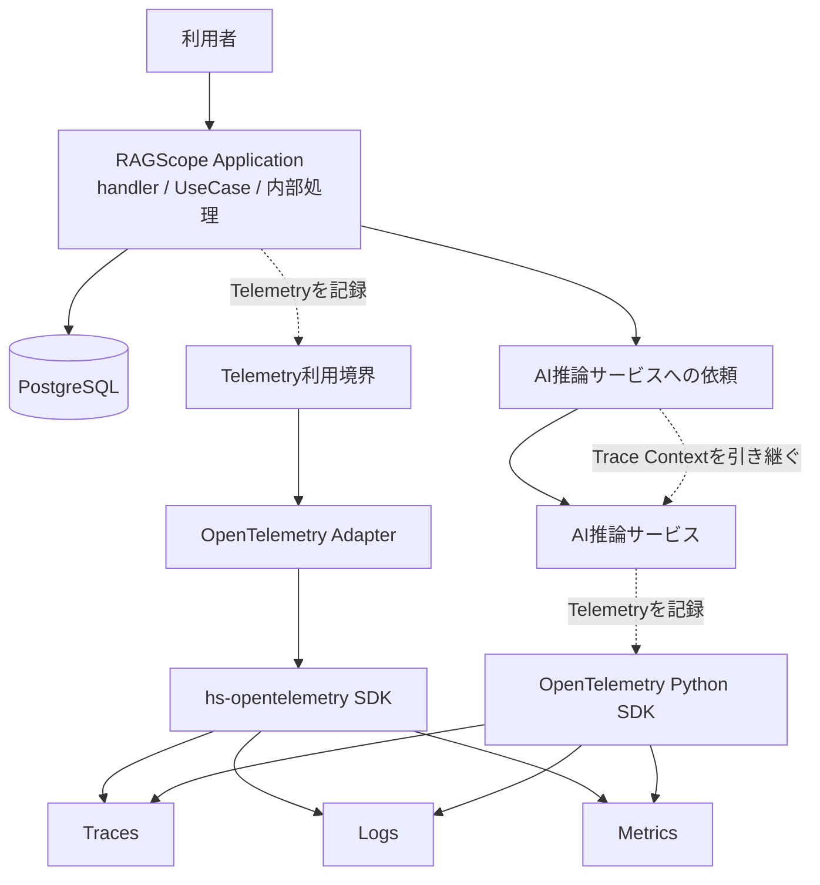
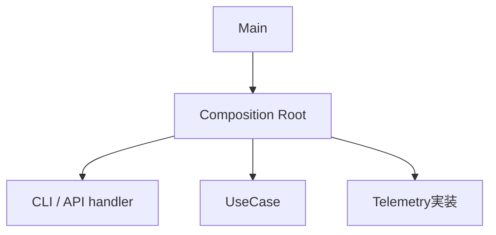

# RS-0023 Observability設計メモ

> [!note]
> これはRS-0023を正本へ反映する前にレビューするための**Workbench上の設計ドラフト**であり、RAGScopeの正本ではない。
> 現在の正本にあるUseCase境界とRAGScope Application / AI推論サービス / DBの責務を前提に、RS-0023で検討したObservability設計を扱う。
> このノートで「決定」とする内容はRS-0023の検討結果であり、現在仕様として有効になるのは正本リポジトリへ責務に応じて反映した後である。
> このノートで使うOpenTelemetry用語とRAGScope / RS-0023側の用語は[[RS-0023 Observability用語メモ]]を参照する。

## このノートが答える問い

> **RAGScopeではOpenTelemetryを何に使い、Trace / Logs / Metricsをどう分担させるか？**

このノートは、Observability全体の共通方針と、OpenTelemetryをRAGScopeへどう組み込むかをレビューする。
Trace / Logs / Metrics固有の判断は、それぞれの設計メモで扱う。

| ノート | 答える問い |
|---|---|
| [[RS-0023 Observability用語メモ]] | OpenTelemetry用語とRAGScope / RS-0023側の用語をどう区別し、それぞれ何を意味するか |
| このノート | OpenTelemetryを何に使い、Trace / Logs / Metricsをどう分担させるか |
| [[RS-0023 Trace設計メモ]] | RAGScopeの1回の実行をTrace上でどう追うか |
| [[RS-0023 Logs設計メモ]] | 何をLogに残し、何をSpanに任せるか |
| [[RS-0023 Metrics設計メモ]] | 個別実行の性能値と、複数実行を集約するMetricsをどう使い分けるか |

## 要するに

RAGScopeはOpenTelemetryをObservabilityの共通基盤として使う。

- **Trace**は、1回の実行でどの処理がどの順序で行われ、どこに時間がかかり、どこで失敗したかを追う。
- **Logs**は、Spanだけでは分からない出来事や状態変化を残す。
- **Metrics**は、複数回の実行をまとめて観測する。

retry、timeout、fallback、処理順序などを決めるのはRAGScope Applicationである。Telemetryは処理を制御せず、**実際に何が起きたかを記録する**。

また、HTTP、Database、CLI、GenAIなど、観測する処理に適用できるOpenTelemetry Semantic Conventionsがある場合は、RAGScope独自の同義表現を作らず、そのConventionを優先する。

Trace / Logs / Metricsと失敗時の扱いはRS-0023で決定済みとして扱う。OpenTelemetry採用に必要な主要SDK能力も確認済みだが、RAGScope固有のGHC / Cabal / Python環境での依存解決とビルドはまだ実測していない。

## 全体像

RAGScopeの1回の実行でApplicationがDBやAI推論サービスを利用し、ApplicationとAI推論サービスがそれぞれOpenTelemetryを通じてTelemetryを記録する。



Composition Rootは実行に必要な部品を構築・接続する**構築時**の責務であり、RAGScopeの1回の実行フローではないため、この図には含めない。

この図では、Application内部のhandler / UseCase境界やSpanの包含関係までは表さない。Trace上の具体的な構造は[[RS-0023 Trace設計メモ]]で扱う。

自動計装 / 手動計装、Telemetry利用境界が公開する具体API、AI推論サービス側でOpenTelemetry Python SDKを利用するmoduleもここでは決めない。Collector / Tempo / Lokiなどの本番環境向けの外部構成も、このノートでは採用を決めない。

## Trace / Logs / Metricsをどう使い分けるか

### Trace

Traceは、RAGScopeの1回の実行に含まれる処理のつながりを追うために使う。
RS-0023では**1回の実行ごとに独立したTraceを開始する**。RAGScope ApplicationからAI推論サービスを呼び出すときはTrace Contextを引き継ぎ、同じTraceを継続する。

APIへ外部Trace Contextが届いた場合の扱い、entry Span、UseCase Span、Span Statusなどの詳細は[[RS-0023 Trace設計メモ]]で扱う。

### Logs

Logsは、Spanの開始・終了・attributes・Statusだけでは後から識別できない出来事や状態変化を記録するために使う。
Spanですでに分かる事実を、Eventへ機械的に重複させない。

EventはOpenTelemetry `EventRecord`として記録する。詳細は[[RS-0023 Logs設計メモ]]で扱う。

### Metrics

Metricsは、複数実行を集約して観測するために使う。
評価データ1件ごとの性能値は実験結果へ保存し、OpenTelemetry Metricを個別実行値の保存先にはしない。

DB / HTTP / GenAIなど、観測する処理に適用できる標準Metricがある場合は利用する。詳細は[[RS-0023 Metrics設計メモ]]で扱う。

## TelemetryとApplication制御を分ける

Telemetryが決めるのは「何を観測して記録するか」である。
retry、timeout、fallback、処理順序など、Applicationの振る舞いそのものはTelemetryへ移さない。

たとえばretryするかどうかは、そのUseCaseまたは内部処理の設計が決める。Telemetryは、その結果として何回の処理が実際に行われ、最終的に成功したか失敗したかを、適用するSpan / Event / Metricの規則に従って記録する。

同じように、Exporter / Processor / Collectorへの送信に失敗しても、RAGScope Application本体の処理結果は変更しない。UseCaseが成功しているなら、Telemetry送信の失敗だけを理由にUseCase失敗へ変えない。

## 失敗理由をAPI・保存データ・Telemetryへどう渡すか

契約上想定される失敗は、そのUseCaseまたは内部処理に対応するエラー型で表す。
API / CLI、実験・評価結果、Telemetryは用途が違うため、同じ分類名・同じ粒度へ無理にそろえず、それぞれ必要な表現へ変換する。

```text
UseCaseまたは内部処理のエラー型で表した失敗
        ├─→ API / CLI向けに変換
        │      └─ API応答 / CLI stderr・終了状態
        ├─→ 実験・評価結果へ保存する形に変換
        │      └─ 実験・評価データモデル上のerror
        └─→ Telemetryへ記録する形に変換
               └─ 適用するSemConv / RAGScope固有Span・Eventのerror.type
```

### RAGScope全体で共通のエラー分類は設けない

RAGScopeでは、UseCaseや内部処理ごとのエラー型を、いったん`RAGScopeError`のような共通分類へ変換してからAPI / CLI、実験・評価結果、Telemetryへ渡す構造にはしない。
`RAGScopeError`は、ここで作らない構造を説明するための例であり、採用する型名ではない。

例えば、仮に`SearchError`と`GenerateAnswerError`というエラー型があるとしても、次のような中間分類は置かない。

```text
SearchErrorで表した失敗 ───────────┐
GenerateAnswerErrorで表した失敗 ───┤
                                     └─→ RAGScopeErrorのような共通分類
                                             ├─→ API / CLI
                                             ├─→ 実験・評価結果
                                             └─→ Telemetry
```

代わりに、各エラー型で表した失敗を、それぞれの用途に必要な表現へ直接変換する。

```text
各UseCase / 内部処理のエラー型で表した失敗
        ├─→ API / CLI向けの表現
        ├─→ 実験・評価結果へ保存する表現
        └─→ Telemetry向けの表現
```

現在の要求はこの構造で成立する。
共通分類を間に置くと、各エラー型から共通分類への変換と、共通分類から各出力先への変換を別々に維持する必要がある。さらに、UseCaseや内部処理ごとの失敗を共通分類の粒度へ合わせる必要が生じ、固有の失敗定義を不要に1つの分類体系へ結合することになる。

Application / AI推論サービス間で共有する失敗コードが通信契約として実際に必要になった場合は、その通信方式を定義するContractで扱う。その失敗コードをRAGScope全体の共通エラー分類として先に定義しない。

OpenTelemetryの`error.type`もRAGScope全体の共通エラー分類ではない。Telemetry上で「そのoperationやEventがどの種類のerrorを表すか」を記録する属性である。
HTTP、Database、GenAIなど、適用するSemantic Conventionが`error.type`を定めている場合はその規則に従う。RAGScope固有SpanとEventでの変換は、それぞれ[[RS-0023 Trace設計メモ]]と[[RS-0023 Logs設計メモ]]で扱う。

複数のUseCaseや内部処理をまたいで、共通のエラー分類がないと必要な集計やContractを成立させられない具体的な要求が追加された場合に、共通分類の必要性を再評価する。

## OpenTelemetry SDKとの依存境界

RAGScope Applicationでは、UseCaseや内部処理を実装するmoduleからOpenTelemetry SDKを直接importしない。
UseCaseや内部処理はRAGScopeが定義するTelemetry利用境界を呼び、その外側のOpenTelemetry AdapterがOpenTelemetry SDKへ接続する。
AI推論サービスではOpenTelemetry Python API / SDKを使うが、SDKを利用する具体的なmodule境界はPython実装時に決める。

この境界で守ることは次のとおりである。

- UseCaseや内部処理を実装するmoduleからOpenTelemetry SDKを直接importしない。
- OpenTelemetry SDK固有の型を、UseCaseや内部処理が公開・受け渡しする型へ含めない。
- Trace Contextの引き継ぎにはPropagator / instrumentationなどOpenTelemetryの機構を使う。
- Processor / Exporter、batching、flush / shutdown、送信にはSDKの機構を使い、同等の基盤処理をRAGScopeで別実装しない。

OpenTelemetry SDK相当をRAGScopeで独自実装すると、Context管理、batching、Processor / Exporter、flush / shutdown、送信失敗時の処理までRAGScope側の保守対象になる。これらはRAGScope固有の責務ではないためSDKへ委ねる。

Haskell SDKは`hs-opentelemetry` 1.xを第一候補とする。AI推論サービスではOpenTelemetry Python API / SDKを使う。Python LogsはDevelopmentであるため、利用するバージョンとSDK固有APIは実装境界内へ閉じる。

## Semantic Conventionsをどう扱うか

Span名、Span Kind、attributes、Event、Metric名、instrument、unitなどをRAGScope独自に定義する前に、観測する処理へ適用できるOpenTelemetry Semantic Conventionsがあるか確認する。

適用できるConventionがある場合は、その定義を優先する。HTTP、Database、CLI、Exceptionなどについて、同じ意味を持つRAGScope独自表現を重ねない。

RAGScope独自のTelemetry表現は、UseCase、RAGScopeの1回の実行、実験、評価データなど、既存Conventionだけでは表現できないRAGScope固有の意味に限定する。独自attributeが必要な場合も、まず既存attributeを再利用できないか確認し、OpenTelemetryが使用するnamespaceと衝突する名前は作らない。

Semantic Conventionごとにstabilityが異なるため、実装時には採用するOpenTelemetry / instrumentationバージョンと対象Conventionのstabilityを確認する。

2026-09-06時点で、このドラフトが直接参照する主な規約は次のとおりである。

| 対象 | stability | このドラフトでの扱い |
|---|---|---|
| `error.type`属性 | Stable | operationがどの種類のerrorで失敗したかを表す標準属性として使う |
| HTTP client / server Span | Stable | API / HTTP通信へ適用する |
| SQL / PostgreSQL database client Span | Stable | PostgreSQL operationへ適用する |
| `http.client.request.duration` | Stable | HTTP requestの所要時間を集約観測する |
| `db.client.operation.duration` | Stable | DB operationの所要時間を集約観測する |
| CLI Execution Span | Development | CLI entry Spanへ適用する。現在の細部をRAGScope独自の恒久契約へコピーしない |
| Recording errors | Development | RAGScope固有operationのStatus / `error.type`を決める指針として使う |
| Semantic conventions for events | Development | RAGScope固有Eventを設計する指針として使う |
| Semantic conventions for exceptions in logs | Stable（個別節にDevelopmentあり） | Exception Eventの基本表現へ利用する |
| GenAI Semantic Conventions | Development | 適用できるSpan / Event / Metricへ利用し、現在の名称やattributesをRAGScope独自契約へ固定しない |

## 構築時と1回の実行時を分ける

Observabilityを組み込む位置は、プロセス起動時の構築とRAGScopeの1回の実行時で分けて考える。
Composition RootはTelemetry実装を他の依存と一緒に構築・接続し、1回の実行時は構築済みのhandler / UseCase / Telemetry実装を使って処理する。

### 構築時

Composition Rootは、実行に必要なUseCase、handler、Telemetry実装などの依存を構築・接続する。
APIサーバーのような長時間動作するプロセスでは、ここで一度構築したhandler、UseCase、Telemetry実装を複数回の実行から利用できる。



実装上のmodule / function名として`Bootstrap`を使うかは、package / module設計時に決める。

### 1回の実行時

1回の実行では、構築済みのhandler / UseCase / Telemetry実装を使う。
Traceは1回の実行ごとに独立したTraceを開始し、handler / UseCase / 内部処理をどのSpanで観測するかは[[RS-0023 Trace設計メモ]]に従う。

ApplicationからAI推論サービスを呼び出す場合はTrace Contextを引き継ぎ、AI推論サービス側の処理も同じTraceへ参加させる。

プロセス起動時の依存構築やProcessor / ExporterによるTelemetry送信は、1回の実行内のUseCase処理そのものではない。

## SDKで必要な能力を利用できるか

RS-0023で必要なのは、RAGScope ApplicationとAI推論サービスの両方でTrace / Logsを記録でき、ApplicationからAI推論サービスへTrace Contextを引き継げること、さらにProcessor / Exporter経由の送信失敗をApplication本体の処理結果から分離できることである。

2026-09-06時点では、次の能力を確認している。

| 対象 | 確認した能力 | stability / 互換性 |
|---|---|---|
| `hs-opentelemetry` 1.x | Traces / Metrics / Logs、W3C Trace Context Propagator、Log / Span Processor、OTLP exporter、handle / in-memory exporter | SDK 1.0.0.0。upstreamはGHC 9.12を対象に含めるが、`proto-lens`は`allow-newer`利用の注記あり |
| OpenTelemetry Python | Traces / Metrics / Logs、Context propagation、`LoggerProvider`、`BatchLogRecordProcessor`、OTLP exporter、console exporter | Traces / MetricsはStable、LogsはDevelopment。Python 3.10以上をサポート |

現時点では、RAGScopeが必要とするTrace / Logs / Context連携を成立させられない具体的なSDK制約は確認できていない。

ただし、次の2点はRAGScope固有環境でまだ実測していない。

- RAGScope ApplicationのGHC 9.12.4 / `base ^>=4.21.2.0`と`hs-opentelemetry` 1.x / OTLP exporterを組み合わせたCabal依存解決とビルド。upstreamにはGHC 9.12対応で`proto-lens`の`allow-newer`注記があるため、実装着手前に最小構成で確認する。
- AI推論サービスのPythonプロジェクトとPythonバージョンは正本上まだ実装されていない。実装時にOpenTelemetry Python SDKのバージョンを固定し、利用APIとOTLP Logs exportを最小構成で確認する。

これは**RAGScope環境でビルド確認済みという意味ではない**。解消できない依存衝突や必要動作の不足が実測された場合は、SDK採用判断を見直す。

このHaskell / Python固有の採用可能性調査はWorkbenchでは検討材料として保持する。正本へ反映するときは、複数コンポーネント共通のObservability設計へGHC / Cabal / Python packageなどの実装固有情報をそのまま移さず、各コンポーネントの設計、Ticket、コード、設定、テストへ責務に応じて分離する。

## ローカル実行でTelemetryをどう確認するか

RAGScope本体のObservability設計と本番環境の保存・集約先の選定を分離するため、ローカル確認では永続的な保存・集約先を必須にしない。

| 確認したいこと | 方法 |
|---|---|
| 単一コンポーネントのSpan / Log / Metricが生成されること | Haskellはhandle exporter、Pythonはconsole exporterでローカル出力を確認する |
| Application → AI推論サービスのTrace Context伝播 | 両コンポーネントを同じOTLP endpointへ送り、必要ならローカルOpenTelemetry Collectorのdebug exporterでTraceId / 親子関係を確認する |
| Processor / Exporter失敗時にApplication結果が変わらないこと | テスト用または失敗するExporter / Processor境界で自動テストする |

console / handle exporterの出力形式はデバッグ用であり、RAGScopeの外部Contractとして扱わない。OpenTelemetry標準でもstdout exporterの具体出力形式は標準化されていない。

ローカルCollectorは複数コンポーネントのTelemetryを同じ受信先で確認するための開発用手段であり、RAGScope ApplicationやAI推論サービスの機能責務には含めない。Tempo / Lokiなどの保存・集約先、本番環境のCollector構成、保持期間は別の外部構成設計で決める。

## Telemetry基盤自身が失敗した場合

Exporter、Processor、Collectorへの送信などTelemetry基盤自身の失敗は、Application本体の結果を変更しない。
UseCaseが成功している場合、Telemetry送信に失敗してもUseCase成功のままとする。

まず採用するOpenTelemetry SDKのエラー処理と内部診断機能を利用する。SDKの診断機能では満たせない具体的な診断要求が確認された場合だけ、RAGScope側の補助経路を検討する。

Telemetryの欠落をApplication処理失敗として扱う要求が追加された場合は、この判断を見直す。

## 正本へ反映するときの責務分離

Workbenchには今回の検討結果、確認した根拠、実装前に再確認する事項を残す。正本へ反映するときは、このNoteをそのまま正本化せず、情報の責務に応じて分ける。

| 情報 | 正本反映時の配置 |
|---|---|
| 現在採用するTrace / Logs / Metricsの責務・境界・契約と、理解に必要な最小限の理由 | `design/`の関係する設計書 |
| 複数案比較と変更影響を伴う重要判断 | ADR |
| 正本の更新、実装、Contract更新などの作業範囲と完了条件 | RS-0023と後続Ticket |
| GHC / Cabal / `hs-opentelemetry`、Python SDKバージョンなどコンポーネント固有の採用可能性・実装詳細 | 各コンポーネントの設計、Ticket、コード、設定、テスト |
| 実際に行ったSDK / exporter等の検証結果 | 必要ならExperiment |

## このドラフトでは決めないこと

以下はObservability全体の共通方針から分けて具体化する。

| 論点 | 具体化する設計 |
|---|---|
| Trace / Logs / Metricsの利用境界を1つにまとめるか分けるか | Telemetry利用境界設計 |
| Telemetry利用境界の名前と公開API | Telemetry利用境界設計 |
| SDK初期化設定エラー時に起動失敗するかTelemetryなしで起動するか | Telemetry初期化設計 |
| package / module構成 | Telemetry利用境界の決定後に行うpackage / module設計 |
| 本番環境のCollector / Tempo / Loki等の外部構成 | 外部構成設計。現時点では候補であり採用を決めない |
| エラー型の値をSpan / Eventの`error.type`などへ変換する場所 | Telemetry利用境界とpackage / moduleを設計する時 |

Haskellでエラー型の値をTelemetry向けの値へ変換する位置を決めるときは、実際のimportとCabalの`build-depends`を確認する。少なくとも次を守る。

- UseCaseまたは内部処理を実装するmoduleからOpenTelemetry SDKを直接importしない。
- 各module / packageの責務に従った静的依存方向とし、Cabalの`build-depends`を循環させない。
- OpenTelemetry AdapterがTelemetry利用境界の公開APIやApplication側のエラー型へ静的に依存する構造にするかは、この共通設計で先に固定しない。

package / module構成はTelemetry利用境界を決めた後に定め、先にpackageを分割してから責務を割り当てない。

## 参考

- [[RS-0023 Observability用語メモ]]
- [OpenTelemetry — Error handling](https://opentelemetry.io/docs/specs/otel/error-handling/)
- [OpenTelemetry — `error.type`](https://opentelemetry.io/docs/specs/semconv/registry/attributes/error/)
- [OpenTelemetry — Recording errors](https://opentelemetry.io/docs/specs/semconv/general/recording-errors/)
- [OpenTelemetry — Semantic conventions for events](https://opentelemetry.io/docs/specs/semconv/general/events/)
- [OpenTelemetry — Semantic conventions for exceptions in logs](https://opentelemetry.io/docs/specs/semconv/exceptions/exceptions-logs/)
- [OpenTelemetry — Python](https://opentelemetry.io/docs/languages/python/)
- [OpenTelemetry — Python instrumentation](https://opentelemetry.io/docs/languages/python/instrumentation/)
- [OpenTelemetry — stdout LogRecord exporter](https://opentelemetry.io/docs/specs/otel/logs/sdk_exporters/stdout/)
- [hs-opentelemetry](https://github.com/iand675/hs-opentelemetry)