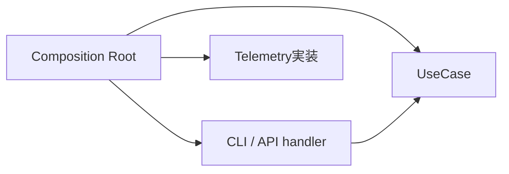
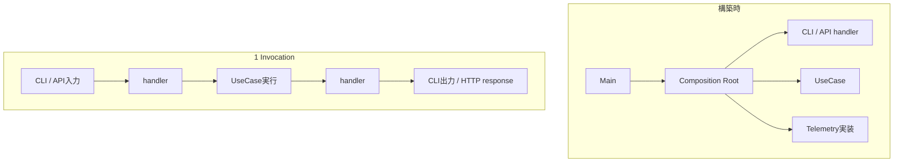
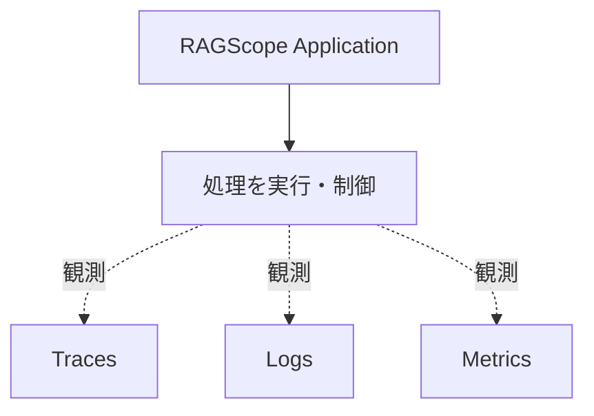
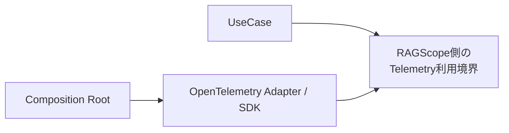
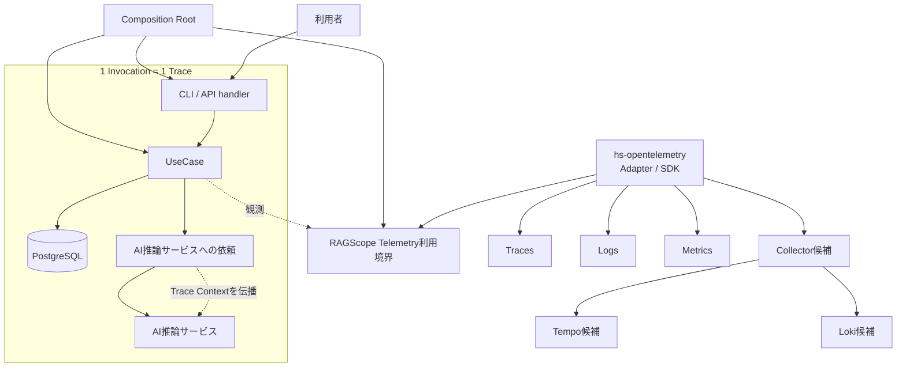

# RS-0023 Observability設計メモ

> [!note]
> これはRS-0023を考えるための**Workbench上の検討メモ**であり、RAGScopeの正本ではない。
> 現在の正本にあるUseCase境界とRAGScope Application / AI推論サービス / DBの責務を前提に、RS-0023で新しく決めるObservability設計だけを扱う。

## このメモの役割

このメモはRS-0023 Observability設計の**全体像とsignal横断の共通方針**を扱う。
Trace / Logs / Metricsの詳細は次のノートへ分ける。

| signal | このメモから切り出す詳細 |
|---|---|
| Trace | [[RS-0023 Trace設計メモ]] — Invocation / Trace / Span境界、Span Status、failure / Exception / interruptionのTrace側 |
| Logs | [[RS-0023 Logs設計メモ]] — Event / LogRecord、severity、Exception Log、Logs固有の表現規則 |
| Metrics | [[RS-0023 Metrics設計メモ]] — RAGScopeで必要なMetricと既存Semantic Conventionsとの関係 |

ここでは、各signalへ共通するApplicationとの境界、OpenTelemetryの採用方針、実行時構成、全体構成だけを保持する。

## ✅ 今回決めたこと

### Composition Rootで依存を組み立てる

Composition Rootが、UseCaseや利用インターフェースに必要な依存をまとめて組み立てる。
OpenTelemetry SDKの初期化やExporterなどの実行時構成も、UseCaseの中ではなくこの外側で扱う。

Composition Rootは1回の利用者処理を構成する実行ステップではなく、実行に必要な部品を構築・接続する責務である。
APIサーバーのような長時間動作するプロセスでは、Composition Rootで一度構築したhandlerやUseCaseを複数のInvocationから利用できる。

実装上のmodule/function名として`Bootstrap`を使うかは、package / module設計時に決める。

### handlerはインターフェース固有の仕事をする

CLI / APIのhandlerは、入力をUseCaseへ渡せる形へ変換し、UseCaseを呼び、戻ってきた結果を表示やHTTPレスポンスへ変換する。
UseCase内部の依存構造までは知らず、Composition Rootから依存を閉じたUseCase実行能力を受け取る。

handlerはUseCaseの外側にあり、UseCase呼び出し前の入力受付・変換と、UseCase終了後の出力変換を担当する。
CLI parserやHTTP routingのどこまでをhandlerに含めるかという実装上の詳細境界は、必要になった時点で決める。

### Composition Root・handler・Invocation・UseCaseは同じ階層ではない

4つを`Composition Root -> handler -> Invocation -> UseCase`という処理順として扱わない。

| 概念 | 境界 |
|---|---|
| Composition Root | 実行に必要な依存を構築・接続する |
| handler | CLI / API固有表現とUseCaseの入力・結果の間を仲介する |
| Invocation | RAGScopeが外部から1回呼び出され、その処理が完了するまでの実行範囲 |
| UseCase | RAGScope ApplicationがUseCaseを呼び出してから、Applicationへ制御が戻るまで |

構築時と実行時は次のように分けて考える。

UseCaseから呼び出されるEmbedding生成、DB検索などは、そのUseCaseを構成する内部処理である。
AI推論サービス側の処理は同じTraceへ参加できるが、RAGScope Application側のUseCaseそのものではない。

すべてのRAGScope内部処理がhandlerやUseCaseを通るわけではない。
たとえばプロセス起動時のComposition Rootによる構築や、OpenTelemetry SDK / ExporterによるTelemetry送信はInvocationやUseCaseとは別の処理である。

### Telemetryは処理を制御しない

処理を続けるか、retryするか、timeoutで打ち切るかはRAGScope Applicationが決める。
Telemetryは、その処理を観測する。

Telemetryの都合でUseCaseの意味や処理順序を変えない。

### UseCaseへOpenTelemetry SDKを直接漏らさない

UseCaseがOpenTelemetry SDKそのものを直接扱う構造にはしない。
UseCaseから見えるのは、RAGScope側のTelemetry利用境界までとする。

Trace / Logs / Metricsの利用境界を1つにまとめるか分けるか、名前をどうするかは後で決める。

### Haskell側OpenTelemetry SDKは`hs-opentelemetry`を採用する

RAGScopeアプリケーションのOpenTelemetry SDKとして`hs-opentelemetry` 1.xを採用する。
`hs-opentelemetry`固有の型やAPIはOpenTelemetry Adapterの内側に閉じ込め、UseCaseやfeature固有のfailure型へ直接依存させない。

採用理由は次のとおり。

- RAGScopeが必要とするTrace、Logs、Context / Propagator、Processor、OTLP Exporterの主要能力が揃っている。
- HaskellでTrace + Logs + Context + Processor + OTLPまで一式を提供する実用的な候補として最も適合しており、同等の別SDKを探し続ける具体的な理由がない。
- OpenTelemetry SDK相当をRAGScopeで自作すると、Context管理、batching、Processor / Exporter、flush / shutdown、export失敗処理などRAGScope固有ではない責務まで保守することになる。
- SDK固有型をAdapter内へ閉じ込められるため、SDK採用がUseCase設計を固定する理由にはならない。

採用前の大規模PoCを必須条件にはしない。実装時にRAGScopeのGHC / dependency構成との互換性や、必要なAdapter動作を確認する。

この判断を見直すのは、`hs-opentelemetry` 1.xではRAGScopeの必須能力を薄いAdapterでも成立させられない、RAGScopeの採用GHC / dependency構成で実用上解消できない問題がある、またはSDKのruntime挙動がApplicationの正しさを損なう具体的事実が確認された場合とする。

### OpenTelemetryが持つ共通Telemetry機構は作り直さない

Context伝播、Processor / Exporter、batching、flush / shutdown、Telemetry送信など、OpenTelemetryが共通機構として提供するものをRAGScope固有基盤として並行実装しない。
RAGScopeが追加で所有するのは、既存のOpenTelemetry表現だけでは定義できないRAGScope固有の意味と、それをApplicationから利用するための境界である。

Logs固有の旧RS-0022基盤について、何を再導入しないかは[[RS-0023 Logs設計メモ]]へ集約する。

### OpenTelemetry Semantic Conventionsを優先する

Telemetry表現をRAGScope独自に定義する前に、対象へ適用可能なOpenTelemetry Semantic Conventionsが存在するか確認する。

適用可能なSemantic Conventionが存在する場合は、Span名、Span Kind、属性、Event、Metric名・instrument・unitなど、そのConventionで定義されている表現を優先して使用する。
HTTP、Database、CLI、Exceptionなどについて、既存Conventionと同じ意味を持つRAGScope独自表現を重複して作らない。

RAGScope独自のTelemetry表現は、UseCase、Invocation、実験、評価データなど、既存のSemantic Conventionsだけでは表現できないRAGScope固有の意味に限定する。
独自属性が必要な場合も、まず既存属性を再利用できないか確認し、OpenTelemetryが使用するnamespaceと衝突する属性は作らない。

Semantic Conventionごとにstabilityが異なるため、実装時には使用するOpenTelemetry / instrumentationのバージョンと対象Conventionのstabilityを確認する。

### Telemetry基盤自身の失敗はApplication結果を変えない

Exporter、Processor、Collectorへの送信などTelemetry基盤自身の失敗は、Application本体の結果を変更しない。
UseCaseが成功している場合、Telemetry exportに失敗してもUseCase成功のままとする。

Telemetry基盤の診断は、まず`hs-opentelemetry` SDK自身のerror handling / internal diagnosticsを使用する。
旧RS-0022のような別の診断・転送経路を先に再構築せず、SDKで具体的に不足する診断要求が判明した場合だけRAGScope側の補助経路を追加検討する。

**見直し条件**: Telemetryの欠落をApplication処理失敗として扱わなければならない明示的なRAGScope要求が追加された場合に限り再検討する。なお、SDK初期化時の設定不備で起動を失敗させるか、Telemetryなしで起動するかは別論点であり未決定とする。

## 今の一枚絵

Collector / Tempo / Lokiはまだ候補である。
Trace / Logs / Metricsのsignal固有設計はそれぞれの詳細ノートで扱い、この図はsignal間とApplication / OpenTelemetry基盤の関係だけを示す。

## 🤔 次に決めること

TraceとLogsの共通設計は、それぞれのノートへ分離した。
次は[[RS-0023 Metrics設計メモ]]でMetricsを具体化する。

Metricsまで決めた後に、実際に必要な観測能力を基準として次を決める。

1. RAGScope側のTelemetry利用境界
2. package / module構成
3. Collector / Tempo / Lokiを含む外部構成

packageを先に切って、あとから責務を当てはめる順番にはしない。

## 参考にした外部仕様・実装

- [OpenTelemetry — Error handling](https://opentelemetry.io/docs/specs/otel/error-handling/)
- [hs-opentelemetry](https://github.com/iand675/hs-opentelemetry)
