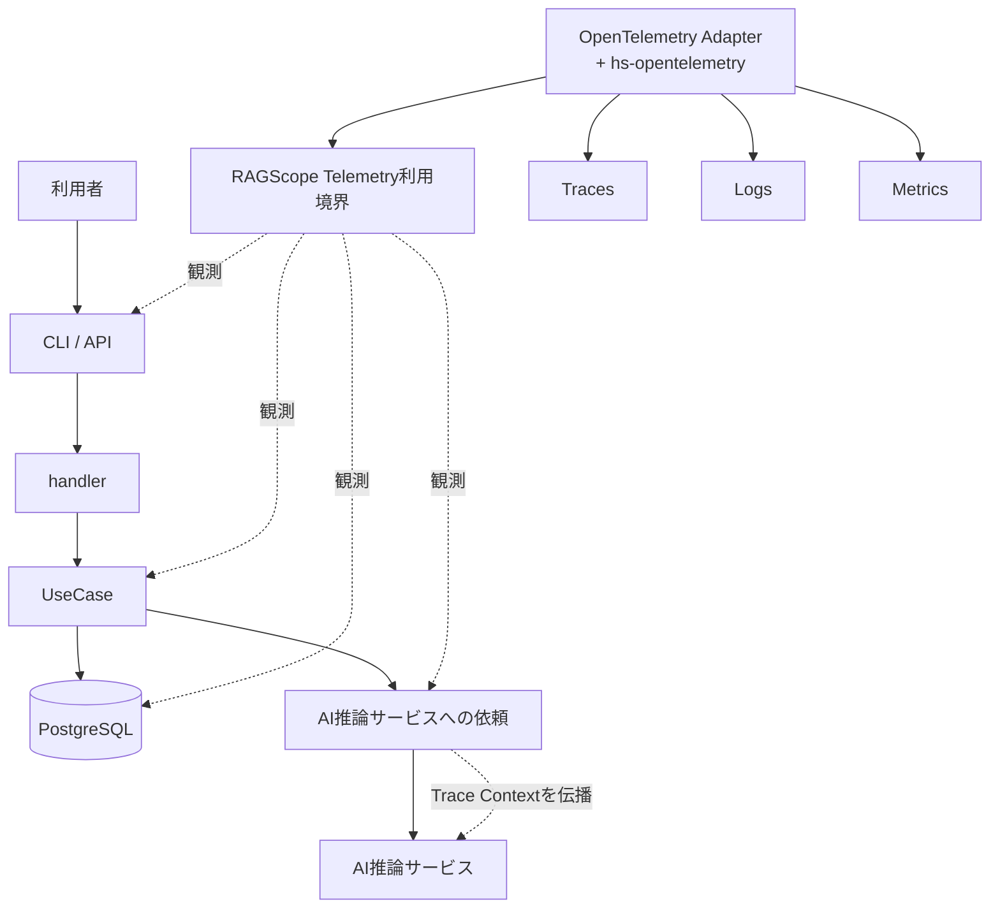
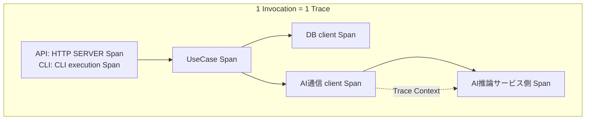
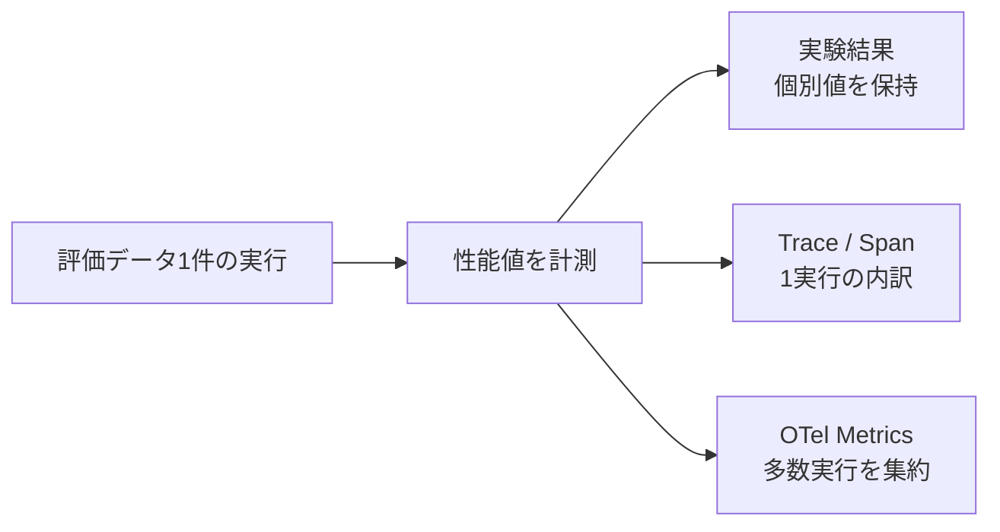

# RS-0023 Observability設計メモ

> [!note]
> これはRS-0023の設計を正本へ反映する前にレビューするための**Workbench上のドラフト**であり、RAGScopeの正本ではない。
> 上から順に読むことで、RAGScopeのObservability全体像、主要な意思決定、Trace / Logs / Metricsで実際にどう観測されるかを把握できることを目的とする。

## まず結論

RAGScopeのObservabilityはOpenTelemetryを土台にし、次の3つを役割分担させる。

| signal | RAGScopeでの役割 |
|---|---|
| Trace | 1回の実行で、どの処理がどの順序・親子関係で動き、どこで時間を使い、どこで失敗したかを追う |
| Logs | Spanだけでは表しにくい、後から独立して確認する意味がある「時点の出来事」を残す |
| Metrics | 多数の実行を集約して傾向を見る。評価データごとの性能値の保存先にはしない |

共通方針は次の通り。

- TelemetryはApplicationの処理を**観測する**。retry / timeout / fallback / 処理順序を決めない。
- UseCaseへOpenTelemetry SDKを直接漏らさない。RAGScope側のTelemetry利用境界を置き、SDK固有型はAdapterの内側へ閉じ込める。
- Haskell SDKには`hs-opentelemetry` 1.xを採用する。
- HTTP、Database、GenAI、Exceptionなど、適用可能なOpenTelemetry Semantic ConventionsをRAGScope独自表現より優先する。
- Exporter / Processor / Collector送信などTelemetry基盤の失敗で、Application本体の成功・失敗を変えない。
- Context伝播、Processor / Exporter、batching、flush / shutdown、送信などOpenTelemetry SDKが担う仕組みをRAGScopeで並行実装しない。

## 全体像



Composition Rootは、handler、UseCase、Telemetry実装などの依存を構築・接続する。
handlerはCLI / API固有表現とUseCaseの入力・結果を仲介する。
UseCaseから呼ばれるEmbedding生成、DB検索などはUseCase内部の処理であり、AI推論サービス側の処理はRAGScope ApplicationのUseCaseではない。

## 1回の実行はどう見えるか

RAGScopeがCLI / APIから1回呼び出され、処理が完了するまでを**Invocation**と呼ぶ。
1 Invocationを1 Traceとして追跡する。

例として、UseCaseがDBとAI推論サービスを使う場合は次のように見える。



Invocation専用のSpanは追加せず、APIならHTTP SERVER Span、CLIならCLI execution SpanをTraceの入口として使う。
handlerには原則として独立Spanを作らない。
UseCaseは1実行につき1つのRAGScope固有Spanを持つ。
PostgreSQL、HTTP / RPC、Embedding / generationなどは、適用可能なSemantic Conventionsやinstrumentationを優先する。

UseCaseが呼ばれる前にhandlerで終了した場合もInvocationは発生するためTraceは残るが、UseCase Spanは発生しない。

## Trace: 成功・失敗をどう追うか

Span Statusは、子処理で途中失敗したかではなく、**そのoperation自身の最終結果**で決める。

| ケース | Span側の扱い |
|---|---|
| 最終成功 | `Unset` |
| typed failureで最終失敗 | `Error`。必要ならownerが安定した`error.type`を設定する |
| retry / fallbackで途中失敗したが最終成功 | 親operationは`Unset` |
| child Spanが失敗したがparentは成功 | parentへ`Error`を自動伝播しない |
| unexpectedな同期Exceptionがoperation境界からescape | `Error` + exception class相当の`error.type`。元のExceptionはrethrowする |
| async interruption / cancellation | 一律分類しない。実際の中断源とownerが確定した時点で決め、捕捉しても元のExceptionを飲み込まない |

全UseCase共通の`ErrorCategory`や`ErrorType`へfailureを押し込める設計は採用しない。
具体failureの意味と詳細値は、そのfailureを所有するfeature / UseCase / operationが保持する。

## Logs: RAGScopeはいつLogを出すか

基本ルールはシンプルにする。

```text
期間を持つ処理               → Span
operation全体を説明する値    → Span attributes
意味のある「時点」の出来事    → Log Event
```

そのため、処理開始・処理終了・成功・失敗を機械的にLogへ重複記録しない。
Trace / Spanですでに分かることは、原則としてLogにしない。

| 出来事 | Logs側の扱い |
|---|---|
| 処理開始 / 正常終了 | 原則Logを出さない。Spanで確認する |
| typed failure発生 | failureが発生したという理由だけではLogを出さない |
| retry / fallback後に最終成功 | 途中failureという理由だけではLogを出さない |
| retryを選択した、fallbackへ切り替えた等、Spanだけでは失われる意味のある状態変化 | 後から独立して確認する必要がある場合にEvent候補とする |
| unexpectedな同期Exceptionがescape | Exception Logを1件記録する |

RAGScope固有Eventが必要な場合は、`EventName`を持つOpenTelemetry `LogRecord`として表現する。
`EventName`は`ragscope.*` namespaceを使い、IDやattempt番号のような実行ごとに変わる値はEventNameへ埋め込まずattributesへ置く。

Traceとの関連付けはOpenTelemetry `LogRecord`自身のTrace Contextを使い、RAGScope独自の`trace_id` / `span_id`属性へ複製しない。
severityはOpenTelemetry `SeverityNumber`の意味体系を使う。

Exception Logでは`exception.type`、`exception.message`、取得できる場合は`exception.stacktrace`を記録する。
同じExceptionをUseCase / handler / rootなど伝播経路の各層で重複記録しない。下位instrumentationが同じExceptionをすでに記録している場合、RAGScope上位層で追加記録しない。

### 作り直さないもの

旧設計にあった次のLogging基盤は再構築しない。

- RAGScope独自LogRecord
- Logging Runtime
- 独自Sink
- Logging専用ContextへのTrace Context手動注入
- OTelと並行する独自ログ転送基盤
- 全Eventを列挙する共通`LogSpec`
- 共通`payload`

RAGScopeが所有するのは、必要なEventの意味、記録条件、EventName、attributes、severity、failureとの関係である。

## Metrics: 何をMetricとして扱うか

ここでは、**評価データごとの性能値**と**OpenTelemetry Metrics**を分ける。



`REQ-NF-PERF-001` / `REQ-NF-PERF-002`で要求される検索、reranking、回答生成、TTFT、生成token数などは、評価データごとの実行結果から取得できる必要がある。
OTel Metricsだけを出して、集約値から個別の実験結果を復元する設計にはしない。

| 性能値 | 実験結果 | Telemetry側 |
|---|---|---|
| 検索stage時間 | Applicationがstage全体を計測して保存 | Traceで内訳を追う。`ragscope.search.duration`は作らない |
| reranking stage時間 | Applicationから見たstage時間を保存 | 専用SemConv Metricを現在確認できていないため独自Metricは作らない |
| 回答生成stage時間 | Applicationから見たstage時間を保存 | 適用可能な境界でGenAI標準Metricを利用する |
| TTFT | 評価データごとの値として保存 | AI推論サービス側で適用可能な`gen_ai.server.time_to_first_token`を利用する |
| 生成token数 | AI推論サービスを正確な値のsourceとし、実験結果へ保存 | GenAI client instrumentationで適用可能なら`gen_ai.client.token.usage`を利用する |
| PostgreSQL operation時間 | 必要な内訳としてTraceで確認 | `db.client.operation.duration`を利用する |

検索stageは質問Embedding生成とPostgreSQL検索など複数処理を含むため、DB MetricやGenAI Metricのどれか1つを検索stage全体の時間と同一視しない。
回答生成でも、Applicationから見たstage時間、GenAI client operation時間、AI推論サービス側request時間は境界が異なるため同一視しない。

TTFTは「AI serverが最初のtokenを生成するまで」とし、clientがstreaming responseの最初のchunkを受信するまでの時間とは区別する。

現時点では、**RAGScope固有Metricを追加しない**。
実験ID、評価データID、文書ID、文書チャンクIDなど実行ごとに増えるhigh-cardinality値もMetric attributesへ入れない。

> [!warning]
> 2026-09-06確認時点で、OpenTelemetry core Semantic Conventionsは1.44.0、GenAI Semantic Conventionsは別リポジトリでDevelopmentとして管理されている。
> 現在の`gen_ai.*`名やattributesをRAGScope独自の恒久契約へコピーせず、実装時に採用versionとstabilityを再確認する。

## 主要な意思決定

レビューでは、特に次の判断に違和感がないか確認する。

| 論点 | 決定 |
|---|---|
| Trace単位 | 1 Invocation = 1 Trace |
| Trace入口 | APIはHTTP SERVER Span、CLIはCLI execution Span。Invocation専用Spanは作らない |
| UseCase | 1 UseCase実行 = 1 RAGScope固有Span |
| handler | 原則独立Spanを作らない |
| Span Status | operation自身の最終結果で決め、child failureを親へ自動伝播しない |
| Logs | Spanと重複する開始 / 終了 / 成功 / failure Logを機械的に作らない |
| Event | Spanでは失われる、独立して確認する意味がある時点だけ定義する |
| Exception | unexpected同期ExceptionはException Logを1件。重複記録しない |
| Logging基盤 | RAGScope独自Runtime / Sink / LogRecordを作らない |
| 性能値 | 評価データごとの値は実験結果へ保存する |
| Metrics | 集約観測に使い、適用可能な標準Metricを優先する |
| RAGScope固有Metric | 現時点では0個 |
| SDK境界 | UseCaseへOpenTelemetry SDKを直接漏らさない |
| Semantic Conventions | 適用可能なものをRAGScope独自表現より優先する |

## まだ決めていないこと

Trace / Logs / Metricsの**意味の設計**は一通り揃ったが、Haskellへ落とすための構造はこれから決める。

| 論点 | 状態 |
|---|---|
| Trace / Logs / Metricsの利用境界を1つにまとめるか分けるか | 次に検討する |
| Telemetry利用境界の名前・公開API・境界で渡す型 | 次に検討する |
| package / module構成と`build-depends`の依存方向 | Telemetry利用境界の後に決める |
| SDK初期化設定エラー時に起動失敗するかTelemetryなしで起動するか | 未決定 |
| RAGScope固有Span名 / attributes | 対象feature設計時 |
| feature固有EventName / attributes / severity / Body | 対象feature設計時 |
| retry attemptの追加Span / Event要否 | 対象retry設計時 |
| cancellation / interruptのStatus | 実際の中断源とowner確定時 |
| ExperimentとTrace / Telemetryの関係 | 実験実行境界が具体化した時 |
| TTFT / output token countをAI推論サービスから返す通信Contract | AI通信Contract設計時 |
| 回答生成stageの厳密な開始・終了点 | 対象feature設計時 |
| Runtime / host / accelerator Metrics | 外部構成と運用上の観測要求を決める時 |
| Collector / backend / aggregation / retention | 後続の外部構成設計で決める |

次は**Telemetry利用境界 → package / module → 外部構成**の順で設計する。
packageを先に切り、あとから責務を当てはめる進め方はしない。

## 正本へ反映するときに見直す点

- 現在のADR-0005にある共通`error_type`の扱いは、Spanの`error.type`とException Logの`exception.type`を使う今回の設計に合わせて見直す。
- 同じ失敗クラスを表す場合は値の意味を一致させるが、同じ属性名をTraceとLogsへ重複して置くことは要求しない。
- 旧設計にあるretry / timeout等のLogging基準は、Span / Eventの役割分担に合わせて再評価する。
- Workbench上のこのドラフトだけで現在の正本を変更したことにはしない。

## 参考

- [OpenTelemetry — Semantic Conventions](https://opentelemetry.io/docs/specs/semconv/)
- [OpenTelemetry — Recording errors](https://opentelemetry.io/docs/specs/semconv/general/recording-errors/)
- [OpenTelemetry — Logs Data Model](https://opentelemetry.io/docs/specs/otel/logs/data-model/)
- [OpenTelemetry — Exceptions in Logs](https://opentelemetry.io/docs/specs/semconv/exceptions/exceptions-logs/)
- [OpenTelemetry GenAI Semantic Conventions](https://github.com/open-telemetry/semantic-conventions-genai)
- [hs-opentelemetry](https://github.com/iand675/hs-opentelemetry)
