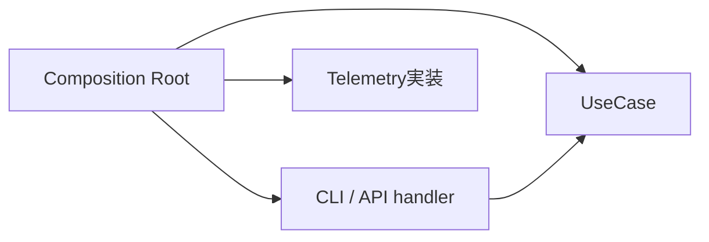
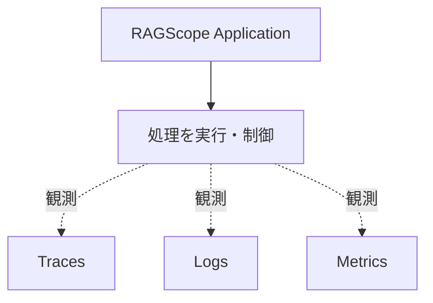
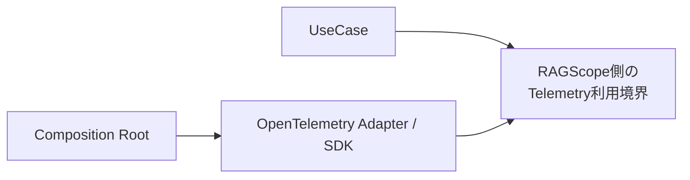
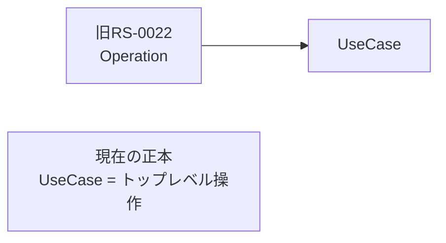
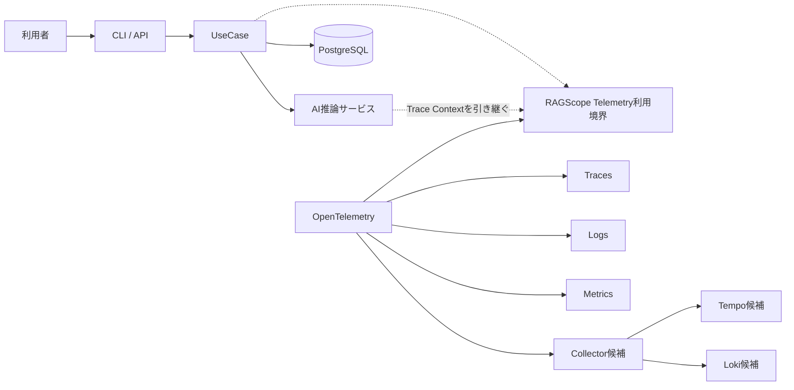
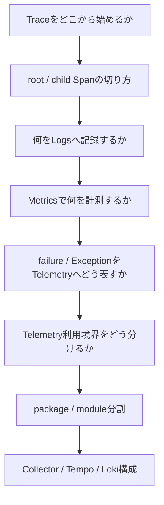

# RS-0023 Observability設計メモ

> [!note]
> これはRS-0023を考えるための**Workbench上の検討メモ**であり、RAGScopeの正本ではない。
> 現在の正本にあるUseCase境界とRAGScope Application / AI推論サービス / DBの責務を前提に、RS-0023で新しく決めるObservability設計だけを扱う。

## RS-0023で採用して進めること

ここからは旧RS-0022の考え方も見直したうえで、特に懸念なく使えるものを先に採用する。

### Composition Rootで依存を組み立てる

Composition Rootが、UseCaseや利用インターフェースに必要な依存をまとめて組み立てる。
OpenTelemetry SDKの初期化やExporterなどの実行時構成も、UseCaseの中ではなくこの外側で扱う。

### handlerはインターフェース固有の仕事をする

CLI / APIのhandlerは、入力を受け取り、UseCaseへ渡せる形へ変換し、UseCaseを呼び、戻ってきた結果を表示やHTTPレスポンスへ変換する。

UseCase内部の依存構造までは知らない。
Composition Rootから、依存を閉じたUseCase実行能力を受け取る方向で進める。

### Telemetryは処理を制御しない

処理を続けるか、retryするか、timeoutで打ち切るかはRAGScope Applicationの責務である。
Telemetryは、その処理を観測する。

Telemetryの都合でUseCaseの意味や処理順序を変えない。

### UseCaseへOpenTelemetry SDKを直接漏らさない

UseCaseがOpenTelemetry SDKそのものを直接扱う構造にはしない。
UseCaseから必要になるのは「spanを作る」「logを記録する」「metricを記録する」といったRAGScope側の利用境界までとする。

その利用境界をTrace / Logs / Metricsでどう分けるか、名前をどうするかはまだ決めない。

### OpenTelemetryが持っているTelemetry基盤は作り直さない

OpenTelemetry LogsにはLogRecordのData Modelがあり、SDKにはProcessor / Exporterなどの仕組みがある。
Trace Contextとの関連付けもOpenTelemetryの責務として扱える。

そのため、旧RS-0022にあった次の仕組みは**原則として復活させない**。

| 旧設計 | 今回の方針 |
|---|---|
| RAGScope独自LogRecord | 作らない |
| Logging Runtime | 作らない |
| 独自Sink | 作らない |
| Trace ContextをLoggingへ手動注入する仕組み | 作らない |
| OTelと並行して存在する独自ログ転送基盤 | 作らない |

RAGScope固有のevent名、属性、failureの意味までOpenTelemetryが決めてくれるわけではない。
**RAGScope固有の意味だけをRAGScope側で持ち、Telemetryの共通機構はOpenTelemetryへ任せる**という線で進める。

## 旧Operationはそのまま復活させない

ここだけは旧RS-0022をそのまま戻さない。

旧設計では、UseCaseの前後まで含む1回の利用者操作全体を`Operation`と呼んでいた。
一方、現在の正本では「利用者がRAGScopeへ依頼するトップレベルの操作」をUseCaseと定義している。

両方を置くと、どちらも「利用者のトップレベル操作」を表すことになって意味が二重になる。

そのため、旧`Operation`をApplicationの別概念として復活させるのではなく、現在のUseCaseを中心にTelemetry境界を考える。

CLI / APIの入力変換や結果変換をTraceへ含める必要があるかは、Trace境界を決めるときに考える。
これは`Operation`概念を復活させることとは分ける。

## Telemetryの今の一枚絵

ここまで採用すると、かなりシンプルになる。

Collector / Tempo / Lokiはまだ候補であり、RAGScope Application側の設計とは分けて考える。

## ここから先だけ話し合う

もう全部を白紙として話す必要はない。
残る主要論点はこのくらいでよさそうだ。

### 今の時点で特に残しておきたい論点

| 論点 | なぜ話す必要があるか |
|---|---|
| Trace開始位置 | UseCaseだけを1 Traceとするか、CLI / API側の前後処理まで同じTraceへ入れるかで構造が変わる |
| Span境界 | UseCase、AI推論サービス、DB、内部処理のどこまでを独立Spanとして扱うか決める必要がある |
| Logs | Spanで十分な情報と、時点として残すLogRecordを分けたい |
| Metrics | 段階別処理時間、TTFT、token数などをどうinstrumentするか決めたい |
| failure | Applicationの失敗とSpan Status / Logsを混同しないルールが必要 |
| Telemetry利用境界 | Trace / Logs / Metricsを1つのPortにするか分けるかは、実際の利用責務を見て決めたい |
| package分割 | APIが決まってから静的依存を見て決める |

この先は、この表にないものを毎回わざわざ再検討しない。
新しい制約や問題が見つかったときだけ戻る。
