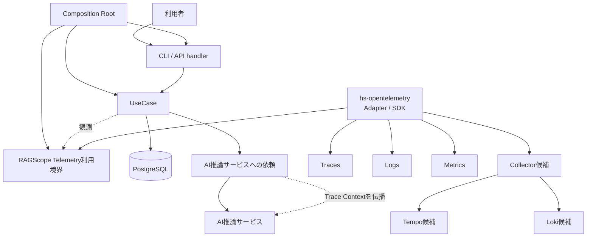
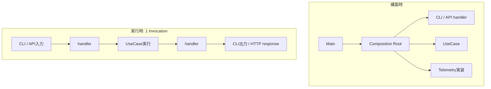

# RS-0023 Observability設計メモ

> [!note]
> これはRS-0023を考えるための**Workbench上の検討メモ**であり、RAGScopeの正本ではない。
> 現在の正本にあるUseCase境界とRAGScope Application / AI推論サービス / DBの責務を前提に、RS-0023で新しく決めるObservability設計だけを扱う。

## 30秒で見る

| 項目 | 状態 | 要点 |
|---|---|---|
| Trace | ✅ 共通設計決定 | 1 Invocation = 1 Trace。詳細は[[RS-0023 Trace設計メモ]] |
| Logs | ✅ 共通設計決定 | OTel Logs / Eventを土台にし、Spanと重複させない。詳細は[[RS-0023 Logs設計メモ]] |
| Metrics | ✅ 共通設計決定 | 性能値は実験結果へ保持し、集約観測には適用可能な標準Metricを使う。詳細は[[RS-0023 Metrics設計メモ]] |
| Telemetry利用境界 | 次に検討 | Trace / Logs / MetricsをHaskellからどう利用するかを決める |
| package / module | 後続 | Telemetry利用境界を見て決める |
| Collector / backend | 後続 | 実際に必要なsignalと利用方法を見て決める |

**Trace / Logs / Metricsの共通設計は一通り揃った。次は、その設計をHaskellへ落とすためのTelemetry利用境界を決める。**

このメモは**全体像とsignal横断の共通方針**だけを扱う。

## 全体像

> [!warning]
> Collector / Tempo / Lokiはまだ候補であり、採用決定ではない。

## ✅ signal横断で決めたこと

| 論点 | 決定 |
|---|---|
| Composition Root | UseCase、handler、Telemetry実装などの依存を構築・接続する |
| handler | CLI / API固有表現とUseCaseの入力・結果を仲介する |
| Telemetryの役割 | 処理を観測する。retry / timeout / 処理順序などApplicationの制御を決めない |
| SDK境界 | UseCaseへOpenTelemetry SDKを直接漏らさず、RAGScope側のTelemetry利用境界までを見せる |
| Haskell SDK | `hs-opentelemetry` 1.xを採用する |
| SDK固有型 | OpenTelemetry Adapterの内側に閉じ込める |
| 共通Telemetry機構 | Context伝播、Processor / Exporter、batching、flush / shutdown、送信などをRAGScopeで並行実装しない |
| Semantic Conventions | 適用可能なConventionをRAGScope独自表現より優先する |
| Telemetry runtime failure | Exporter / Processor / Collector送信失敗でApplication本体の結果を変更しない |

## 構築時と実行時

Composition Root・handler・Invocation・UseCaseは同じ階層の処理ステップではない。

| 概念 | 境界 |
|---|---|
| Composition Root | 実行に必要な依存を構築・接続する |
| handler | CLI / API固有表現とUseCaseの入力・結果の間を仲介する |
| Invocation | RAGScopeが外部から1回呼び出され、その処理が完了するまでの実行範囲 |
| UseCase | RAGScope ApplicationがUseCaseを呼び出してから、Applicationへ制御が戻るまで |

UseCaseから呼び出されるEmbedding生成、DB検索などはUseCaseを構成する内部処理である。
AI推論サービス側の処理は同じTraceへ参加できるが、RAGScope Application側のUseCaseそのものではない。
プロセス起動時の構築やTelemetry送信はInvocation / UseCaseとは別の処理である。

## 未決定・後続

| 論点 | 状態 |
|---|---|
| Trace / Logs / Metricsの利用境界を1つにまとめるか分けるか | 未決定。次に検討する |
| Telemetry利用境界の名前と公開API | 未決定。次に検討する |
| SDK初期化設定エラー時に起動失敗するかTelemetryなしで起動するか | 未決定 |
| package / module構成 | Telemetry利用境界の決定後に決める |
| Collector / Tempo / Lokiなどの外部構成 | 後続で決める |

次は**Telemetry利用境界**を具体化する。
その後、**package / module → 外部構成**の順で落とす。
packageを先に切って、あとから責務を当てはめない。

## 詳細

> [!info]- Composition Root / handlerの補足
> Composition Rootは1回の利用者処理を構成する実行ステップではなく、実行に必要な部品を構築・接続する責務である。
> APIサーバーのような長時間動作するプロセスでは、Composition Rootで一度構築したhandlerやUseCaseを複数のInvocationから利用できる。
>
> handlerはUseCaseの外側にあり、UseCase呼び出し前の入力受付・変換と、UseCase終了後の出力変換を担当する。
> CLI parserやHTTP routingのどこまでをhandlerに含めるかという実装上の詳細境界は、必要になった時点で決める。
>
> 実装上のmodule/function名として`Bootstrap`を使うかは、package / module設計時に決める。

> [!info]- `hs-opentelemetry`採用理由と見直し条件
> 採用理由:
> - RAGScopeが必要とするTrace、Logs、Context / Propagator、Processor、OTLP Exporterの主要能力が揃っている。
> - HaskellでTrace + Logs + Context + Processor + OTLPまで一式を提供する実用的な候補として最も適合しており、同等の別SDKを探し続ける具体的な理由がない。
> - OpenTelemetry SDK相当をRAGScopeで自作すると、Context管理、batching、Processor / Exporter、flush / shutdown、export失敗処理などRAGScope固有ではない責務まで保守することになる。
> - SDK固有型をAdapter内へ閉じ込められるため、SDK採用がUseCase設計を固定する理由にはならない。
>
> 採用前の大規模PoCを必須条件にはしない。実装時にRAGScopeのGHC / dependency構成との互換性や、必要なAdapter動作を確認する。
>
> 見直すのは、`hs-opentelemetry` 1.xではRAGScopeの必須能力を薄いAdapterでも成立させられない、採用GHC / dependency構成で実用上解消できない問題がある、またはSDKのruntime挙動がApplicationの正しさを損なう具体的事実が確認された場合とする。

> [!info]- Semantic Conventions優先の補足
> Telemetry表現をRAGScope独自に定義する前に、対象へ適用可能なOpenTelemetry Semantic Conventionsが存在するか確認する。
>
> 適用可能なConventionが存在する場合は、Span名、Span Kind、属性、Event、Metric名・instrument・unitなど、そのConventionで定義されている表現を優先する。
> HTTP、Database、CLI、Exceptionなどについて、既存Conventionと同じ意味を持つRAGScope独自表現を重複して作らない。
>
> RAGScope独自のTelemetry表現は、UseCase、Invocation、実験、評価データなど、既存Conventionだけでは表現できないRAGScope固有の意味に限定する。
> 独自属性が必要な場合も、まず既存属性を再利用できないか確認し、OpenTelemetryが使用するnamespaceと衝突する属性は作らない。
>
> Semantic Conventionごとにstabilityが異なるため、実装時には使用するOpenTelemetry / instrumentationのバージョンと対象Conventionのstabilityを確認する。

> [!info]- Telemetry基盤自身の失敗
> Exporter、Processor、Collectorへの送信などTelemetry基盤自身の失敗は、Application本体の結果を変更しない。
> UseCaseが成功している場合、Telemetry exportに失敗してもUseCase成功のままとする。
>
> Telemetry基盤の診断は、まず`hs-opentelemetry` SDK自身のerror handling / internal diagnosticsを使用する。
> 旧RS-0022のような別の診断・転送経路を先に再構築せず、SDKで具体的に不足する診断要求が判明した場合だけRAGScope側の補助経路を追加検討する。
>
> 見直すのは、Telemetryの欠落をApplication処理失敗として扱わなければならない明示的なRAGScope要求が追加された場合に限る。

## 参考

- [OpenTelemetry — Error handling](https://opentelemetry.io/docs/specs/otel/error-handling/)
- [hs-opentelemetry](https://github.com/iand675/hs-opentelemetry)
