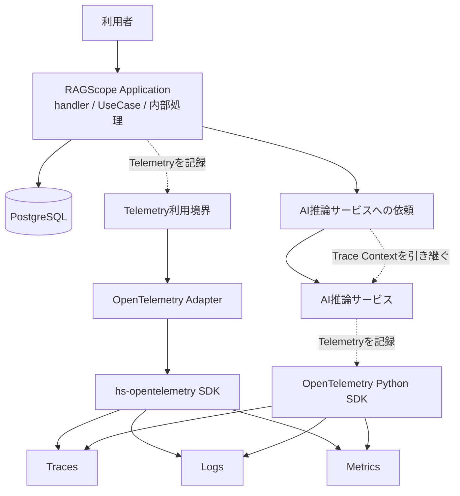
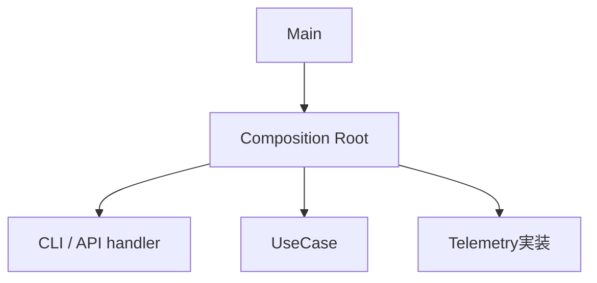

# RS-0023 Observability設計メモ

> [!note]
> これはRS-0023を正本へ反映する前にレビューするための**Workbench上の設計ドラフト**であり、RAGScopeの正本ではない。
> 現在の正本にあるUseCase境界とRAGScope Application / AI推論サービス / DBの責務を前提に、RS-0023で検討したObservability設計を扱う。
> このノートで「決定」とする内容はRS-0023の検討結果であり、現在仕様として有効になるのは正本リポジトリへ責務に応じて反映した後である。

## このノートが答える問い

> **RAGScopeではOpenTelemetryを何に使い、Trace / Logs / Metricsをどう分担させるか？**

このノートは、Observability全体の共通方針と、OpenTelemetryをRAGScopeへどう組み込むかをレビューする。
Trace / Logs / Metrics固有の判断は、それぞれの設計メモで扱う。

| ノート | 答える問い |
|---|---|
| このノート | OpenTelemetryを何に使い、Trace / Logs / Metricsをどう分担させるか |
| [[RS-0023 Trace設計メモ]] | RAGScopeの1回の実行をTrace上でどう追うか |
| [[RS-0023 Logs設計メモ]] | 何をLogに残し、何をSpanに任せるか |
| [[RS-0023 Metrics設計メモ]] | 個別実行の性能値と、複数実行を集約するMetricsをどう使い分けるか |

## 要するに

RAGScopeはOpenTelemetryをObservabilityの共通基盤として使う。

- **Trace**は、1回の実行でどの処理がどの順序で行われ、どこに時間がかかり、どこで失敗したかを追う。
- **Logs**は、Spanだけでは分からない出来事や状態変化を残す。
- **Metrics**は、複数回の実行をまとめて観測する。

retry、timeout、fallback、処理順序などを決めるのはRAGScope Applicationである。Telemetryは処理を制御せず、**実際に何が起きたかを記録する**。

また、HTTP、Database、CLI、GenAIなど、観測する処理に適用できるOpenTelemetry Semantic Conventionsがある場合は、RAGScope独自の同義表現を作らず、そのConventionを優先する。

## 全体像

1 InvocationでRAGScope ApplicationがDBやAI推論サービスを利用し、ApplicationとAI推論サービスがそれぞれOpenTelemetryを通じてTelemetryを記録する。



Composition Rootは実行に必要な部品を構築・接続する**構築時**の責務であり、1 Invocationの実行フローではないため、この図には含めない。

この図では、Application内部のhandler / UseCase境界やSpanの包含関係までは表さない。Trace上の具体的な構造は[[RS-0023 Trace設計メモ]]で扱う。

自動計装 / 手動計装、Telemetry利用境界が公開する具体API、AI推論サービス側でOpenTelemetry Python SDKを利用するmoduleもここでは決めない。Collector / Tempo / Lokiなどのproduction向け外部構成も、このノートでは採用を決めない。

## Trace / Logs / Metricsをどう使い分けるか

このドラフトでは、OpenTelemetryで扱うTrace / Logs / Metricsをまとめて**signal**と呼ぶ。

### Trace

Traceは、1 Invocationの処理のつながりを追うために使う。
RS-0023では**1 Invocation = 1独立Trace**とする。RAGScope ApplicationからAI推論サービスを呼び出すときはTrace Contextを引き継ぎ、同じTraceを継続する。

APIへ外部Trace Contextが届いた場合の扱い、entry Span、UseCase Span、Span Statusなどの詳細は[[RS-0023 Trace設計メモ]]で扱う。

### Logs

Logsは、Spanの開始・終了・attributes・Statusだけでは後から識別できない出来事や状態変化を記録するために使う。
Spanですでに分かる事実を、Log Eventへ機械的に重複させない。

ログの記録単位にはOpenTelemetry `LogRecord`を使う。OTLPとは別にRAGScopeが独自定義する共通ログJSON契約や、RAGScopeが所有するログ保存用SQLite表現は維持しない。詳細は[[RS-0023 Logs設計メモ]]で扱う。

### Metrics

Metricsは、複数実行を集約して観測するために使う。
評価データ1件ごとの性能値は実験結果へ保存し、OpenTelemetry Metricを個別実行値の保存先にはしない。

DB / HTTP / GenAIなど、観測する処理に適用できる標準Metricがある場合は利用する。詳細は[[RS-0023 Metrics設計メモ]]で扱う。

## TelemetryとApplication制御を分ける

Telemetryが決めるのは「何を観測して記録するか」である。
retry、timeout、fallback、処理順序など、Applicationの振る舞いそのものはTelemetryへ移さない。

たとえばretryするかどうかは、そのUseCaseまたは内部処理の設計が決める。Telemetryは、その結果として何回の処理が実際に行われ、最終的に成功したか失敗したかを、適用するSpan / Event / Metricの規則に従って記録する。

同じように、Exporter / Processor / Collectorへの送信に失敗しても、RAGScope Application本体の処理結果は変更しない。UseCaseが成功しているなら、Telemetry exportの失敗だけを理由にUseCase失敗へ変えない。

## 失敗理由をAPI・保存データ・Telemetryへどう渡すか

ここでいう`typed failure`は、その失敗が属するUseCaseまたは、そのUseCaseを構成する内部処理の契約上想定されるfailureを指す。

失敗理由の元情報は、そのUseCaseまたは内部処理に対応するtyped failureで保持する。
API / CLI、実験・評価結果、Telemetryは用途が違うため、同じ分類名・同じ粒度へ無理にそろえず、それぞれ必要な表現へ変換する。

```text
UseCaseまたは内部処理に対応するtyped failure
        ├─→ API / CLI向けに変換
        │      └─ API response / CLI stderr・exit status
        ├─→ 実験・評価結果へ保存する形に変換
        │      └─ 実験・評価データモデル上のerror
        └─→ Telemetryへ記録する形に変換
               └─ 適用するSemConv / RAGScope固有Span・Eventのerror.type
```

### 共通`error_type` taxonomyは置かない

RAGScope全体で共有する独立した`error_type` taxonomyは設けない。

現在の要求では、typed failureと各出力先の間に共通taxonomyを置かなくても、API / CLI、保存error、Telemetryはそれぞれ成立する。
一方、共通taxonomyを追加すると、typed failureから共通taxonomyへの変換と、そこから各出力先への変換を別々に維持する必要がある。これはUseCaseや内部処理ごとの失敗定義を、不要に1つの分類体系へ結合する。

Application / AI推論サービス間で共有するfailure codeが通信契約として実際に必要になった場合は、その通信方式を定義するContractで扱う。RAGScope全体の共通`error_type`として先に定義しない。

OpenTelemetryの`error.type`は、Telemetry上で「そのoperationやEventがどの種類のerrorを表すか」を記録する属性であり、RAGScopeのtyped failureそのものを置き換える型ではない。
HTTP、Database、GenAIなど、適用するSemantic Conventionが`error.type`を定めている場合はその規則に従う。RAGScope固有SpanとEventでの変換は、それぞれ[[RS-0023 Trace設計メモ]]と[[RS-0023 Logs設計メモ]]で扱う。

## OpenTelemetryをどう利用するか

RAGScopeはOpenTelemetryをObservabilityの基盤として使うが、UseCaseや内部処理を実装するmoduleからOpenTelemetry SDKを直接importする構造にはしない。
Application側はRAGScopeが定義するTelemetry利用境界を呼び、その外側のAdapterがOpenTelemetry SDKと接続する。

この境界で守ることは次のとおりである。

- UseCaseや内部処理を実装するmoduleからOpenTelemetry SDKを直接importしない。
- OpenTelemetry SDK固有の型を、UseCaseや内部処理が公開・受け渡しする型へ含めない。
- Trace Contextの引き継ぎにはPropagator / instrumentationなどOpenTelemetryの機構を使う。
- Processor / Exporter、batching、flush / shutdown、送信にはSDKの機構を使い、同等の基盤処理をRAGScopeで別実装しない。
- 観測する処理に適用できるSemantic Conventionがある場合は、そのSpan名・attributes・Event・MetricなどをRAGScope独自表現より優先する。

Haskell SDKは`hs-opentelemetry` 1.xを第一候補とする。AI推論サービスではOpenTelemetry Python API / SDKを使う。Python LogsはDevelopmentであるため、利用するversionとSDK固有APIは実装境界内へ閉じる。

AI推論サービス側の具体的なmodule境界はPython実装時に決める。

## Semantic Conventionsをどう扱うか

Span名、attributes、Event、Metric名などをRAGScope独自に定義する前に、観測する処理へ適用できるOpenTelemetry Semantic Conventionsがあるか確認する。

適用できるConventionがある場合は、その定義を優先する。HTTP、Database、CLI、Exceptionなどについて、同じ意味を持つRAGScope独自表現を重ねない。

RAGScope独自のTelemetry表現は、UseCase、Invocation、実験、評価データなど、既存Conventionだけでは表現できないRAGScope固有の意味に限定する。独自attributeが必要な場合も、まず既存attributeを再利用できないか確認し、OpenTelemetryが使用するnamespaceと衝突する名前は作らない。

Semantic Conventionごとにstabilityが異なるため、実装時には採用するOpenTelemetry / instrumentation versionと対象Conventionのstabilityを確認する。

2026-09-06時点で、このドラフトが直接参照する主な規約は次のとおりである。

| 対象 | stability | このドラフトでの扱い |
|---|---|---|
| `error.type`属性 | Stable | operationがどの種類のerrorで失敗したかを表す標準属性として使う |
| HTTP client / server Span | Stable | API / HTTP通信へ適用する |
| SQL / PostgreSQL database client Span | Stable | PostgreSQL operationへ適用する |
| `http.client.request.duration` | Stable | HTTP requestの所要時間を集約観測する |
| `db.client.operation.duration` | Stable | DB operationの所要時間を集約観測する |
| CLI Execution Span | Development | CLI entry Spanへ適用する。現在の細部をRAGScope独自の恒久契約へコピーしない |
| General Recording Errors | Development | RAGScope固有operationのStatus / `error.type`を決めるguidanceとして使う |
| General Events | Development | RAGScope固有Eventを設計するguidanceとして使う |
| Exceptions in Logs | Stable（個別節にDevelopmentあり） | Exception Logの基本表現へ利用する |
| GenAI Semantic Conventions | Development | 適用できるSpan / Event / Metricへ利用し、現在の名称やattributesをRAGScope独自契約へ固定しない |

## RAGScopeへどう組み込むか

Composition Root、handler、Invocation、UseCaseは同じ階層の処理ステップではない。
Observabilityを組み込む位置を理解するため、**構築時**と**1 Invocationの実行時**を分ける。

### 構築時

Composition Rootは、実行に必要なUseCase、handler、Telemetry実装などの依存を構築・接続する。
APIサーバーのような長時間動作するプロセスでは、ここで一度構築したhandlerやUseCaseを複数のInvocationから利用できる。



実装上のmodule / function名として`Bootstrap`を使うかは、package / module設計時に決める。

### 1 Invocationの実行時

`handler`はCLI / APIから受け取った入力をUseCaseへ渡す値へ変換し、UseCaseを呼び出し、その結果をCLI表示またはHTTP responseへ変換する1つの境界処理である。
入力側handlerと出力側handlerが別々に存在するのではなく、1回のhandler実行の前後に入力変換と出力変換がある。UseCaseそのものはhandlerの責務には含めない。

`Invocation`は、RAGScopeがCLI / APIなどを通じて外部から1回呼び出され、その処理が完了するまでの実行範囲である。Traceでは1 Invocationを1独立Traceとして追跡する。

UseCaseから呼び出されるEmbedding生成やDB検索などは、そのUseCaseを構成する内部処理である。AI推論サービス側の処理はApplicationから引き継いだTrace Contextを使って同じTraceへ参加できるが、Application側UseCaseそのものではない。

プロセス起動時の構築やTelemetry送信はInvocation / UseCaseとは別の処理である。

Trace上でhandler、entry Span、UseCase Spanをどう対応させるかは[[RS-0023 Trace設計メモ]]で扱う。

## SDKで必要な能力を利用できるか

RS-0023で必要なのは、RAGScope ApplicationとAI推論サービスの両方でTrace / Logsを記録でき、ApplicationからAI推論サービスへTrace Contextを引き継げること、さらにProcessor / Exporter経由の送信失敗をApplication本体の処理結果から分離できることである。

2026-09-06時点では、次の能力を確認している。

| 対象 | 確認した能力 | stability / 互換性 |
|---|---|---|
| `hs-opentelemetry` 1.x | Traces / Metrics / Logs、W3C Trace Context Propagator、Log / Span Processor、OTLP exporter、handle / in-memory exporter | SDK 1.0.0.0。upstreamはGHC 9.12を対象に含めるが、`proto-lens`は`allow-newer`利用の注記あり |
| OpenTelemetry Python | Traces / Metrics / Logs、Context propagation、`LoggerProvider`、`BatchLogRecordProcessor`、OTLP exporter、console exporter | Traces / MetricsはStable、LogsはDevelopment。Python 3.10以上をサポート |

現時点では、RAGScopeが必要とするTrace / Logs / Context連携を成立させられない具体的なSDK制約は確認できていない。このため、OpenTelemetry Logs採用判断を撤回する根拠はない。

ただし、次の2点はRAGScope固有環境でまだ実測していない。

- RAGScope ApplicationのGHC 9.12.4 / `base ^>=4.21.2.0`と`hs-opentelemetry` 1.x / OTLP exporterを組み合わせたCabal依存解決とビルド。upstreamにはGHC 9.12対応で`proto-lens`の`allow-newer`注記があるため、実装着手前に最小構成で確認する。
- AI推論サービスのPythonプロジェクトとPython versionは正本上まだ実装されていない。実装時にOpenTelemetry Python SDKのversionを固定し、利用APIとOTLP Logs exportを最小構成で確認する。

これは**RAGScope環境でビルド確認済みという意味ではない**。解消できない依存衝突や必要動作の不足が実測された場合は、SDK採用判断を見直す。

このHaskell / Python固有の採用可能性調査はWorkbenchでは検討材料として保持する。正本へ反映するときは、複数コンポーネント共通のObservability設計へGHC / Cabal / Python packageなどの実装固有情報をそのまま移さず、各コンポーネントの設計、Ticket、コード、設定、テストへ責務に応じて分離する。

## ローカル実行でTelemetryをどう確認するか

RAGScope本体のObservability設計とproduction backend選定を分離するため、ローカル確認では永続backendを必須にしない。

| 確認したいこと | 方法 |
|---|---|
| 単一コンポーネントのSpan / Log / Metricが生成されること | Haskellはhandle exporter、Pythonはconsole exporterでローカル出力を確認する |
| Application → AI推論サービスのTrace Context伝播 | 両コンポーネントを同じOTLP endpointへ送り、必要ならローカルOpenTelemetry Collectorのdebug exporterでTraceId / 親子関係を確認する |
| Processor / Exporter失敗時にApplication結果が変わらないこと | テスト用または失敗するExporter / Processor境界で自動テストする |

console / handle exporterの出力形式はデバッグ用であり、RAGScopeの外部JSON契約として扱わない。OpenTelemetry標準でもstdout exporterの具体出力形式は標準化されていない。

ローカルCollectorは複数コンポーネントのTelemetryを同じ受信先で確認するための開発用手段であり、RAGScope ApplicationやAI推論サービスの機能責務には含めない。Tempo / Lokiなどのbackend、production Collector構成、retentionは別の外部構成設計で決める。

## Telemetry基盤自身が失敗した場合

Exporter、Processor、Collectorへの送信などTelemetry基盤自身の失敗は、Application本体の結果を変更しない。
UseCaseが成功している場合、Telemetry exportに失敗してもUseCase成功のままとする。

まず採用するOpenTelemetry SDKのerror handling / internal diagnosticsを利用する。SDKの診断機能では満たせない具体的な診断要求が確認された場合だけ、RAGScope側の補助経路を検討する。

Telemetryの欠落をApplication処理失敗として扱う要求が追加された場合は、この判断を見直す。

## 旧設計から引き継がないもの

RS-0023では、OpenTelemetryへ寄せることで不要になる独自基盤を現在設計として維持しない。

- RAGScope全体で共有する独立した`error_type` taxonomy
- OpenTelemetry `LogRecord`とは別のRAGScope独自`LogRecord`
- OpenTelemetryと並行する独自Logging Runtime / Sink / 転送基盤
- OTLPとは別にRAGScopeが定義する共通ログJSON契約
- RAGScopeが所有するログ保存用SQLite表現
- Spanと同じ処理を別の識別体系で追跡するRAGScope独自の実行追跡概念

ただし、JSONやSQLiteという形式自体をRAGScopeから禁止するわけではない。実験結果、評価データ、ドメインデータなどログ以外の用途は別である。

過去のJSON / SQLite投影Experimentや完了済みTicketは、当時の作業・検証履歴として書き換えない。RS-0023反映後の現在仕様の根拠や必須Contractとしては使用しない。

## 正本へ反映するときの責務分離

Workbenchには今回の検討結果、確認した根拠、実装前に再確認する事項を残す。正本へ反映するときは、このNoteをそのまま正本化せず、情報の責務に応じて分ける。

| 情報 | 正本反映時の配置 |
|---|---|
| 現在採用するTrace / Logs / Metricsの責務・境界・契約と、理解に必要な最小限の理由 | `design/`の関係する設計書 |
| 1 Invocation = 1独立Trace、共通`error_type`廃止、独自JSON / SQLiteログ契約廃止など、複数案比較と変更影響を伴う重要判断 | ADR。RS-0023全体を1つの後続ADRとしてADR-0005をsupersedeするか、判断を分けるかは正本反映作業で文書管理規約に従って決める |
| 正本の更新・削除、既存実装移行、Contract更新などの作業範囲と完了条件 | RS-0023と後続Ticket |
| GHC / Cabal / `hs-opentelemetry`、Python SDK versionなどコンポーネント固有の採用可能性・実装詳細 | 各コンポーネントの設計、Ticket、コード、設定、テスト |
| 実際に行ったSDK / exporter / projection等の検証結果 | 必要ならExperiment |

正本反映時には、現在`error_type`、独自ログ外部表現、JSON Schema / SQLite表現を現在契約として参照する設計索引、システムアーキテクチャ、logging設計、Milestone / Epic / 未完了Ticket、Contract / fixtureを横断して更新する。完了済みTicketや過去のExperimentは当時の履歴として書き換えない。

## このドラフトでは決めないこと

以下はObservability全体の共通方針から分けて具体化する。

| 論点 | 具体化する設計 |
|---|---|
| Trace / Logs / Metricsの利用境界を1つにまとめるか分けるか | Telemetry利用境界設計 |
| Telemetry利用境界の名前と公開API | Telemetry利用境界設計 |
| SDK初期化設定エラー時に起動失敗するかTelemetryなしで起動するか | Telemetry初期化設計 |
| package / module構成 | Telemetry利用境界の決定後に行うpackage / module設計 |
| production Collector / Tempo / Loki等の外部構成 | 外部構成設計。現時点では候補であり採用を決めない |
| typed failureからTelemetry表現への変換module / package | Telemetry利用境界とpackage / moduleを設計する時 |

Haskellでtyped failureをTelemetry向けの値へ変換する位置を決めるときは、実際のimportとCabalの`build-depends`を確認する。少なくとも次を守る。

- UseCaseまたは内部処理を実装するmoduleからOpenTelemetry SDKを直接importしない。
- 各module / packageの責務に従った静的依存方向とし、Cabalの`build-depends`を循環させない。
- Telemetry AdapterがApplication側で定義されたPortやtyped failure型へ依存するかどうかは、この共通設計で先に固定しない。

現在`main`では`ragscope` main libraryがprivate sublibrary `ragscope-logging`へ依存しているが、この既存構造を新しいTelemetry変換処理の配置を決める前提にはしない。

## 参考

- [OpenTelemetry — Error handling](https://opentelemetry.io/docs/specs/otel/error-handling/)
- [OpenTelemetry — `error.type`](https://opentelemetry.io/docs/specs/semconv/registry/attributes/error/)
- [OpenTelemetry — Recording errors](https://opentelemetry.io/docs/specs/semconv/general/recording-errors/)
- [OpenTelemetry — Events](https://opentelemetry.io/docs/specs/semconv/general/events/)
- [OpenTelemetry — Exceptions in Logs](https://opentelemetry.io/docs/specs/semconv/exceptions/exceptions-logs/)
- [OpenTelemetry — Python](https://opentelemetry.io/docs/languages/python/)
- [OpenTelemetry — Python instrumentation](https://opentelemetry.io/docs/languages/python/instrumentation/)
- [OpenTelemetry — stdout LogRecord exporter](https://opentelemetry.io/docs/specs/otel/logs/sdk_exporters/stdout/)
- [hs-opentelemetry](https://github.com/iand675/hs-opentelemetry)
