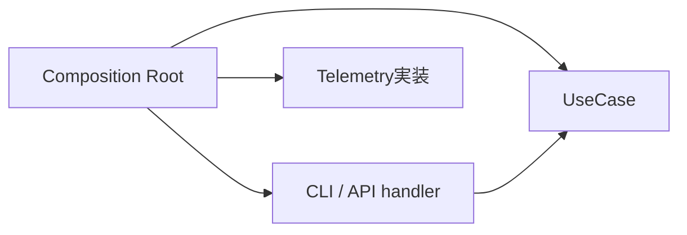
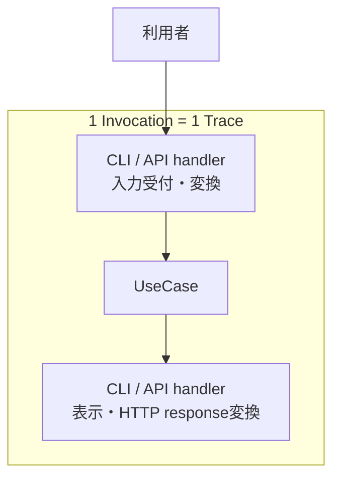
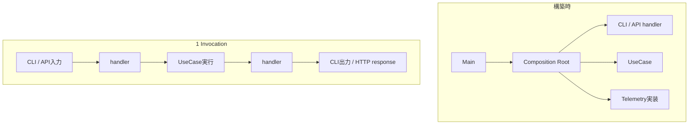
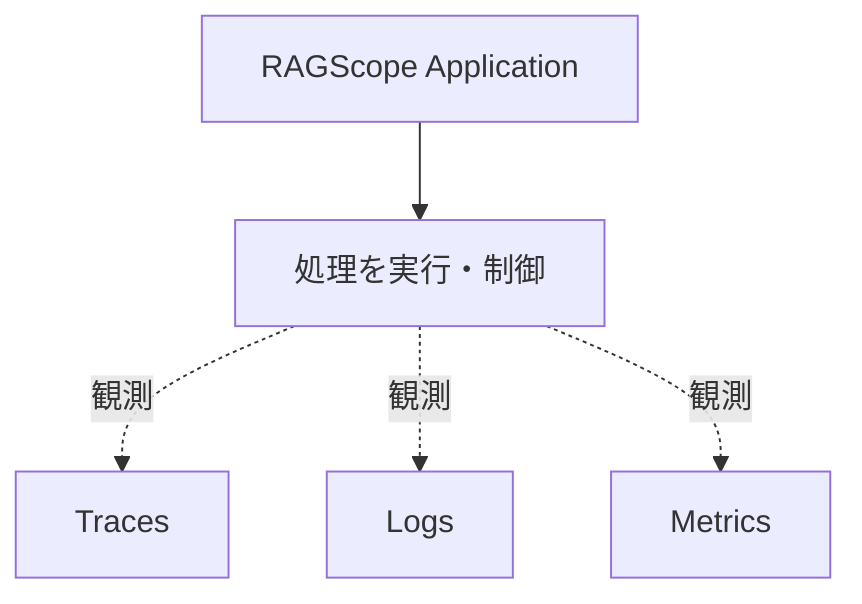
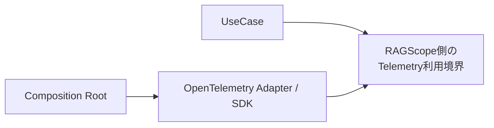
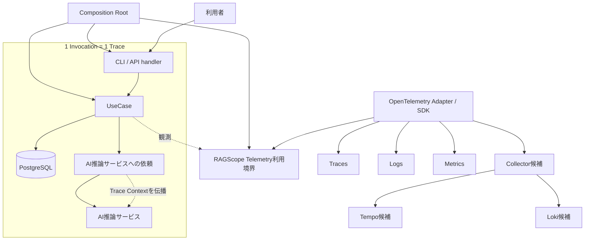
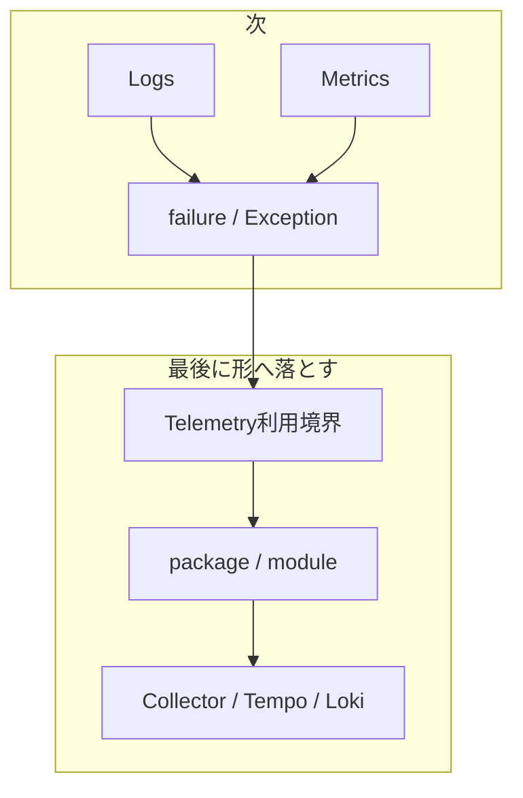

# RS-0023 Observability設計メモ

> [!note]
> これはRS-0023を考えるための**Workbench上の検討メモ**であり、RAGScopeの正本ではない。
> 現在の正本にあるUseCase境界とRAGScope Application / AI推論サービス / DBの責務を前提に、RS-0023で新しく決めるObservability設計だけを扱う。

## ✅ 今回決めたこと

### Composition Rootで依存を組み立てる

Composition Rootが、UseCaseや利用インターフェースに必要な依存をまとめて組み立てる。
OpenTelemetry SDKの初期化やExporterなどの実行時構成も、UseCaseの中ではなくこの外側で扱う。

Composition Rootは1回の利用者処理を構成する実行ステップではなく、実行に必要な部品を構築・接続する責務である。
APIサーバーのような長時間動作するプロセスでは、Composition Rootで一度構築したhandlerやUseCaseを複数のInvocationから利用できる。

実装上のmodule/function名として`Bootstrap`を使うかは、package / module設計時に決める。

### handlerはインターフェース固有の仕事をする

CLI / APIのhandlerは、入力をUseCaseへ渡せる形へ変換し、UseCaseを呼び、戻ってきた結果を表示やHTTPレスポンスへ変換する。
UseCase内部の依存構造までは知らず、Composition Rootから依存を閉じたUseCase実行能力を受け取る。

handlerはUseCaseの外側にあり、UseCase呼び出し前の入力受付・変換と、UseCase終了後の出力変換を担当する。
CLI parserやHTTP routingのどこまでをhandlerに含めるかという実装上の詳細境界は、必要になった時点で決める。

### Invocationを1 Traceの単位とする

RAGScopeがCLI / APIなどの利用インターフェースを通じて外部から1回呼び出され、その呼び出しに対する処理が完了するまでを**Invocation**と呼ぶ。

Invocationはmoduleやlayerではなく、1回の実行範囲を表す概念である。
1 Invocationに伴って発生する一連の処理を、1つのOpenTelemetry Traceとして追跡する。

UseCaseが呼び出される前にhandlerで処理が終了した場合でもInvocationは発生しているためTraceには残る。
一方、UseCaseは呼び出されていないためUseCase実行は発生しない。

RAGScope ApplicationからAI推論サービスなど別プロセスへ処理が続く場合は、Trace Contextを伝播し、同じInvocationに対応するTraceを継続する。

### Composition Root・handler・Invocation・UseCaseは同じ階層ではない

4つを`Composition Root -> handler -> Invocation -> UseCase`という処理順として扱わない。

| 概念 | 境界 |
|---|---|
| Composition Root | 実行に必要な依存を構築・接続する |
| handler | CLI / API固有表現とUseCaseの入力・結果の間を仲介する |
| Invocation | RAGScopeが外部から1回呼び出され、その処理が完了するまでの実行範囲 |
| UseCase | RAGScope ApplicationがUseCaseを呼び出してから、Applicationへ制御が戻るまで |

構築時と実行時は次のように分けて考える。

UseCaseから呼び出されるEmbedding生成、DB検索などは、そのUseCaseを構成する内部処理である。
AI推論サービス側の処理は同じTraceへ参加できるが、RAGScope Application側のUseCaseそのものではない。

すべてのRAGScope内部処理がhandlerやUseCaseを通るわけではない。
たとえばプロセス起動時のComposition Rootによる構築や、OpenTelemetry SDK / ExporterによるTelemetry送信はInvocationやUseCaseとは別の処理である。

### Telemetryは処理を制御しない

処理を続けるか、retryするか、timeoutで打ち切るかはRAGScope Applicationが決める。
Telemetryは、その処理を観測する。

Telemetryの都合でUseCaseの意味や処理順序を変えない。

### UseCaseへOpenTelemetry SDKを直接漏らさない

UseCaseがOpenTelemetry SDKそのものを直接扱う構造にはしない。
UseCaseから見えるのは、RAGScope側のTelemetry利用境界までとする。

Trace / Logs / Metricsの利用境界を1つにまとめるか分けるか、名前をどうするかは後で決める。

### OpenTelemetryが持っているTelemetry基盤は作り直さない

RAGScope固有の意味はRAGScope側で持つ。一方、Telemetryの共通機構はOpenTelemetryへ任せる。

| 旧RS-0022で自前にしていたもの | 今回 |
|---|---|
| RAGScope独自LogRecord | 作らない |
| Logging Runtime | 作らない |
| 独自Sink | 作らない |
| Trace ContextをLoggingへ手動注入する仕組み | 作らない |
| OTelと並行する独自ログ転送基盤 | 作らない |

event名、属性、failureの意味など、RAGScope固有のTelemetry表現はRAGScope側で決める。

### OpenTelemetry Semantic Conventionsを優先する

Telemetry表現をRAGScope独自に定義する前に、対象へ適用可能なOpenTelemetry Semantic Conventionsが存在するか確認する。

適用可能なSemantic Conventionが存在する場合は、Span名、Span Kind、属性、event、Metric名・instrument・unitなど、そのConventionで定義されている表現を優先して使用する。
HTTP、Database、CLI、Exceptionなどについて、既存Conventionと同じ意味を持つRAGScope独自表現を重複して作らない。

RAGScope独自のTelemetry表現は、UseCase、Invocation、実験、評価データなど、既存のSemantic Conventionsだけでは表現できないRAGScope固有の意味に限定する。
独自属性が必要な場合も、まず既存属性を再利用できないか確認し、OpenTelemetryが使用するnamespaceと衝突する属性は作らない。

Semantic Conventionごとにstabilityが異なるため、実装時には使用するOpenTelemetry / instrumentationのバージョンと対象Conventionのstabilityを確認する。

### Span境界

Spanは、開始・終了、所要時間、失敗、親子関係を独立して確認する価値がある処理に切る。
既存のOpenTelemetry Semantic ConventionsがSpanモデルを定義している領域ではそのモデルを採用し、同じ意味のRAGScope独自Spanを重複して作らない。
RAGScope固有の処理についてだけ、独立して観測する価値がある場合にRAGScope独自Spanを追加する。

採用するSpan境界は次のとおり。

| 対象 | Span境界 | 表現方針 |
|---|---|---|
| Invocation | 専用Spanは作らない。Invocationは1 Traceの意味上の単位とする | API / CLIのentry側SpanをTraceの入口として使う |
| API | 1回のHTTP requestをSERVER Spanとして追跡する | HTTP Semantic Conventionsに従う |
| CLI | 1回のCLI executionをSpanとして追跡する | CLI Semantic Conventionsに従う |
| handler | 原則として独立Spanにしない | API / CLIのentry側Spanの内部処理として扱う |
| UseCase | 1回のUseCase実行を1 Spanとして追跡する | RAGScope固有Spanとして表現する |
| PostgreSQL | database client operationをDB client Spanとして追跡する | Database / PostgreSQL Semantic Conventionsに従う |
| AI推論サービスへの通信 | 通信のclient / server処理をSpanとして追跡する | 採用する通信方式に対応するHTTP / RPC等のSemantic Conventionsに従う |
| Embedding / generation | 適用可能なGenAI Semantic Conventionが定義するSpanモデルをまず採用する | GenAI Semantic Conventionsを確認し、同義のRAGScope独自Spanを重複させない |
| RAGScope内部処理 | 開始・終了、所要時間、失敗、親子関係を独立して確認する価値がある場合だけSpanにする | 必要な場合はRAGScope固有Spanとして表現する |
| retry attempt | instrumentationや対象SemConvですでにattempt単位のSpanが表現される場合は重複して作らない | 既存表現で不足する場合だけ対象機能の設計で追加要否を決める |

この表は、**どの処理をSpanとして扱うか**と、**そのSpanをどのSemantic ConventionまたはRAGScope固有表現で表すか**を決めるものである。
自動計装 / 手動計装のどちらでSpanを生成するかは別の実装論点であり、この表では決めない。

具体的なSpan名、属性、Span StatusのError条件は、適用するSemantic Conventionまたは対象機能の設計で後から具体化する。

## 🧪 failure / `error.type`設計の採用候補

ここはまだ採用済み設計ではない。旧RS-0022のfailure分類設計から、現在のTrace / Span境界とOpenTelemetry Semantic Conventions優先方針へ合わせて再利用できそうな考え方だけを候補として残す。

### 採用候補

- **具体failureの意味は、そのfailureを所有する側が定義する。** UseCase固有failureであればUseCase側、利用インターフェース固有failureであればそのインターフェース側など、failureを最も具体的に理解できる所有側が意味を持つ。
- **RAGScope固有operationが最終的に失敗し、RAGScope側で`error.type`を付ける必要がある場合は、そのoperation / failureの所有側が安定した機械可読な分類規則を定義する。** HTTP、Database、GenAIなど適用可能なSemantic Conventionやinstrumentationが分類を定義する領域では、同義のRAGScope独自分類を重複して作らない。
- **具体failureの詳細値とTelemetry用の分類を分離する。** `error.type`を得るために具体failureそのものを共通エラーへ置換せず、failureが保持する原因・詳細値を失わない。
- **failure型自身をOpenTelemetryやObservability固有型へ依存させない。** Telemetry分類が必要な場合は、failure型とTelemetry表現の境界に変換規則を置く。
- **分類規則が必要なら、実行状態やTrace Contextへ依存しない純粋な変換を第一候補とする。** 旧`ErrorClassifier failure`のような名前付き値にするか、専用の`ErrorType`型を持つかは未決定であり、必要な公開API・package依存を見て判断する。
- **すべてのtyped failureへRAGScope独自分類を要求しない。** retryや代替処理で回復し、そのRAGScope固有operation自体が最終的に成功した場合、そのoperationのSpanへ失敗として反映するための分類は不要である。また、DB / HTTP / GenAIなど対象SemConvやinstrumentationが`error.type`を所有するfailureについても、RAGScope独自分類を追加する理由にはしない。

### 現時点で採用しない・保留するもの

- **全体共通の上位`ErrorCategory`** は現時点では導入しない。旧設計には`Input` / `Resource` / `Data` / `Dependency` / `Timeout` / `Internal`のような横断カテゴリが存在したが、現在確認しているRAGScope要求から、異なるUseCaseやoperationをこの共通カテゴリで集計・分岐・契約化する必要性はまだ確認できていない。現在の要求なしに導入すると、feature固有のfailure分類とは別に維持すべき分類軸と共通依存を増やすためである。今後、横断的な成功率・failure集計、運用判断、API契約などで共通カテゴリが実際に必要だと正本から確認できた場合は、その要求と必要な分類粒度を基準に改めて設計する。
- **共通`ErrorType`型、共通`ErrorClassifier failure`型、専用の共通error package** は現時点では採用済みにしない。RAGScope固有operationの`error.type`を安定して決める責務は必要になり得るが、それを全operationで共有する型・packageとして持つ必要があるかは未確認である。実際に複数のRAGScope固有operationで同じ抽象が必要になった時点で、公開API・依存方向・重複削減の効果を比較して判断する。
- **`OperationFailure`へ具体failureとClassifierをまとめ、root Spanまで共通分類を伝播する旧構造** は現在のSpan境界にはそのまま適用しない。現在はInvocation専用Spanを作らず、API / CLI entry Spanは各Semantic Convention、UseCase SpanはRAGScope固有operationとしてそれぞれ自身の規則でStatus / `error.type`を決めるため、異なるoperationへ同じ分類を伝播させること自体を共通要件にしない。

> [!important]
> このメモで「採用しない」「保留」と記録する場合は、後続の検討者が再評価できるように、**現在採用しない理由と、判断を見直す条件を可能な範囲で併記する**。現在要求から導入根拠を確認できないだけのものを、将来も不要な恒久ルールとして扱わない。

## 今の一枚絵

ここまで決めた時点では、ざっくりこの形で考える。

Collector / Tempo / Lokiはまだ候補である。

## 🤔 次に決めること

Trace境界は**1 Invocation = 1 Trace**、Span境界は上記の表として決めた。
次は、そのTrace / Span構造を基準にLogs、Metrics、failure / Exceptionの扱いを決める。

### 次: Logs / Metrics / failure

Trace / Spanで表せるものが見えたので、残る情報を整理する。

- Logs: 「その時点で何が起きたか」として残したいもの
- Metrics: 処理時間、TTFT、token数などの計測
- failure / Exception: Applicationの失敗をSpan StatusやLogsへどう反映するか

LogsとMetricsはある程度独立しているので、必要なら順番を入れ替えてよい。

### 最後: 実装境界と外部構成

実際に何を観測するかが決まってから、RAGScope側のTelemetry利用境界を決める。
そのAPIと依存方向を見てpackage / moduleを分け、最後にCollector / Tempo / Lokiを含む外部構成へ落とす。

packageを先に切って、あとから責務を当てはめる順番にはしない。
