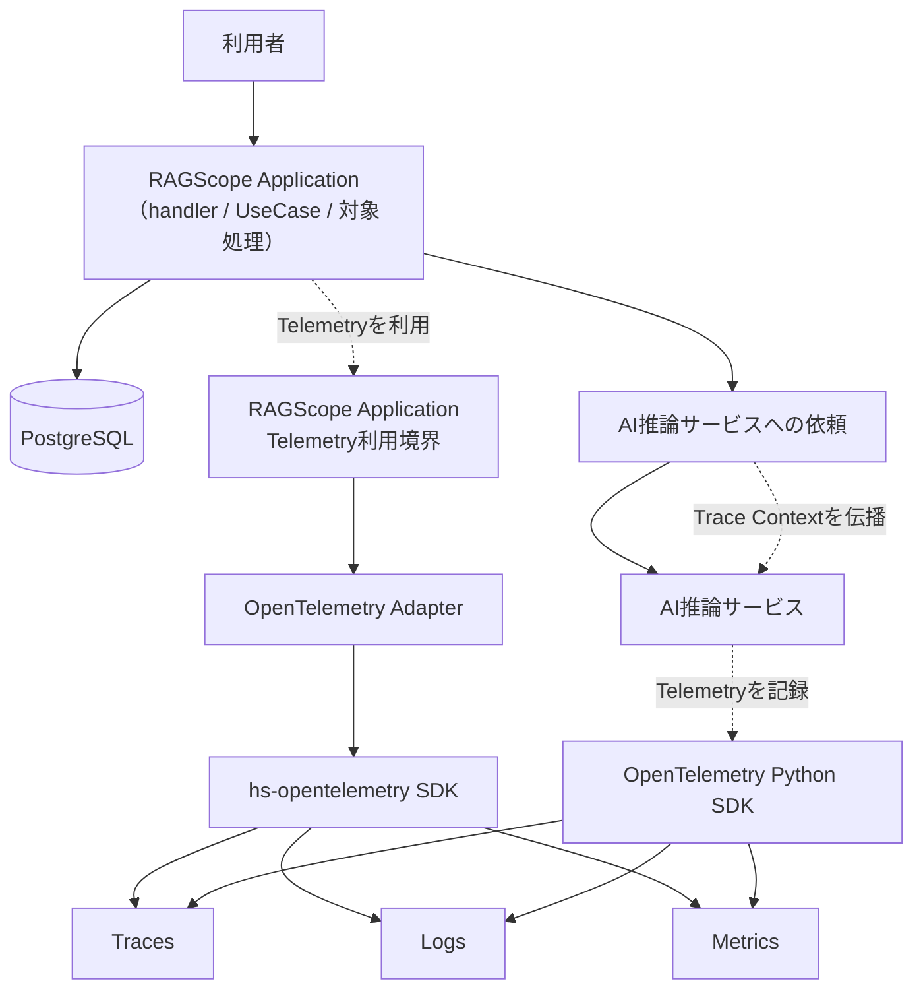
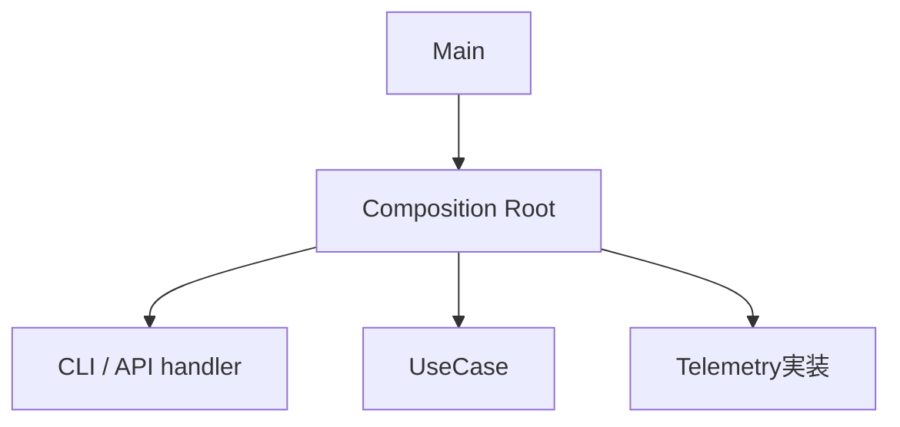

# RS-0023 Observability設計メモ

> [!note]
> これはRS-0023を正本へ反映する前にレビューするための**Workbench上の設計ドラフト**であり、RAGScopeの正本ではない。
> 現在の正本にあるUseCase境界とRAGScope Application / AI推論サービス / DBの責務を前提に、RS-0023で検討するObservability設計を扱う。

## このノートでレビューすること

このノートは**上から順に読むレビュー用ドラフト**であり、後から引くリファレンスを目的としない。
ここではObservabilityの全体像、Trace / Logs / Metricsに共通する基本方針、OpenTelemetryの利用方針、RAGScopeへの組み込み方をレビューする。
Trace / Logs / Metrics固有の判断は、それぞれの設計メモでレビューする。

| ノート | レビューする内容 |
|---|---|
| このノート | Observability全体像、共通方針、OpenTelemetryの利用方針、RAGScopeへの組み込み方 |
| [[RS-0023 Trace設計メモ]] | RAGScopeの1回の実行をどうTrace / Spanとして追跡するか |
| [[RS-0023 Logs設計メモ]] | RAGScopeがいつ、何をLog Eventとして出すか |
| [[RS-0023 Metrics設計メモ]] | 性能値とOTel Metricsをどう分け、何をMetricとして観測するか |

## まず結論

| 項目 | 状態 | 要点 |
|---|---|---|
| Trace | ドラフト内で決定 | 1 Invocation = 1 Trace。詳細は[[RS-0023 Trace設計メモ]] |
| Logs | ドラフト内で決定 | OTel Logs / Eventを土台にし、Spanと重複させない。詳細は[[RS-0023 Logs設計メモ]] |
| Metrics | ドラフト内で決定 | 性能値は実験結果へ保持し、集約観測には適用可能な標準Metricを使う。詳細は[[RS-0023 Metrics設計メモ]] |
| OpenTelemetry採用可能性 | 主要能力を確認済み | Haskell / PythonともTrace / Logs / Context連携とexportに必要なSDK能力を確認した。RAGScope固有の依存解決は実装前に最小確認する |

## 全体像

この図では、1 InvocationでRAGScope Applicationが外部のDB / AI推論サービスを利用する関係と、両コンポーネントがOpenTelemetryへTelemetryを記録する関係を俯瞰する。Composition Rootは実行に必要な部品を構築・接続する**構築時**の責務であり、1 Invocationの実行フローではないため、この図には含めない。

この図はApplication内部のhandler / UseCase境界やSpanの包含関係までは表さない。それらは後述の「RAGScopeへどう組み込むか」と[[RS-0023 Trace設計メモ]]で具体化する。自動計装 / 手動計装の選択、Application側Telemetry利用境界の具体API、AI推論サービス側でSDKを包む具体構造も、この図からは決めない。

Collector / Tempo / Lokiなどのproduction向け外部構成は、このノートでは採用を決めない。

## Observabilityの基本方針

このドラフトでは、OpenTelemetryで扱うTrace / Logs / Metricsをまとめて**signal**と呼ぶ。

TelemetryはRAGScopeで実際に行われた処理を観測し、その結果をTrace / Logs / Metricsとして記録する。
Applicationの処理内容や制御方針はTelemetryへ移さない。

| 論点 | 決定 |
|---|---|
| Telemetryの責務 | RAGScopeで実際に行われた処理をTrace / Logs / Metricsとして観測する |
| Application制御との関係 | retry / timeout / fallback / 処理順序はRAGScope Applicationが制御し、具体的な条件は対象処理の機能設計で定める。Telemetryはその実行結果を観測する |
| Trace / Logs / Metricsの関係 | 同じ事実を機械的に重複させず、各signalで後から確認する内容に応じて使い分ける |
| Telemetry runtime failure | Exporter / Processor / Collector送信失敗でApplication本体の結果を変更しない |

Trace / Logs / Metricsそれぞれの具体的な役割と表現は、各設計メモで定義する。

## OpenTelemetryをどう利用するか

RAGScopeはOpenTelemetryをObservabilityの基盤として利用するが、OpenTelemetry SDKそのものをRAGScope固有の処理設計へ直接露出させない。

| 論点 | 決定 |
|---|---|
| SDK境界 | RAGScope ApplicationのUseCaseへOpenTelemetry SDKを直接漏らさず、RAGScope側のTelemetry利用境界までを見せる。AI推論サービス側の具体境界はPython実装時に決める |
| Haskell SDK | `hs-opentelemetry` 1.xを第一候補として採用する |
| Python SDK | OpenTelemetry Python API / SDKを採用する。LogsはDevelopmentであることを前提にversionとSDK固有APIを実装境界内へ閉じる |
| SDK固有型 | RAGScope固有の処理境界から外へ漏らさない |
| OpenTelemetry SDKが担当する基盤処理 | Context伝播、Processor / Exporter、batching、flush / shutdown、送信などはSDKへ任せ、RAGScopeで並行実装しない |
| Semantic Conventions | 適用可能なConventionをRAGScope独自表現より優先する |

### Haskell / Python実装で必要な能力を利用できるか

RS-0023で必要なのは、両コンポーネントでTrace / Logsを記録でき、Trace Contextをコンポーネント間で引き継ぎ、Processor / Exporter経由の送信失敗をApplication本体の結果から分離できることである。

2026-09-06時点で確認した実装能力は次のとおりである。

| 対象 | 確認した能力 | stability / 互換性 |
|---|---|---|
| `hs-opentelemetry` 1.x | Traces / Metrics / Logs、W3C Trace Context Propagator、Log / Span Processor、OTLP exporter、handle / in-memory exporter | SDK 1.0.0.0。upstreamはGHC 9.12を対象に含めるが、`proto-lens`は`allow-newer`利用の注記あり |
| OpenTelemetry Python | Traces / Metrics / Logs、Context propagation、`LoggerProvider`、`BatchLogRecordProcessor`、OTLP exporter、console exporter | Traces / MetricsはStable、LogsはDevelopment。Python 3.10以上をサポート |

現時点では、RAGScopeが必要とするTrace / Logs / Context連携を成立させられない具体的なSDK制約は確認できていない。このため、OpenTelemetry Logs採用判断を撤回する根拠はない。

一方、次の2点はRAGScope固有環境でまだ実測していない。

- RAGScope ApplicationのGHC 9.12.4 / `base ^>=4.21.2.0`と`hs-opentelemetry` 1.x / OTLP exporterを組み合わせたCabal依存解決とビルド。upstreamではGHC 9.12対応に`proto-lens`の`allow-newer`注記があるため、実装着手前に最小の依存解決・ビルド確認を行う
- AI推論サービスのPythonプロジェクトとPython versionは正本上まだ実装されていないため、OpenTelemetry Python SDKの具体versionとの依存解決。Python LogsがDevelopmentであるため、実装時にversionを固定し、利用APIとOTLP Logs exportを最小確認する

これらは採用前提を覆す事実がまだ見つかっていないという意味であり、**RAGScope環境でビルド確認済みという意味ではない**。解消できない依存衝突または必要動作の不足が実測された場合は、SDK採用判断を見直す。

OpenTelemetry SDK相当をRAGScopeで独自実装すると、Context管理、batching、Processor / Exporter、flush / shutdown、export失敗処理など、RAGScope固有ではない責務までRAGScopeが保守することになるため採用しない。

### Semantic Conventionsを優先する

Telemetry表現をRAGScope独自に定義する前に、対象へ適用可能なOpenTelemetry Semantic Conventionsが存在するか確認する。

適用可能なConventionが存在する場合は、Span名、Span Kind、属性、Event、Metric名・instrument・unitなど、そのConventionで定義されている表現を優先する。
HTTP、Database、CLI、Exceptionなどについて、既存Conventionと同じ意味を持つRAGScope独自表現を重複して作らない。

RAGScope独自のTelemetry表現は、UseCase、Invocation、実験、評価データなど、既存Conventionだけでは表現できないRAGScope固有の意味に限定する。
独自属性が必要な場合も、まず既存属性を再利用できないか確認し、OpenTelemetryが使用するnamespaceと衝突する属性は作らない。

Semantic Conventionごとにstabilityが異なるため、実装時には使用するOpenTelemetry / instrumentationのバージョンと対象Conventionのstabilityを確認する。

## RAGScopeへどう組み込むか

Composition Root・handler・Invocation・UseCaseは同じ階層の処理ステップではない。
Observabilityを組み込む位置を理解するため、**構築時**と**1 Invocationの実行時**を分ける。

| 概念 | 境界 |
|---|---|
| Composition Root | 実行に必要なUseCase、handler、Telemetry実装などの依存を構築・接続する |
| handler | CLI / APIとUseCaseの間の境界処理 |
| Invocation | RAGScopeが外部から1回呼び出され、その処理が完了するまでの実行範囲。Traceでは**1 Invocation = 1 Trace**として追跡する |
| UseCase | RAGScope ApplicationがUseCaseを呼び出してから、Applicationへ制御が戻るまで |
| Telemetry利用境界 | UseCase等のRAGScope側コードがOpenTelemetry SDKへ直接依存せずTelemetryを利用するための境界。具体APIはこのノートでは決めない |

### handler

`handler`は、CLI / APIとUseCaseの間の**1つの境界処理**を指す。CLI / APIから受け取った入力をUseCaseへ渡す値へ変換してUseCaseを呼び出し、UseCaseから制御が戻った後は、その結果をCLI表示やHTTP responseなどへ変換する。入力側handlerと出力側handlerが別々に存在するのではなく、1つのhandler実行の中でUseCase呼び出しの前後にこれらの処理がある。UseCaseそのものはhandlerに含めない。

### 構築時

Composition Rootは1回の利用者処理を構成する実行ステップではなく、実行に必要な部品を構築・接続する。
APIサーバーのような長時間動作するプロセスでは、Composition Rootで一度構築したhandlerやUseCaseを複数のInvocationから利用できる。

実装上のmodule/function名として`Bootstrap`を使うかは、package / module設計時に決める。

### 1 Invocationの実行時

UseCaseから呼び出されるEmbedding生成、DB検索などはUseCaseを構成する内部処理である。
AI推論サービス側の処理は同じTraceへ参加できるが、RAGScope Application側のUseCaseそのものではない。
プロセス起動時の構築やTelemetry送信はInvocation / UseCaseとは別の処理である。

## ローカル実行でTelemetryをどう確認するか

RAGScope本体のObservability設計とproduction backend選定を分離するため、ローカル確認では永続backendを必須にしない。

| 確認したいこと | 方法 |
|---|---|
| 単一コンポーネントのSpan / Log / Metricが生成されること | Haskellはhandle exporter、Pythonはconsole exporterを使い、ローカル出力で確認する |
| RAGScope Application → AI推論サービスのTrace Context伝播 | 両コンポーネントを同じOTLP endpointへ送り、必要な場合はローカルOpenTelemetry Collectorのdebug exporterでTraceId / 親子関係を確認する |
| Processor / Exporter失敗時にApplication結果が変わらないこと | テスト用または失敗するExporter / Processor境界で自動テストする |

console / handle exporterの出力形式はデバッグ用であり、RAGScopeの外部JSON契約として扱わない。OpenTelemetry標準でもstdout exporterの具体出力形式は標準化されていない。

ローカルCollectorは複数コンポーネントのTelemetryを同じ受信先で確認するための開発用手段であり、RAGScope ApplicationまたはAI推論サービスの機能責務には含めない。Tempo / Loki等のbackend、production Collector構成、retentionは別の外部構成設計で決める。

## Telemetry自身が失敗したらどうするか

Exporter、Processor、Collectorへの送信などTelemetry基盤自身の失敗は、Application本体の結果を変更しない。
UseCaseが成功している場合、Telemetry exportに失敗してもUseCase成功のままとする。

Telemetry基盤の診断には、まず採用するOpenTelemetry SDK自身のerror handling / internal diagnosticsを使用する。
SDKの診断機能では満たせない具体的な診断要求が確認された場合だけ、RAGScope側の補助経路を検討する。

Telemetryの欠落をApplication処理失敗として扱う要求が追加された場合は、この判断を見直す。

## このドラフトでは扱わないこと

以下はObservabilityの全体像・共通方針とは分けて具体化する。

| 論点 | 具体化する設計 |
|---|---|
| Trace / Logs / Metricsの利用境界を1つにまとめるか分けるか | Telemetry利用境界設計 |
| Telemetry利用境界の名前と公開API | Telemetry利用境界設計 |
| SDK初期化設定エラー時に起動失敗するかTelemetryなしで起動するか | Telemetry初期化設計 |
| package / module構成 | Telemetry利用境界の決定後に行うpackage / module設計 |
| production Collector / Tempo / Loki等の外部構成 | 外部構成設計。現時点では候補であり採用を決めない |

package / module構成はTelemetry利用境界を決めた後に定め、先にpackageを分割してから責務を割り当てない。

## 参考

- [OpenTelemetry — Error handling](https://opentelemetry.io/docs/specs/otel/error-handling/)
- [OpenTelemetry — Python](https://opentelemetry.io/docs/languages/python/)
- [OpenTelemetry — Python instrumentation](https://opentelemetry.io/docs/languages/python/instrumentation/)
- [OpenTelemetry — stdout LogRecord exporter](https://opentelemetry.io/docs/specs/otel/logs/sdk_exporters/stdout/)
- [hs-opentelemetry](https://github.com/iand675/hs-opentelemetry)