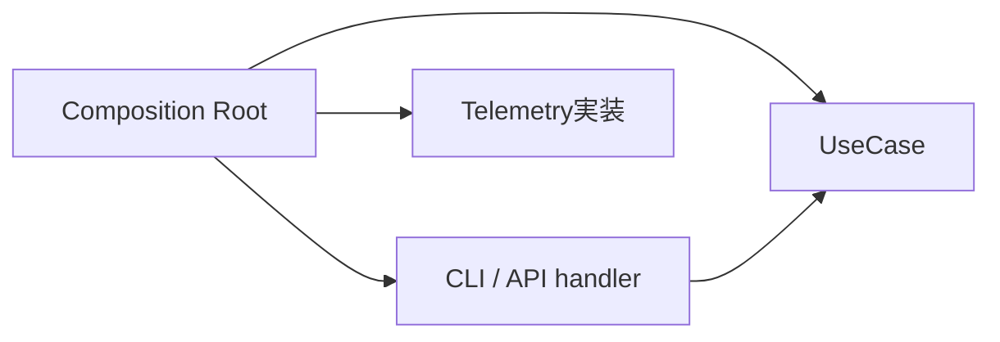
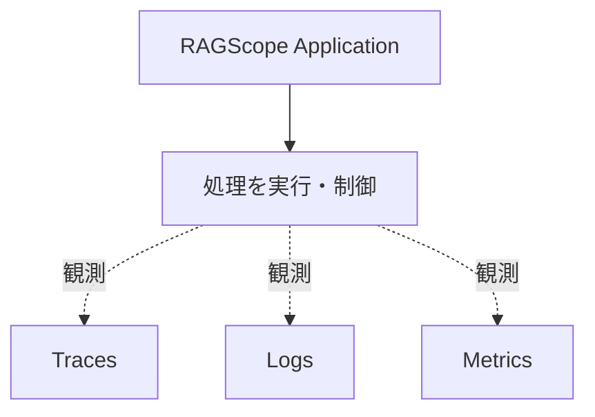
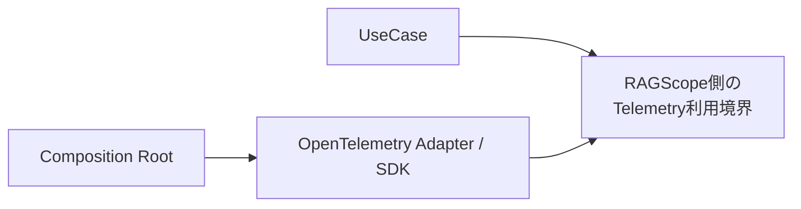
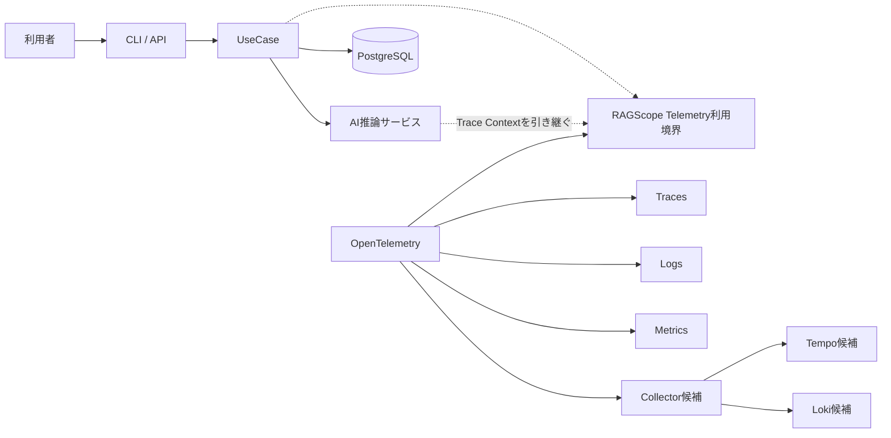
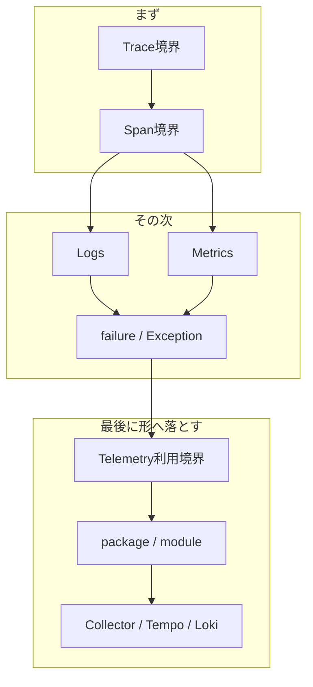

# RS-0023 Observability設計メモ

> [!note]
> これはRS-0023を考えるための**Workbench上の検討メモ**であり、RAGScopeの正本ではない。
> 現在の正本にあるUseCase境界とRAGScope Application / AI推論サービス / DBの責務を前提に、RS-0023で新しく決めるObservability設計だけを扱う。

## ✅ 今回決めたこと

### Composition Rootで依存を組み立てる

Composition Rootが、UseCaseや利用インターフェースに必要な依存をまとめて組み立てる。
OpenTelemetry SDKの初期化やExporterなどの実行時構成も、UseCaseの中ではなくこの外側で扱う。

### handlerはインターフェース固有の仕事をする

CLI / APIのhandlerは、入力をUseCaseへ渡せる形へ変換し、UseCaseを呼び、戻ってきた結果を表示やHTTPレスポンスへ変換する。
UseCase内部の依存構造までは知らず、Composition Rootから依存を閉じたUseCase実行能力を受け取る。

### Telemetryは処理を制御しない

処理を続けるか、retryするか、timeoutで打ち切るかはRAGScope Applicationが決める。
Telemetryは、その処理を観測する。

Telemetryの都合でUseCaseの意味や処理順序を変えない。

### UseCaseへOpenTelemetry SDKを直接漏らさない

UseCaseがOpenTelemetry SDKそのものを直接扱う構造にはしない。
UseCaseから見えるのは、RAGScope側のTelemetry利用境界までとする。

Trace / Logs / Metricsの利用境界を1つにまとめるか分けるか、名前をどうするかは後で決める。

### OpenTelemetryが持っているTelemetry基盤は作り直さない

RAGScope固有の意味はRAGScope側で持つ。一方、Telemetryの共通機構はOpenTelemetryへ任せる。

| 旧RS-0022で自前にしていたもの | 今回 |
|---|---|
| RAGScope独自LogRecord | 作らない |
| Logging Runtime | 作らない |
| 独自Sink | 作らない |
| Trace ContextをLoggingへ手動注入する仕組み | 作らない |
| OTelと並行する独自ログ転送基盤 | 作らない |

event名、属性、failureの意味など、RAGScope固有のTelemetry表現はRAGScope側で決める。

### 旧Operationは復活させない

旧RS-0022ではUseCaseの前後まで含む利用者操作全体を`Operation`と呼んでいたが、現在の正本ではトップレベルの利用者操作をUseCaseと定義している。

両方を置くと意味が二重になるため、旧`Operation`はApplicationの別概念として復活させない。
CLI / APIの前後処理をTraceへ含めるかどうかは、Operationとは切り離してTrace境界の問題として決める。

## 今の一枚絵

ここまで決めた時点では、ざっくりこの形で考える。

Collector / Tempo / Lokiはまだ候補である。

## 🤔 次に決めること

完全な工程表ではないが、依存関係を考えるとこの順番が自然そうだ。

### まず: Trace / Span

最初に、**1回の実行をどこからどこまで同じTraceとして追うか**を決める。
そのTraceの中で、UseCase、AI推論サービス、DB、内部処理のどこを独立したSpanとして見るかを決める。

ここがLogsを考えるときの基準にもなる。

### その次: Logs / Metrics / failure

Trace / Spanで表せるものが見えたら、残る情報を整理する。

- Logs: 「その時点で何が起きたか」として残したいもの
- Metrics: 処理時間、TTFT、token数などの計測
- failure / Exception: Applicationの失敗をSpan StatusやLogsへどう反映するか

LogsとMetricsはある程度独立しているので、必要なら順番を入れ替えてよい。

### 最後: 実装境界と外部構成

実際に何を観測するかが決まってから、RAGScope側のTelemetry利用境界を決める。
そのAPIと依存方向を見てpackage / moduleを分け、最後にCollector / Tempo / Lokiを含む外部構成へ落とす。

packageを先に切って、あとから責務を当てはめる順番にはしない。

---

今後は、ここで「今回決めたこと」に入ったものを毎回再検討しない。
新しい制約や具体的な問題が見つかった場合だけ戻る。
