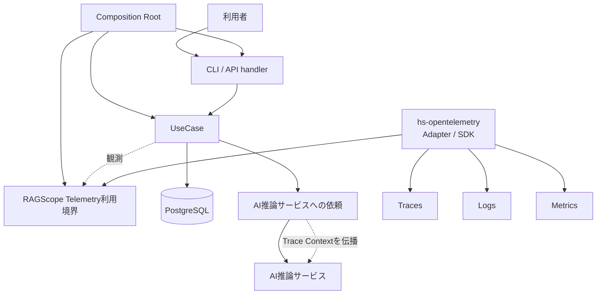
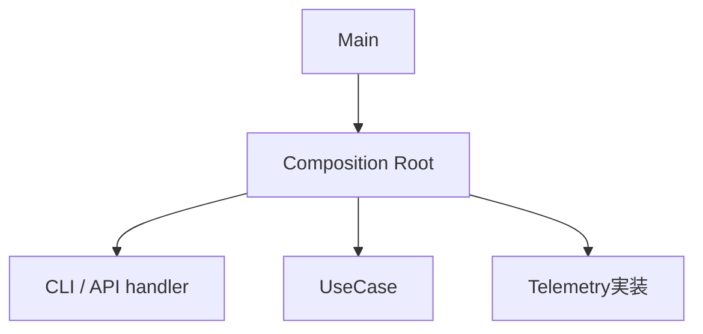
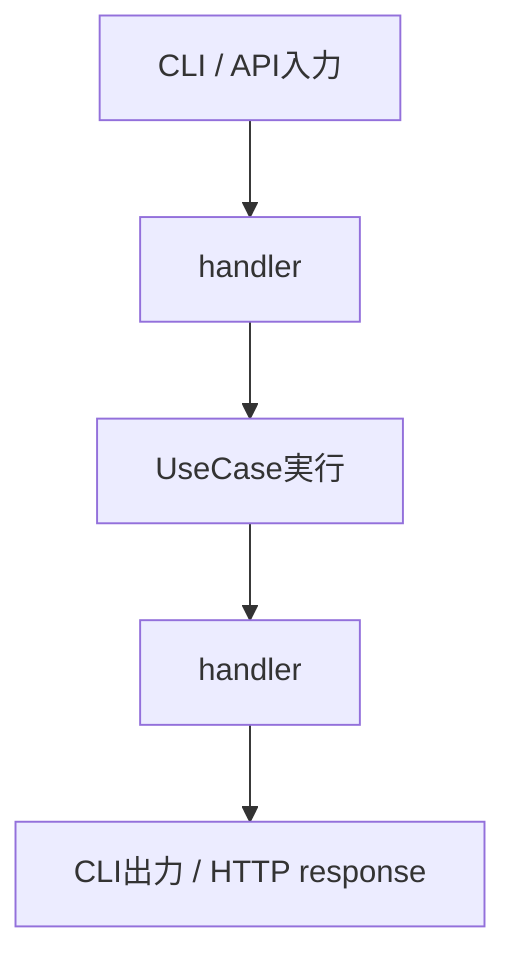

# RS-0023 Observability設計メモ

> [!note]
> これはRS-0023を正本へ反映する前にレビューするための**Workbench上の設計ドラフト**であり、RAGScopeの正本ではない。
> 現在の正本にあるUseCase境界とRAGScope Application / AI推論サービス / DBの責務を前提に、RS-0023で検討するObservability設計を扱う。

## このノートでレビューすること

このノートは**上から順に読むレビュー用ドラフト**であり、後から引くリファレンスを目的としない。
ここではObservabilityの全体像、Trace / Logs / Metricsに共通する基本方針、OpenTelemetryの利用方針、RAGScopeへの組み込み方をレビューする。
Trace / Logs / Metrics固有の判断は、それぞれの設計メモでレビューする。

| ノート | レビューする内容 |
|---|---|
| このノート | Observability全体像、共通方針、OpenTelemetryの利用方針、RAGScopeへの組み込み方 |
| [[RS-0023 Trace設計メモ]] | RAGScopeの1回の実行をどうTrace / Spanとして追跡するか |
| [[RS-0023 Logs設計メモ]] | RAGScopeがいつ、何をLog Eventとして出すか |
| [[RS-0023 Metrics設計メモ]] | 性能値とOTel Metricsをどう分け、何をMetricとして観測するか |

## まず結論

| 項目 | 状態 | 要点 |
|---|---|---|
| Trace | ドラフト内で決定 | 1 Invocation = 1 Trace。詳細は[[RS-0023 Trace設計メモ]] |
| Logs | ドラフト内で決定 | OTel Logs / Eventを土台にし、Spanと重複させない。詳細は[[RS-0023 Logs設計メモ]] |
| Metrics | ドラフト内で決定 | 性能値は実験結果へ保持し、集約観測には適用可能な標準Metricを使う。詳細は[[RS-0023 Metrics設計メモ]] |

## 全体像

Collector / Tempo / Lokiなどの外部構成は、このノートでは採用を決めない。

## Observabilityの基本方針

このドラフトでは、OpenTelemetryで扱うTrace / Logs / Metricsをまとめて**signal**と呼ぶ。

TelemetryはRAGScopeで実際に行われた処理を観測し、その結果をTrace / Logs / Metricsとして記録する。
Applicationの処理内容や制御方針はTelemetryへ移さない。

| 論点 | 決定 |
|---|---|
| Telemetryの責務 | RAGScopeで実際に行われた処理をTrace / Logs / Metricsとして観測する |
| Application制御との関係 | retry / timeout / fallback / 処理順序はRAGScope Applicationが制御し、具体的な条件は対象処理の機能設計で定める。Telemetryはその実行結果を観測する |
| Trace / Logs / Metricsの関係 | 同じ事実を機械的に重複させず、各signalで後から確認する内容に応じて使い分ける |
| Telemetry runtime failure | Exporter / Processor / Collector送信失敗でApplication本体の結果を変更しない |

Trace / Logs / Metricsそれぞれの具体的な役割と表現は、各設計メモで定義する。

## OpenTelemetryをどう利用するか

RAGScopeはOpenTelemetryをObservabilityの基盤として利用するが、OpenTelemetry SDKそのものをApplication設計へ直接露出させない。

| 論点 | 決定 |
|---|---|
| SDK境界 | UseCaseへOpenTelemetry SDKを直接漏らさず、RAGScope側のTelemetry利用境界までを見せる |
| Haskell SDK | `hs-opentelemetry` 1.xを採用する |
| SDK固有型 | OpenTelemetry Adapterの内側に閉じ込める |
| OpenTelemetry SDKが担当する基盤処理 | Context伝播、Processor / Exporter、batching、flush / shutdown、送信などはSDKへ任せ、RAGScopeで並行実装しない |
| Semantic Conventions | 適用可能なConventionをRAGScope独自表現より優先する |

### `hs-opentelemetry`を採用する理由と見直し条件

`hs-opentelemetry` 1.xは、RAGScopeで必要となるTrace、Logs、Context / Propagator、Processor、OTLP Exporterの主要能力を提供する。
SDK固有型をAdapter内へ閉じ込められるため、UseCaseをSDK固有型へ依存させずに利用できる。

OpenTelemetry SDK相当をRAGScopeで実装すると、Context管理、batching、Processor / Exporter、flush / shutdown、export失敗処理など、RAGScope固有ではない責務までRAGScopeが保守することになるため採用しない。

採用前の大規模PoCを必須条件にはしない。実装時にRAGScopeのGHC / dependency構成との互換性と、必要なAdapter動作を確認する。

次のいずれかが確認された場合は採用を見直す。

- `hs-opentelemetry` 1.xの提供APIでは、RAGScopeが必要とするTrace / Logs / Context / Processor / Exporterの動作をAdapterから成立させられない
- 採用するGHC / dependency構成で解消できない互換性問題がある
- SDKのruntime例外・終了処理・export処理によってUseCase結果またはApplicationの処理制御が変更される

### Semantic Conventionsを優先する

Telemetry表現をRAGScope独自に定義する前に、対象へ適用可能なOpenTelemetry Semantic Conventionsが存在するか確認する。

適用可能なConventionが存在する場合は、Span名、Span Kind、属性、Event、Metric名・instrument・unitなど、そのConventionで定義されている表現を優先する。
HTTP、Database、CLI、Exceptionなどについて、既存Conventionと同じ意味を持つRAGScope独自表現を重複して作らない。

RAGScope独自のTelemetry表現は、UseCase、Invocation、実験、評価データなど、既存Conventionだけでは表現できないRAGScope固有の意味に限定する。
独自属性が必要な場合も、まず既存属性を再利用できないか確認し、OpenTelemetryが使用するnamespaceと衝突する属性は作らない。

Semantic Conventionごとにstabilityが異なるため、実装時には使用するOpenTelemetry / instrumentationのバージョンと対象Conventionのstabilityを確認する。

## RAGScopeへどう組み込むか

Composition Root・handler・Invocation・UseCaseは同じ階層の処理ステップではない。
Observabilityを組み込む位置を理解するため、**構築時**と**1 Invocationの実行時**を分ける。

| 概念 | 境界 |
|---|---|
| Composition Root | 実行に必要なUseCase、handler、Telemetry実装などの依存を構築・接続する |
| handler | CLI / API固有表現とUseCaseの入力・結果の間を仲介する |
| Invocation | RAGScopeが外部から1回呼び出され、その処理が完了するまでの実行範囲。Traceでは**1 Invocation = 1 Trace**として追跡する |
| UseCase | RAGScope ApplicationがUseCaseを呼び出してから、Applicationへ制御が戻るまで |
| Telemetry利用境界 | UseCase等のRAGScope側コードがOpenTelemetry SDKへ直接依存せずTelemetryを利用するための境界。具体APIはこのノートでは決めない |

### 構築時

Composition Rootは1回の利用者処理を構成する実行ステップではなく、実行に必要な部品を構築・接続する。
APIサーバーのような長時間動作するプロセスでは、Composition Rootで一度構築したhandlerやUseCaseを複数のInvocationから利用できる。

実装上のmodule/function名として`Bootstrap`を使うかは、package / module設計時に決める。

### 1 Invocationの実行時

handlerはUseCaseの外側にあり、UseCase呼び出し前の入力受付・変換と、UseCase終了後の出力変換を担当する。
CLI parserやHTTP routingのどこまでをhandlerに含めるかという実装上の詳細境界は、このノートでは決めない。

UseCaseから呼び出されるEmbedding生成、DB検索などはUseCaseを構成する内部処理である。
AI推論サービス側の処理は同じTraceへ参加できるが、RAGScope Application側のUseCaseそのものではない。
プロセス起動時の構築やTelemetry送信はInvocation / UseCaseとは別の処理である。

## Telemetry自身が失敗したらどうするか

Exporter、Processor、Collectorへの送信などTelemetry基盤自身の失敗は、Application本体の結果を変更しない。
UseCaseが成功している場合、Telemetry exportに失敗してもUseCase成功のままとする。

Telemetry基盤の診断には、まず`hs-opentelemetry` SDK自身のerror handling / internal diagnosticsを使用する。
SDKの診断機能では満たせない具体的な診断要求が確認された場合だけ、RAGScope側の補助経路を検討する。

Telemetryの欠落をApplication処理失敗として扱う要求が追加された場合は、この判断を見直す。

## このドラフトでは扱わないこと

以下はObservabilityの全体像・共通方針とは分けて具体化する。

| 論点 | 具体化する設計 |
|---|---|
| Trace / Logs / Metricsの利用境界を1つにまとめるか分けるか | Telemetry利用境界設計 |
| Telemetry利用境界の名前と公開API | Telemetry利用境界設計 |
| SDK初期化設定エラー時に起動失敗するかTelemetryなしで起動するか | Telemetry初期化設計 |
| package / module構成 | Telemetry利用境界の決定後に行うpackage / module設計 |
| Collector / Tempo / Lokiなどの外部構成 | 外部構成設計。現時点では候補であり採用を決めない |

package / module構成はTelemetry利用境界を決めた後に定め、先にpackageを分割してから責務を割り当てない。

## 参考

- [OpenTelemetry — Error handling](https://opentelemetry.io/docs/specs/otel/error-handling/)
- [hs-opentelemetry](https://github.com/iand675/hs-opentelemetry)