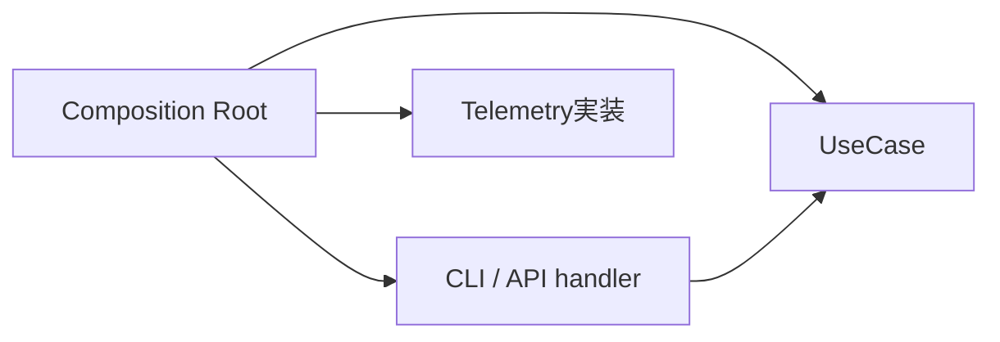
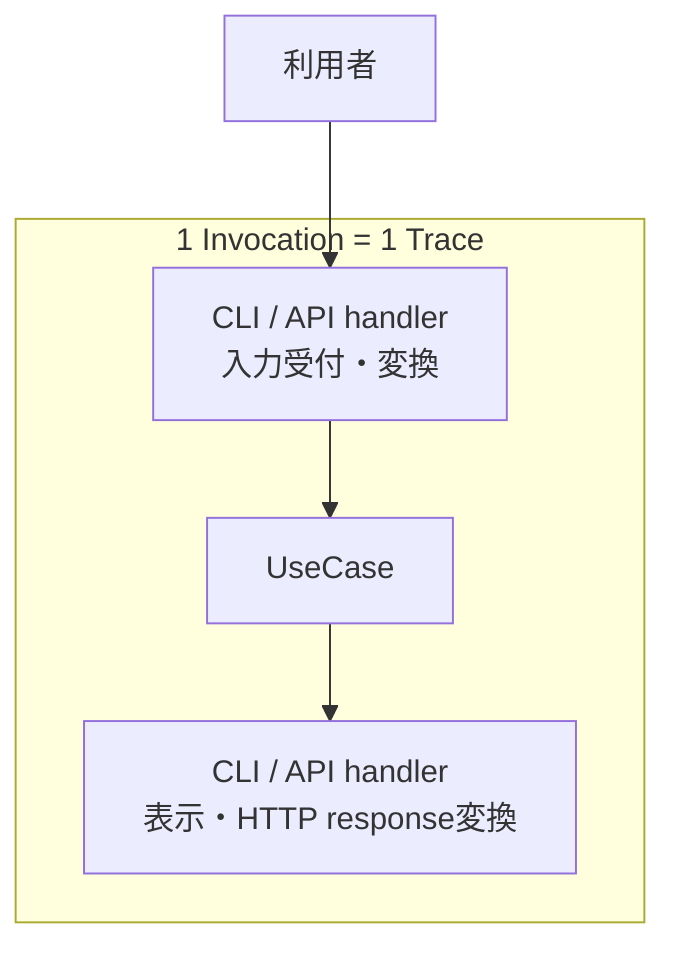
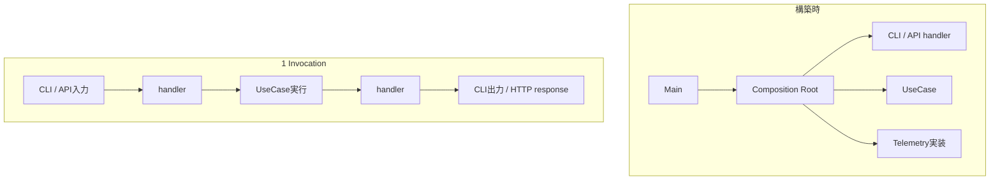
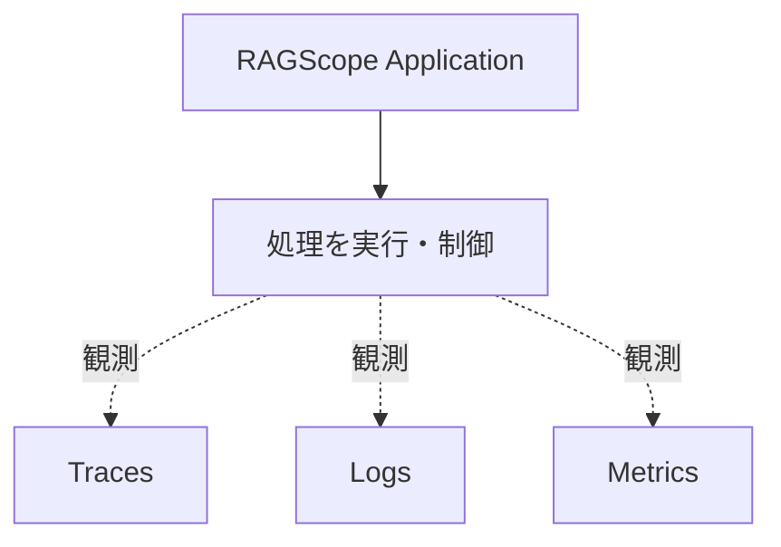
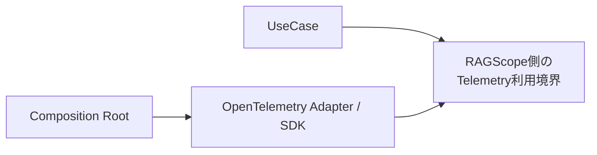
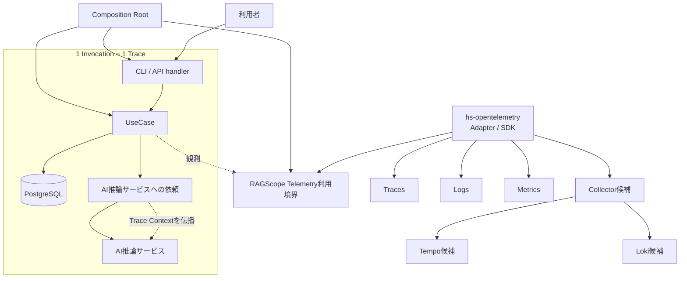
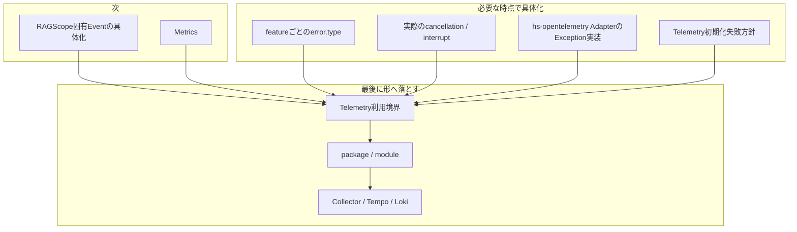

# RS-0023 Observability設計メモ

> [!note]
> これはRS-0023を考えるための**Workbench上の検討メモ**であり、RAGScopeの正本ではない。
> 現在の正本にあるUseCase境界とRAGScope Application / AI推論サービス / DBの責務を前提に、RS-0023で新しく決めるObservability設計だけを扱う。

## ✅ 今回決めたこと

### Composition Rootで依存を組み立てる

Composition Rootが、UseCaseや利用インターフェースに必要な依存をまとめて組み立てる。
OpenTelemetry SDKの初期化やExporterなどの実行時構成も、UseCaseの中ではなくこの外側で扱う。



Composition Rootは1回の利用者処理を構成する実行ステップではなく、実行に必要な部品を構築・接続する責務である。
APIサーバーのような長時間動作するプロセスでは、Composition Rootで一度構築したhandlerやUseCaseを複数のInvocationから利用できる。

実装上のmodule/function名として`Bootstrap`を使うかは、package / module設計時に決める。

### handlerはインターフェース固有の仕事をする

CLI / APIのhandlerは、入力をUseCaseへ渡せる形へ変換し、UseCaseを呼び、戻ってきた結果を表示やHTTPレスポンスへ変換する。
UseCase内部の依存構造までは知らず、Composition Rootから依存を閉じたUseCase実行能力を受け取る。

handlerはUseCaseの外側にあり、UseCase呼び出し前の入力受付・変換と、UseCase終了後の出力変換を担当する。
CLI parserやHTTP routingのどこまでをhandlerに含めるかという実装上の詳細境界は、必要になった時点で決める。

### Invocationを1 Traceの単位とする

RAGScopeがCLI / APIなどの利用インターフェースを通じて外部から1回呼び出され、その呼び出しに対する処理が完了するまでを**Invocation**と呼ぶ。

Invocationはmoduleやlayerではなく、1回の実行範囲を表す概念である。
1 Invocationに伴って発生する一連の処理を、1つのOpenTelemetry Traceとして追跡する。



UseCaseが呼び出される前にhandlerで処理が終了した場合でもInvocationは発生しているためTraceには残る。
一方、UseCaseは呼び出されていないためUseCase実行は発生しない。

RAGScope ApplicationからAI推論サービスなど別プロセスへ処理が続く場合は、Trace Contextを伝播し、同じInvocationに対応するTraceを継続する。

### Composition Root・handler・Invocation・UseCaseは同じ階層ではない

4つを`Composition Root -> handler -> Invocation -> UseCase`という処理順として扱わない。

| 概念 | 境界 |
|---|---|
| Composition Root | 実行に必要な依存を構築・接続する |
| handler | CLI / API固有表現とUseCaseの入力・結果の間を仲介する |
| Invocation | RAGScopeが外部から1回呼び出され、その処理が完了するまでの実行範囲 |
| UseCase | RAGScope ApplicationがUseCaseを呼び出してから、Applicationへ制御が戻るまで |

構築時と実行時は次のように分けて考える。



UseCaseから呼び出されるEmbedding生成、DB検索などは、そのUseCaseを構成する内部処理である。
AI推論サービス側の処理は同じTraceへ参加できるが、RAGScope Application側のUseCaseそのものではない。

すべてのRAGScope内部処理がhandlerやUseCaseを通るわけではない。
たとえばプロセス起動時のComposition Rootによる構築や、OpenTelemetry SDK / ExporterによるTelemetry送信はInvocationやUseCaseとは別の処理である。

### Telemetryは処理を制御しない

処理を続けるか、retryするか、timeoutで打ち切るかはRAGScope Applicationが決める。
Telemetryは、その処理を観測する。



Telemetryの都合でUseCaseの意味や処理順序を変えない。

### UseCaseへOpenTelemetry SDKを直接漏らさない

UseCaseがOpenTelemetry SDKそのものを直接扱う構造にはしない。
UseCaseから見えるのは、RAGScope側のTelemetry利用境界までとする。



Trace / Logs / Metricsの利用境界を1つにまとめるか分けるか、名前をどうするかは後で決める。

### Haskell側OpenTelemetry SDKは`hs-opentelemetry`を採用する

RAGScopeアプリケーションのOpenTelemetry SDKとして`hs-opentelemetry` 1.xを採用する。
`hs-opentelemetry`固有の型やAPIはOpenTelemetry Adapterの内側に閉じ込め、UseCaseやfeature固有のfailure型へ直接依存させない。

採用理由は次のとおり。

- RAGScopeが必要とするTrace、Logs、Context / Propagator、Processor、OTLP Exporterの主要能力が揃っている。
- HaskellでTrace + Logs + Context + Processor + OTLPまで一式を提供する実用的な候補として最も適合しており、同等の別SDKを探し続ける具体的な理由がない。
- OpenTelemetry SDK相当をRAGScopeで自作すると、Context管理、batching、Processor / Exporter、flush / shutdown、export失敗処理などRAGScope固有ではない責務まで保守することになる。
- 旧RS-0022でもSDK利用はPort / Adapterの内側へ隔離しており、今回も同じ境界を維持できるため、SDK採用がUseCase設計を固定する理由にはならない。

採用前の大規模PoCを必須条件にはしない。実装時にRAGScopeのGHC / dependency構成との互換性や、必要なAdapter動作を確認する。

この判断を見直すのは、`hs-opentelemetry` 1.xではRAGScopeの必須能力を薄いAdapterでも成立させられない、RAGScopeの採用GHC / dependency構成で実用上解消できない問題がある、またはSDKのruntime挙動がApplicationの正しさを損なう具体的事実が確認された場合とする。

### OpenTelemetryが持っているTelemetry基盤は作り直さない

RAGScope固有の意味はRAGScope側で持つ。一方、Telemetryの共通機構はOpenTelemetryへ任せる。

| 旧RS-0022で自前にしていたもの | 今回 |
|---|---|
| RAGScope独自LogRecord | 作らない |
| Logging Runtime | 作らない |
| 独自Sink | 作らない |
| Trace ContextをLoggingへ手動注入する仕組み | 作らない |
| OTelと並行する独自ログ転送基盤 | 作らない |

event名、属性、failureの意味など、RAGScope固有のTelemetry表現はRAGScope側で決める。

### OpenTelemetry Semantic Conventionsを優先する

Telemetry表現をRAGScope独自に定義する前に、対象へ適用可能なOpenTelemetry Semantic Conventionsが存在するか確認する。

適用可能なSemantic Conventionが存在する場合は、Span名、Span Kind、属性、event、Metric名・instrument・unitなど、そのConventionで定義されている表現を優先して使用する。
HTTP、Database、CLI、Exceptionなどについて、既存Conventionと同じ意味を持つRAGScope独自表現を重複して作らない。

RAGScope独自のTelemetry表現は、UseCase、Invocation、実験、評価データなど、既存のSemantic Conventionsだけでは表現できないRAGScope固有の意味に限定する。
独自属性が必要な場合も、まず既存属性を再利用できないか確認し、OpenTelemetryが使用するnamespaceと衝突する属性は作らない。

Semantic Conventionごとにstabilityが異なるため、実装時には使用するOpenTelemetry / instrumentationのバージョンと対象Conventionのstabilityを確認する。

### Span境界

Spanは、開始・終了、所要時間、失敗、親子関係を独立して確認する価値がある処理に切る。
既存のOpenTelemetry Semantic ConventionsがSpanモデルを定義している領域ではそのモデルを採用し、同じ意味のRAGScope独自Spanを重複して作らない。
RAGScope固有の処理についてだけ、独立して観測する価値がある場合にRAGScope独自Spanを追加する。

採用するSpan境界は次のとおり。

| 対象 | Span境界 | 表現方針 |
|---|---|---|
| Invocation | 専用Spanは作らない。Invocationは1 Traceの意味上の単位とする | API / CLIのentry側SpanをTraceの入口として使う |
| API | 1回のHTTP requestをSERVER Spanとして追跡する | HTTP Semantic Conventionsに従う |
| CLI | 1回のCLI executionをSpanとして追跡する | CLI Semantic Conventionsに従う |
| handler | 原則として独立Spanにしない | API / CLIのentry側Spanの内部処理として扱う |
| UseCase | 1回のUseCase実行を1 Spanとして追跡する | RAGScope固有Spanとして表現する |
| PostgreSQL | database client operationをDB client Spanとして追跡する | Database / PostgreSQL Semantic Conventionsに従う |
| AI推論サービスへの通信 | 通信のclient / server処理をSpanとして追跡する | 採用する通信方式に対応するHTTP / RPC等のSemantic Conventionsに従う |
| Embedding / generation | 適用可能なGenAI Semantic Conventionが定義するSpanモデルをまず採用する | GenAI Semantic Conventionsを確認し、同義のRAGScope独自Spanを重複させない |
| RAGScope内部処理 | 開始・終了、所要時間、失敗、親子関係を独立して確認する価値がある場合だけSpanにする | 必要な場合はRAGScope固有Spanとして表現する |
| retry attempt | instrumentationや対象SemConvですでにattempt単位のSpanが表現される場合は重複して作らない | 既存表現で不足する場合だけ対象機能の設計で追加要否を決める |

この表は、**どの処理をSpanとして扱うか**と、**そのSpanをどのSemantic ConventionまたはRAGScope固有表現で表すか**を決めるものである。
自動計装 / 手動計装のどちらでSpanを生成するかは別の実装論点であり、この表では決めない。

具体的なSpan名、属性、Span StatusのError条件は、適用するSemantic Conventionまたは対象機能の設計で後から具体化する。

## ✅ failure / Exception / interruption / Telemetry failureの扱い

通常のtyped failure、unexpected同期Exception、async interruption / cancellation、Telemetry基盤自身の失敗は、原因やApplicationへの意味が異なるため同じ経路へまとめない。

### typed failure

具体failureの意味は、そのfailureを所有するfeature / UseCase / operationが定義する。
RAGScope固有operationが最終的に失敗し、RAGScope側で`error.type`を付ける必要がある場合は、そのoperation / failureの所有側が安定した機械可読な分類規則を定義する。

具体failureの詳細値とTelemetry用の分類は分離する。`error.type`を得るために具体failureそのものを共通エラーへ置換せず、failureが保持する原因・詳細値を失わない。
failure型自身をOpenTelemetryやObservability固有型へ依存させない。分類規則が必要なら、実行状態やTrace Contextへ依存しない純粋な変換を第一候補とする。

operationのSpan Statusは、そのoperation自身の**最終結果**で決める。

```text
final success
  -> Span Status = Unset
  -> error.typeなし

final typed failure
  -> Span Status = Error
  -> 必要なerror.typeを設定
```

途中でfailureが発生しても、retryや代替処理によってoperationが最終的に成功した場合は、そのoperationのSpanをErrorにしない。
child Spanのfailureも、親operationのSpan Statusへ自動伝播させない。

HTTP、Database、GenAIなど適用可能なSemantic Conventionやinstrumentationが`error.type`を所有する領域では、同義のRAGScope独自分類を重複して作らない。
すべてのtyped failureへRAGScope独自分類を要求しない。

また、typed failureでSpanがErrorになったことだけを理由にLogRecordを自動生成しない。
retry scheduled、retry exhausted、timeoutなど、後から確認する意味がある出来事をeventとしてLogへ記録する。

**決定理由**: OpenTelemetryのRecording errorsでは、retryや内部処理でerrorが起きても最終的にoperationが成功した場合は、囲っているoperationをerrorとして記録しない。RAGScopeのUseCase設計でも、内部処理が失敗しても最終結果を成立させればUseCase成功であるため、この意味をそのままSpan Statusへ反映できる。Spanの結果とevent Logを分離することで、failureが発生しただけで同義のTelemetryを重複生成する必要もなくなる。

**見直し条件**: feature固有のfailureだけでは複数operationを横断して必要な集計・契約を成立させられない具体的要求が正本で追加された場合は、共通分類や共通型を再検討する。

### unexpected同期Exception

RAGScopeが所有するoperation境界からunexpectedな同期Exceptionがescapeする場合は、次の扱いを基本とする。

```text
unexpected synchronous Exception
  -> Span Status = Error
  -> error.type = exception class相当
  -> Exception Logを1件記録
  -> original Exceptionをrethrow
```

Exception LogではOpenTelemetryのException Logs Semantic Conventionを使用し、`exception.type`、`exception.message`、取得できる場合は`exception.stacktrace`を記録する。
`exception.stacktrace`は取得できる情報の品質を超えて作らない。

同じExceptionをUseCase / handler / rootなど伝播経路の各層で重複記録しない。
下位のHTTP / DB / GenAI instrumentationなどが同じExceptionをすでに所有・記録している場合は、RAGScope上位層が同じException Logを追加しない。
一方、親operation自身が最終的に失敗した場合に、その親SpanをErrorとすることはException Logの重複防止とは別に判断する。

`hs-opentelemetry`の`inSpan`は、既定ではescapeしたExceptionをSpanのException Eventとして記録する。一方、現在のOpenTelemetry Semantic ConventionsではExceptionをLogsとして記録する方向へ移行しているため、RAGScopeが所有するmanual SpanではSDKの既定挙動をそのままRAGScope契約にしない。
必要な場合はOpenTelemetry Adapterで既定のException記録を抑え、RAGScopeが採用するException Log + Span Status / `error.type`へ写像する。
具体的に`ExceptionHandler`を使うか、Span lifecycleを別の方法で扱うかはAdapter実装時に決める。

**決定理由**: OpenTelemetryではfailed operationのSpanをErrorにし、operationがExceptionで失敗した場合はExceptionをLogRecordとして記録することが推奨されている。また同じExceptionを複数回記録しないことが求められる。RAGScopeでもExceptionの観測のためにApplicationの例外制御を変えるべきではないため、記録後もoriginal Exceptionを維持する。

**見直し条件**: 採用する`hs-opentelemetry`の将来versionが現在のException Logs Semantic Conventionを直接扱い、RAGScope固有Adapterでの補正が不要になった場合はAdapter内部の実装を簡略化する。RAGScope側の「Span Error + Exception Log 1件 + rethrow」という意味は、OpenTelemetry仕様またはRAGScope要求が変わらない限り維持する。

### async interruption / cancellation

async interruption / cancellationをtyped failureやunexpected同期Exceptionへ一括して統合しない。
Haskellでは`AsyncCancelled`、`ThreadKilled`、`UserInterrupt`、`StackOverflow`、`HeapOverflow`などが同じ意味ではなく、`AsyncException`であることだけから「意図的cancellation」と判断できない。

async interruptionを捕捉する必要がある境界でも、original exceptionを飲み込まない。必要なcleanupとTelemetry処理を行った後はrethrowする。
Span StatusをErrorにするかUnsetにするかは、そのoperationのownerがその中断をどう扱うかで決める。
`ThreadKilled`を一律に正常cancellationとして扱う、またはすべての`AsyncException`を一律にErrorとして扱う共通規則は作らない。

**決定理由**: Haskellのasync exception constructorは発生理由の業務的意味を一意に表さない。たとえば`ThreadKilled`だけでは利用者が意図したcancelか、別の終了処理かを判別できず、`StackOverflow` / `HeapOverflow`までcancellationとして扱うのは不正確である。対象operationの意味を確認せずTelemetryだけで分類するとApplicationの結果意味とずれる。

**見直し条件**: RAGScopeに実際のstructured cancellation、CLI interrupt、timeout打ち切りなどの仕組みが実装される時点で、実際に発生・捕捉するExceptionとowner operationを確認し、そのケースに必要なStatus / Log表現を具体化する。

### Telemetry基盤自身の失敗

Exporter、Processor、Collectorへの送信などTelemetry基盤自身の失敗は、Application本体の結果を変更しない。
UseCaseが成功している場合、Telemetry exportに失敗してもUseCase成功のままとする。

Telemetry基盤の診断は、まず`hs-opentelemetry` SDK自身のerror handling / internal diagnosticsを使用する。
旧RS-0022の`LoggingFailureReporter`、独自Logging Runtime、独自Sinkのような別経路を先に再構築しない。
SDKで具体的に不足する診断要求が判明した場合だけRAGScope側の補助経路を追加検討する。

**決定理由**: ObservabilityはApplicationを観測するための補助機構であり、runtimeでTelemetryが壊れたことによって本来成功するApplication処理を失敗へ変えると、観測対象の意味そのものを変えてしまう。OpenTelemetryのerror handlingもruntimeのTelemetry失敗をApplicationへ未処理Exceptionとして漏らさないことを要求している。

**見直し条件**: Telemetryの欠落をApplication処理失敗として扱わなければならない明示的なRAGScope要求が追加された場合に限り再検討する。なお、SDK初期化時の設定不備で起動を失敗させるか、Telemetryなしで起動するかは別論点であり未決定とする。

### 現時点で採用しない・保留するもの

- **全体共通の上位`ErrorCategory`** は現時点では導入しない。旧設計には`Input` / `Resource` / `Data` / `Dependency` / `Timeout` / `Internal`のような横断カテゴリが存在したが、現在確認しているRAGScope要求から、異なるUseCaseやoperationをこの共通カテゴリで集計・分岐・契約化する必要性はまだ確認できていない。現在の要求なしに導入すると、feature固有のfailure分類とは別に維持すべき分類軸と共通依存を増やすためである。今後、横断的な成功率・failure集計、運用判断、API契約などで共通カテゴリが実際に必要だと正本から確認できた場合は、その要求と必要な分類粒度を基準に改めて設計する。
- **共通`ErrorType`型、共通`ErrorClassifier failure`型、専用の共通error package** は現時点では採用済みにしない。RAGScope固有operationの`error.type`を安定して決める責務は必要だが、それを全operationで共有する型・packageとして持つ必要があるかは未確認である。実際に複数のRAGScope固有operationで同じ抽象が必要になった時点で、公開API・依存方向・重複削減の効果を比較して判断する。
- **`OperationFailure`へ具体failureとClassifierをまとめ、root Spanまで共通分類を伝播する旧構造** は採用しない。entry SpanとUseCase Spanなど異なるoperationはそれぞれ自身の最終結果とSemConv / owner規則でStatus / `error.type`を決めるため、同じ分類をrootまで運ぶことを共通要件にしない。将来、異なるoperationへ同じfailure classificationを伝播させる明示的な要求が出た場合だけ再検討する。
- **typed failureを自動的にLogへ変換する共通処理** は採用しない。Span Statusとevent Logは別責務として扱う。featureごとの意味のあるeventが必要な場合にLogを定義する。
- **Exception Span EventをRAGScopeの新しい主表現にすること** は採用しない。現在のOpenTelemetry Exception Logs Semantic Conventionを優先する。OpenTelemetry側の仕様が再度変わった場合はその時点で再評価する。
- **`AsyncException`を一括してcancellationまたはErrorへ分類する規則** は採用しない。実際の中断源とowner operationが確定した時点で具体化する。

> [!important]
> このメモで「採用しない」「保留」と記録する場合は、後続の検討者が再評価できるように、**現在採用しない理由と、判断を見直す条件を可能な範囲で併記する**。現在要求から導入根拠を確認できないだけのものを、将来も不要な恒久ルールとして扱わない。

### 正本へ反映するときに確認する点

現在のADR-0005は、同じ失敗をSpanと構造化ログの両方へ記録する場合に同じ`error_type`値を使うとしている。
OpenTelemetryのException Logは`exception.type`を標準属性として使用するため、unexpected Exceptionについては「Spanの`error.type`とException Logの`exception.type`が同じ失敗クラスを表す」という意味を維持しつつ、同じ属性名をLogへ重複して持たせる必要があるかを正本反映時に確認する。

これはWorkbench上の判断だけで現在のADRを変更したことにはしない。

## ✅ Logsの共通設計

Logsの表現はOpenTelemetry Logs / Semantic Conventionsを土台とし、RAGScopeは既存仕様で表現できないRAGScope固有の意味だけを追加で所有する。
RAGScope独自のログモデルを作ってOpenTelemetryへ変換する構造にはせず、OpenTelemetryの表現へRAGScope固有Eventを載せる。

### Span・Span属性・Eventを分ける

期間を持つ処理はSpan、operation全体を説明する値はSpan属性、その時点で起きたこと自体を後から確認する意味がある出来事はEventとして表現する。
RAGScopeの構造化Eventは、`EventName`を持つOpenTelemetry `LogRecord`として記録する。

operationの開始・終了、duration、最終成功・失敗だけを表すLogを機械的に追加しない。これらはSpanとSpan Statusで表現する。
typed failureが発生したことだけでもEventを生成しない。retryを選択した、fallbackへ切り替えた、retryを使い切ったなど、failureとは別に時点として確認する意味がある出来事が存在する場合にEventを定義する。

### Eventのownerが意味と記録条件を定義する

RAGScope固有Eventを定義する場合は、その出来事を所有するfeature / UseCase / operationが次を定義する。

- Eventが表す出来事
- 記録条件
- `EventName`
- 発生時刻が指す時点
- 既定severity
- Event固有attributes

全Eventを先に共通型へ列挙したり、共通`LogSpec`のような型へ押し込んだりしない。
複数featureで実際に同じEvent定義を共有する必要が生じた場合にだけ共通化を検討する。

### Semantic ConventionsをEventでも優先する

対象の出来事に適用可能なOpenTelemetry Semantic Conventionが存在する場合は、そのEventName、attributes、severity等の定義を優先する。
同じ意味のRAGScope独自Eventや独自attributeを重複して定義しない。

RAGScope固有Eventが必要な場合は、OpenTelemetryのnamespaceと衝突しない`ragscope.*`をEventNameのnamespaceとして使用する。
ID、attempt番号、対象名など実行ごとに変化する値をEventNameへ埋め込まず、attributesとして持たせる。

Semantic Conventionごとにstabilityが異なるため、Developmentの規約を含む現在仕様の細部をRAGScope独自の恒久契約として固定しない。実装時に採用するOpenTelemetry / instrumentation versionと対象Conventionのstabilityを確認する。

### Trace Contextを独自属性として複製しない

Eventを現在のTrace / Spanへ関連付けるために、RAGScope独自の`trace_id` / `span_id`属性を追加しない。
OpenTelemetry `LogRecord`自身が持つTrace Contextとの関連付けを使用する。

旧RS-0022のように、Logging専用ContextへTrace Contextを手動注入する仕組みも作らない。

### 共通`payload`を設けない

旧ログ契約の`payload`のようなRAGScope共通コンテナは設けない。
Eventを検索・分類・集計するために機械可読であるべき値は、そのEventのattributesとして定義する。

`Body`をRAGScope固有の構造化契約の入れ物にはせず、必要な場合の補助的な表示情報として扱う。
RAGScope固有Eventの機械可読な意味は、EventNameとattributesで表現する。

### severityはOpenTelemetryの体系を使う

RAGScope独自の`debug` / `info` / `warn` / `error` / `fatal`という別のLog Level契約は新設計では維持しない。
Eventの重要度はOpenTelemetry `SeverityNumber`の意味体系に従い、各Eventのownerが既定severityを決める。

これはUseCaseやfeatureへ`hs-opentelemetry`固有型を直接渡すことを意味しない。SDK型を境界の外へ漏らすかどうかと、Telemetry上のseverity体系をOpenTelemetryへ合わせることは別問題として扱う。

severityからSpan Status、Applicationの最終結果、保存状態を導出しない。Span StatusとLog severityは引き続き独立した意味を持つ。

### signalごとのSemantic Conventionを使う

同じ論理的な失敗を複数signalへ反映する場合も、各signalへ適用されるSemantic Conventionの属性を使用する。
たとえばunexpected Exceptionでは、Span側は`error.type`、Exception Log側は`exception.type`を使用する。

同じ失敗を表す値の意味は矛盾させないが、同じ属性名をSpanとLogの両方へ置くことは共通契約として要求しない。
この方針を正本へ反映する際は、ADR-0005の「同じ失敗をSpanと構造化ログの両方へ記録する場合は同じ`error_type`を使う」という現在契約を、このsignalごとのSemantic Conventionとの関係が明確になるよう見直す。

## 今の一枚絵

ここまで決めた時点では、ざっくりこの形で考える。



Collector / Tempo / Lokiはまだ候補である。

## 🤔 次に決めること

Trace境界、Span境界、failure / Exception / interruption / Telemetry failureと、Logsの共通表現方針までは決めた。
次は、RAGScope固有Eventが実際に必要になるケースを具体例で確認しながらLogsを具体化し、Metricsを決める。その後でTelemetry利用境界とpackage / moduleへ落とす。



### 次: Logsの具体化 / Metrics

- Logs: retry、timeout、experimentなどを具体例に、Eventとして残す必要があるか、必要ならEventName、attributes、既定severity、記録条件を決める。
- Metrics: 処理時間、TTFT、token数など、RAGScopeで必要な計測を決める。

failure / Exceptionについては共通方針を再検討するのではなく、具体的なfeature / interruption / Adapterを設計するときに上記の未決定部分だけを具体化する。

### 最後: 実装境界と外部構成

実際に何を観測するかが決まってから、RAGScope側のTelemetry利用境界を決める。
そのAPIと依存方向を見てpackage / moduleを分け、最後にCollector / Tempo / Lokiを含む外部構成へ落とす。

packageを先に切って、あとから責務を当てはめる順番にはしない。

## 参考にした外部仕様・実装

- [OpenTelemetry — Logs Data Model](https://opentelemetry.io/docs/specs/otel/logs/data-model/)
- [OpenTelemetry — Events](https://opentelemetry.io/docs/specs/semconv/general/events/)
- [OpenTelemetry — Naming](https://opentelemetry.io/docs/specs/semconv/general/naming/)
- [OpenTelemetry — Recording errors](https://opentelemetry.io/docs/specs/semconv/general/recording-errors/)
- [OpenTelemetry — Exceptions in Logs](https://opentelemetry.io/docs/specs/semconv/exceptions/exceptions-logs/)
- [OpenTelemetry — Error handling](https://opentelemetry.io/docs/specs/otel/error-handling/)
- [hs-opentelemetry](https://github.com/iand675/hs-opentelemetry)