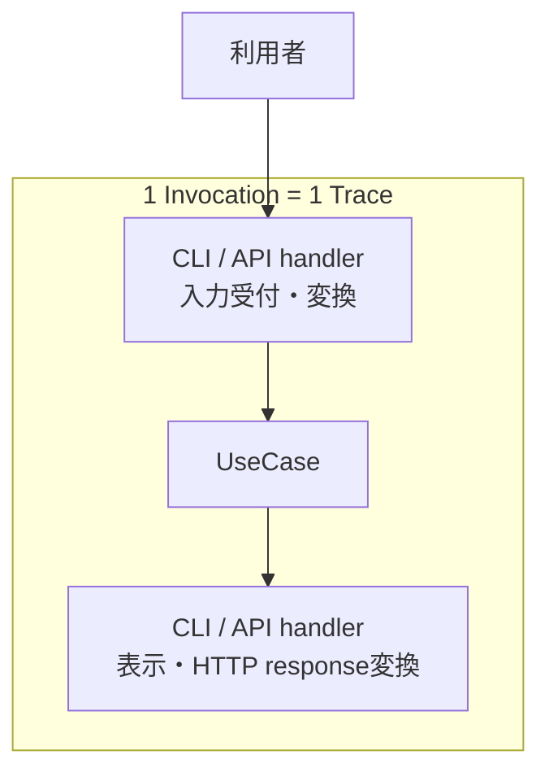

# RS-0023 Trace設計メモ

> [!note]
> これはRS-0023を考えるための**Workbench上の検討メモ**であり、RAGScopeの正本ではない。
> Observability全体の共通方針は[[RS-0023 Observability設計メモ]]を参照する。

## ✅ Traceの共通設計

### Invocationを1 Traceの単位とする

RAGScopeがCLI / APIなどの利用インターフェースを通じて外部から1回呼び出され、その呼び出しに対する処理が完了するまでを**Invocation**と呼ぶ。

Invocationはmoduleやlayerではなく、1回の実行範囲を表す概念である。
1 Invocationに伴って発生する一連の処理を、1つのOpenTelemetry Traceとして追跡する。



UseCaseが呼び出される前にhandlerで処理が終了した場合でもInvocationは発生しているためTraceには残る。
一方、UseCaseは呼び出されていないためUseCase実行は発生しない。

RAGScope ApplicationからAI推論サービスなど別プロセスへ処理が続く場合は、Trace Contextを伝播し、同じInvocationに対応するTraceを継続する。

### Invocation専用Spanは作らない

Invocationは1 Traceの意味上の単位であり、Invocationそのものを表す専用Spanは作らない。
APIではHTTP SERVER Span、CLIではCLI execution SpanをTraceの入口として使用する。

handlerは原則として独立Spanを持たず、entry側Spanの内部処理として扱う。
UseCaseはRAGScope固有の処理境界として、1回のUseCase実行を1 Spanで追跡する。

### Span境界

Spanは、開始・終了、所要時間、失敗、親子関係を独立して確認する価値がある処理に切る。
既存のOpenTelemetry Semantic ConventionsがSpanモデルを定義している領域ではそのモデルを採用し、同じ意味のRAGScope独自Spanを重複して作らない。
RAGScope固有の処理についてだけ、独立して観測する価値がある場合にRAGScope独自Spanを追加する。

採用するSpan境界は次のとおり。

| 対象 | Span境界 | 表現方針 |
|---|---|---|
| Invocation | 専用Spanは作らない。Invocationは1 Traceの意味上の単位とする | API / CLIのentry側SpanをTraceの入口として使う |
| API | 1回のHTTP requestをSERVER Spanとして追跡する | HTTP Semantic Conventionsに従う |
| CLI | 1回のCLI executionをSpanとして追跡する | CLI Semantic Conventionsに従う |
| handler | 原則として独立Spanにしない | API / CLIのentry側Spanの内部処理として扱う |
| UseCase | 1回のUseCase実行を1 Spanとして追跡する | RAGScope固有Spanとして表現する |
| PostgreSQL | database client operationをDB client Spanとして追跡する | Database / PostgreSQL Semantic Conventionsに従う |
| AI推論サービスへの通信 | 通信のclient / server処理をSpanとして追跡する | 採用する通信方式に対応するHTTP / RPC等のSemantic Conventionsに従う |
| Embedding / generation | 適用可能なGenAI Semantic Conventionが定義するSpanモデルをまず採用する | GenAI Semantic Conventionsを確認し、同義のRAGScope独自Spanを重複させない |
| RAGScope内部処理 | 開始・終了、所要時間、失敗、親子関係を独立して確認する価値がある場合だけSpanにする | 必要な場合はRAGScope固有Spanとして表現する |
| retry attempt | instrumentationや対象SemConvですでにattempt単位のSpanが表現される場合は重複して作らない | 既存表現で不足する場合だけ対象機能の設計で追加要否を決める |

この表は、**どの処理をSpanとして扱うか**と、**そのSpanをどのSemantic ConventionまたはRAGScope固有表現で表すか**を決めるものである。
自動計装 / 手動計装のどちらでSpanを生成するかは別の実装論点であり、この表では決めない。

具体的なSpan名、属性、Span StatusのError条件は、適用するSemantic Conventionまたは対象機能の設計で後から具体化する。

## ✅ failure / Exception / interruptionのTrace側の扱い

通常のtyped failure、unexpected同期Exception、async interruption / cancellationは、原因やApplicationへの意味が異なるため同じ経路へまとめない。

### typed failure

具体failureの意味は、そのfailureを所有するfeature / UseCase / operationが定義する。
RAGScope固有operationが最終的に失敗し、RAGScope側で`error.type`を付ける必要がある場合は、そのoperation / failureの所有側が安定した機械可読な分類規則を定義する。

具体failureの詳細値とTelemetry用の分類は分離する。`error.type`を得るために具体failureそのものを共通エラーへ置換せず、failureが保持する原因・詳細値を失わない。
failure型自身をOpenTelemetryやObservability固有型へ依存させない。分類規則が必要なら、実行状態やTrace Contextへ依存しない純粋な変換を第一候補とする。

operationのSpan Statusは、そのoperation自身の**最終結果**で決める。

```text
final success
  -> Span Status = Unset
  -> error.typeなし

final typed failure
  -> Span Status = Error
  -> 必要なerror.typeを設定
```

途中でfailureが発生しても、retryや代替処理によってoperationが最終的に成功した場合は、そのoperationのSpanをErrorにしない。
child Spanのfailureも、親operationのSpan Statusへ自動伝播させない。

HTTP、Database、GenAIなど適用可能なSemantic Conventionやinstrumentationが`error.type`を所有する領域では、同義のRAGScope独自分類を重複して作らない。
すべてのtyped failureへRAGScope独自分類を要求しない。

Logを生成するかどうかはSpan Statusとは別に判断する。Logs側の規則は[[RS-0023 Logs設計メモ]]を参照する。

**決定理由**: OpenTelemetryのRecording errorsでは、retryや内部処理でerrorが起きても最終的にoperationが成功した場合は、囲っているoperationをerrorとして記録しない。RAGScopeのUseCase設計でも、内部処理が失敗しても最終結果を成立させればUseCase成功であるため、この意味をそのままSpan Statusへ反映できる。

**見直し条件**: feature固有のfailureだけでは複数operationを横断して必要な集計・契約を成立させられない具体的要求が正本で追加された場合は、共通分類や共通型を再検討する。

### unexpected同期Exception

RAGScopeが所有するoperation境界からunexpectedな同期Exceptionがescapeする場合は、Trace側では次の扱いを基本とする。

```text
unexpected synchronous Exception
  -> Span Status = Error
  -> error.type = exception class相当
  -> original Exceptionをrethrow
```

Exception Logの記録と重複防止は[[RS-0023 Logs設計メモ]]で扱う。
親operation自身が最終的に失敗した場合に、その親SpanをErrorとすることはException Logの重複防止とは別に判断する。

### async interruption / cancellation

async interruption / cancellationをtyped failureやunexpected同期Exceptionへ一括して統合しない。
Haskellでは`AsyncCancelled`、`ThreadKilled`、`UserInterrupt`、`StackOverflow`、`HeapOverflow`などが同じ意味ではなく、`AsyncException`であることだけから「意図的cancellation」と判断できない。

async interruptionを捕捉する必要がある境界でも、original exceptionを飲み込まない。必要なcleanupとTelemetry処理を行った後はrethrowする。
Span StatusをErrorにするかUnsetにするかは、そのoperationのownerがその中断をどう扱うかで決める。
`ThreadKilled`を一律に正常cancellationとして扱う、またはすべての`AsyncException`を一律にErrorとして扱う共通規則は作らない。

**見直し条件**: RAGScopeに実際のstructured cancellation、CLI interrupt、timeout打ち切りなどの仕組みが実装される時点で、実際に発生・捕捉するExceptionとowner operationを確認し、そのケースに必要なStatus / Log表現を具体化する。

## 現時点で採用しない・保留するもの

- **全体共通の上位`ErrorCategory`** は現時点では導入しない。現在確認しているRAGScope要求から、異なるUseCaseやoperationを共通カテゴリで集計・分岐・契約化する必要性はまだ確認できていない。
- **共通`ErrorType`型、共通`ErrorClassifier failure`型、専用の共通error package** は現時点では採用済みにしない。RAGScope固有operationの`error.type`を安定して決める責務は必要だが、それを全operationで共有する型・packageとして持つ必要があるかは未確認である。
- **`OperationFailure`へ具体failureとClassifierをまとめ、root Spanまで共通分類を伝播する旧構造** は採用しない。entry SpanとUseCase Spanなど異なるoperationはそれぞれ自身の最終結果とSemConv / owner規則でStatus / `error.type`を決める。
- **`AsyncException`を一括してcancellationまたはErrorへ分類する規則** は採用しない。実際の中断源とowner operationが確定した時点で具体化する。

> [!important]
> 「採用しない」「保留」とした内容は、現在要求から導入根拠を確認できないためであり、将来も不要な恒久ルールを意味しない。必要な要求が正本で追加された場合は再評価する。

## feature側で具体化すること

Trace共通設計として次までは固定しない。

- Semantic Conventionで定義されないRAGScope固有Spanの具体名とattributes
- feature固有failureに必要な`error.type`値
- 実際のcancellation / interruptのStatus
- retry attemptをRAGScope固有Spanとして追加する必要性
- 実験実行が具体化された時点でのExperimentとTraceの関係
- `hs-opentelemetry` Adapterでの具体的なException処理実装

## 参考にした外部仕様・実装

- [OpenTelemetry — Recording errors](https://opentelemetry.io/docs/specs/semconv/general/recording-errors/)
- [hs-opentelemetry](https://github.com/iand675/hs-opentelemetry)
