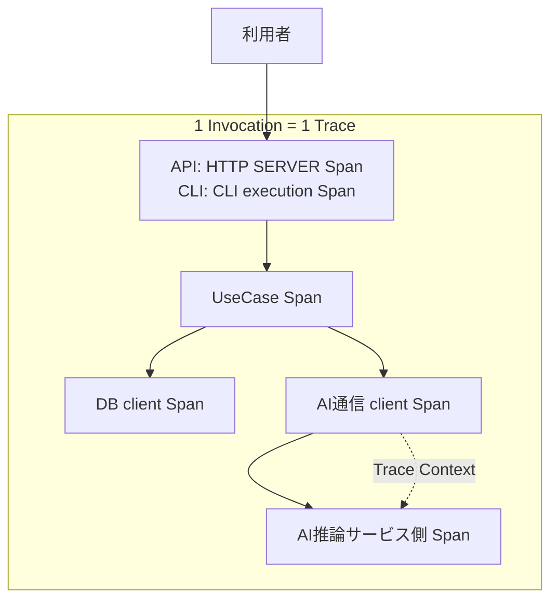

# RS-0023 Trace設計メモ

> [!note]
> これはRS-0023を考えるための**Workbench上の検討メモ**であり、RAGScopeの正本ではない。
> Observability全体の共通方針は[[RS-0023 Observability設計メモ]]を参照する。

## 30秒で見る

| 論点 | 状態 | 決定 |
|---|---|---|
| Trace単位 | ✅ | 1 Invocation = 1 Trace |
| Invocation専用Span | ✅ | 作らない |
| entry Span | ✅ | APIはHTTP SERVER Span、CLIはCLI execution Span |
| handler Span | ✅ | 原則作らない |
| UseCase Span | ✅ | 1 UseCase実行 = 1 RAGScope固有Span |
| DB / HTTP / GenAI | ✅ | 適用可能なSemantic Conventionsを優先 |
| Span Status | ✅ | operation自身の最終結果で決める |
| child failure | ✅ | 親SpanへErrorを自動伝播しない |
| async interruption | 注意 | 一律分類しない。実際の中断源とownerで具体化 |

## Trace構造

Invocationはmoduleやlayerではなく、RAGScopeがCLI / APIなどを通じて外部から1回呼び出され、その処理が完了するまでの**実行範囲**である。
UseCaseが呼ばれる前にhandlerで終了してもInvocationは発生するためTraceには残るが、UseCase Spanは発生しない。

## ✅ Span境界

Spanは、開始・終了、所要時間、失敗、親子関係を**独立して確認する価値がある処理**に切る。

| 対象 | Span境界 | 表現方針 |
|---|---|---|
| Invocation | 専用Spanは作らない | entry側SpanをTraceの入口として使う |
| API | 1 HTTP request = SERVER Span | HTTP Semantic Conventions |
| CLI | 1 CLI execution = Span | CLI Semantic Conventions |
| handler | 原則Spanにしない | entry側Spanの内部処理 |
| UseCase | 1 UseCase実行 = 1 Span | RAGScope固有Span |
| PostgreSQL | database client operation = DB client Span | Database / PostgreSQL Semantic Conventions |
| AI推論サービスへの通信 | client / server処理をSpan化 | HTTP / RPC等の適用SemConv |
| Embedding / generation | 適用可能なGenAI Spanモデルを優先 | 同義のRAGScope独自Spanを重複させない |
| RAGScope内部処理 | 独立観測する価値がある場合だけ | 必要ならRAGScope固有Span |
| retry attempt | 既存instrumentation / SemConvで表現されるなら追加しない | 不足時だけfeature設計で判断 |

自動計装 / 手動計装のどちらでSpanを生成するかは別の実装論点であり、ここでは決めない。
Semantic Conventionで決まらない具体Span名・attributesはfeature設計で具体化する。

## ✅ failure / Exception / interruption

| ケース | Span Status | `error.type` | その他 |
|---|---|---|---|
| final success | `Unset` | なし | — |
| final typed failure | `Error` | 必要ならownerが安定した分類を設定 | failure詳細値は失わない |
| intermediate failure → recovery成功 | 親operationは`Unset` | 親には不要 | retry / fallbackで回復したことだけで親をErrorにしない |
| child Span failure / parent success | 親は`Unset` | 親へ自動伝播しない | 各operation自身の結果で判断 |
| unexpected同期Exceptionがescape | `Error` | exception class相当 | original Exceptionをrethrow |
| async interruption / cancellation | ownerの意味で判断 | 一律規則なし | cleanup / Telemetry後もoriginal exceptionをrethrow |

Logを生成するかどうかはSpan Statusとは別に判断する。[[RS-0023 Logs設計メモ]]を参照する。

## 現時点で採用しない

| 候補 | 判断 | 理由 |
|---|---|---|
| 全体共通`ErrorCategory` | 採用しない | 異なるUseCase / operationを共通カテゴリで集計・契約化する要求を確認できていない |
| 共通`ErrorType` / `ErrorClassifier failure` / 専用error package | 採用しない | 全operationで共有する必要性を確認できていない |
| `OperationFailure`で分類をroot Spanまで伝播 | 採用しない | 各operationが自身の最終結果とSemConv / owner規則でStatus / `error.type`を決める |
| `AsyncException`を一律にcancellation / Errorへ分類 | 採用しない | constructorだけでは業務的意味を決められない |

> [!important]
> 「採用しない」は将来も不要という意味ではない。必要な要求が正本で追加された場合は再評価する。

## feature / 実装時に具体化すること

| 論点 | 具体化する時点 |
|---|---|
| RAGScope固有Spanの具体名 / attributes | 対象feature設計時 |
| feature固有failureの`error.type`値 | 対象operation設計時 |
| cancellation / interruptのStatus | 実際の中断源とownerが確定した時 |
| retry attemptのRAGScope固有Span要否 | 対象retry設計時 |
| ExperimentとTraceの関係 | 実験実行境界が具体化した時 |
| `hs-opentelemetry` AdapterのException処理 | Adapter実装時 |

## 詳細

> [!info]- typed failureの考え方
> 具体failureの意味は、そのfailureを所有するfeature / UseCase / operationが定義する。
> RAGScope固有operationが最終的に失敗し、RAGScope側で`error.type`を付ける必要がある場合は、そのownerが安定した機械可読な分類規則を定義する。
>
> 具体failureの詳細値とTelemetry用の分類は分離する。
> `error.type`を得るために具体failureそのものを共通エラーへ置換せず、failureが保持する原因・詳細値を失わない。
> failure型自身をOpenTelemetryやObservability固有型へ依存させない。
> 分類規則が必要なら、実行状態やTrace Contextへ依存しない純粋な変換を第一候補とする。
>
> HTTP、Database、GenAIなど適用可能なSemantic Conventionやinstrumentationが`error.type`を所有する領域では、同義のRAGScope独自分類を重複して作らない。
> すべてのtyped failureへRAGScope独自分類を要求しない。

> [!info]- Span Statusを最終結果で決める理由
> OpenTelemetryのRecording errorsでは、retryや内部処理でerrorが起きても最終的にoperationが成功した場合は、囲っているoperationをerrorとして記録しない。
> RAGScopeのUseCase設計でも、内部処理が失敗しても最終結果を成立させればUseCase成功であるため、この意味をSpan Statusへ反映する。
>
> 見直すのは、feature固有のfailureだけでは複数operationを横断して必要な集計・契約を成立させられない具体的要求が正本で追加された場合とする。

> [!info]- unexpected同期Exception
> RAGScopeが所有するoperation境界からunexpectedな同期Exceptionがescapeする場合は、Spanを`Error`とし、`error.type`へexception class相当を設定してoriginal Exceptionをrethrowする。
>
> Exception Logの記録と重複防止は[[RS-0023 Logs設計メモ]]で扱う。
> 親operation自身が最終的に失敗した場合に親SpanをErrorとすることは、Exception Logの重複防止とは別に判断する。

> [!info]- async interruption / cancellation
> async interruption / cancellationをtyped failureやunexpected同期Exceptionへ一括して統合しない。
> Haskellでは`AsyncCancelled`、`ThreadKilled`、`UserInterrupt`、`StackOverflow`、`HeapOverflow`などが同じ意味ではなく、`AsyncException`であることだけから「意図的cancellation」と判断できない。
>
> async interruptionを捕捉する必要がある境界でもoriginal exceptionを飲み込まない。
> 必要なcleanupとTelemetry処理を行った後はrethrowする。
>
> 見直すのは、RAGScopeに実際のstructured cancellation、CLI interrupt、timeout打ち切りなどが実装され、実際に発生・捕捉するExceptionとowner operationを確認できる時点とする。

## 参考

- [OpenTelemetry — Recording errors](https://opentelemetry.io/docs/specs/semconv/general/recording-errors/)
- [hs-opentelemetry](https://github.com/iand675/hs-opentelemetry)
