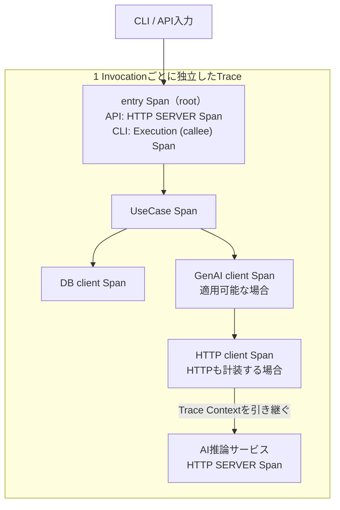

# RS-0023 Trace設計メモ

> [!note]
> これはRS-0023を正本へ反映する前にレビューするための**Workbench上の設計ドラフト**であり、RAGScopeの正本ではない。
> Observability全体の共通方針は[[RS-0023 Observability設計メモ]]を参照する。
> このノートで使うOpenTelemetry用語とRAGScope / RS-0023側の用語は[[RS-0023 Observability用語メモ]]を参照する。

## このノートが答える問い

> **RAGScopeの1回の実行を、Trace上でどこからどこまで・どんなSpanとして追うか？**

このノートでは、1 InvocationのTrace境界、Spanの切り方、成功・失敗・Exceptionの表現をレビューする。

## 要するに

RAGScopeでは、**1 Invocationごとに独立したTraceを開始して追跡する**。

APIではHTTP SERVER Span、CLIではExecution (callee) SpanがそのTraceのrootとなる`entry Span`を担当する。Invocation専用Spanは別に作らない。

その内側でUseCaseを1つのUseCase Spanとして追い、必要に応じてDB、GenAI、HTTPなどのSpanを子として記録する。

```text
API: HTTP SERVER Span / CLI: Execution (callee) Span  ← entry Span / root
└─ UseCase Span
   ├─ DB client Span
   └─ GenAI client Span                 ※適用可能な場合
      └─ HTTP client Span               ※HTTPも計装する場合
         └─ AI推論サービス HTTP SERVER Span
```

外部の呼び出し元からAPIへTrace Contextが届いても、現在はそのTraceへRAGScopeを参加させない。RAGScopeが新しいTraceを開始する。
一方、RAGScopeアプリケーションからAI推論サービスへはTrace Contextを引き継ぎ、同じTraceを継続する。

## Trace境界をどう決めるか

現在の要求とシステム構造では、利用者がCLI / APIを通じてRAGScopeへ行う1回のInvocationをトップレベルの追跡単位とする。

現在要求には、外部の呼び出し元が持つTraceへRAGScope APIを参加させ、さらにAI推論サービスまで1本の分散Traceとして継続することは含まれていない。
そのため、API / CLIのどちらから開始しても同じ単位で追跡できるよう、InvocationごとにRAGScopeが独立したTraceを開始する。

```text
RAGScopeが追跡するトップレベル単位 = 1 Invocation
    ↓
1 Invocationごとに独立したTraceを開始する
    ↓
API / CLIのentry Spanをrootにする
    ↓
APIが受信した外部Trace Contextはparentに使わない
```

APIへのリクエストにTrace Contextが含まれていても、そのContextをentry Spanの親にはしない。
外部Traceとの因果関係だけを残すSpan Linkについても、現在はその関連付けを必要とする要求がないため作成しない。

一方、RAGScopeアプリケーションからAI推論サービスへの呼び出しは、RAGScopeが開始したInvocationの内部処理である。RAGScopeアプリケーション側HTTP client SpanのTrace ContextをHTTP通信で引き継ぎ、AI推論サービス側HTTP SERVER Spanをその子Spanとして同じTraceへ記録する。

将来、外部の呼び出し元からRAGScope APIまでを1本の分散Traceとして継続する要求が追加された場合は、Invocationごとに独立したTraceを開始する現在の方針と外部Trace Contextの扱いを一緒に再評価する。
独立Traceを維持しつつ上流Traceとの因果関係だけを残す要求が追加された場合は、その時点でSpan Linkを再評価する。

## handlerとSpanは別の概念である

`handler`はRAGScopeアプリケーション上の境界処理であり、`entry Span`はそのInvocationを観測するためのSpanである。両者は同じ種類の概念ではない。

- `handler`は、CLI / API入力をUseCaseへ渡す値へ変換し、UseCaseを呼び出し、その結果をCLI表示やHTTP応答へ変換する。
- `entry Span`は、その1 Invocation全体をTrace上で観測するroot Spanである。
- `UseCase Span`は、handlerからUseCaseを呼び出してからRAGScopeアプリケーションへ制御が戻るまでを観測するchild Spanである。

entry Spanがhandlerの代わりに処理を行うわけではない。handler実行がentry Spanの計測範囲に含まれ、その途中でUseCaseが呼ばれたときだけUseCase Spanを作る。
UseCaseが呼ばれる前にhandlerで処理が終了してもInvocationは発生しているため、entry Spanは残る。一方、UseCaseは実行されていないのでUseCase Spanは作らない。

## 1 InvocationはTrace上でどう見えるか



この図はTrace上の親子関係を示している。handlerの責務そのものをSpan階層として表した図ではない。

GenAI client SpanはRAGScopeアプリケーションからモデルまたはGenAIサービスへ行う論理的な依頼全体を表し、HTTP client Spanはその依頼の中で行う1回のHTTP requestを表す。両方を計装する場合は別のSpanとして扱う。
適用可能なGenAI Spanがない場合、またはGenAI Spanを計装しない場合は、HTTP client SpanをUseCase Spanの子Spanとして記録する。

現行のGenAI Semantic Conventionsではclient側のinference / embeddings Spanは定義されているが、AI推論サービス側の汎用`gen_ai.inference.server` Spanは確認できない。そのため、AI推論サービス側へRAGScope独自のGenAI server Spanを補って作らない。将来、適用可能なserver側Conventionが成立した場合は、そのConventionを優先する。

## Spanをどこに切るか

Spanは、開始・終了、所要時間、失敗、親子関係を他の処理と分けて確認する必要があるoperationに作る。

| 対象 | Span境界 | 方針 |
|---|---|---|
| Invocation | 専用Spanは作らない | API / CLIのentry SpanをrootとしてInvocation全体を観測する |
| API | 1 HTTP request = SERVER Span | HTTP Semantic Conventionsに従う。RAGScope側では新しいTraceを開始する |
| CLI | 1 CLI program execution = Execution (callee) Span | CLI Semantic Conventionsに従う。RAGScope側では新しいTraceを開始する |
| handler | 専用Spanは作らない | handler実行はentry Spanの計測範囲に含める |
| UseCase | 1 UseCase実行 = 1 UseCase Span | RAGScope固有SpanとしてUseCase全体を追う |
| PostgreSQL | database client operation = DB client Span | Database / PostgreSQL Semantic Conventionsに従う |
| Embedding / generation | 1 logical client operation = GenAI client Span | 適用可能なGenAI Semantic Conventionsを優先する |
| AI推論サービスへのHTTP通信 | 1 HTTP request | RAGScopeアプリケーション側HTTP client SpanとAI推論サービス側HTTP SERVER Spanを同じTraceでつなぐ |
| UseCaseを構成する内部処理 | 他のSpanと分けて確認する必要がある処理 | 必要な場合だけRAGScope固有Spanを作る |
| retryの各試行 | 既存計装で区別できるなら追加しない | 既存計装では区別できず、その区別を必要とする要求がある場合だけ設計する |

適用可能なSemantic Conventionが同じoperationを表現できる場合は、同義のRAGScope固有Spanを重ねない。
自動計装 / 手動計装のどちらでSpanを生成するかは別の実装論点であり、このノートでは決めない。

RAGScopeの実行追跡にはOpenTelemetry Spanを使い、OpenTelemetry Spanとは別の実行追跡用の識別体系は設けない。同じ処理を2つの識別体系で追跡しないためである。

## 成功・失敗をどう表すか

Span Statusと`error.type`は、そのSpanが表すoperation自身の**最終結果**から決める。
子Spanが失敗したことだけを理由に、親Spanを`Error`にはしない。

このルールが必要なのは、内部処理が途中で失敗してもretry / fallbackによって親operation全体が成功する場合があるためである。親Spanは、内部で一度失敗したかではなく、親Span自身が表すoperationが最終的にどう終わったかを表す。

HTTP、CLI、Database、GenAIなど、適用するSemantic ConventionがStatusや`error.type`を定めているSpanでは、その規則を優先する。RAGScope固有Spanの規則で上書きしない。

たとえばAPIのentry SpanはHTTP SERVER SpanなのでHTTP Semantic Conventionsに従う。HTTP 4xx responseはSERVER Spanでは通常`Unset`のままであり、5xx responseなどHTTP operation自身がエラーとなる場合に`Error`となる。
CLIのentry SpanであるExecution (callee) Spanは、`process.exit.code`が0以外なら`Error`となる。
そのため、UseCase Spanが`Error`でも、それだけを理由にAPI / CLIのentry Spanを`Error`へ変えない。

RAGScope固有Spanでは、2026-09-06時点のRecording errorsの指針に沿って次のように扱う。

| operationの最終結果 | Span Status | `error.type` | その他 |
|---|---|---|---|
| 成功 | `Unset` | なし | — |
| エラー型で表す失敗により最終的に失敗 | `Error` | 対応するエラー型の値から、そのoperationに対応する予測可能で低カーディナリティな値へ変換 | エラー型の値が持つ詳細値や原因は失わない |
| 内部処理が失敗したがretry / fallbackで最終成功 | `Unset` | なし | 内部失敗だけを理由に親Spanを`Error`にしない |
| 想定外の同期Exceptionがoperation境界から外へ投げられる | `Error` | Exception型のcanonical class name | 元のExceptionを再送出する |
| 非同期中断 / キャンセル | そのoperationにおける中断の意味に従う | 一律規則なし | 必要な後始末とTelemetry処理の後も元のExceptionを再送出する |

Recording errorsはDevelopmentである。実装時に対象バージョンを再確認し、現在の細部をRAGScope独自の恒久契約として固定しない。

Logを生成するかどうかはSpan Statusとは別に判断する。[[RS-0023 Logs設計メモ]]を参照する。

## エラー型で表す失敗をSpanの`error.type`へどう変換するか

RAGScope全体の失敗理由の扱いは[[RS-0023 Observability設計メモ]]に従う。
契約上想定される失敗は、UseCaseまたは内部処理に対応するエラー型で表す。

Trace設計が担当するのは、**RAGScope固有Spanが表すoperationが最終的に失敗したとき、そのエラー型の値からSpanの`error.type`へどう変換するか**だけである。
API / CLIで利用者へ返す失敗情報や、実験・評価データモデルへ保存するerrorは、この`error.type`から決めない。

各エラー型とは別に、RAGScope全体で使う共通のエラー分類や、すべてのエラー型を中央で分類する仕組みは設けない。
各Spanは自身が表すoperationの最終結果と適用規則からStatus / `error.type`を決めるため、子Spanのエラー分類を親Spanへそのまま引き継ぐためだけの共通型も設けない。

複数のUseCaseや内部処理をまたいで、共通のエラー分類がないと必要な集計やContractを成立させられない具体的な要求が追加された場合に、共通分類の必要性を再評価する。

RAGScope固有Spanで使う`error.type`は、そのSpanが表すUseCaseまたは内部処理に対応するエラー型の値から、予測可能で低カーディナリティな値へ変換する。
`error.type`を得るために各エラー型を共通エラー型へ置き換えず、エラー型の値が持つ原因・詳細値を失わない。エラー型自身をOpenTelemetryやObservability固有型へ依存させない。

変換規則が必要なら、実行状態やTrace Contextへ依存しない純粋な変換を第一候補とする。
具体的なエラー型、`Either` / `ExceptT`などの利用位置は、このTrace共通設計では決めない。

HTTP、Database、GenAIなど、Semantic Conventionや計装が`error.type`を定めるSpanでは、その規則に従い、同義のRAGScope独自分類を重ねない。

## 想定外の同期Exception

RAGScope固有Spanが表すoperationの境界から想定外の同期Exceptionが外へ投げられる場合は、そのSpanを`Error`とし、`error.type`へException型のcanonical class nameを設定して元のExceptionを再送出する。

Exception Eventの記録と重複防止は[[RS-0023 Logs設計メモ]]で扱う。
子SpanでExceptionが発生していても、親Spanを`Error`にするかは親Span自身が表すoperationの最終結果から判断する。これはException Eventを重複記録しないこととは別の判断である。

## 非同期中断 / キャンセル

非同期中断 / キャンセルを、エラー型で表す失敗や想定外の同期Exceptionへ一括して統合しない。

Haskellでは`AsyncCancelled`、`ThreadKilled`、`UserInterrupt`、`StackOverflow`、`HeapOverflow`などが同じ意味ではなく、`AsyncException`であることだけから「意図的なキャンセル」と判断できない。

非同期中断を捕捉する必要がある境界でも元のExceptionを飲み込まない。必要な後始末とTelemetry処理を行った後は再送出する。

structured cancellation、CLIからの中断、timeoutによる打ち切りなどについて、実際に発生・捕捉するExceptionと中断されたoperationが特定できた時点で、そのSpan Statusを具体化する。

## Semantic Conventionsのstability

2026-09-06時点では、このTrace設計で参照する規約のstabilityは同一ではない。

| 対象 | stability | 扱い |
|---|---|---|
| `error.type`属性 | Stable | operationがどの種類のerrorで失敗したかを表す標準属性として利用する |
| HTTP client / server Span | Stable | API entry / HTTP通信へ適用する |
| SQL / PostgreSQL database client Span | Stable | PostgreSQL operationへ適用する |
| CLI Execution (callee) Span | Development | CLI entry Spanへ適用するが、現在の細部をRAGScope独自の恒久契約へコピーしない |
| Recording errors | Development | RAGScope固有SpanのStatus / `error.type`を決める指針として利用する |
| GenAI Semantic Conventions | Development | 適用可能なGenAIへの論理的な依頼に利用する。現在のSpan名・attributes等をRAGScope独自契約へ固定しない |

## このTrace共通設計では決めないこと

| 論点 | 具体化する時点 |
|---|---|
| RAGScope固有Spanの具体名 / attributes | そのSpanが表すUseCaseまたは内部処理を定義する時 |
| RAGScope固有Spanの`error.type`値 | 対応するエラー型を具体化する時 |
| API / CLIで利用者へ返す失敗表現 | API / CLI設計・Contract |
| 実験・評価データモデルへ保存するerror | 実験・評価の設計 / データモデル |
| RAGScopeアプリケーション / AI推論サービス間の失敗時の応答 / 失敗コード | AI通信方式・Contract設計時 |
| キャンセル / 中断時のStatus | 実際の中断源と、そのSpanが表すoperationが確定した時 |
| retryの各試行にRAGScope固有Spanが必要か | そのretryを定義する設計時 |
| ExperimentとTraceの関係 | Experimentをどの単位で実行・追跡するかを定義する時 |
| `hs-opentelemetry` AdapterのException処理 | Adapter実装時 |

## 参考

- [[RS-0023 Observability用語メモ]]
- [OpenTelemetry — Trace API](https://opentelemetry.io/docs/specs/otel/trace/api/)
- [OpenTelemetry — Context propagation](https://opentelemetry.io/docs/concepts/context-propagation/)
- [OpenTelemetry — `error.type`](https://opentelemetry.io/docs/specs/semconv/registry/attributes/error/)
- [OpenTelemetry — Recording errors](https://opentelemetry.io/docs/specs/semconv/general/recording-errors/)
- [OpenTelemetry — Semantic conventions for HTTP spans](https://opentelemetry.io/docs/specs/semconv/http/http-spans/)
- [OpenTelemetry — Semantic conventions for CLI programs](https://opentelemetry.io/docs/specs/semconv/cli/cli-spans/)
- [OpenTelemetry — SQL database semantic conventions](https://opentelemetry.io/docs/specs/semconv/db/sql/)
- [OpenTelemetry GenAI Semantic Conventions](https://github.com/open-telemetry/semantic-conventions-genai)
- [hs-opentelemetry](https://github.com/iand675/hs-opentelemetry)
