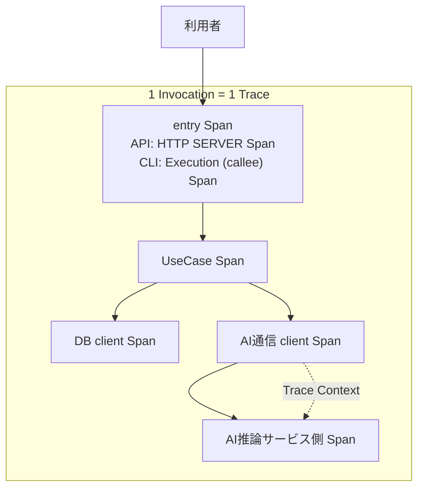

# RS-0023 Trace設計メモ

> [!note]
> これはRS-0023を正本へ反映する前にレビューするための**Workbench上の設計ドラフト**であり、RAGScopeの正本ではない。
> Observability全体の共通方針は[[RS-0023 Observability設計メモ]]を参照する。

## このノートでレビューすること

このノートは**上から順に読むレビュー用ドラフト**である。
RAGScopeの1回の実行をどのようなTrace / Spanとして追跡し、成功・失敗・Exceptionをどう表現するかをレビューする。

## このノートで使う用語

このノートでは、OpenTelemetryからそのまま使う用語、RAGScopeですでに定義されている用語、RS-0023のTrace設計で導入する用語を区別する。
同じ短い用語を複数箇所で使う場合は、ここで定義した意味で使用する。

### OpenTelemetryから使う用語

| 用語 | 意味 |
|---|---|
| Trace | 複数のSpanを親子関係などで結び、1つながりの処理として追跡するもの |
| Span | Trace内の1つのoperationを表す。開始・終了、所要時間、属性、Status、親子関係などを持つ |
| operation | Spanが表す1つの処理。OpenTelemetryで一般に使われる意味で使用し、RAGScope独自の`operation`型・識別子・実行追跡概念を新設する意味では使わない |
| parent / child Span | Span同士の親子関係。あるSpanが表すoperationの内部で別のoperationを追跡する場合、そのSpanをchild Spanとして表現できる |
| Span Status | Spanが表すoperationの最終状態を表すOpenTelemetryのStatus。この設計では主に`Unset` / `Error`を扱う |
| `error.type` | operationがエラーで終了した場合、そのエラーのクラスを表すOpenTelemetry Semantic Conventionsの属性 |
| Trace Context | Traceをコンポーネント間で継続するために引き継ぐTrace / SpanのContext |
| Semantic Conventions（SemConv） | Span名、Span Kind、attributes、`error.type`など、対象領域ごとのTelemetry表現を定めるOpenTelemetryの規約 |

現在の正本ADR-0005は、RAGScope独自の`operation`を実行追跡概念として設けず、OpenTelemetryのSpanで処理を表すことを定めている。
このドラフトでも`operation`は**Spanが表す処理**という意味だけで使用する。

### RAGScope / RS-0023側の用語

| 用語 | 出自 | 意味 |
|---|---|---|
| Invocation | RS-0023 Observability設計 | RAGScopeがCLI / APIなどを通じて外部から1回呼び出され、その処理が完了するまでの実行範囲。moduleやlayerではない |
| entry Span | RS-0023 Trace設計 | 1 Invocationについて、RAGScope側の処理をTrace上で追跡し始めるSpanの**役割名**。OpenTelemetryのSpan KindやSemantic Convention上のSpan種別名ではない。APIではHTTP SERVER Span、CLIではCLI SemConvのExecution (callee) Spanがこの役割を担う |
| UseCase | RAGScope正本 | 利用者がRAGScopeへ依頼するトップレベルな操作。具体的な実行境界と成功条件は正本のユースケース設計に従う |
| UseCase Span | RS-0023 Trace設計 | 1回のUseCase実行全体を表すRAGScope固有Span。UseCase Spanの配下には、DBアクセス、AI通信など内部operationを表すchild Spanが存在しうる |
| RAGScope固有Span | RS-0023 Trace設計 | 適用可能なSemantic Conventionだけでは表せないRAGScope固有の意味を持つoperationを追跡するSpan。UseCase Spanはその1つ |
| owner | この設計ドラフトで使う責務表現 | operation、failure分類、Telemetry表現などの意味や規則を定義する責務主体。具体的なownerは、そのUseCase・対象機能・対象処理を定義する設計で特定する |

### failure / Exceptionを区別するための用語

| 用語 | 意味 |
|---|---|
| typed failure | unexpected Exceptionと区別するために、このドラフトで処理の契約上想定されるfailureを指す便宜語。Haskellで`Either`等のどの型・機構を使って表現するかをこの用語だけで決めない |
| unexpected同期Exception | typed failureとして扱われず、RAGScopeが追跡するoperation境界から同期的にescapeするException |
| async interruption / cancellation | 実行中の処理を外部・非同期要因から中断するケースの総称。このドラフトでは`AsyncException`であることだけからcancellationやErrorへ一律分類しない |

## まず結論

- **1 Invocation = 1 Trace**とする。Invocation専用Spanは作らず、API / CLIに対応するentry SpanをTraceの入口として使う。
- 1 UseCase実行につきUseCase Spanを1つ作る。DBアクセス、AI通信など独立して追跡する価値がある内部operationはchild Spanとして表現する。
- handlerは原則として独立Spanにしない。
- DB / HTTP / GenAIなど適用可能なSemantic Conventionsがある領域では、その表現を優先する。
- Span Statusは各operation自身の最終結果で決め、child Spanのfailureを親Spanへ自動伝播しない。
- async interruption / cancellationは一律分類せず、実際の中断源とownerが分かる時点で具体化する。

## RAGScopeの1回の実行はTrace上どう見えるか

UseCaseが呼ばれる前にhandlerで終了してもInvocationは発生するためTraceには残るが、UseCase Spanは発生しない。

## Spanをどこに切るか

Spanは、開始・終了、所要時間、失敗、親子関係を**独立して確認する価値があるoperation**に切る。

| 対象 | Span境界 | 表現方針 |
|---|---|---|
| Invocation | 専用Spanは作らない | entry SpanをTraceの入口として使う |
| API | 1 HTTP request = SERVER Span | HTTP Semantic Conventions。entry Spanの役割を担う |
| CLI | 1 CLI program execution = Execution (callee) Span | CLI Semantic Conventions。entry Spanの役割を担う |
| handler | 原則Spanにしない | entry Spanの内部処理 |
| UseCase | 1 UseCase実行 = 1 UseCase Span | RAGScope固有Span。必要な内部operationはchild Spanとして追跡する |
| PostgreSQL | database client operation = DB client Span | Database / PostgreSQL Semantic Conventions |
| AI推論サービスへの通信 | client / server処理をSpan化 | HTTP / RPC等の適用SemConv |
| Embedding / generation | 適用可能なGenAI Spanモデルを優先 | 同義のRAGScope固有Spanを重複させない |
| RAGScope内部処理 | 独立観測する価値がある場合だけ | 必要ならRAGScope固有Span |
| retry attempt | 既存計装 / SemConvで表現されるなら追加しない | 不足時だけ対象機能の設計で判断 |

自動計装 / 手動計装のどちらでSpanを生成するかは別の実装論点であり、ここでは決めない。
Semantic Conventionで決まらない具体Span名・attributesは対象機能の設計で具体化する。

## 成功・失敗をどう表すか

| ケース | Span Status | `error.type` | その他 |
|---|---|---|---|
| final success | `Unset` | なし | — |
| final typed failure | `Error` | 必要ならownerが安定した分類を設定 | failure詳細値は失わない |
| intermediate failure → recovery成功 | 親operationは`Unset` | 親には不要 | retry / fallbackで回復したことだけで親をErrorにしない |
| child Span failure / parent success | 親は`Unset` | 親へ自動伝播しない | 各operation自身の結果で判断 |
| unexpected同期Exceptionがescape | `Error` | exception class相当 | original Exceptionをrethrow |
| async interruption / cancellation | ownerの意味で判断 | 一律規則なし | cleanup / Telemetry後もoriginal exceptionをrethrow |

Logを生成するかどうかはSpan Statusとは別に判断する。[[RS-0023 Logs設計メモ]]を参照する。

## このTrace共通設計ではまだ決めないこと

| 論点 | 具体化する時点 |
|---|---|
| RAGScope固有Spanの具体名 / attributes | 対象機能の設計時 |
| 対象機能固有failureの`error.type`値 | 対象operationの設計時 |
| cancellation / interruptのStatus | 実際の中断源とownerが確定した時 |
| retry attemptのRAGScope固有Span要否 | 対象retry設計時 |
| ExperimentとTraceの関係 | 実験実行境界が具体化した時 |
| `hs-opentelemetry` AdapterのException処理 | Adapter実装時 |

## 検討したが現在設計には採用しないもの

以下は**現在のTrace設計を構成する概念ではない**。
RS-0023の検討過程で候補になったが、現在の要求とTrace設計には不要と判断したものを、判断理由を失わないために残している。

| 候補 | 判断 | 理由 |
|---|---|---|
| 全体共通`ErrorCategory` | 採用しない | 異なるUseCase / operationを共通カテゴリで集計・契約化する要求を確認できていない |
| 共通`ErrorType` / `ErrorClassifier failure` / 専用error package | 採用しない | 全operationで共有する必要性を確認できていない |
| `OperationFailure`で分類をroot Spanまで伝播 | 採用しない | 各operationが自身の最終結果とSemConv / owner規則でStatus / `error.type`を決める |
| `AsyncException`を一律にcancellation / Errorへ分類 | 採用しない | constructorだけでは業務的意味を決められない |

> [!important]
> 「採用しない」は将来も不要という意味ではない。必要な要求が正本で追加された場合は再評価する。

## 判断理由・実装上の注意

> [!info]- typed failureの考え方
> 具体failureの意味は、そのfailureを所有するUseCase・対象機能・operationが定義する。
> RAGScope固有Spanが表すoperationが最終的に失敗し、RAGScope側で`error.type`を付ける必要がある場合は、そのownerが安定した機械可読な分類規則を定義する。
>
> 具体failureの詳細値とTelemetry用の分類は分離する。
> `error.type`を得るために具体failureそのものを共通エラーへ置換せず、failureが保持する原因・詳細値を失わない。
> failure型自身をOpenTelemetryやObservability固有型へ依存させない。
> 分類規則が必要なら、実行状態やTrace Contextへ依存しない純粋な変換を第一候補とする。
>
> HTTP、Database、GenAIなど適用可能なSemantic Conventionや計装が`error.type`を所有する領域では、同義のRAGScope独自分類を重複して作らない。
> すべてのtyped failureへRAGScope独自分類を要求しない。

> [!info]- Span Statusを最終結果で決める理由
> OpenTelemetryのRecording errorsでは、retryや内部処理でerrorが起きても最終的にoperationが成功した場合は、囲っているoperationをerrorとして記録しない。
> RAGScopeのUseCase設計でも、内部処理が失敗しても最終結果を成立させればUseCase成功であるため、この意味をSpan Statusへ反映する。
>
> 見直すのは、対象機能固有のfailureだけでは複数operationを横断して必要な集計・契約を成立させられない具体的要求が正本で追加された場合とする。

> [!info]- unexpected同期Exception
> RAGScopeが所有するoperation境界からunexpectedな同期Exceptionがescapeする場合は、Spanを`Error`とし、`error.type`へexception class相当を設定してoriginal Exceptionをrethrowする。
>
> Exception Logの記録と重複防止は[[RS-0023 Logs設計メモ]]で扱う。
> 親operation自身が最終的に失敗した場合に親SpanをErrorとすることは、Exception Logの重複防止とは別に判断する。

> [!info]- async interruption / cancellation
> async interruption / cancellationをtyped failureやunexpected同期Exceptionへ一括して統合しない。
> Haskellでは`AsyncCancelled`、`ThreadKilled`、`UserInterrupt`、`StackOverflow`、`HeapOverflow`などが同じ意味ではなく、`AsyncException`であることだけから「意図的cancellation」と判断できない。
>
> async interruptionを捕捉する必要がある境界でもoriginal exceptionを飲み込まない。
> 必要なcleanupとTelemetry処理を行った後はrethrowする。
>
> 見直すのは、RAGScopeに実際のstructured cancellation、CLI interrupt、timeout打ち切りなどが実装され、実際に発生・捕捉するExceptionと対象operationのownerを確認できる時点とする。

## 参考

- [OpenTelemetry — Trace API](https://opentelemetry.io/docs/specs/otel/trace/api/)
- [OpenTelemetry — Recording errors](https://opentelemetry.io/docs/specs/semconv/general/recording-errors/)
- [OpenTelemetry — Semantic conventions for CLI programs](https://opentelemetry.io/docs/specs/semconv/cli/cli-spans/)
- [hs-opentelemetry](https://github.com/iand675/hs-opentelemetry)
