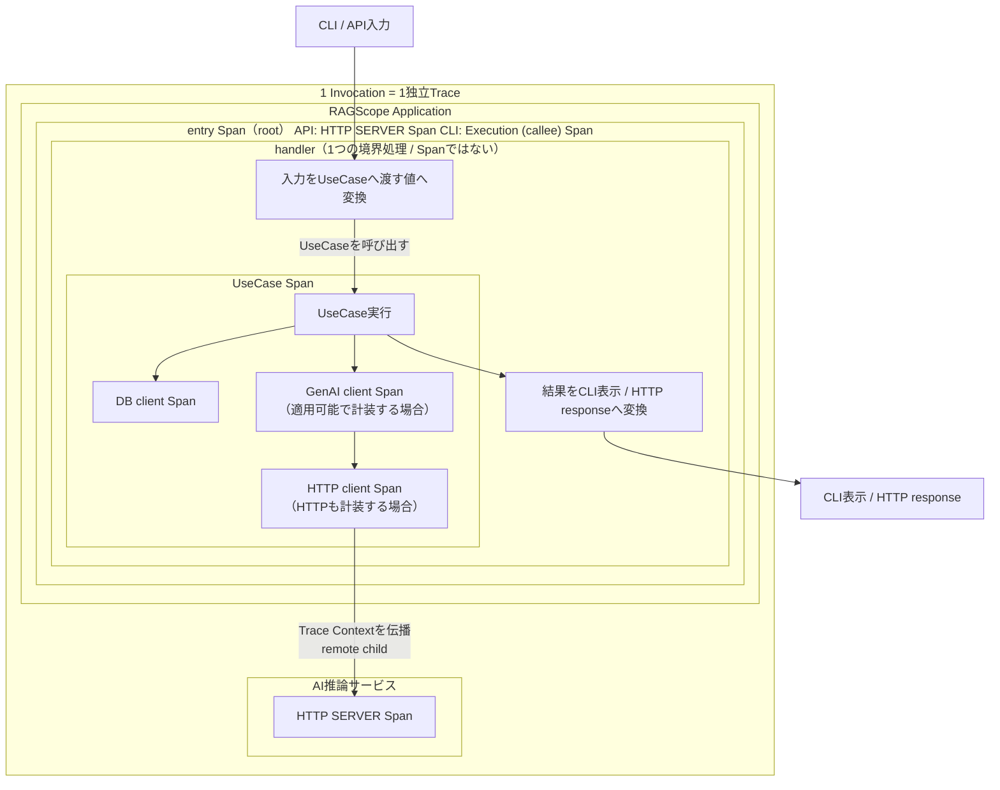

# RS-0023 Trace設計メモ

> [!note]
> これはRS-0023を正本へ反映する前にレビューするための**Workbench上の設計ドラフト**であり、RAGScopeの正本ではない。
> Observability全体の共通方針は[[RS-0023 Observability設計メモ]]を参照する。

## このノートでレビューすること

このノートは**上から順に読むレビュー用ドラフト**である。
RAGScopeの1回の実行をどのようなTrace / Spanとして追跡し、成功・失敗・Exceptionをどう表現するかをレビューする。

## このノートで使う用語

このノートでは、OpenTelemetryから使う用語、RAGScopeで定義済みの用語、RS-0023のTrace設計で使う用語を区別する。
同じ短い用語を複数箇所で使う場合は、ここで定義した意味で使用する。

### OpenTelemetryから使う用語

| 用語 | 意味 |
|---|---|
| Trace | 複数のSpanを親子関係などで結び、1つながりの処理として追跡するもの |
| Span | Trace内の1つのoperationを表す。開始・終了、所要時間、attributes、Status、親子関係などを持つ |
| operation | Spanが表す1つの処理 |
| parent / child Span | Span同士の親子関係。あるoperationの内部で別のoperationを追跡する場合、後者をchild Spanとして表現できる |
| Span Status | Spanが表すoperationの最終状態を表すOpenTelemetryのStatus。この設計では主に`Unset` / `Error`を扱う |
| `error.type` | operationがエラーで終了した場合、そのエラーのクラスを表すOpenTelemetry Semantic Conventionsの属性 |
| Trace Context | Traceをコンポーネント間で継続するために引き継ぐTrace / SpanのContext。RAGScopeではApplicationからAI推論サービスへの通信で引き継ぎ、同じTraceを継続する |
| Semantic Conventions（SemConv） | Span名、Span Kind、attributes、`error.type`など、対象領域ごとのTelemetry表現を定めるOpenTelemetryの規約 |

### RAGScope / RS-0023側の用語

| 用語 | 出自 | 意味 |
|---|---|---|
| Invocation | RS-0023 Observability設計 | RAGScopeがCLI / APIなどを通じて外部から1回呼び出され、その処理が完了するまでの実行範囲。RS-0023 Trace設計では**1 Invocation = 1独立Trace**として追跡する |
| entry Span | RS-0023 Trace設計 | 1 Invocationを表すTraceを開始するroot Spanの役割名。Invocation専用Spanは別に作らず、APIではHTTP SERVER Span、CLIではCLI SemConvのExecution (callee) Spanがこの役割を担う |
| UseCase | RAGScope正本 | 利用者がRAGScopeへ依頼するトップレベルな操作。実行境界と成功条件は正本のユースケース設計に従う |
| UseCase Span | RS-0023 Trace設計 | **1 UseCase実行につき1つ作り**、UseCase実行全体を表すRAGScope固有Span。DBアクセス、AI通信などUseCase内部のoperationを表すchild Spanを持ちうる |
| RAGScope固有Span | RS-0023 Trace設計 | 適用可能なSemantic Conventionだけでは表せないRAGScope固有のoperationを追跡するSpan。適用可能なSemConvで同じoperationを表現できる場合は同義のRAGScope固有Spanを重ねない。UseCase SpanはRAGScope固有Spanの1つ |

### failure / Exceptionを区別するための用語

| 用語 | 意味 |
|---|---|
| typed failure | 処理の契約上想定されるfailure。unexpected同期Exceptionと区別して扱う |
| unexpected同期Exception | typed failureとして扱われず、RAGScopeが追跡するoperation境界から同期的にescapeするException |
| async interruption / cancellation | 実行中の処理を外部・非同期要因から中断するケースの総称 |

## まず結論

- **1 Invocation = 1独立Trace**とする。Invocation専用Spanは作らず、API / CLIに対応するentry Spanをroot SpanとしてTraceの入口に使う。APIが外部から受け取ったTrace Contextはentry Spanのparentにはせず、現在要求のないLinkも設けない。
- このTrace境界は「1 Invocation = 1 Traceを維持するため」に先に決めたものではない。現在の要求とシステム境界から、RAGScopeが追跡するトップレベル単位を1 Invocationと決めた結果として、entry Spanがrootになりincoming Trace Contextをparentにしない。
- RAGScope ApplicationからAI推論サービスを呼び出す通信では通常のOpenTelemetry Trace Context propagationを使い、同一Traceを継続する。
- 1 UseCase実行につきUseCase Spanを1つ作る。DBアクセス、AI通信など、開始・終了・所要時間・失敗・親子関係をUseCase Spanと分けて確認する必要がある内部operationはchild Spanとして表現する。
- handlerは原則として独立Spanにしない。
- DB / HTTP / GenAIなど適用可能なSemantic Conventionsがある領域では、その表現を優先する。
- Span Statusは、SemConvで規則が定義されるSpanはその規則に従い、RAGScope固有Spanはoperation自身の最終結果で決める。child Spanのfailureを親Spanへ自動伝播しない。
- feature / UseCase固有のtyped failureを失敗意味の正本とし、RAGScope固有Spanがfinal failureで終了する場合はcurrent General Recording Errors guidanceに従って`error.type`へmappingする。RAGScope全体で共有する独立した`error_type` taxonomyは設けない。
- async interruption / cancellationは一律分類せず、実際の中断源と対象operationが確定した時点でStatusを決める。

## Trace境界をどう決めるか

現在のRAGScopeで追跡したいトップレベル単位は、利用者がCLI / APIを通じてRAGScopeへ行う1回のInvocationである。現在要求には、外部callerが持つTraceからRAGScope API、さらにAI推論サービスまでを1本のdistributed Traceとして継続することは要求されていない。

このため、API / CLIのどちらから開始しても同じ意味で追跡できるよう、InvocationごとにRAGScope自身が独立したTraceを開始する。

```text
要求・システム構造
    ↓
RAGScopeの追跡単位 = 1 Invocation
    ↓
1 Invocation = 1独立Trace
    ↓
entry Span = root Span
    ↓
incoming Trace Contextはparentとして使用しない
```

APIへincoming Trace Contextが渡されてもparentとしては使用しない。現在は、別Traceとの因果関係を残すためのSpan Linkを必要とする要求も確認できないためLinkも設けない。

一方、RAGScope Application → AI推論サービスはRAGScopeが開始したInvocationの内部処理である。ここではApplication側HTTP client SpanからTrace Contextを伝播し、AI推論サービス側HTTP SERVER Spanをremote childとして同一Traceを継続する。

将来、外部callerからRAGScope APIまでを1本のdistributed Traceとして継続する要求が追加された場合は、「1 Invocation = 1独立Trace」自体とincoming Trace Contextの扱いを一緒に再評価する。独立Traceを維持しつつ上流との因果関係だけを残す要求が追加された場合は、その時点でSpan Linkを再評価する。

## RAGScopeの1回の実行はTrace上どう見えるか

`handler`と`entry Span`は同じ種類の概念ではない。

- `handler`は、CLI / APIとUseCaseの間で、入力変換・UseCase呼び出し・結果変換を行うApplication上の**1つの境界処理**である。
- `entry Span`は、その1 InvocationをTrace上で観測するためのOpenTelemetryのroot Spanである。APIではHTTP SERVER Span、CLIではExecution (callee) Spanがこの役割を担う。
- `UseCase Span`は、そのhandlerが呼び出したUseCase実行を観測するchild Spanである。

つまり、entry Spanがhandlerの代わりに処理を行うわけではない。**1つのhandler実行がentry Spanの計測範囲の中で動き、その途中でUseCase Spanが開始・終了する**。



図の`handler`は1つであり、その実行の中に「入力変換 → UseCase呼び出し → 結果変換」がある。`UseCase Span`をhandlerの内側に描いているのは、handlerがUseCaseを呼び出して制御が戻るまで待つ実行上の包含関係を示すためであり、UseCaseそのものをhandlerの責務に含めるという意味ではない。

図のAI通信は、Embedding生成やgenerationなどApplication側でGenAI Semantic Conventionsが適用できるoperationの例を示している。GenAI client SpanはモデルまたはGenAIサービスへの**論理的な依頼**、HTTP client Spanはその依頼を運ぶ**HTTP transport**を表すため、同じSpanを二重に描いているわけではない。**両方を計装する場合**は、GenAI client SpanのchildとしてHTTP client Spanを置く。適用可能なGenAI Spanがない、またはGenAI Spanを計装しないoperationでは、HTTP client SpanをUseCase Span配下の通信operationとして記録できる。

AI推論サービス側のHTTP SERVER Spanは別コンポーネントで実行されるため、RAGScope Applicationのboxとは分けて描いている。ただしTrace上では、Application側のHTTP client SpanからTrace Contextを引き継ぐremote childであり、entry Spanの子孫として同じTraceに属する。図でコンポーネントのboxを分けていることは、Trace上の親子関係が切れることを意味しない。

現行のGenAI Semantic Conventionsではclient側のinference / embeddings Spanは定義されているが、AI推論サービス側の汎用`gen_ai.inference.server` Spanは確認できない。そのため、AI推論サービス側へRAGScope独自のGenAI server Spanを補って描かない。将来、適用可能なserver側Conventionが成立した場合は、その時点のConventionを優先する。

handlerの責務とUseCaseとの関係は[[RS-0023 Observability設計メモ#handler]]も参照する。
UseCaseが呼ばれる前にhandlerで終了してもInvocationは発生するためTraceには残るが、UseCase Spanは発生しない。

## Spanをどこに切るか

Spanは、開始・終了、所要時間、失敗、親子関係を他のSpanと分けて確認する必要があるoperationに切る。

| 対象 | Span境界 | 表現方針 |
|---|---|---|
| Invocation | 専用Spanは作らない | rootのentry SpanをTraceの入口として使う |
| API | 1 HTTP request = SERVER Span | HTTP Semantic Conventions。RAGScopeのentry Spanとして新しいTraceを開始する |
| CLI | 1 CLI program execution = Execution (callee) Span | CLI Semantic Conventions。rootのentry Spanとして新しいTraceを開始する |
| handler | 原則Spanにしない | entry Spanの内部処理 |
| UseCase | 1 UseCase実行 = 1 UseCase Span | RAGScope固有Span。必要な内部operationはchild Spanとして追跡する |
| PostgreSQL | database client operation = DB client Span | Database / PostgreSQL Semantic Conventions |
| Embedding / generation | ApplicationからモデルまたはGenAIサービスへの1 logical client operation = GenAI client Span | 適用可能なGenAI Semantic Conventionsを優先する。HTTPも計装する場合、そのtransport Spanとは別operationとして扱う |
| AI推論サービスへのHTTP通信 | HTTP request = Application側HTTP client Span + AI推論サービス側HTTP SERVER Span | HTTP Semantic Conventions。Trace Contextを伝播して同じTraceへ接続する。GenAI client Spanも計装する場合、HTTP client Spanはそのchild |
| RAGScope内部処理 | 開始・終了、所要時間、失敗、親子関係を他のSpanと分けて確認する必要がある場合だけ | 必要ならRAGScope固有Span |
| retry attempt | 既存計装 / SemConvでattemptを追跡できる場合は追加しない | 追跡できない場合は対象retry設計で判断 |

自動計装 / 手動計装のどちらでSpanを生成するかは別の実装論点であり、このノートでは決めない。
Semantic Conventionで決まらない具体Span名・attributesは対象機能の設計で具体化する。

RAGScopeの実行追跡にはOpenTelemetryのSpanを使用し、Spanと同じ処理を別に識別するRAGScope独自の実行追跡概念は設けない。同じ処理を2つの識別体系で追跡しないためである。

## 成功・失敗をどう表すか

Span Statusと`error.type`は、そのSpanが表すoperationを定義する規則から決める。
HTTP、CLI、Database、GenAIなど、適用するSemantic ConventionがStatusや`error.type`を定義しているSpanでは、その規則を優先する。RAGScope固有Spanへ、SemConv対象SpanのStatus規則を上書きして適用しない。

たとえばAPIのentry SpanはHTTP SERVER SpanなのでHTTP Semantic Conventionsに従う。HTTP 4xx responseはSERVER Spanでは通常`Unset`のままであり、5xx responseなどHTTP operation自身がエラーとなる場合に`Error`となる。CLIのentry SpanであるExecution (callee) Spanは、`process.exit.code`が0以外なら`Error`となる。このため、UseCase Spanが`Error`でもentry Spanが必ず`Error`になるわけではない。

RAGScope固有Spanについては、operation自身の最終結果を次のように表す。2026-09-06時点のGeneral Recording ErrorsはDevelopmentだが、failed operationではSpan Statusを`Error`にし`error.type`を設定することをSHOULDとしているため、このcurrent guidanceに従う。実装時には対象versionを再確認し、現在のDevelopment規則の細部をRAGScope独自の恒久契約として固定しない。

| ケース | Span Status | `error.type` | その他 |
|---|---|---|---|
| final success | `Unset` | なし | — |
| final typed failure | `Error` | typed failureから、そのoperationに対応する予測可能で低カーディナリティな値へmappingする | failure詳細値は失わない |
| intermediate failure → recovery成功 | `Unset` | なし | retry / fallbackで回復したことだけで、このSpanをErrorにしない |
| unexpected同期Exceptionがescape | `Error` | exception class相当 | original Exceptionをrethrow |
| async interruption / cancellation | 対象operationでの中断の意味に従う | 一律規則なし | cleanup / Telemetry後もoriginal exceptionをrethrow |

child Spanのfailureは親Spanへ自動伝播しない。親がRAGScope固有Spanなら親operation自身の最終結果で判断し、親がSemConv対象SpanならそのSemConvの規則で判断する。

Logを生成するかどうかはSpan Statusとは別に判断する。[[RS-0023 Logs設計メモ]]を参照する。

## failureの正本とTelemetry mapping

feature / UseCase固有のtyped failureをRAGScopeの失敗意味の正本とする。RAGScope全体で共有する独立した`ErrorType` / `error_type` taxonomyや、すべてのfailureを中央で分類する`ErrorClassifier`は設けない。

Trace設計が担当するのは、このtyped failureを**そのSpanが表すoperationのTelemetry表現へmappingする規則**である。API / CLIの利用者向け失敗表現と、実験・評価データモデルへ保存するerrorは別boundaryの責務であり、このTrace設計から`error.type`を逆流させて決めない。

| 項目 | 方針 | 理由 |
|---|---|---|
| feature / UseCase固有typed failure | 失敗意味の正本とする | failureの意味・詳細値・原因を、その処理を所有する設計と型で保持する |
| RAGScope共通`ErrorCategory` / `ErrorType` / `error_type` taxonomy | 設けない | typed failureと別の共通分類を置かなければ成立しない現在要求を確認できず、対応規則の二重管理とfeature間の不要な結合を作る |
| `ErrorClassifier failure` / 専用error package | 共通前提として設けない | 全operationを横断するtaxonomyを中央packageへ集約する要求がない |
| RAGScope固有Spanの`error.type` | final failureではcurrent General Recording Errors guidanceに従い、対象operationのtyped failureからmappingする | `error.type`はTelemetry boundaryの表現でありfailure modelそのものではない |
| SemConv対象Spanの`error.type` | 適用SemConvに従う | HTTP / Database / GenAI等のoperation固有規則をRAGScope分類で上書きしない |
| `OperationFailure`で分類を上位Spanまで伝播する仕組み | 設けない | 各Spanは自身のoperationの最終結果と適用規則からStatus / `error.type`を決める |
| `AsyncException`を一律にcancellation / Errorへ分類する規則 | 設けない | constructorだけでは中断の意味を特定できない |

Application / AI推論サービス間で共有するfailure codeが通信契約として必要になった場合は、その通信Contractで定義する。RAGScope全体の共通`error_type`として先に定義しない。

## Semantic Conventionsのstability

このTrace設計で参照する規約はstabilityが同一ではない。2026-09-06時点では次のように扱う。

| 対象 | stability | 扱い |
|---|---|---|
| `error.type`属性 | Stable | operationの失敗クラスを表す標準属性として利用する |
| HTTP client / server Span | Stable | API entry / HTTP transportへ適用する |
| SQL / PostgreSQL database client Span | Stable | PostgreSQL operationへ適用する |
| CLI Execution (callee) Span | Development | CLI entry Spanへ適用するが、現在の細部をRAGScope独自の恒久契約へコピーしない |
| General Recording Errors | Development | RAGScope固有Spanのerror記録を決めるcurrent guidanceとして利用し、実装時に対象versionを再確認する |
| GenAI Semantic Conventions | Development | 適用可能なlogical operationに利用するが、現在のSpan名・attributes等をRAGScope独自契約へ固定しない |

## このTrace共通設計では決めないこと

| 論点 | 具体化する時点 |
|---|---|
| RAGScope固有Spanの具体名 / attributes | 対象機能の設計時 |
| 対象機能固有failureの`error.type`値 | 対象operationの設計時 |
| API / CLIで利用者へ返すfailure表現 | 各interface設計 / Contract |
| 実験・評価データモデルへ保存するerror | 実験・評価機能設計 / データモデル |
| Application / AI推論サービス間のfailure response / code | AI通信方式・Contract設計時 |
| cancellation / interruptのStatus | 実際の中断源と対象operationが確定した時 |
| retry attemptのRAGScope固有Span要否 | 対象retry設計時 |
| ExperimentとTraceの関係 | 実験実行境界が具体化した時 |
| `hs-opentelemetry` AdapterのException処理 | Adapter実装時 |

## 判断理由・実装上の注意

> [!info]- typed failureの考え方
> 具体failureの意味は、そのfailureを定義するUseCase・対象機能・operationの設計が定める。
> RAGScope固有Spanが表すoperationが最終的に失敗した場合は、current General Recording Errors guidanceに従い、そのoperationを定義する設計でtyped failureから予測可能で低カーディナリティな`error.type`へのmappingを定める。
>
> 具体failureの詳細値とTelemetry用の分類は分離する。
> `error.type`を得るために具体failureそのものを共通エラーへ置換せず、failureが保持する原因・詳細値を失わない。
> failure型自身をOpenTelemetryやObservability固有型へ依存させない。
> 分類規則が必要なら、実行状態やTrace Contextへ依存しない純粋な変換を第一候補とする。
>
> HTTP、Database、GenAIなど適用可能なSemantic Conventionや計装が`error.type`を定める領域では、同義のRAGScope独自分類を重複して作らない。
> すべてのtyped failureに共通`error_type`や共通taxonomyを持たせない。RAGScope固有Spanがfinal failureになる場合に、そのSpanが表すoperationに対応するTelemetry mappingを定める。
>
> `typed failure`という用語だけでは、Haskellで`Either`、Exception、その他のどの型・機構を使って表現するかを決めない。

> [!info]- RAGScope固有SpanのStatusを最終結果で決める理由
> OpenTelemetryのRecording Errorsでは、retryや内部処理でerrorが起きても、最終的にoperationが成功した場合は、囲っているoperationをerrorとして記録しない。
> RAGScopeのUseCase設計でも、内部処理が失敗しても最終結果を成立させればUseCase成功であるため、UseCase SpanなどRAGScope固有Spanにはこの意味を反映する。
>
> 対象機能固有のfailureだけでは複数operationを横断して必要な集計・契約を成立させられない要求が追加された場合は、その具体的要求を基準に共通分類の必要性を再評価する。

> [!info]- unexpected同期Exception
> RAGScope固有operationの境界からunexpectedな同期Exceptionがescapeする場合は、そのSpanを`Error`とし、`error.type`へexception class相当を設定してoriginal Exceptionをrethrowする。
>
> Exception Logの記録と重複防止は[[RS-0023 Logs設計メモ]]で扱う。
> 親operation自身が最終的に失敗した場合に親SpanをErrorとすることは、Exception Logの重複防止とは別に判断する。

> [!info]- async interruption / cancellation
> async interruption / cancellationをtyped failureやunexpected同期Exceptionへ一括して統合しない。
> Haskellでは`AsyncCancelled`、`ThreadKilled`、`UserInterrupt`、`StackOverflow`、`HeapOverflow`などが同じ意味ではなく、`AsyncException`であることだけから「意図的cancellation」と判断できない。
>
> async interruptionを捕捉する必要がある境界でもoriginal exceptionを飲み込まない。
> 必要なcleanupとTelemetry処理を行った後はrethrowする。
>
> structured cancellation、CLI interrupt、timeout打ち切りなどについて実際に発生・捕捉するExceptionと対象operationが特定できた時点で、そのStatusを具体化する。

## 参考

- [OpenTelemetry — Trace API](https://opentelemetry.io/docs/specs/otel/trace/api/)
- [OpenTelemetry — Context propagation](https://opentelemetry.io/docs/concepts/context-propagation/)
- [OpenTelemetry — `error.type`](https://opentelemetry.io/docs/specs/semconv/registry/attributes/error/)
- [OpenTelemetry — Recording errors](https://opentelemetry.io/docs/specs/semconv/general/recording-errors/)
- [OpenTelemetry — Semantic conventions for HTTP spans](https://opentelemetry.io/docs/specs/semconv/http/http-spans/)
- [OpenTelemetry — Semantic conventions for CLI programs](https://opentelemetry.io/docs/specs/semconv/cli/cli-spans/)
- [OpenTelemetry — SQL database semantic conventions](https://opentelemetry.io/docs/specs/semconv/db/sql/)
- [OpenTelemetry GenAI Semantic Conventions](https://github.com/open-telemetry/semantic-conventions-genai)
- [hs-opentelemetry](https://github.com/iand675/hs-opentelemetry)
