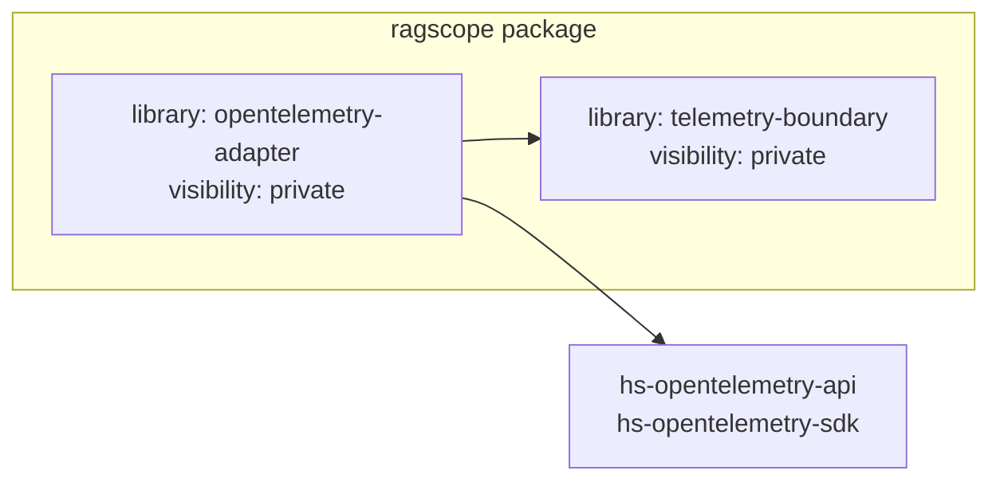

# RS-0024 Haskellライブラリ・モジュールマップ

> [!note]
> これはRS-0024実行中のWorkbench Noteであり、RAGScopeの現在設計の正本ではない。
> 現在設計はRAGScope正本リポジトリの`project-docs/design/RAGScopeアプリケーションHaskell構成設計.md`とADR-0007、実装後の正確なcomponent・依存は`ragscope.cabal`、Haskellコード、テストを参照する。

## 今回のSubtaskで作るCabal component



今回の`RS-0024/sdk-cabal-boundary`では、まず次の2 libraryだけを構築してCabalの依存境界を確認する。

- `telemetry-boundary`: UseCaseや内部処理から使うSDK非依存のTelemetry境界
- `opentelemetry-adapter`: `telemetry-boundary`をOpenTelemetry Haskell API / SDKへ接続するAdapter

現在の無名main libraryをRAGScopeアプリケーション全体の受け皿として使わない。代わりに包括的な`application` libraryを作って今後の機能moduleを集約することもしない。

文書、検索、評価、実験など将来の機能について、このNoteでlibrary構成を先に固定しない。各実装時に実際の型、import、呼び出すAPI、package依存と、Cabalで禁止したい依存方向を確認してcomponent境界を決める。

## 最小module構成

このSubtaskでは依存境界を成立させるための最小moduleだけを置く。

| library | module | このSubtaskでの役割 |
|---|---|---|
| `telemetry-boundary` | `RAGScope.Telemetry` | SDK非依存componentとしてbuild/importできる入口 |
| `opentelemetry-adapter` | `RAGScope.Telemetry.OpenTelemetry` | `RAGScope.Telemetry`とOpenTelemetry API / SDKを同じcomponentからimportできることを確認する入口 |

`RAGScope.Telemetry.Trace`、`Logs`、`Metrics`、`Context`や、Adapter側の`Lifecycle`などの具体的なmodule分割はこのSubtaskで先行して固定しない。後続Subtaskで実際の型・関数・SDK APIを決める時点で必要な責務に沿って追加する。

## Cabal依存

| component | RAGScope内の依存 | OpenTelemetry package |
|---|---|---|
| `library telemetry-boundary` | なし | 依存しない |
| `library opentelemetry-adapter` | `ragscope:telemetry-boundary` | `hs-opentelemetry-api ^>=1.0.0.0`、`hs-opentelemetry-sdk ^>=1.0.0.0` |

`OpenTelemetry.Trace`は`hs-opentelemetry-sdk`、`OpenTelemetry.Trace.Core`は`hs-opentelemetry-api`が提供するため、Adapterが両方を直接importする場合は両packageを直接`build-depends`へ宣言する。

`hs-opentelemetry-exporter-in-memory`はproductionの`opentelemetry-adapter`には追加しない。後続でテストに実際に使用する時点で、そのtest componentの依存として追加する。

## 依存境界の検証

最初に実際のlibrary target名を確認する。

```bash
cd ragscope-app
cabal target all:libs
```

その出力にある完全修飾targetを使って検証する。target名は実測前に固定しない。

続いてlibrary全体とpackage全体をbuildする。

```bash
cabal build all:libs
cabal build all
```

`telemetry-boundary`のREPLでは次を確認する。

```haskell
import RAGScope.Telemetry ()         -- 成功
import OpenTelemetry.Trace ()       -- 失敗
import OpenTelemetry.Trace.Core ()  -- 失敗
```

`opentelemetry-adapter`のREPLでは次を確認する。

```haskell
import RAGScope.Telemetry ()         -- 成功
import OpenTelemetry.Trace ()       -- 成功
import OpenTelemetry.Trace.Core ()  -- 成功
```

`cabal repl --build-depends=...`はREPLへ追加packageを露出させ、検証対象のCabal境界を変更するため使用しない。

## このSubtaskの後

このSubtaskで確認するのはCabal componentとSDK依存境界までである。RS-0024全体では後続SubtaskでTelemetry利用API、OpenTelemetry SDK lifecycle / Context、Trace / Logs / Metrics、例外・失敗時の挙動と自動テストを順に具体化する。
