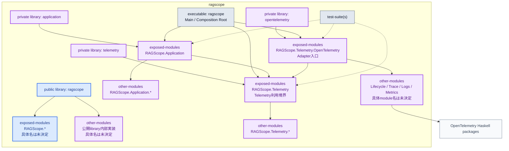
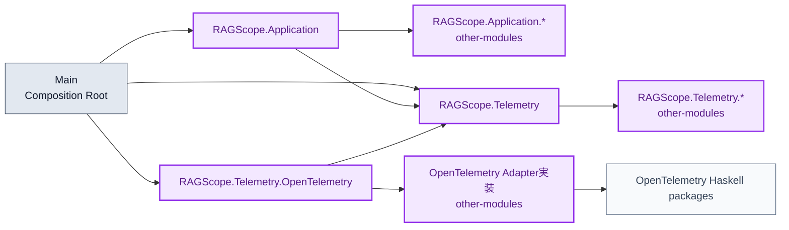

# RS-0024 Haskellライブラリ・モジュールマップ

> [!note]
> これはRS-0024の実装前にレビューするためのWorkbench上の設計ドラフトであり、RAGScopeの正本ではない。
> library名とmodule名はこのNoteでレビューする提案である。

## library / component map



- `application`は`telemetry`へ依存する。
- `application`は`opentelemetry`とOpenTelemetry packageへ依存しない。
- `telemetry`はOpenTelemetry packageへ依存しない。
- `opentelemetry`だけがOpenTelemetry packageへ依存する。
- private libraryをまたいで利用するmoduleは`exposed-modules`、そのlibrary内だけで使うmoduleは`other-modules`に置く。

## module dependency map



禁止する依存は次のとおり。

```text
application -X-> opentelemetry
application -X-> OpenTelemetry packages
telemetry -X-> opentelemetry
telemetry -X-> OpenTelemetry packages
opentelemetry -X-> application
```
