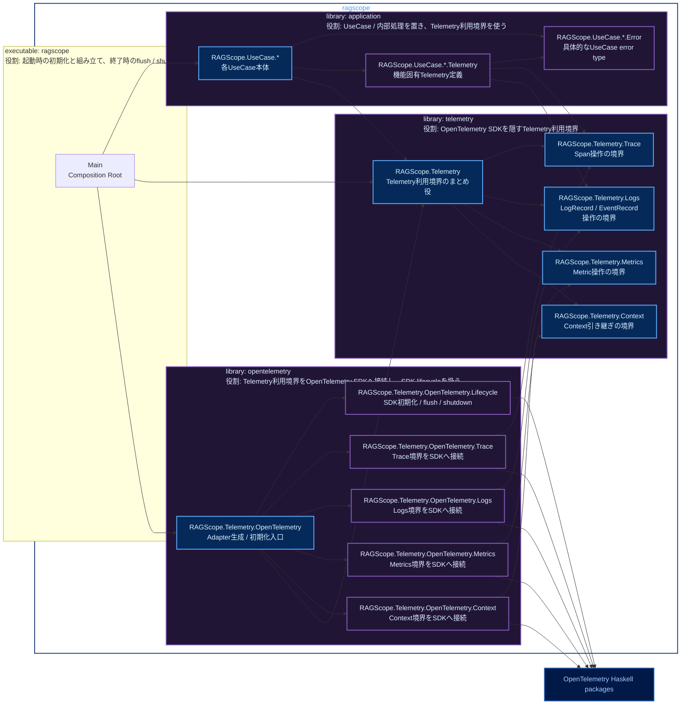

# RS-0024 Haskellライブラリ・モジュールマップ

> [!note]
> これはRS-0024の実装前にレビューするためのWorkbench上の設計ドラフトであり、RAGScopeの正本ではない。
> library名とmodule名はこのNoteでレビューする提案である。

Mermaidの色分けは[[Mermaid図の色分けルール]]に従う。

## library / module map



凡例: **青** = 公開library / module、**紫** = 非公開library / module、**濃青** = 外部package、**実線** = 本体の依存

現在の`application`、`telemetry`、`opentelemetry`はprivate libraryなのでlibrary枠は紫とする。別componentからimportする`exposed-modules`は青、そのlibrary内部だけで使う`other-modules`は紫で表す。

`RAGScope.UseCase.*`、`RAGScope.UseCase.*.Error`、`RAGScope.UseCase.*.Telemetry`の`*`は図上の省略表記であり、実際のHaskell module名ではない。例えば`RAGScope.UseCase.IndexDocument`、`RAGScope.UseCase.IndexDocument.Error`、`RAGScope.UseCase.IndexDocument.Telemetry`のような具体名になる。

テスト用componentは今回のlibrary / module構成レビューから一旦省略する。テストを作成しないという意味ではない。

## library / moduleの役割

### `application`

RAGScopeアプリケーションのUseCaseと、そのUseCaseを構成する内部処理を置く。`telemetry`には依存するが、`opentelemetry`とOpenTelemetry packageには依存しない。

- `RAGScope.UseCase.*`: 各UseCase本体。処理順序、再試行、timeout、fallback、最終結果など機能処理を決める。Telemetryの記録が必要な箇所ではRAGScope側のTelemetry利用境界を使う。
- `RAGScope.UseCase.*.Error`: そのUseCaseが必要とする具体的なerror typeを定義する。共通`RAGScopeError`、共通`ErrorType`、共通`ErrorClassifier`へ集約しない。UseCaseの公開APIからerror typeを返す必要がある場合は、`RAGScope.UseCase.*`から必要な型をre-exportする。
- `RAGScope.UseCase.*.Telemetry`: そのUseCaseに固有のTelemetry上の意味を定義する。RAGScope独自Spanが必要な場合のSpan名・attributes、EventRecordのEventName・記録条件・timestamp・Severity・attributes、具体的なUseCase error typeからTelemetryの`error.type`への変換をここへ置く。OpenTelemetry Semantic Conventionが適用できるものは独自定義を追加しない。

`RAGScope.UseCase.*.Telemetry`から具体的なerror typeを参照するため、error typeを`RAGScope.UseCase.*`本体だけに置いて相互importを発生させず、`RAGScope.UseCase.*.Error`を独立させる。

現在設計では機能固有のRAGScope独自Metricは定義していないため、`RAGScope.UseCase.*.Telemetry`から`RAGScope.Telemetry.Metrics`への依存は現時点では置かない。後続機能で標準Metricの明示的な利用が必要になった場合に追加する。

### `telemetry`

UseCaseや内部処理から使うSDK非依存のTelemetry利用境界を提供する。OpenTelemetry SDKの型やAPIをApplication側へ漏らさない。

- `RAGScope.Telemetry`: Trace / Logs / Metrics / Contextの操作を利用側へ渡すためのまとめ役。具体的にrecord、型クラス、関数群のどれで表すかは実装時に決める。
- `RAGScope.Telemetry.Trace`: RAGScope独自Spanの開始・終了、Status、`error.type`など、Trace / Span操作に必要なRAGScope側の型と関数を定義する。機能固有Spanの名前やattributesそのものは定義しない。
- `RAGScope.Telemetry.Logs`: 通常LogRecordとEventRecordを記録するためのRAGScope側の型と関数を定義する。機能固有EventRecordのEventNameや記録条件は定義しない。
- `RAGScope.Telemetry.Metrics`: OpenTelemetry Metricsを利用するためのRAGScope側の操作を定義する。RS-0024では新しいRAGScope独自Metricを共通基盤として定義しない。
- `RAGScope.Telemetry.Context`: 現在のContextを子処理や通信境界へ引き継ぐための操作を定義する。OpenTelemetry SDK Contextと同じ責務を持つ独自Context実装は作らない。

`RAGScope.Telemetry.Trace`、`Logs`、`Metrics`、`Context`は`application`と`opentelemetry`という別library componentからimportするため、`telemetry` private libraryの`exposed-modules`に置く。ここでの`exposed-modules`は同一package内の別componentからimport可能にするためのもので、RAGScopeを外部向けHaskell libraryとして公開するという意味ではない。

### `opentelemetry`

`telemetry`で定義した利用境界をOpenTelemetry Haskell SDKへ接続するAdapterを置く。OpenTelemetry packageへ直接依存するのはこのlibraryだけとする。

- `RAGScope.Telemetry.OpenTelemetry`: executableから使うAdapterの入口。Trace / Logs / Metrics / ContextのSDK実装を組み立て、`RAGScope.Telemetry`としてApplicationへ渡せる形へする。
- `RAGScope.Telemetry.OpenTelemetry.Lifecycle`: Trace / Logs / Metricsに必要なSDK初期化、Processor / Exporter構成、flush / shutdownを担当する。
- `RAGScope.Telemetry.OpenTelemetry.Trace`: `RAGScope.Telemetry.Trace`の操作をOpenTelemetry SDKのTrace APIへ接続する。例外をLogsで1件だけ記録するためにSDK側の自動Span Eventを抑制する必要がある場合、そのSDK設定もここで扱う。
- `RAGScope.Telemetry.OpenTelemetry.Logs`: `RAGScope.Telemetry.Logs`のLogRecord / EventRecord操作をOpenTelemetry SDKのLogs APIへ接続する。
- `RAGScope.Telemetry.OpenTelemetry.Metrics`: `RAGScope.Telemetry.Metrics`の操作をOpenTelemetry SDKのMetrics APIへ接続する。
- `RAGScope.Telemetry.OpenTelemetry.Context`: `RAGScope.Telemetry.Context`の操作をOpenTelemetry SDK Contextへ接続し、SDKにContextの保持と伝播を委ねる。

`Lifecycle`、`Trace`、`Logs`、`Metrics`、`Context`は`opentelemetry` library内部だけで使うため`other-modules`に置き、別componentからは`RAGScope.Telemetry.OpenTelemetry`だけを利用する。

### `executable: ragscope`

- `Main`: `application`と`opentelemetry`を組み立てるComposition Root。起動時にOpenTelemetry Adapterを初期化し、得られたTelemetry利用境界をApplicationへ渡す。終了時にflush / shutdownする。OpenTelemetry SDK APIを直接使わず、`RAGScope.Telemetry.OpenTelemetry`を通す。

## Cabalへ落としたときの依存

| component | `build-depends`で必要なRAGScope内依存 | OpenTelemetry package |
|---|---|---|
| `library: application` | `telemetry` | 依存しない |
| `library: telemetry` | なし | 依存しない |
| `library: opentelemetry` | `telemetry` | 依存する |
| `executable: ragscope` | `application`, `telemetry`, `opentelemetry` | 直接依存しない |

OpenTelemetryの具体的なpackage名とversionは、このNoteではまだ固定しない。

## module分割の考え方

- Application側の個別UseCaseは`RAGScope.UseCase.*`で代表する。Application全体の詳細なmodule分割はこのNoteでは行わない。
- 機能固有Telemetryは`RAGScope.UseCase.*.Telemetry`へまとめる。現時点で`Spans`、`Events`、`Attributes`などへさらに分割する根拠はないため、必要になるまで増やさない。
- 具体的なUseCase error typeは`RAGScope.UseCase.*.Error`へ置き、`RAGScope.UseCase.*.Telemetry`から参照してもmodule cycleが発生しない構造にする。
- SDK非依存の共通操作は`RAGScope.Telemetry.*`、SDK接続処理は`RAGScope.Telemetry.OpenTelemetry.*`へ分ける。
- `telemetry`側のSignal別moduleは別library componentから利用するので`exposed-modules`、`opentelemetry`側のSignal別moduleはAdapter内部だけで使うので`other-modules`とする。
- Processor / Exporterの設定は現時点では`Lifecycle`の責務に含め、実装時に独立した責務が必要になった場合だけmoduleを追加する。
- exactな型、関数、export listは実装時に決める。このNoteではmoduleの責務、公開範囲、依存方向を先に固定する。

## 依存方向

- 現在のCabalにある無名の`library` componentは、このターゲット設計には含めない。
- `application`は`telemetry`へ依存する。
- `application`は`opentelemetry`とOpenTelemetry packageへ依存しない。
- `telemetry`は`application`、`opentelemetry`、OpenTelemetry packageへ依存しない。
- `opentelemetry`は`telemetry`とOpenTelemetry packageへ依存し、`application`へ依存しない。
- `Main`はApplicationとAdapterを組み立てるため`application`、`telemetry`、`opentelemetry`へ依存するが、OpenTelemetry packageへ直接依存しない。

禁止する依存は次のとおり。

```text
application -X-> opentelemetry
application -X-> OpenTelemetry packages
telemetry -X-> application
telemetry -X-> opentelemetry
telemetry -X-> OpenTelemetry packages
opentelemetry -X-> application
executable -X-> OpenTelemetry packages
```
