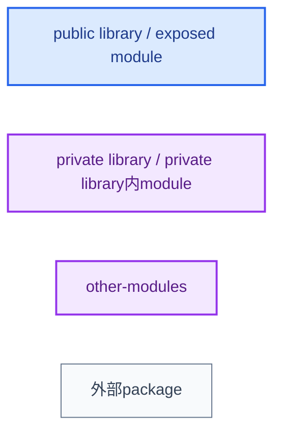
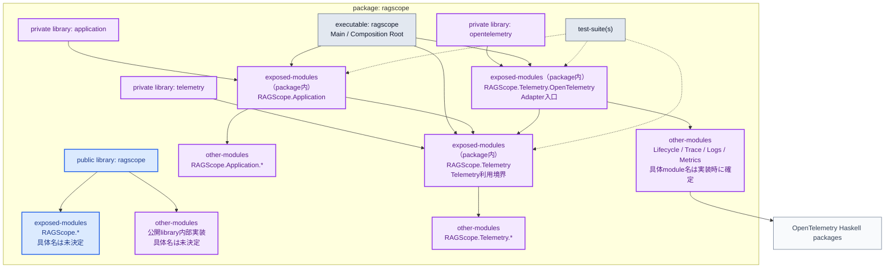
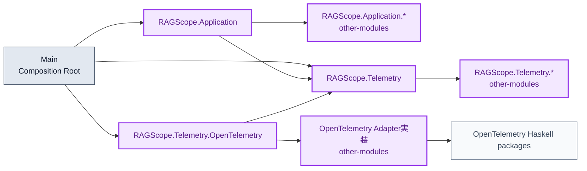

# RS-0024 Haskellライブラリ・モジュールマップ

> [!note]
> これはRS-0024の実装前にレビューするための**Workbench上の設計ドラフト**であり、RAGScopeの正本ではない。
> 対象は`RS-0024/telemetry-boundary-sdk-lifecycle` branchの1 package構成である。
> library名、module名、source rootはこのNoteでレビューする提案であり、正本へ反映されるまでは現在設計として扱わない。

## 現在の土台

現在のRAGScopeアプリケーションは、`ragscope-app/ragscope.cabal`を持つ1 package構成である。

```text
ragscope-app/
├─ cabal.project
├─ ragscope.cabal
├─ src/
├─ app/
└─ test/
```

現在の`ragscope.cabal`にはmain library、`ragscope` executable、`ragscope-test` test-suiteがある。main libraryの具体的な`exposed-modules` / `other-modules`はまだ定義されていない。

RS-0024で正本から要求されている依存方向は次である。

```text
UseCase / 内部処理 -> Telemetry利用境界
OpenTelemetry Adapter -> Telemetry利用境界
OpenTelemetry Adapter -> OpenTelemetry SDK
```

UseCase / 内部処理からOpenTelemetry AdapterまたはOpenTelemetry SDKへ直接依存させない。

## 色の意味



- **青**: package外へ公開するmain libraryと`exposed-modules`
- **紫**: private library、そのlibraryからpackage内へ公開するmodule、`other-modules`
- **灰**: RAGScope package外の依存

## library / component map



### この図で決めていること

- `application`は`telemetry`へ依存してよい。
- `application`は`opentelemetry`とOpenTelemetry packageへ依存しない。
- `telemetry`はOpenTelemetry packageへ依存しない。
- `opentelemetry`だけがOpenTelemetry packageへ依存する。
- `Main`はComposition Rootとして`application`、`telemetry`、`opentelemetry`を接続してよい。
- private libraryをまたいで利用するmoduleは、そのprivate libraryの`exposed-modules`に置く。
- libraryの実装詳細は`other-modules`に置き、別componentからimportさせない。

### この図でまだ決めないこと

main public library `ragscope`の具体的な公開APIと、`application`との依存関係はRS-0024のTelemetry境界だけからは決めない。

また、`Lifecycle`、`Trace`、`Logs`、`Metrics`は責務を示すためのラベルであり、実際に4 moduleへ分割すると決定したものではない。

## module dependency map

RS-0024で機械的に守りたいmodule依存は次の形にする。



禁止するedgeは次である。

```text
application -X-> opentelemetry
application -X-> OpenTelemetry packages
telemetry   -X-> opentelemetry
telemetry   -X-> OpenTelemetry packages
opentelemetry -X-> application
```

## source root map

componentごとのsource rootは重ねない。

```text
ragscope-app/
├─ src/                         # public library: ragscope
├─ internal/
│  ├─ application/              # private library: application
│  ├─ telemetry/                # private library: telemetry
│  └─ opentelemetry/            # private library: opentelemetry
├─ app/                         # executable: ragscope
└─ test/                        # test-suite(s)
```

`src`をpublic libraryの`hs-source-dirs`にしたまま、private libraryを`src/application`などへ置かない。source rootが重なると、component境界とファイル配置の境界が一致しなくなるためである。

## Cabalで強制する範囲

| 禁止したい依存 | 強制方法 |
|---|---|
| `application -> opentelemetry` | `application`の`build-depends`へ`opentelemetry`を書かない |
| `application -> OpenTelemetry package` | `application`の`build-depends`へOpenTelemetry packageを書かない |
| `telemetry -> OpenTelemetry package` | `telemetry`の`build-depends`へOpenTelemetry packageを書かない |
| `opentelemetry -> application` | `opentelemetry`の`build-depends`へ`application`を書かない |
| 別component -> implementation module | implementation moduleを`other-modules`に置く |

同じlibrary component内のmodule同士のimport方向は、`exposed-modules` / `other-modules`だけでは禁止できない。

また、`.cabal`自体を書き換えて禁止していた`build-depends`を追加することまでは、この構造だけでは防げない。必要なら別途CIで依存edgeを検査する。
