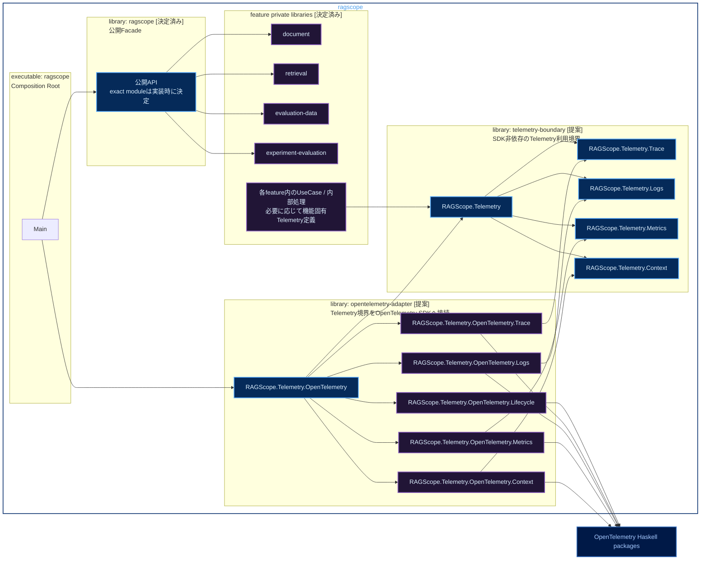

# RS-0024 Haskellライブラリ・モジュールマップ

> [!note]
> これはRS-0024の実装前にレビューするためのWorkbench上の設計ドラフトであり、RAGScopeの正本ではない。
> 機能側のCabal library構成は、RAGScope正本リポジトリの`project-docs/design/RAGScopeアプリケーションHaskell構成設計.md`とADR-0008で決定済みである。
> `telemetry-boundary`、`opentelemetry-adapter`、`RAGScope.Telemetry.*`などTelemetry側のcomponent名・module名・APIは、このNoteでレビューする実装候補である。

Mermaidの色分けは[[Mermaid図の色分けルール]]に従う。

## 現在確定している機能側Cabal構成

RAGScope正本では、`ragscope-app/`を1つのCabal package `ragscope`として維持し、無名main library `ragscope`を公開Facade、主要な機能実装をprivate named libraryへ分ける構成を採用した。

```text
ragscope package
│
├─ library ragscope
│    └─ RAGScopeアプリケーションの公開Facade
│
├─ private library document
│    └─ 文書機能
│
├─ private library retrieval
│    └─ 検索・回答生成機能
│
├─ private library evaluation-data
│    └─ 評価データ機能
│
├─ private library experiment-evaluation
│    └─ 実験・評価機能
│
└─ executable ragscope
     └─ 実行入口
```

各feature libraryは、その機能を実装する時点で追加する。空libraryを先行して作らない。main libraryからfeature libraryへ依存し、feature libraryからmain libraryへは依存しない。feature library同士の依存は、実際に参照する型、module、関数/APIがある場合だけ`build-depends`へ追加する。

HTTP、DB、OpenTelemetry SDKなど、一部の責務だけが必要とする具体的な外部package依存をfeature library全体へ許可したくない場合は、境界またはAdapterを担当する別private libraryへ分ける。

## RS-0024で検討するTelemetry component

RS-0024では、上記の機能側構成に対して、UseCase / 内部処理からOpenTelemetry SDKを直接参照させないためのCabal境界を追加する。

現時点の候補は次のとおり。



凡例: **青** = 別componentから利用するmodule / API候補、**紫** = private componentまたは内部module、**濃青** = 外部package、**実線** = 想定する静的依存

機能側4 libraryとmain libraryの役割は正本で決定済みである。一方、Telemetry側のlibrary名、module名、export範囲、exactな依存は、このSubtaskでCabalとSDK APIを実測しながら確定する。

## main library `ragscope`

main libraryはRAGScopeアプリケーションの公開Facadeであり、UseCaseや内部処理の包括的な置き場にはしない。公開する必要があるfeature側APIをまとめるが、機能固有の実装や、その機能だけが必要とするOpenTelemetry、HTTP、DBなどの具体的な外部package依存を持ち込まない。

feature libraryからmain libraryへ逆向きに依存しない。複数featureで必要な型や処理が具体化した場合は、main libraryを共有module置き場にせず、その責務を置くprivate libraryまたは適切なfeature libraryを検討する。

## feature private library

`document`、`retrieval`、`evaluation-data`、`experiment-evaluation`は、RAGScopeアプリケーション内部の機能実装と静的依存を分離するprivate named libraryである。

UseCaseや内部処理がTelemetryを利用する場合、そのfeature libraryからSDK非依存のTelemetry境界へ依存する。OpenTelemetry SDK packageや`opentelemetry-adapter`へ直接依存させない。

### UseCase / 内部処理のmodule候補

`RAGScope.UseCase.*`、`RAGScope.UseCase.*.Error`、`RAGScope.UseCase.*.Telemetry`は、このNoteで検討するmodule配置例である。`*`は図上の省略表記であり、実際のHaskell module名ではない。

例えば文書機能のUseCaseを実装する場合、これらは`document` library内に配置する候補となる。検索・回答生成なら`retrieval` library内に配置する。すべてのUseCaseを1つの`application` libraryへ集約する構成は採用しない。

#### `RAGScope.UseCase.*`

各UseCase本体を置く候補とする。UseCase固有の入力と必要な依存を受け取り、機能処理を実行してUseCase固有の結果または具体的なerror typeを返す。

- 処理順序、retry、timeout、fallback、途中失敗を最終失敗とするか回復して成功とするかを決める。
- Telemetry記録が必要な箇所では、機能固有Telemetry定義とSDK非依存のTelemetry境界を利用する。
- Telemetryへ変換する前の具体的なerror値を保持し、Telemetry用`error.type`で置き換えない。
- SDK初期化、Processor / Exporter設定、Context保持、batching、flush / shutdown、送信は担当しない。

#### `RAGScope.UseCase.*.Error`

そのUseCaseが機能上区別する必要のある具体的なerror typeを定義する候補とする。constructorと保持する詳細値はUseCaseの失敗理由を表すためのものであり、Telemetry専用の分類へ合わせて設計しない。

UseCaseの公開APIからerror typeを返す必要がある場合は、対象feature libraryの公開moduleから必要な型をre-exportする。

#### `RAGScope.UseCase.*.Telemetry`

そのUseCaseに固有のTelemetry上の意味を定義する候補とする。ここで決めるのは「何を観測するか」であり、「OpenTelemetry SDKでどう記録するか」ではない。

- RAGScope独自Spanが必要な場合のSpan名、attributes、どの処理をそのSpanで表すかを定義する。
- RAGScope固有EventRecordが必要な場合のEventName、記録条件、timestamp、Severity、attributesを定義する。
- 具体的なUseCase error typeから、そのSpanまたはEventRecordで必要なTelemetryの`error.type`へ変換する。
- OpenTelemetry SDKをimportせず、SDK Context、Processor / Exporter、batching、送信、flush / shutdownは担当しない。

独立した内部処理が具体的なerror typeや機能固有Telemetry定義を持つ場合、それらまでUseCase配下へ置くことを意味しない。具体的なmodule配置は、その処理の責務と共有範囲を確認して実装時に決める。

## `telemetry-boundary`候補

UseCaseや内部処理から使うSDK非依存のRAGScope側Telemetry利用境界を提供するprivate library候補とする。OpenTelemetry SDKと同じRuntimeを作るlibraryではなく、Contextの実体管理、Processor / Exporter、batching、送信、flush / shutdownは持たない。

### `RAGScope.Telemetry`

Trace / Logs / Metrics / Contextの操作をfeature側へ渡すためのまとめ役候補とする。productionでは`opentelemetry-adapter`がこの境界を満たす実装を構築し、UseCaseテストではOpenTelemetry SDKを起動せず差し替えられる形を目指す。

具体的に関数record、型クラス、個別関数群のどれで表すかは、このSubtask以降でSDK APIと利用側signatureを確認して決める。

### `RAGScope.Telemetry.Trace`

Span操作に必要なSDK非依存の型と操作を定義する候補とする。SDKのSpan handle、Tracer、SDK Contextをfeature側の公開型へ露出させない。

### `RAGScope.Telemetry.Logs`

通常LogRecordとEventRecordを記録するためのSDK非依存の型と操作を定義する候補とする。独自のログqueue、filtering Runtime、Sink、配送、再送、batchingは実装しない。

### `RAGScope.Telemetry.Metrics`

OpenTelemetry Metricsをfeature側から利用するためのSDK非依存の操作を定義する候補とする。Meter、InstrumentなどのSDK型をfeature側へそのまま渡さない。

RS-0024では新しいRAGScope独自Metric名、instrument、attribute集合を共通基盤として追加しない。

### `RAGScope.Telemetry.Context`

現在のOpenTelemetry Contextを子処理や通信境界へ引き継ぐためにfeature側から必要な操作を定義する候補とする。RAGScope独自ContextをSDK Contextの代わりとして重複管理しない。

`RAGScope.Telemetry.Trace`、`Logs`、`Metrics`、`Context`を別componentからimportする構成を採用する場合は、`telemetry-boundary` private libraryの`exposed-modules`に置く。

## `opentelemetry-adapter`候補

`telemetry-boundary`で定義した利用境界をOpenTelemetry Haskell SDKへ接続するprivate library候補とする。UseCase / 内部処理と`telemetry-boundary`はOpenTelemetry SDKへ依存せず、AdapterだけがSDKの型・APIを利用する構成を検証する。

後続機能でHTTP、DB、GenAIなどの標準instrumentation packageをどのcomponentが利用するかは、その機能を実装する時点で決める。このNoteは、後続componentのOpenTelemetry関連package依存まで`opentelemetry-adapter`経由に固定するものではない。

### `RAGScope.Telemetry.OpenTelemetry`

executableから使うAdapterの入口候補とする。SDK構成を受け取り、Trace / Logs / Metrics / Contextの各Adapterとlifecycleを組み立て、feature側へ渡せるTelemetry境界の実装を構築する。

### `RAGScope.Telemetry.OpenTelemetry.Lifecycle`

Trace / Logs / Metricsに必要なSDK ProviderとProcessor / Exporterを構築し、アプリケーション起動から終了までのSDK lifecycleを扱う候補とする。独自queue、独自batching、独自送信Runtime、独自Sinkを作らず、同じ責務はSDKへ委ねる。

### `RAGScope.Telemetry.OpenTelemetry.Trace`

SDK非依存のTrace境界をOpenTelemetry SDKのTrace APIへ接続する候補とする。SDKのTracer / Span / Context型を`telemetry-boundary`側へ返さない。

### `RAGScope.Telemetry.OpenTelemetry.Logs`

SDK非依存のLogs境界をOpenTelemetry SDKのLogs APIへ接続する候補とする。Processor / Exporter、batching、送信を独自実装せず、SDK構成を利用する。

### `RAGScope.Telemetry.OpenTelemetry.Metrics`

SDK非依存のMetrics境界をOpenTelemetry SDKのMetrics APIへ接続する候補とする。SDKが提供するaggregation、Reader / Exporter、収集周期、送信を利用する。

### `RAGScope.Telemetry.OpenTelemetry.Context`

SDK非依存のContext境界をOpenTelemetry SDK ContextとPropagatorへ接続する候補とする。RAGScope独自のContext stack、Trace ID / Span ID保持、独自伝播Runtimeを追加しない。

`Lifecycle`、`Trace`、`Logs`、`Metrics`、`Context`をAdapter内部だけで使う構成を採用する場合は`other-modules`に置き、別componentからは`RAGScope.Telemetry.OpenTelemetry`だけを利用する。

## `executable: ragscope`

`Main`はComposition Rootとして、main library `ragscope`の公開APIとOpenTelemetry Adapterを組み立てる。具体的なTelemetry境界の受け渡しsignatureと、それに伴いexecutableが`telemetry-boundary`へ直接`build-depends`する必要があるかは実装時に確定する。

このRS-0024のtargetでは、executableからOpenTelemetry SDK APIを直接呼ばず、Adapterの公開入口を通してSDK初期化とflush / shutdownを行う構成を候補とする。

## 実装前に確認するOpenTelemetry API

exactな`RAGScope.Telemetry.Trace` / `Logs` / `Context`の関数signatureは、採用する`hs-opentelemetry`のversionと実APIを確認してから決める。

実装開始時に最小コードで次を確認する。

- Spanを開始し、未処理の同期Exceptionが外へ伝播したときにStatus Errorと必要な`error.type`を設定できること。
- 同じExceptionについてSpan Eventを追加せず、LogsのEventRecordを1件だけ記録できること。
- 元のExceptionを変更せず再throwできること。
- EventRecord / LogRecordをcurrent Trace Contextへ関連付けられること。
- test用Processor / Exporter構成で、flush / shutdownとExporter失敗時の挙動を制御して確認できること。

採用versionのexception helperが`recordException`などでSpan Eventを自動記録する場合は、そのhelperを無条件に使わず、重複しないSDK APIの組み合わせを確認してAdapter実装を決める。

## Cabalへ落としたときの依存候補

`ragscope.cabal`は`cabal-version: 3.4`を使用するため、同一package内のnamed sublibraryへの依存は`package-name:internal-library-name`で明示する。

| component | 状態 | `build-depends`で必要なRAGScope内依存 | OpenTelemetry package |
|---|---|---|---|
| `library ragscope` | 機能側の役割は決定済み | 公開するfeature library | 機能固有のSDK依存を持ち込まない |
| `library document` / `retrieval` / `evaluation-data` / `experiment-evaluation` | 決定済み。実装時に必要なlibraryのみ追加 | 実際に利用するfeature library。Telemetry利用時はTelemetry境界 | UseCase / 内部処理からSDKへ直接依存しない |
| `library telemetry-boundary` | RS-0024の提案 | なし | 依存しない |
| `library opentelemetry-adapter` | RS-0024の提案 | `ragscope:telemetry-boundary` | 必要なSDK packageへ依存する |
| `executable ragscope` | 実行入口は決定済み。exactなwiring依存は提案 | `ragscope`、`ragscope:opentelemetry-adapter`、必要なら`ragscope:telemetry-boundary` | このRS-0024のtargetでは直接依存しない |

OpenTelemetryの具体的なpackage名とversionは、実測結果を`ragscope.cabal`へ反映する時点で確定する。後続機能で利用する標準instrumentation packageの依存先componentも、その機能実装時に決める。

## 依存方向

機能側について正本で決定済みの依存方向は次のとおり。

```text
main library ragscope
        │
        ├────────► document
        ├────────► retrieval
        ├────────► evaluation-data
        └────────► experiment-evaluation

feature library ──X──► main library ragscope
```

feature library同士の依存方向は、実際に参照する型、module、関数/APIに基づいて個別に決める。

RS-0024のTelemetry境界として、このSubtaskで検証する候補は次のとおり。

```text
feature library ─────► telemetry-boundary
opentelemetry-adapter ─────► telemetry-boundary
opentelemetry-adapter ─────► OpenTelemetry packages

feature library ──X──► opentelemetry-adapter
feature library ──X──► OpenTelemetry packages
telemetry-boundary ──X──► opentelemetry-adapter
telemetry-boundary ──X──► OpenTelemetry packages
```

この禁止は、後続機能でHTTP / DB / GenAIなどの標準instrumentation packageを利用するcomponentまで`opentelemetry-adapter`経由に固定するものではない。後続機能固有のOpenTelemetry関連package依存は、その機能の責務と実際に呼ぶinstrumentation APIを確認して決める。
