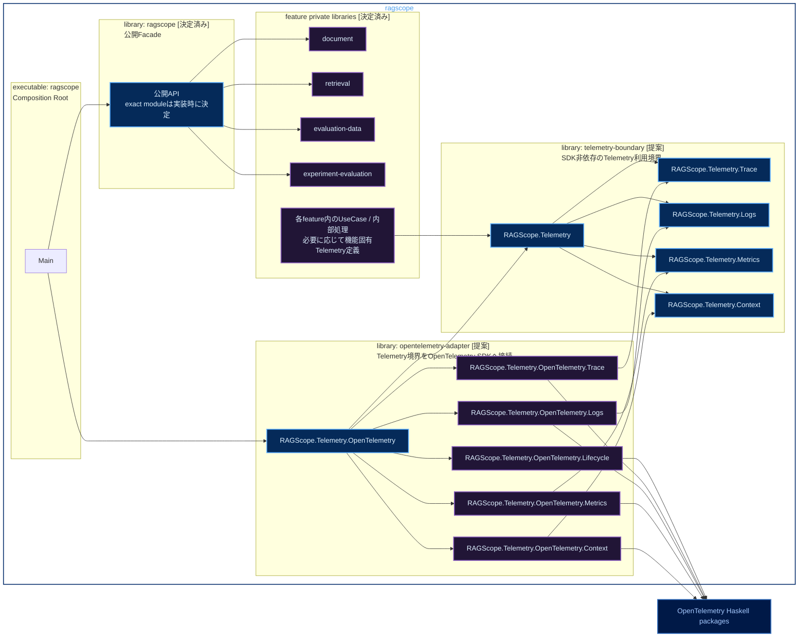

# RS-0024 Haskellライブラリ・モジュールマップ

> [!note]
> これはRS-0024の実装前にレビューするためのWorkbench上の設計ドラフトであり、RAGScopeの正本ではない。
> 機能側のCabal library構成は、RAGScope正本リポジトリのADR-0008で採用済みである。実装後の正確なcomponent名、`build-depends`、公開module、型、関数は`ragscope.cabal`とHaskellコード・テストを正本とする。このNoteには、実装前に必要な構成整理と候補を置く。
> `telemetry-boundary`、`opentelemetry-adapter`、`RAGScope.Telemetry.*`などTelemetry側のcomponent名・module名・APIは、このNoteでレビューする実装候補である。

Mermaidの色分けは[[Mermaid図の色分けルール]]に従う。

## 現在確定している機能側Cabal構成

以下はADR-0008で採用済みの内容をRS-0024の実装前マップとして要約したものであり、このNote自体は正本ではない。`ragscope-app/`を1つのCabal package `ragscope`として維持し、無名main library `ragscope`を公開Facade、主要な機能実装をprivate named libraryへ分ける構成を採用している。

```text
ragscope package
│
├─ library ragscope
│    └─ RAGScopeアプリケーションの公開Facade
│
├─ private library document
│    └─ 文書機能
│
├─ private library retrieval
│    └─ 検索・回答生成機能
│
├─ private library evaluation-data
│    └─ 評価データ機能
│
├─ private library experiment-evaluation
│    └─ 実験・評価機能
│
└─ executable ragscope
     └─ 実行入口
```

各feature libraryは、その機能を実装する時点で追加する。空libraryを先行して作らない。main libraryからfeature libraryへ依存し、feature libraryからmain libraryへは依存しない。feature library同士の依存は、実際に参照する型、module、関数/APIがある場合だけ`build-depends`へ追加する。

HTTP、DB、OpenTelemetry SDKなど、一部の責務だけが必要とする具体的な外部package依存をfeature library全体へ許可したくない場合は、境界またはAdapterを担当する別private libraryへ分ける。

## RS-0024で検討するTelemetry component

RS-0024では、上記の機能側構成に対して、UseCase / 内部処理からOpenTelemetry SDKを直接参照させないためのCabal境界を追加する。

現時点の候補は次のとおり。



凡例: **青** = 別componentから利用するmodule / API候補、**紫** = private componentまたは内部module、**濃青** = 外部package、**実線** = 想定する静的依存

機能側4 libraryとmain libraryの役割はADR-0008で採用済みである。一方、Telemetry側のlibrary名、module名、export範囲、exactな依存は、このSubtaskでCabalとSDK APIを実測しながら確定する。

テスト用componentはこのマップから省略する。テストを作成しないという意味ではない。

## main library `ragscope`

main libraryはRAGScopeアプリケーションの公開Facadeであり、UseCaseや内部処理の包括的な置き場にはしない。公開する必要があるfeature側APIをまとめるが、機能固有の実装や、その機能だけが必要とするOpenTelemetry、HTTP、DBなどの具体的な外部package依存を持ち込まない。

feature libraryからmain libraryへ逆向きに依存しない。複数featureで必要な型や処理が具体化した場合は、main libraryを共有module置き場にせず、その責務を置くprivate libraryまたは適切なfeature libraryを検討する。

## feature private library

`document`、`retrieval`、`evaluation-data`、`experiment-evaluation`は、RAGScopeアプリケーション内部の機能実装と静的依存を分離するprivate named libraryである。

UseCaseや内部処理がTelemetryを利用する場合、そのfeature libraryからSDK非依存のTelemetry境界へ依存する。OpenTelemetry SDK packageや`opentelemetry-adapter`へ直接依存させない。

機能上の処理順序、retry、timeout、fallback、成功・失敗の最終判断は各featureのUseCase / 内部処理が所有する。Telemetryはその判断結果や途中で起きた事実を記録するために利用し、**Telemetryの記録・export失敗だけを理由に、成功した機能処理を機能上の失敗へ変更しない。**

### UseCase / 内部処理のmodule候補

`RAGScope.UseCase.*`、`RAGScope.UseCase.*.Error`、`RAGScope.UseCase.*.Telemetry`は、このNoteで検討するmodule配置例である。`*`は図上の省略表記であり、実際のHaskell module名ではない。

例えば文書機能のUseCaseを実装する場合、これらは`document` library内に配置する候補となる。検索・回答生成なら`retrieval` library内に配置する。すべてのUseCaseを1つの包括的なlibraryへ集約する前提にはしない。

#### `RAGScope.UseCase.*`

各UseCase本体を置く候補とする。UseCase固有の入力と必要な依存を受け取り、機能処理を実行してUseCase固有の結果または具体的なerror typeを返す。Telemetry利用境界の具体的な渡し方を引数、環境record、その他のどの形にするかは実装時に決める。

- 処理順序、retry、timeout、fallback、途中失敗を最終失敗とするか回復して成功とするかを決める。
- Telemetry記録が必要な箇所では、機能固有Telemetry定義と`RAGScope.Telemetry.*`のSDK非依存操作を使う。
- 子処理のSpanがErrorになったという理由だけでUseCase自身を失敗扱いにせず、UseCase自身の最終結果から機能結果を決める。
- Telemetryへ変換する前の具体的なerror値を保持し、Telemetry用`error.type`で置き換えない。
- SDK初期化、Processor / Exporter設定、Context保持、batching、flush / shutdown、送信は担当しない。

#### `RAGScope.UseCase.*.Error`

そのUseCaseが機能上区別する必要のある具体的なerror typeを定義する候補とする。constructorと保持する詳細値はUseCaseの失敗理由を表すためのものであり、Telemetry専用の分類へ合わせて設計しない。

- UseCase本体や、そのUseCase固有Telemetry定義から参照する具体的なerror typeを置く。
- API / CLI、実験結果、Telemetryは用途ごとに必要な表現へこのerror値から直接変換する前提とし、共通`RAGScopeError`、共通`ErrorType`、共通`ErrorClassifier`へ一度集約しない。
- Telemetryの`error.type`へ変換した後も、詳細な失敗理由やcauseは元のerror値に残す。
- UseCaseの公開APIからerror typeを返す必要がある場合は、対象feature libraryの公開moduleから必要な型をre-exportする。

`RAGScope.UseCase.*.Telemetry`から具体的なerror typeを参照する場合、error typeをUseCase本体だけに置いて相互importを発生させず、独立した`.Error` moduleへ置く構成を候補とする。

#### `RAGScope.UseCase.*.Telemetry`

そのUseCaseに固有のTelemetry上の意味を定義する候補とする。ここで決めるのは「何を観測するか」であり、「OpenTelemetry SDKでどう記録するか」ではない。

- RAGScope独自Spanが必要な場合のSpan名、attributes、どの処理をそのSpanで表すかを定義する。
- RAGScope固有EventRecordが必要な場合のEventName、記録条件、timestampが表す時点、Severity、attributesを定義する。
- 具体的なUseCase error typeから、そのSpanまたはEventRecordで必要なTelemetryの`error.type`へ変換する。
- 同じ種類のerrorからは同じ安定した`error.type`を生成し、ID、ファイル名、メッセージなど実行ごとに変わる値を`error.type`へ含めない。
- OpenTelemetry Semantic Conventionが適用できるSpan、Event、attribute、`error.type`は標準定義を使い、同じ意味のRAGScope独自定義を重ねない。
- 機能値やerror値からTelemetry境界へ渡すSDK非依存の値を組み立てる純粋変換と、境界操作を呼ぶ補助関数のどこまでをこのmoduleへ置くかは、具体的な関数signatureを決める時点で判断する。
- OpenTelemetry SDKをimportせず、SDK Context、Processor / Exporter、batching、送信、flush / shutdownは担当しない。

RS-0024では新しいRAGScope独自Metricを共通基盤として定義しないため、機能固有Telemetry moduleからMetrics境界への依存を先に作らない。後続機能で標準Metricの明示的な利用が必要になった時点で追加する。

独立した内部処理が具体的なerror typeや機能固有Telemetry定義を持つ場合、それらまでUseCase配下へ置くことを意味しない。具体的なmodule配置は、その処理の責務と共有範囲を確認して実装時に決める。

## `telemetry-boundary`候補

UseCaseや内部処理から使うSDK非依存のRAGScope側Telemetry利用境界を提供するprivate library候補とする。この境界は「feature側が何を記録したいか」と「OpenTelemetry SDKがそれをどう実行するか」の間に置き、feature側へSDKの型やAPIを漏らさない。

ここへ置く型と関数はfeature側から必要なTelemetry操作を表現するためのものに限定する。OpenTelemetry SDKと同じRuntimeを作るlibraryではなく、Contextの実体管理、Processor / Exporter、batching、送信、flush / shutdownは持たない。

### `RAGScope.Telemetry`

Trace / Logs / Metrics / Contextの操作をfeature側へ渡すためのまとめ役候補とする。productionでは`opentelemetry-adapter`がこの境界を満たす実装を構築し、UseCaseテストではOpenTelemetry SDKを起動せず、記録内容を保持する実装、no-op実装、失敗を返す実装などへ差し替えられる形を候補とする。

具体的に関数record、型クラス、個別関数群のどれで表すかはまだ決めない。feature側が`opentelemetry-adapter`をimportせずに必要なTelemetry操作を受け取り、production実装とテスト実装を同じ利用側コードへ渡せることを優先する。

### `RAGScope.Telemetry.Trace`

Span操作に必要なSDK非依存の型と操作を定義する候補とする。feature側から指定するSpan名、attributes、その処理自身の最終結果に応じたStatus / `error.type`などを、OpenTelemetry SDK型を使わず表現できるようにする。

- Spanを開始・終了する、またはある処理をSpanで囲むために必要な操作を提供する。exactな関数signatureは実装時に決める。
- 成功時はStatus Unsetかつ`error.type`なし、最終失敗時はStatus Errorと対応する`error.type`を表現できる境界にする。
- 想定外の同期ExceptionがSpan外へ伝播する場合に、対応SpanをErrorにして元のExceptionを再throwする実装をAdapter側で行える操作形にする。
- 機能固有Span名やattributes自体は定義せず、それらは各featureの機能固有Telemetry定義で決める。
- SDKのSpan handle、Tracer、SDK Contextをfeature側の公開型へ露出させない。

### `RAGScope.Telemetry.Logs`

通常LogRecordとEventRecordを記録するためのSDK非依存の型と操作を定義する候補とする。feature側がEventName、Severity、Body、attributesなど必要な記録内容を渡せる境界を提供し、実際のOpenTelemetry LogRecord / EventRecord生成はAdapterへ委ねる。

- current Trace Contextと関連付いたLogRecord / EventRecordを記録できる操作を提供する。
- RAGScope固有EventRecordのEventName、記録条件、既定Severity、attributesはこのmoduleでは決めず、各UseCase / 内部処理のTelemetry定義で決める。
- 例外を表すLogs EventRecordを同じ例外について1件だけ記録する要件をAdapter側で実装できる境界にする。
- 独自のログqueue、filtering Runtime、Sink、配送、再送、batchingは実装しない。

### `RAGScope.Telemetry.Metrics`

OpenTelemetry Metricsをfeature側から利用するためのSDK非依存の操作を定義する候補とする。Meter、InstrumentなどのSDK型をfeature側へそのまま渡さず、後続機能が必要とするMetric操作をRAGScope側の境界として表現する。

- 標準計装が提供するMetricや、将来正本で定義されたMetricを利用できる境界を提供する。
- instrument作成、record、addなどをどの粒度の型・関数で公開するかは実装時に決める。
- RS-0024では新しいRAGScope独自Metric名、instrument、attribute集合を共通基盤として追加しない。
- aggregation、temporality、Reader / Exporter、送信はOpenTelemetry SDKへ委ねる。

### `RAGScope.Telemetry.Context`

現在のOpenTelemetry Contextを子処理や通信境界へ引き継ぐためにfeature側から必要な操作を定義する候補とする。RAGScope独自ContextをSDK Contextの代わりとして保持するmoduleではない。

- current Contextを子処理へ引き継ぐことと、後続のHTTP通信境界からTrace Contextをinjectできる状態にするために必要な操作だけを公開する。
- まずContext値そのものをfeature側へ渡さず、必要な操作だけを境界として公開できるかを検討する。Context値をUseCaseの業務値として複数処理へ持ち回る形は、具体的な必要性がない限り採用しない。
- 操作だけでは要件を満たせない場合に限り、SDK型を漏らさないopaqueなRAGScope側の値など別の表現を検討する。exactなContext APIは実装時に決める。
- Trace ID / Span IDやContext stackをRAGScope側で重複管理しない。
- 実際のContext保持、attach / detach、Propagatorによるinjectなどは`opentelemetry-adapter`からSDKへ委ねる。

`RAGScope.Telemetry.Trace`、`Logs`、`Metrics`、`Context`をfeature libraryと`opentelemetry-adapter`という別componentからimportする構成を採用する場合は、`telemetry-boundary` private libraryの`exposed-modules`に置く。ここでの`exposed-modules`は同一package内の別componentからimport可能にするためのもので、RAGScopeを外部向けHaskell libraryとして公開するという意味ではない。

## `opentelemetry-adapter`候補

`telemetry-boundary`で定義した利用境界をOpenTelemetry Haskell SDKへ接続するprivate library候補とする。RS-0024で実装する共通TelemetryのSDK接続処理をここへ置き、UseCase / 内部処理と`telemetry-boundary`はOpenTelemetry SDKへ依存しない。feature側から渡されたSDK非依存の値をSDKの型・APIへ変換し、SDKが提供するContext、Processor / Exporter、batching、flush / shutdown、送信を利用する。

後続機能でHTTP、DB、GenAIなどの標準instrumentation packageをどのcomponentが利用するかは、その機能を実装する時点で決める。このNoteは、後続componentのOpenTelemetry関連package依存まで`opentelemetry-adapter`経由に固定したり、OpenTelemetry関連packageへの依存を全面禁止したりするものではない。

Adapter本体を環境ごとに別実装するのではなく、同じAdapter実装へ渡すProcessor / ExporterなどのSDK構成をproduction、ローカル、自動テストで切り替えられる形を候補とする。どの設定型・constructorで表すかは実装時に決める。

### `RAGScope.Telemetry.OpenTelemetry`

executableから使うAdapterの入口候補とする。SDK構成を受け取り、Trace / Logs / Metrics / Contextの各Adapterとlifecycleを組み立て、feature側へ渡せる`RAGScope.Telemetry`の実装を構築する。

- `telemetry-boundary`が要求する各操作へOpenTelemetry実装を接続する。
- production、ローカル、自動テストでProcessor / Exporter等を差し替えられる構築入口を提供する。
- 構築結果としてTelemetry境界だけを返すのか、flush / shutdown用のhandleもまとめて返すのか、bracket形式のAPIにするのかは実装時に決める。
- executable以外へSDK初期化の詳細を漏らさず、別componentからは原則このmoduleだけを利用する構成を候補とする。

### `RAGScope.Telemetry.OpenTelemetry.Lifecycle`

Trace / Logs / Metricsに必要なSDK ProviderとProcessor / Exporterを構築し、アプリケーション起動から終了までのSDK lifecycleを扱う候補とする。

- 採用するSDK APIに従ってTracerProvider、LoggerProvider、MeterProviderなど必要なProviderを初期化する。
- Processor / Exporterをproductionコードへ固定せず、構築時に必要な構成へ差し替えられるようにする。
- 終了時に必要なflush / shutdownをSDK API経由で実行する。
- flush / shutdownやexport失敗を、失敗した同じTelemetry経路へ再帰的に記録しない。
- 独自queue、独自batching、独自送信Runtime、独自Sinkを作らず、同じ責務はSDKへ委ねる。

Processor / Exporter設定を独立moduleへ分ける必要が実装上明確になった場合は分割を再検討するが、現時点では`Lifecycle`の責務に含める候補とする。

### `RAGScope.Telemetry.OpenTelemetry.Trace`

`RAGScope.Telemetry.Trace`のSDK非依存操作をOpenTelemetry SDKのTrace APIへ接続する候補とする。

- current SDK ContextをparentとしてSpanを開始・終了する。
- feature側から渡されたSpan名、attributes、最終結果をSDKのSpan操作、Status、`error.type`へ反映する。
- 想定外の同期Exceptionが外へ伝播する場合はSpanをErrorにし、元のExceptionを再throwする。
- Logs側で同じException EventRecordを1件記録する場合、SDK APIが同じExceptionのSpan Eventを自動生成するなら、その重複をAdapter側の設定・呼び出しで抑制する。
- SDKのTracer / Span / Context型を`telemetry-boundary`側へ返さない。

### `RAGScope.Telemetry.OpenTelemetry.Logs`

`RAGScope.Telemetry.Logs`のSDK非依存操作をOpenTelemetry SDKのLogs APIへ接続する候補とする。

- 境界から受け取ったEventName、Severity、Body、attributesなどをSDKのLogRecord / EventRecordへ変換して記録する。
- current SDK Contextを利用してTrace / Spanとの相関情報を付与し、RAGScope側でTrace ID / Span IDを重複管理しない。
- 想定外ExceptionのLogs EventRecordを同じ例外について1件だけ記録し、Trace側や標準計装との重複を避ける。
- Processor / Exporter、batching、送信を独自実装せず、SDK構成を利用する。

### `RAGScope.Telemetry.OpenTelemetry.Metrics`

`RAGScope.Telemetry.Metrics`のSDK非依存操作をOpenTelemetry SDKのMetrics APIへ接続する候補とする。

- 境界で表現したMetric操作をSDKのMeter / Instrumentへ変換する。
- SDKが提供するaggregation、Reader / Exporter、収集周期、送信を利用する。
- RS-0024で独自Metric定義を増やさず、後続機能が必要とする標準Metric利用のためのSDK構成を整える。
- Metric属性へInvocation IDなど高cardinalityな実行識別子を自動付与しない。

### `RAGScope.Telemetry.OpenTelemetry.Context`

`RAGScope.Telemetry.Context`の操作をOpenTelemetry SDK ContextとPropagatorへ接続する候補とする。

- current Contextの保持と子処理への引き継ぎはSDKのContext機構を使う。
- 後続のHTTP通信境界からTrace Contextをinjectできるよう、必要なSDK Propagator操作へ接続する。
- RAGScope独自のContext stack、Trace ID / Span ID保持、独自伝播Runtimeを追加しない。
- SDK Context型をどこまでAdapter内部へ閉じるかは、`telemetry-boundary`のContext APIを具体化する時点で決める。

`Lifecycle`、`Trace`、`Logs`、`Metrics`、`Context`をAdapter内部だけで使う構成を採用する場合は`other-modules`に置き、別componentからは`RAGScope.Telemetry.OpenTelemetry`だけを利用する。

## `executable: ragscope`

`Main`はComposition Rootとして、main library `ragscope`の公開APIとOpenTelemetry Adapterを組み立てる。具体的なTelemetry境界の受け渡しsignatureと、それに伴いexecutableが`telemetry-boundary`へ直接`build-depends`する必要があるかは実装時に確定する。

- 起動時に実行環境で必要なOpenTelemetry構成をAdapterへ渡して初期化する。
- Adapterから得たTelemetry境界の実装を、実行するfeature側UseCaseへ渡す。
- 終了時にはAdapterが提供するlifecycle APIを通してflush / shutdownを行う。
- production / ローカルのProcessor / Exporter構成差はComposition Rootから渡す設定またはその設定生成処理で表し、Adapter本体の実装を環境別に複製しない。
- このRS-0024のtargetではOpenTelemetry SDK APIを直接呼ばず、OpenTelemetry packageへ直接依存しない構成を候補とする。

## 実装前に確認するOpenTelemetry API

exactな`RAGScope.Telemetry.Trace` / `Logs` / `Context`の関数signatureは、採用する`hs-opentelemetry`のversionと実APIを確認してから決める。特に例外処理は、正本Ticketが「SpanをErrorにして再throwし、Logsには同じ例外を表すEventRecordを1件だけ記録する」ことを要求しているため、便利なSDK helperをそのまま採用できるとは限らない。

実装開始時に最小コードで次を確認する。

- Spanを開始し、未処理の同期Exceptionが外へ伝播したときにStatus Errorと必要な`error.type`を設定できること。
- 同じExceptionについてSpan Eventを追加せず、LogsのEventRecordを1件だけ記録できること。
- 元のExceptionを変更せず再throwできること。
- EventRecord / LogRecordをcurrent Trace Contextへ関連付けられること。
- test用Processor / Exporter構成で、flush / shutdownとExporter失敗時の挙動を制御して確認できること。

採用versionのexception helperが`recordException`などでSpan Eventを自動記録する場合は、そのhelperを無条件に使わず、重複しないSDK APIの組み合わせを確認してAdapter実装を決める。

## Cabalへ落としたときの依存候補

`ragscope.cabal`は`cabal-version: 3.4`を使用するため、同一package内のnamed sublibraryへの依存は`package-name:internal-library-name`で明示する。

| component | 状態 | `build-depends`で必要なRAGScope内依存 | OpenTelemetry package |
|---|---|---|---|
| `library ragscope` | 機能側の役割は決定済み | 公開するfeature library | 機能固有のSDK依存を持ち込まない |
| `library document` / `retrieval` / `evaluation-data` / `experiment-evaluation` | 決定済み。実装時に必要なlibraryのみ追加 | 実際に利用するfeature library。Telemetry利用時はTelemetry境界 | UseCase / 内部処理からSDKへ直接依存しない |
| `library telemetry-boundary` | RS-0024の提案 | なし | 依存しない |
| `library opentelemetry-adapter` | RS-0024の提案 | `ragscope:telemetry-boundary` | 必要なSDK packageへ依存する |
| `executable ragscope` | 実行入口は決定済み。exactなwiring依存は提案 | `ragscope`、`ragscope:opentelemetry-adapter`、必要なら`ragscope:telemetry-boundary` | このRS-0024のtargetでは直接依存しない |

OpenTelemetryの具体的なpackage名とversionは、実測結果を`ragscope.cabal`へ反映する時点で確定する。後続機能で利用する標準instrumentation packageの依存先componentも、その機能実装時に決める。

## module分割の考え方

- 個別UseCaseは`RAGScope.UseCase.*`で代表する。feature library内の詳細なmodule分割は、具体的な機能を実装する時点で決める。
- `RAGScope.UseCase.*.Error` / `.Telemetry`はUseCaseの場合の配置例であり、独立した内部処理のerror / Telemetry定義をUseCase配下へ集約する規則ではない。内部処理の配置は、その処理の責務と共有範囲に合わせて決める。
- 機能固有Telemetryは`RAGScope.UseCase.*.Telemetry`へまとめる候補とする。現時点で`Spans`、`Events`、`Attributes`などへさらに分割する根拠はないため、必要になるまで増やさない。
- 具体的なUseCase error typeは`RAGScope.UseCase.*.Error`へ置き、`RAGScope.UseCase.*.Telemetry`から参照してもmodule cycleが発生しない構造を候補とする。
- SDK非依存の共通操作は`RAGScope.Telemetry.*`、SDK接続処理は`RAGScope.Telemetry.OpenTelemetry.*`へ分ける。
- `telemetry-boundary`側のSignal別moduleは別library componentから利用する構成なら`exposed-modules`、`opentelemetry-adapter`側のSignal別moduleはAdapter内部だけで使う構成なら`other-modules`とする。
- Processor / Exporterの設定は現時点では`Lifecycle`の責務に含め、実装時に独立した責務が必要になった場合だけmoduleを追加する。
- exactな型、関数、export listは実装時に決める。このNoteではmodule候補の責務、公開範囲、依存方向を先にレビューする。

## 依存方向

機能側についてADR-0008で採用済みの依存方向は次のとおり。

```text
main library ragscope
        │
        ├────────► document
        ├────────► retrieval
        ├────────► evaluation-data
        └────────► experiment-evaluation

feature library ──X──► main library ragscope
```

feature library同士の依存方向は、実際に参照する型、module、関数/APIに基づいて個別に決める。

RS-0024のTelemetry境界として、このSubtaskで検証する候補は次のとおり。

```text
feature library ─────► telemetry-boundary
opentelemetry-adapter ─────► telemetry-boundary
opentelemetry-adapter ─────► OpenTelemetry packages

feature library ──X──► opentelemetry-adapter
feature library ──X──► OpenTelemetry packages
telemetry-boundary ──X──► opentelemetry-adapter
telemetry-boundary ──X──► OpenTelemetry packages
executable ──X──► OpenTelemetry packages
```

この禁止は、後続機能でHTTP / DB / GenAIなどの標準instrumentation packageを利用するcomponentまで`opentelemetry-adapter`経由に固定するものではない。後続機能固有のOpenTelemetry関連package依存は、その機能の責務と実際に呼ぶinstrumentation APIを確認して決める。
