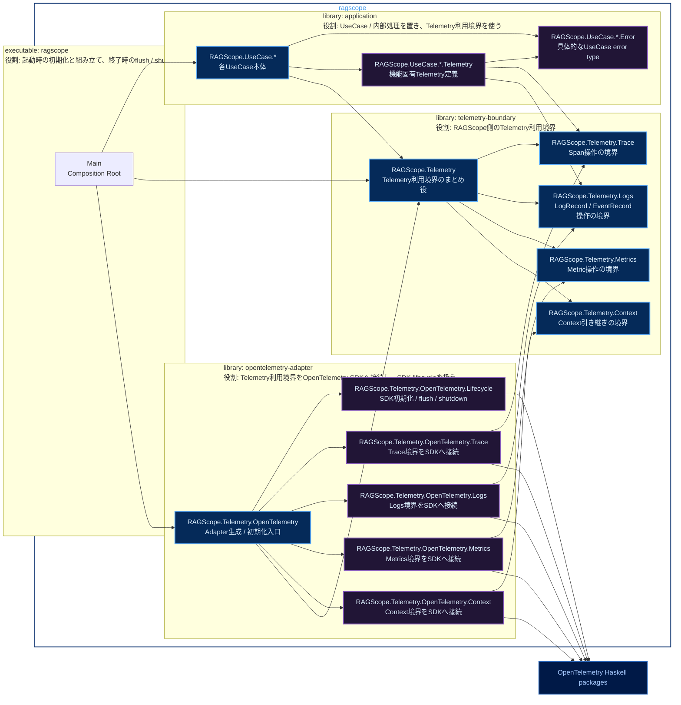

# RS-0024 Haskellライブラリ・モジュールマップ

> [!note]
> これはRS-0024の実装前にレビューするためのWorkbench上の設計ドラフトであり、RAGScopeの正本ではない。
> library名とmodule名はこのNoteでレビューする提案である。

Mermaidの色分けは[[Mermaid図の色分けルール]]に従う。

## library / module map



凡例: **青** = `exposed-modules`、**紫** = `other-modules`、**濃青** = 外部package、**実線** = 本体の依存

library枠は公開・非公開で色分けしない。色はmoduleが別componentからimport可能か、そのlibrary内部だけで使うかを示すために使う。

`RAGScope.UseCase.*`、`RAGScope.UseCase.*.Error`、`RAGScope.UseCase.*.Telemetry`の`*`は図上の省略表記であり、実際のHaskell module名ではない。例えば`RAGScope.UseCase.IndexDocument`、`RAGScope.UseCase.IndexDocument.Error`、`RAGScope.UseCase.IndexDocument.Telemetry`のような具体名になる。

テスト用componentは今回のlibrary / module構成レビューから一旦省略する。テストを作成しないという意味ではない。

## library / moduleの役割

### `application`

RAGScopeアプリケーションのUseCaseと、そのUseCaseを構成する内部処理を置く。機能上の処理順序、再試行、timeout、fallback、成功・失敗の最終判断はこのlibraryが所有する。Telemetryはその判断結果や途中で起きた事実を記録するために利用するだけで、Telemetryの失敗によってUseCaseの成功を失敗へ変更しない。

`application`は`telemetry-boundary`には依存するが、`opentelemetry-adapter`とOpenTelemetry packageには依存しない。UseCaseや内部処理から見えるのはRAGScope側のTelemetry型・操作だけであり、SDKのTracer、Span、LoggerProvider、MeterProvider、Context、Processor / Exporterなどは参照しない。

#### `RAGScope.UseCase.*`

各UseCase本体を置く。UseCase固有の入力と、実行に必要な依存を受け取り、機能処理を実行してUseCase固有の結果または具体的なerror typeを返す。Telemetry利用境界の具体的な渡し方を引数、環境record、その他のどの形にするかは実装時に決める。

- 処理順序、retry、timeout、fallback、途中失敗を最終失敗とするか回復して成功とするかを決める。
- Telemetry記録が必要な箇所では`RAGScope.UseCase.*.Telemetry`で定義した機能固有の意味と、`RAGScope.Telemetry.*`の操作を使う。
- 子処理のSpanがErrorになったという理由だけでUseCase自身を失敗扱いにせず、UseCase自身の最終結果から機能結果を決める。
- Telemetryへ変換する前の具体的なerror値を保持し、Telemetry用`error.type`で置き換えない。
- SDK初期化、Processor / Exporter設定、Context保持、batching、flush / shutdown、送信は担当しない。

#### `RAGScope.UseCase.*.Error`

そのUseCaseが機能上区別する必要のある具体的なerror typeを定義する。constructorと保持する詳細値はUseCaseの失敗理由を表すためのものであり、Telemetry専用の分類へ合わせて設計しない。

- UseCase本体や、そのUseCase固有Telemetry定義から参照する具体的なerror typeを置く。
- API / CLI、実験結果、Telemetryは用途ごとに必要な表現へこのerror値から直接変換する前提とし、共通`RAGScopeError`、共通`ErrorType`、共通`ErrorClassifier`へ一度集約しない。
- Telemetryの`error.type`へ変換した後も、詳細な失敗理由やcauseは元のerror値に残す。
- UseCaseの公開APIからerror typeを返す必要がある場合は、`RAGScope.UseCase.*`から必要な型をre-exportする。

`RAGScope.UseCase.*.Telemetry`から具体的なerror typeを参照するため、error typeを`RAGScope.UseCase.*`本体だけに置いて相互importを発生させず、`RAGScope.UseCase.*.Error`を独立させる。

#### `RAGScope.UseCase.*.Telemetry`

そのUseCaseに固有のTelemetry上の意味を定義する。ここで決めるのは「何を観測するか」であり、「OpenTelemetry SDKでどう記録するか」ではない。

- RAGScope独自Spanが必要な場合のSpan名、attributes、どの処理をそのSpanで表すかを定義する。
- RAGScope固有EventRecordが必要な場合のEventName、記録条件、timestampが表す時点、Severity、attributesを定義する。
- 具体的なUseCase error typeから、そのSpanまたはEventRecordで必要なTelemetryの`error.type`へ変換する。
- 同じ種類のerrorからは同じ安定した`error.type`を生成し、ID、ファイル名、メッセージなど実行ごとに変わる値を`error.type`へ含めない。
- OpenTelemetry Semantic Conventionが適用できるSpan、Event、attribute、`error.type`は標準定義を使い、同じ意味のRAGScope独自定義を重ねない。
- 機能値やerror値から`telemetry-boundary`へ渡すSDK非依存の値を組み立てる純粋変換と、境界操作を呼ぶ補助関数のどこまでをこのmoduleへ置くかは、具体的な関数signatureを決める時点で判断する。
- OpenTelemetry SDKをimportせず、SDK Context、Processor / Exporter、batching、送信、flush / shutdownは担当しない。

現在設計では機能固有のRAGScope独自Metricは定義していないため、`RAGScope.UseCase.*.Telemetry`から`RAGScope.Telemetry.Metrics`への依存は現時点では置かない。後続機能で標準Metricの明示的な利用が必要になった場合に追加する。

### `telemetry-boundary`

UseCaseや内部処理から使うSDK非依存のRAGScope側Telemetry利用境界を提供する。このlibraryは「Applicationが何を記録したいか」と「OpenTelemetry SDKがそれをどう実行するか」の境目であり、Application側へSDKの型やAPIを漏らさない。

ここへ置く型と関数は、Applicationから必要なTelemetry操作を表現するためのものに限定する。OpenTelemetry SDKと同じRuntimeを作るlibraryではなく、Contextの実体管理、Processor / Exporter、batching、送信、flush / shutdownは持たない。

#### `RAGScope.Telemetry`

Trace / Logs / Metrics / Contextの操作をApplicationへ渡すためのまとめ役とする。productionでは`opentelemetry-adapter`がこの境界を満たす実装を構築し、UseCaseテストではOpenTelemetry SDKを起動せず、記録内容を保持する実装、no-op実装、失敗を返す実装などへ差し替えられる形にする。

具体的に関数record、型クラス、個別関数群のどれで表すかはまだ決めない。ここで必要なのは、Applicationが`opentelemetry-adapter`をimportせずに必要なTelemetry操作を受け取れることと、production実装とテスト実装を同じ利用側コードへ渡せることだけである。

#### `RAGScope.Telemetry.Trace`

Span操作に必要なSDK非依存の型と操作を定義する。Application側から指定するSpan名、attributes、その処理自身の最終結果に応じたStatus / `error.type`などを、OpenTelemetry SDK型を使わず表現できるようにする。

- Spanを開始・終了する、またはある処理をSpanで囲むために必要な操作を提供する。exactな関数signatureは実装時に決める。
- 成功時はStatus Unsetかつ`error.type`なし、最終失敗時はStatus Errorと対応する`error.type`という現在設計を表現できる境界にする。
- 想定外の同期ExceptionがSpan外へ伝播する場合に、対応SpanをErrorにして再throwする実装をAdapter側で行える操作形にする。
- 機能固有Span名やattributes自体は定義せず、それらは`RAGScope.UseCase.*.Telemetry`側で決める。
- SDKのSpan handleやTracer、SDK ContextをApplication側の公開型へ露出させない。

#### `RAGScope.Telemetry.Logs`

通常LogRecordとEventRecordを記録するためのSDK非依存の型と操作を定義する。Application側がEventName、Severity、Body、attributesなど必要な記録内容を渡せる境界を提供し、実際のOpenTelemetry LogRecord / EventRecord生成はAdapterへ委ねる。

- 現在のTrace Contextと関連付いたLogRecord / EventRecordを記録できる操作を提供する。
- RAGScope固有EventRecordのEventName、記録条件、既定Severity、attributesはこのmoduleでは決めず、各UseCase / 内部処理のTelemetry定義で決める。
- 例外を表すLogs EventRecordを1件だけ記録するという現在設計をAdapter側で実装できる境界にする。
- 独自のログqueue、filtering Runtime、Sink、配送、再送、batchingは実装しない。

#### `RAGScope.Telemetry.Metrics`

OpenTelemetry MetricsをApplication側から利用するためのSDK非依存の操作を定義する。Meter、InstrumentなどのSDK型をApplicationへそのまま渡さず、後続機能が必要とするMetric操作をRAGScope側の境界として表現する。

- 標準計装が提供するMetricや、将来正本で定義されたMetricを利用できる境界を提供する。
- instrument作成、record、addなどをどの粒度の型・関数で公開するかは実装時に決める。
- RS-0024では新しいRAGScope独自Metric名、instrument、attribute集合を共通基盤として追加しない。
- 集約、temporality、Reader / Exporter、送信はOpenTelemetry SDKへ委ねる。

#### `RAGScope.Telemetry.Context`

現在のOpenTelemetry Contextを子処理や通信境界へ引き継ぐためにApplication側から必要な操作を定義する。RAGScope独自ContextをSDK Contextの代わりとして保持するmoduleではない。

- 現在のContextを子処理へ引き継ぐことと、後続のHTTP通信境界からTrace Contextをinjectできる状態にするために必要な操作だけを公開する。
- SDKのContext型をそのままApplicationへ漏らすのか、opaqueなRAGScope側の値を使うのか、Context値自体を公開せず操作だけを公開するのかは実装時に決める。
- Trace ID / Span IDやContext stackをRAGScope側で重複管理しない。
- 実際のContext保持、attach / detach、Propagatorによるinjectなどは`opentelemetry-adapter`からSDKへ委ねる。

`RAGScope.Telemetry.Trace`、`Logs`、`Metrics`、`Context`は`application`と`opentelemetry-adapter`という別library componentからimportするため、`telemetry-boundary` private libraryの`exposed-modules`に置く。ここでの`exposed-modules`は同一package内の別componentからimport可能にするためのもので、RAGScopeを外部向けHaskell libraryとして公開するという意味ではない。

### `opentelemetry-adapter`

`telemetry-boundary`で定義した利用境界をOpenTelemetry Haskell SDKへ接続するAdapterを置く。OpenTelemetry packageへ直接依存するのはこのlibraryだけとする。Applicationから渡されたSDK非依存の値をSDKの型・APIへ変換し、SDKが提供するContext、Processor / Exporter、batching、flush / shutdown、送信を利用する。

Adapter本体を環境ごとに別実装するのではなく、同じAdapter実装へ渡すProcessor / ExporterなどのSDK構成をproduction、ローカル、自動テストで切り替えられる形にする。どの設定型・constructorで表すかは実装時に決める。

#### `RAGScope.Telemetry.OpenTelemetry`

executableから使うAdapterの入口とする。SDK構成を受け取り、Trace / Logs / Metrics / Contextの各Adapterとlifecycleを組み立て、Applicationへ渡せる`RAGScope.Telemetry`の実装を構築する。

- `telemetry-boundary`が要求する各操作へOpenTelemetry実装を接続する。
- production、ローカル、自動テストでProcessor / Exporter等を差し替えられる構築入口を提供する。
- 構築結果としてTelemetry境界だけを返すのか、flush / shutdown用のhandleもまとめて返すのか、bracket形式のAPIにするのかは実装時に決める。
- executable以外へSDK初期化の詳細を漏らさず、別componentからは原則このmoduleだけを利用する。

#### `RAGScope.Telemetry.OpenTelemetry.Lifecycle`

Trace / Logs / Metricsに必要なSDK ProviderとProcessor / Exporterを構築し、アプリケーション起動から終了までのSDK lifecycleを扱う。

- 採用するSDK APIに従ってTracerProvider、LoggerProvider、MeterProviderなど必要なProviderを初期化する。
- Processor / Exporterをproductionコードへ固定せず、構築時に必要な構成へ差し替えられるようにする。
- 終了時に必要なflush / shutdownをSDK API経由で実行する。
- flush / shutdownやexport失敗を、失敗した同じTelemetry経路へ再帰的に記録しない。
- 独自queue、独自batching、独自送信Runtime、独自Sinkを作らず、同じ責務はSDKへ委ねる。

Processor / Exporter設定を独立moduleへ分ける必要が実装上明確になった場合は分割を再検討するが、現時点では`Lifecycle`の責務に含める。

#### `RAGScope.Telemetry.OpenTelemetry.Trace`

`RAGScope.Telemetry.Trace`のSDK非依存操作をOpenTelemetry SDKのTrace APIへ接続する。

- current SDK ContextをparentとしてSpanを開始・終了する。
- Application側から渡されたSpan名、attributes、最終結果をSDKのSpan操作、Status、`error.type`へ反映する。
- 想定外の同期Exceptionが外へ伝播する場合はSpanをErrorにし、元のExceptionを再throwする。
- Logs側で同じException EventRecordを1件記録する場合、SDK APIが同じExceptionのSpan Eventを自動生成するなら、その重複をAdapter側の設定・呼び出しで抑制する。
- SDKのTracer / Span / Context型を`telemetry-boundary`側へ返さない。

#### `RAGScope.Telemetry.OpenTelemetry.Logs`

`RAGScope.Telemetry.Logs`のSDK非依存操作をOpenTelemetry SDKのLogs APIへ接続する。

- 境界から受け取ったEventName、Severity、Body、attributesなどをSDKのLogRecord / EventRecordへ変換して記録する。
- current SDK Contextを利用してTrace / Spanとの相関情報を付与し、RAGScope側でTrace ID / Span IDを重複管理しない。
- 想定外ExceptionのLogs EventRecordを1件だけ記録し、Trace側や標準計装との重複を避ける。
- Processor / Exporter、batching、送信を独自実装せず、SDK構成を利用する。

#### `RAGScope.Telemetry.OpenTelemetry.Metrics`

`RAGScope.Telemetry.Metrics`のSDK非依存操作をOpenTelemetry SDKのMetrics APIへ接続する。

- 境界で表現したMetric操作をSDKのMeter / Instrumentへ変換する。
- SDKが提供するaggregation、Reader / Exporter、収集周期、送信を利用する。
- RS-0024で独自Metric定義を増やさず、後続機能が必要とする標準Metric利用のためのSDK構成を整える。
- Metric属性へInvocation IDなど高cardinalityな実行識別子を自動付与しない。

#### `RAGScope.Telemetry.OpenTelemetry.Context`

`RAGScope.Telemetry.Context`の操作をOpenTelemetry SDK ContextとPropagatorへ接続する。

- current Contextの保持と子処理への引き継ぎはSDKのContext機構を使う。
- 後続のHTTP通信境界からTrace Contextをinjectできるよう、必要なSDK Propagator操作へ接続する。
- RAGScope独自のContext stack、Trace ID / Span ID保持、独自伝播Runtimeを追加しない。
- SDK Context型をどこまでAdapter内部へ閉じるかは、`telemetry-boundary`のContext APIを具体化する時点で決める。

`Lifecycle`、`Trace`、`Logs`、`Metrics`、`Context`は`opentelemetry-adapter` library内部だけで使うため`other-modules`に置き、別componentからは`RAGScope.Telemetry.OpenTelemetry`だけを利用する。

### `executable: ragscope`

`Main`は`application`と`opentelemetry-adapter`を組み立てるComposition Rootとする。OpenTelemetry SDK APIを直接呼ばず、`RAGScope.Telemetry.OpenTelemetry`を通してAdapterを構築する。

- 起動時に実行環境で必要なOpenTelemetry構成をAdapterへ渡して初期化する。
- Adapterから得た`RAGScope.Telemetry`の実装をApplicationへ渡し、UseCase実行時はApplicationがその境界だけを利用するようにする。
- 終了時にはAdapterが提供するlifecycle APIを通してflush / shutdownを行う。
- production / ローカルのProcessor / Exporter構成差はComposition Rootから渡す設定またはその設定生成処理で表し、Adapter本体の実装を環境別に複製しない。
- OpenTelemetry packageへ直接依存せず、SDK型をApplicationへ渡さない。

## Cabalへ落としたときの依存

| component | `build-depends`で必要なRAGScope内依存 | OpenTelemetry package |
|---|---|---|
| `library: application` | `telemetry-boundary` | 依存しない |
| `library: telemetry-boundary` | なし | 依存しない |
| `library: opentelemetry-adapter` | `telemetry-boundary` | 依存する |
| `executable: ragscope` | `application`, `telemetry-boundary`, `opentelemetry-adapter` | 直接依存しない |

OpenTelemetryの具体的なpackage名とversionは、このNoteではまだ固定しない。

## module分割の考え方

- Application側の個別UseCaseは`RAGScope.UseCase.*`で代表する。Application全体の詳細なmodule分割はこのNoteでは行わない。
- 機能固有Telemetryは`RAGScope.UseCase.*.Telemetry`へまとめる。現時点で`Spans`、`Events`、`Attributes`などへさらに分割する根拠はないため、必要になるまで増やさない。
- 具体的なUseCase error typeは`RAGScope.UseCase.*.Error`へ置き、`RAGScope.UseCase.*.Telemetry`から参照してもmodule cycleが発生しない構造にする。
- SDK非依存の共通操作は`RAGScope.Telemetry.*`、SDK接続処理は`RAGScope.Telemetry.OpenTelemetry.*`へ分ける。
- `telemetry-boundary`側のSignal別moduleは別library componentから利用するので`exposed-modules`、`opentelemetry-adapter`側のSignal別moduleはAdapter内部だけで使うので`other-modules`とする。
- Processor / Exporterの設定は現時点では`Lifecycle`の責務に含め、実装時に独立した責務が必要になった場合だけmoduleを追加する。
- exactな型、関数、export listは実装時に決める。このNoteではmoduleの責務、公開範囲、依存方向を先に固定する。

## 依存方向

- 現在のCabalにある無名の`library` componentは、このターゲット設計には含めない。
- `application`は`telemetry-boundary`へ依存する。
- `application`は`opentelemetry-adapter`とOpenTelemetry packageへ依存しない。
- `telemetry-boundary`は`application`、`opentelemetry-adapter`、OpenTelemetry packageへ依存しない。
- `opentelemetry-adapter`は`telemetry-boundary`とOpenTelemetry packageへ依存し、`application`へ依存しない。
- `Main`はApplicationとAdapterを組み立てるため`application`、`telemetry-boundary`、`opentelemetry-adapter`へ依存するが、OpenTelemetry packageへ直接依存しない。

禁止する依存は次のとおり。

```text
application -X-> opentelemetry-adapter
application -X-> OpenTelemetry packages
telemetry-boundary -X-> application
telemetry-boundary -X-> opentelemetry-adapter
telemetry-boundary -X-> OpenTelemetry packages
opentelemetry-adapter -X-> application
executable -X-> OpenTelemetry packages
```