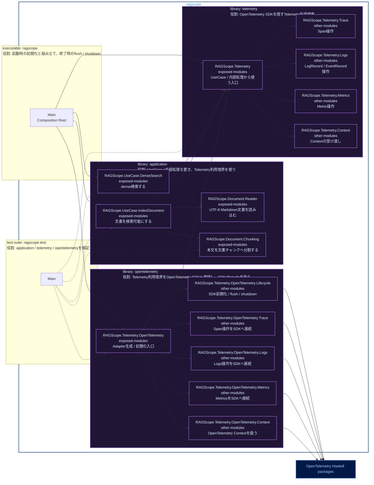

# RS-0024 Haskellライブラリ・モジュールマップ

> [!note]
> これはRS-0024の実装前にレビューするためのWorkbench上の設計ドラフトであり、RAGScopeの正本ではない。
> library名とmodule名はこのNoteでレビューする提案である。

Mermaidの色分けは[[Mermaid図の色分けルール]]に従う。

## library / module map



凡例: **紫** = 非公開library / module、**濃青** = 外部package、**実線** = 本体の依存、**点線** = テスト時の依存

## library / moduleの役割

### `application`

RAGScopeアプリケーションのUseCaseと、そのUseCaseを構成する内部処理を置く。Telemetryが必要な場合は`telemetry`を使い、OpenTelemetry SDKや`opentelemetry`には直接依存しない。

- `RAGScope.UseCase.IndexDocument`: 「文書を検索可能にする」UseCaseを実行する。文書の読み込み、チャンク化、Embedding生成、保存までの処理順序を制御する。
- `RAGScope.UseCase.DenseSearch`: 「dense検索する」UseCaseを実行する。質問Embeddingを生成し、vector searchを行い、順位付きの文書チャンクを返す処理を制御する。
- `RAGScope.Document.Reader`: 指定されたMarkdown文書をUTF-8として読み込み、本文を後続処理へ渡す。チャンク化やEmbedding生成は担当しない。
- `RAGScope.Document.Chunking`: 文書本文を1,000 Unicodeコードポイントごとに、重複範囲なしで文書チャンクへ分割する。ファイル読み込みやEmbedding生成は担当しない。

### `telemetry`

UseCaseや内部処理から使うTelemetry利用境界を提供する。OpenTelemetry SDKの型やAPIをApplication側へ出さず、Span、Logs、Metrics、Contextに必要な操作をRAGScope側の入口としてまとめる。

- `RAGScope.Telemetry`: `application`や他の利用側へ公開するTelemetryの入口。下位のTrace / Logs / Metrics / Context操作を利用側から扱える形で提供する。
- `RAGScope.Telemetry.Trace`: Spanの開始・終了、Status、`error.type`など、Trace / Spanに関する操作を担当する。
- `RAGScope.Telemetry.Logs`: 通常LogRecordとEventRecordの記録に関する操作を担当する。
- `RAGScope.Telemetry.Metrics`: OpenTelemetry Metricsを利用するための操作を担当する。RS-0024では新しいRAGScope独自Metricを定義しない。
- `RAGScope.Telemetry.Context`: 現在のContextを子処理や通信境界へ引き継ぐための受け渡しを担当する。

### `opentelemetry`

`telemetry`で定義した利用境界をOpenTelemetry Haskell SDKへ接続するAdapterを置く。OpenTelemetry packageへ直接依存するのはこのlibraryだけとする。

- `RAGScope.Telemetry.OpenTelemetry`: executableから使うAdapterの入口。SDKを使ったTelemetry実装の生成と初期化へつなぐ。
- `RAGScope.Telemetry.OpenTelemetry.Lifecycle`: Trace / Logs / Metricsに必要なSDK初期化、Processor / Exporter構成、flush / shutdownを担当する。
- `RAGScope.Telemetry.OpenTelemetry.Trace`: `telemetry`のSpan操作をOpenTelemetry SDKのTrace APIへ接続する。
- `RAGScope.Telemetry.OpenTelemetry.Logs`: `telemetry`のLogRecord / EventRecord操作をOpenTelemetry SDKのLogs APIへ接続する。
- `RAGScope.Telemetry.OpenTelemetry.Metrics`: `telemetry`のMetric操作をOpenTelemetry SDKのMetrics APIへ接続する。
- `RAGScope.Telemetry.OpenTelemetry.Context`: OpenTelemetry ContextをSDK上で保持・取得し、`telemetry`側のContext受け渡しへ接続する。

### その他のcomponent

- `executable: ragscope` / `Main`: ApplicationとTelemetry Adapterを組み立てるComposition Root。起動時にSDKを初期化し、終了時にflush / shutdownする。
- `test-suite: ragscope-test` / `Main`: `application`、`telemetry`、`opentelemetry`の振る舞いと依存境界を検証するテストの実行入口。

## module分割の考え方

- `RAGScope.UseCase.IndexDocument`は、現在設計の「文書を検索可能にする」UseCaseに対応する提案名である。
- `RAGScope.UseCase.DenseSearch`は、現在設計の「dense検索する」UseCaseに対応する。
- `RAGScope.Document.Reader`と`RAGScope.Document.Chunking`は、文書処理設計で独立した責務として定義されている文書読み込みとチャンク化に対応する。
- dense検索内部のEmbedding生成やvector searchは、現在の設計だけでは独立moduleへ分ける根拠が足りないため、この図ではまだ分割しない。
- `RAGScope.Telemetry`をUseCase / 内部処理から使う入口とし、Trace / Logs / Metrics / Contextごとの実装詳細を`other-modules`へ分ける。
- `RAGScope.Telemetry.OpenTelemetry`をAdapterの入口とし、SDK初期化・終了、Trace、Logs、Metrics、ContextのSDK接続を`other-modules`へ分ける。
- Processor / Exporterの設定は現時点では`Lifecycle`の責務に含め、実装時に独立した責務が必要になった場合だけmoduleを追加する。
- exactな型、関数、export listは実装時に決める。このNoteではmoduleの責務と依存方向を先にレビューする。

## 依存方向

- 現在のCabalにある無名の`library` componentは、このターゲット設計には含めない。
- `application`は`telemetry`へ依存する。
- `application`は`opentelemetry`とOpenTelemetry packageへ依存しない。
- `telemetry`はOpenTelemetry packageへ依存しない。
- `opentelemetry`だけがOpenTelemetry packageへ依存する。
- private libraryをまたいで利用するmoduleは`exposed-modules`、そのlibrary内だけで使うmoduleは`other-modules`に置く。

禁止する依存は次のとおり。

```text
application -X-> opentelemetry
application -X-> OpenTelemetry packages
telemetry -X-> opentelemetry
telemetry -X-> OpenTelemetry packages
opentelemetry -X-> application
```
