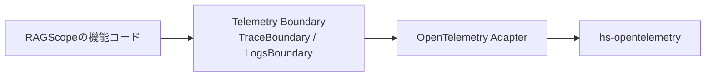
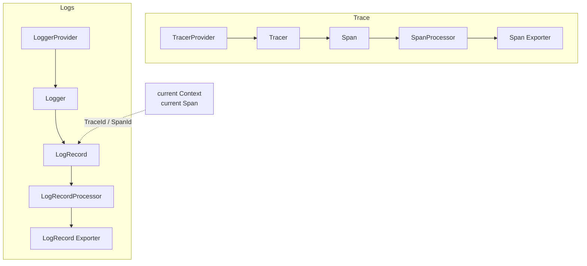

# RS-0024 Observability 全体像と読む順番

対象: `RAGScope` branch `RS-0024/exception-event-once` / commit `9f6517a4dc9c2fbaa70479eea8cf7c1d3a7acc78`

## 最初に持っておく全体像

RAGScopeのコードからOpenTelemetryまでを大きく分けると、次の4段になる。



RAGScopeの機能コードは、`TracerProvider`、`LoggerProvider`、`Tracer`、`Logger`、`Span`などのOpenTelemetry型を直接使わない。

機能コードが使うのは、RAGScope側で定義した次の境界である。

```text
TraceBoundary
  └─ withSpan

LogsBoundary
  ├─ emitLogRecord
  └─ emitEventRecord
```

OpenTelemetry Adapterが、このRAGScope側の境界をhs-opentelemetryへ接続する。

## TraceとLogsを並べて見る



TraceとLogsは別のProvider、別の処理経路を持つ。

ただしLogsをemitするときに現在のOpenTelemetry Contextを使うことで、LogRecordへ現在のSpanの`TraceId`と`SpanId`を関連付けられる。

今回のexception `EventRecord`ではこの関係が重要になる。

```text
internal-span が current
    ↓
EventRecord を emit
    ↓
LogRecord に internal-span の TraceId / SpanId が付く
```

つまり「EventRecordをどのタイミングでemitするか」は、「どのSpanがownerになるか」に直結する。

## 現在のRAGScopeで実装済みの範囲

現在のbranchには次がある。

```text
telemetry-boundary/
  RAGScope/Telemetry/Trace.hs
  RAGScope/Telemetry/Logs.hs

opentelemetry-adapter/
  RAGScope/Telemetry/OpenTelemetry/Trace.hs
  RAGScope/Telemetry/OpenTelemetry/Logs.hs

test/RAGScope/Telemetry/
  OpenTelemetryBehaviorSpec.hs
  OpenTelemetryTraceSpec.hs
  OpenTelemetryLogsSpec.hs
  OpenTelemetryExceptionEventSpec.hs
  OpenTelemetryTestSupport.hs
```

一方、productionの`app/Main.hs`はまだ次だけである。

```haskell
main :: IO ()
main = do
  putStrLn "Hello, Haskell!"
```

そのため現在は、production起動時に

```text
Exporterを作る
↓
Processorを作る
↓
TracerProvider / LoggerProviderを作る
↓
TraceBoundary / LogsBoundaryを作る
↓
アプリケーションへ渡す
```

という初期化処理はまだ組み込まれていない。

この具体的な組み立て方は、現時点ではテストfixtureの`OpenTelemetryTestSupport.hs`で最もはっきり確認できる。

## このフォルダを読む順番

1. [01 OpenTelemetryの基本構造](./01%20OpenTelemetryの基本構造.md)
   - Provider、Tracer、Logger、Processor、Exporter、Contextの関係
   - `TracerProvider`や`LoggerProvider`は何のためにあるのか

2. [02 RAGScopeのTelemetry境界](./02%20RAGScopeのTelemetry境界.md)
   - なぜRAGScope側に`TraceBoundary` / `LogsBoundary`があるのか
   - ProviderからBoundaryがどう作られるか

3. [03 Span実行フロー](./03%20Span実行フロー.md)
   - `withSpan`を呼んでからSpan終了までを追う
   - 正常値、application-level failure、exceptionを分ける

4. [04 exception伝播とEventRecord exactly-once](./04%20exception伝播とEventRecord%20exactly-once.md)
   - nested Spanでexceptionがどう伝播するか
   - なぜ現在EventRecordが3件になるのか
   - recoveryケースはなぜ1件で済むのか

5. [05 Trace Adapterコード読解](./05%20Trace%20Adapterコード読解.md)
   - `Trace.hs`を上から実コード順に読む

6. [06 テストから逆引きする](./06%20テストから逆引きする.md)
   - 「この仕様はどのテストで確認できるか」からコードへ戻る

## 今回の理解で分けて考えるもの

次の3つは混ぜない。

```text
OpenTelemetry自体の仕組み
    Provider / Tracer / Logger / Context / Span / Processor / Exporter

RAGScopeの現在設計
    TraceBoundary / LogsBoundary / OpenTelemetry Adapter

現在のSubtask固有の問題
    exception EventRecordのexactly-once
```

特に`Either CapturedException result`はOpenTelemetry一般の仕組みでも、現在採用済みのRAGScope設計でもない。

現在見つかっているexception propagationの問題を直すための未採用案である。まず現在の構造を理解してから読む。
