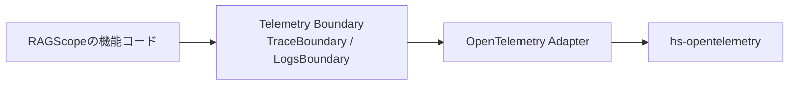
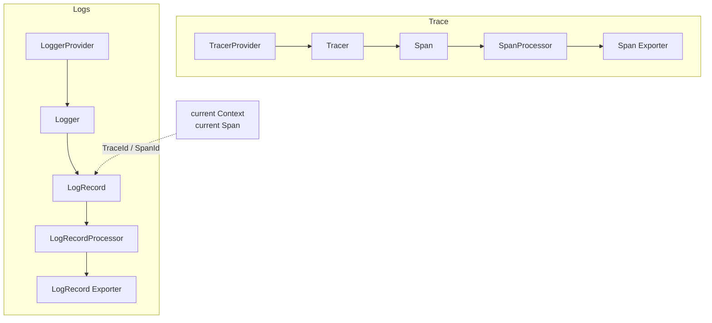

# RS-0024 Observability 全体像と読む順番

対象: `RAGScope` branch `RS-0024/exception-event-once` / commit `e40a998a0352214e4989a0aec5ec6ea1d65d6e8b`

## 最初に持っておく全体像

RAGScopeのコードからOpenTelemetryまでを大きく分けると、次の4段になる。



RAGScopeの機能コードは、`TracerProvider`、`LoggerProvider`、`Tracer`、`Logger`、`Span`などのOpenTelemetry型を直接使わない。

機能コードが使うのは、RAGScope側で定義した次の境界である。

```text
TraceBoundary
  └─ withSpan

LogsBoundary
  ├─ emitLogRecord
  └─ emitEventRecord
```

OpenTelemetry Adapterが、このRAGScope側の境界をhs-opentelemetryへ接続する。

## TraceとLogsを並べて見る



TraceとLogsは別のProvider、別の処理経路を持つ。

ただしLogsをemitするときに現在のOpenTelemetry Contextを使うことで、LogRecordへ現在のSpanの`TraceId`と`SpanId`を関連付けられる。

今回のexception `EventRecord`ではこの関係が重要になる。

```text
internal-span が current
    ↓
EventRecord を emit
    ↓
LogRecord に internal-span の TraceId / SpanId が付く
```

そのため「EventRecordをどのタイミングでemitするか」は、「どのSpanがownerになるか」に直結する。

## Trace AdapterとLogsの関係

現在の`RAGScope.Telemetry.OpenTelemetry.Trace`は、純粋にTraceだけを扱うmoduleではない。

未処理の同期exceptionがSpan外へ伝播するとき、同じ場所で次を行う。

```text
SpanをErrorにする
error.typeを付ける
exception EventRecordを1件だけ記録する
元のexceptionを再throwする
```

このため、Trace Adapterは`RAGScope.Telemetry.Logs`から`EventRecord`、`EventRecordEmitter`、`Severity`などをimportしている。

ただし、依存先はOpenTelemetry Logs Adapterではない。

```text
RAGScope.Telemetry.OpenTelemetry.Trace
    ├─ RAGScope.Telemetry.Trace
    ├─ RAGScope.Telemetry.Logs
    └─ OpenTelemetry.Trace.*

RAGScope.Telemetry.OpenTelemetry.Logs
    ├─ RAGScope.Telemetry.Logs
    └─ OpenTelemetry.Log.*
```

したがって、TraceとLogsのOpenTelemetry Adapter同士が相互依存しているわけではない。Trace Adapterへは`EventRecordEmitter`というSDK非依存の関数を注入する。

この依存は、exception EventRecordを最初に抜けたSpanがcurrentな間に記録するための、現在実装上のcross-signalな接続である。

## 現在のRAGScopeで実装済みの範囲

現在のbranchには次がある。

```text
telemetry-boundary/
  RAGScope/Telemetry/Trace.hs
  RAGScope/Telemetry/Logs.hs

opentelemetry-adapter/
  RAGScope/Telemetry/OpenTelemetry/Trace.hs
  RAGScope/Telemetry/OpenTelemetry/Logs.hs

test/RAGScope/Telemetry/
  OpenTelemetryBehaviorSpec.hs
  OpenTelemetryTraceSpec.hs
  OpenTelemetryLogsSpec.hs
  OpenTelemetryExceptionEventSpec.hs
  OpenTelemetryTestSupport.hs
```

一方、productionの`app/Main.hs`にはProviderやBoundaryを組み立てる初期化処理はまだ入っていない。

そのため現在は、

```text
Exporterを作る
↓
Processorを作る
↓
TracerProvider / LoggerProviderを作る
↓
TraceBoundary / LogsBoundaryを作る
↓
アプリケーションへ渡す
```

という具体的な組み立て方を、テストfixtureの`OpenTelemetryTestSupport.hs`で最もはっきり確認できる。

## このフォルダを読む順番

1. [01 OpenTelemetryの基本構造](./01%20OpenTelemetryの基本構造.md)
   - Provider、Tracer、Logger、Processor、Exporter、Contextの関係

2. [02 RAGScopeのTelemetry境界](./02%20RAGScopeのTelemetry境界.md)
   - `TraceBoundary` / `LogsBoundary`とAdapterの関係
   - Trace AdapterからLogs境界への現在の依存

3. [03 Span実行フロー](./03%20Span実行フロー.md)
   - `withSpan`からSpan終了まで
   - 正常値、application-level failure、exceptionの3経路

4. [04 exception伝播とEventRecord exactly-once](./04%20exception伝播とEventRecord%20exactly-once.md)
   - 以前3件になっていた原因
   - 現在の`SpanExit`による伝播

5. [05 Trace Adapterコード読解](./05%20Trace%20Adapterコード読解.md)
   - 現在の`Trace.hs`を実コード順に読む

6. [06 テストから逆引きする](./06%20テストから逆引きする.md)
   - 各振る舞いをどのテストで確認するか

## 分けて考えるもの

```text
OpenTelemetry自体の仕組み
    Provider / Tracer / Logger / Context / Span / Processor / Exporter

RAGScopeの境界
    TraceBoundary / LogsBoundary

OpenTelemetry Adapterの現在実装
    Trace Adapter / Logs Adapter / cross-signalなexception処理

今回のSubtask固有の問題
    exception EventRecordのexactly-once
```

現在は`Either CapturedException result`をSDK内部を安全に通過するためのAdapter内部表現として採用している。これはapplicationの`Either failure result`とは別物である。
