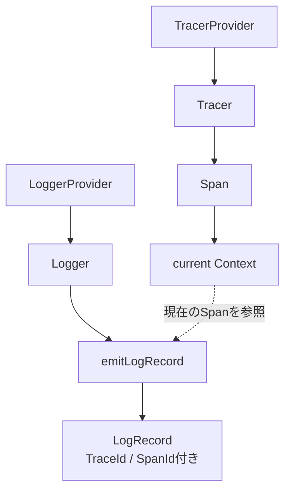

# OpenTelemetryの基本構造

対象: RAGScopeで使っている`hs-opentelemetry-api 1.0.0.0`周辺。

## Trace側は何が並んでいるのか

RAGScopeのテストでは、Trace側を次の順で組み立てている。

```text
Span Exporter
    ↓
SpanProcessor
    ↓
TracerProvider
    ↓
Tracer
    ↓
Span
```

それぞれの役割はかなり違う。

### Span Exporter

完成したSpanを外へ出す役。

本番ならOTLPなどでCollectorやbackendへ送る部分に当たる。

現在のRAGScopeテストでは`inMemoryListExporter`を使っている。

```haskell
(processor, spansRef) <-
  inMemoryListExporter
```

このテスト用関数は、外部サービスへ送る代わりに完了Spanをメモリへ蓄積するための`SpanProcessor`と、検証用の`IORef [ImmutableSpan]`を返す。

テストは後から`spansRef`を読んで、SpanのStatusやattributeを確認する。

### SpanProcessor

Spanのライフサイクルに割り込む処理役。

大きく見ると、Span開始やSpan終了を受け取り、Exporterへ渡す位置にいる。

```text
Spanが開始・終了
    ↓
SpanProcessor
    ↓
Exporter
```

RAGScopeのアプリケーションコードがProcessorを直接呼ぶわけではない。

`TracerProvider`へProcessorを登録しておくことで、Providerから作られたTracer / Spanの処理に参加する。

### TracerProvider

Tracerを作るための大元であり、Trace SDKの設定を保持する場所。

RAGScopeのテストでは次のように作る。

```haskell
tracerProvider <-
  createTracerProvider
    [processor]
    emptyTracerProviderOptions
```

ここで重要なのは、`TracerProvider`そのものが1個のSpanではないということ。

`TracerProvider`は、

- どのProcessorを使うか
- Resource
- sampler
- ID generator
- Span limits

など、TracerやSpanを作る側の共通設定を持つ。

イメージとしては、

```text
TracerProvider
  ├─ 共通設定
  ├─ SpanProcessor A
  └─ SpanProcessor B

        ↓ Tracerを作る

Tracer
        ↓ Spanを作る
Span
```

となる。

### Tracer

実際にSpanを作るためのハンドル。

RAGScopeではTrace Adapter内で作っている。

```haskell
tracer =
  makeTracer
    tracerProvider
    "ragscope"
    tracerOptions
      { tracerExceptionHandlerOptions = ... }
```

ここで`"ragscope"`は、この計装を行っているlibrary / instrumentation scopeの名前である。

これは`service.name`とは別物。

```text
"ragscope"
  = このTracerを使って計装している側の識別

service.name
  = telemetryを発生させているサービス自体の識別
```

現在のテストでは`emptyTracerProviderOptions`を使っており、production用のResource設定はまだ組み立てられていない。

### Span

実際の1回の処理区間。

たとえば、

```text
root-span
└─ use-case-span
   └─ internal-span
```

なら、これは3個のSpanである。

`TracerProvider`や`Tracer`が3個あるわけではない。

同じTracerを使って、必要な処理区間ごとにSpanを作る。

RAGScope Trace Adapterでは、

```haskell
inSpan''
  tracer
  spanName
  defaultSpanArguments
  callback
```

でSpanを1個作り、そのSpanをcurrentにした状態で`callback`を実行する。

## Logs側は何が並んでいるのか

Logs側はほぼ対称になっている。

```text
LogRecord Exporter
    ↓
LogRecordProcessor
    ↓
LoggerProvider
    ↓
Logger
    ↓
LogRecord
```

### LogRecord Exporter

完成したLogRecordを外へ出す。

現在のテストでは、

```haskell
(logExporter, logRecordsRef) <-
  inMemoryLogRecordExporter
```

として、外へ送らずメモリへ保存する。

### LogRecordProcessor

emitされたLogRecordを受け取り、Exporterなど後段へ渡す。

RAGScopeテストでは、

```haskell
logProcessor <-
  simpleLogRecordProcessor
    SimpleLogRecordProcessorConfig
      { simpleLogRecordExporter = logExporter
      , simpleLogRecordExportTimeoutMicros = 30000000
      }
```

としている。

そのProcessorをLoggerProviderへ登録する。

### LoggerProvider

Loggerを作る大元であり、Logs SDK側の共通設定とProcessorを持つ。

```haskell
loggerProvider <-
  createLoggerProvider
    [logProcessor]
    emptyLoggerProviderOptions
```

`LoggerProvider`はLogRecordを1件表すものではない。

TracerProviderと同じように、Log pipelineの共通部分を保持する。

### Logger

LogRecordをemitするためのハンドル。

RAGScope Logs Adapterでは、

```haskell
logger =
  OpenTelemetry.makeLogger
    loggerProvider
    "ragscope"
```

として作っている。

Trace側の`Tracer`とLogs側の`Logger`は別の型、別の経路である。

### LogRecord

実際のログ1件。

RAGScopeでは機能コードがhs-opentelemetryのLogRecordを直接作らず、まずRAGScope側の

```haskell
LogRecord
EventRecord
```

を作る。

OpenTelemetry Logs Adapterがそれを`LogRecordArguments`へ変換し、

```haskell
OpenTelemetry.emitLogRecord logger arguments
```

でSDKへ渡す。

## TraceとLogsはどう繋がるのか

TracerProviderとLoggerProviderを直接つないでいるわけではない。

繋がりの中心は`Context`である。



hs-opentelemetryの`emitLogRecord`は、`LogRecordArguments.context`が指定されていなければ現在のContextを取得する。

RAGScope Logs Adapterは現在、

```haskell
context = Nothing
```

としている。

これは「Trace情報を付けない」という意味ではない。

逆で、

```text
明示Contextを渡さない
    ↓
hs-opentelemetryがcurrent Contextを使う
    ↓
そこにcurrent Spanがあれば
TraceId / SpanId / TraceFlagsをLogRecordへ入れる
```

という意味になる。

このため、

```text
internal-spanのcallback中
    ↓
EventRecordをemit
```

すれば、そのEventRecordは`internal-span`へ関連付く。

一方、internal-span終了後に親Contextへ戻ってからemitすれば、親Spanへ関連付く。

今回のexception EventRecordでemit位置が重要なのはこのため。

## Contextとは何か

今回必要な範囲では、Contextは

> 「今この実行位置で有効なOpenTelemetryの情報を運ぶ入れ物」

くらいに考えると追いやすい。

Traceでは特にcurrent Spanが重要になる。

```text
Spanなし
    ↓
root-spanを開始
current = root-span
    ↓
use-case-spanを開始
current = use-case-span
    ↓
internal-spanを開始
current = internal-span
    ↓
internal-span終了
current = use-case-spanへ復元
    ↓
use-case-span終了
current = root-spanへ復元
    ↓
root-span終了
元のContextへ復元
```

`inSpan''`は、Spanを作るだけでなく、このcurrent化と復元も担当している。

## Providerはいつ作るものか

一般にはアプリケーションの初期化時にProviderを作り、アプリケーションの生存期間中はそれを使い回す。

処理1回ごとに`TracerProvider`や`LoggerProvider`を作るものではない。

イメージは次の通り。

```text
アプリ起動
  ↓
TracerProviderを作る
LoggerProviderを作る
  ↓
Tracer / Loggerを作る
  ↓
Boundaryを作る
  ↓
機能処理を何度も実行
  ├─ Spanを作る
  ├─ LogRecordをemit
  ├─ Spanを作る
  └─ EventRecordをemit
  ↓
アプリ終了
  ↓
Providerをflush / shutdown
```

現在のRAGScope production `Main.hs`には、この初期化はまだ入っていない。

テストではexampleごとに独立したProviderを作り、`bracket`で終了時にshutdownしている。

## forceFlushとshutdown

LogRecordの`emit`とExporterへの書き出しは同じ瞬間とは限らない。

そのためテストでは、LogRecord件数を検証する前に、

```haskell
forceFlushLoggerProvider
  loggerProvider
  Nothing
```

を呼んでいる。

これは、

```text
emitLogRecordが返った
```

ことと、

```text
Exporter側で観測可能になった
```

ことを分けて考えるため。

`shutdownTracerProvider` / `shutdownLoggerProvider`は、Providerとその配下Processorの終了処理を行う。

## ここまでの最小まとめ

```text
Provider
  = SDK側の共通設定とProcessorを持つ大元

Tracer / Logger
  = Providerから作る実際の操作用ハンドル

Span / LogRecord
  = 実際に観測する1件・1区間

Processor
  = Span / LogRecordを受けて後段処理へ渡す

Exporter
  = telemetryを外部またはテスト用保存先へ出す

Context
  = current Spanなどを現在の実行位置へ運ぶ
```

次は、これらをRAGScopeが直接見せずに`TraceBoundary` / `LogsBoundary`へ包んでいる構造を見る。
