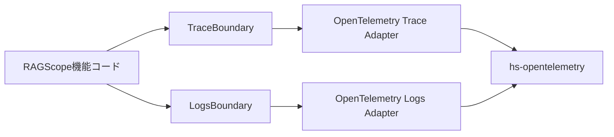

# RAGScopeのTelemetry境界

対象: `RS-0024/exception-event-once` / `e40a998a0352214e4989a0aec5ec6ea1d65d6e8b`

## RAGScopeの機能コードはOpenTelemetry SDKを直接使わない

RAGScopeの機能コードから見ると、TraceとLogsは次の2つの境界として見える。

```text
TraceBoundary
LogsBoundary
```

OpenTelemetry固有の、

```text
TracerProvider
Tracer
Span
LoggerProvider
Logger
LogRecordArguments
```

などはAdapter側へ閉じ込める。



ただし、現在のOpenTelemetry Trace Adapterは未処理exceptionをLogsのEventRecordとして記録するため、SDK非依存のLogs境界型も利用している。このcross-signalな依存は後で分けて見る。

## TraceBoundary

現在の型は次の通り。

```haskell
newtype TraceBoundary = TraceBoundary SpanRunner
```

中身の`SpanRunner`は、

```haskell
type SpanRunner =
  forall result.
  SpanName ->
  (result -> SpanOutcome) ->
  IO result ->
  IO result
```

普通の日本語にすると、

> Span名と、結果をTelemetry上どう分類するかと、実際に実行したいIO処理を受け取り、その処理をSpanの中で実行して元の結果を返す関数

である。

### `SpanOutcome`はapplication resultではない

```haskell
data SpanOutcome
  = SpanSucceeded
  | SpanFailed Text
```

たとえば機能処理が、

```haskell
Left SomeFailure
```

を返しても、その値を`SpanFailed`へ置き換えるわけではない。

元の`Left SomeFailure`はそのまま返し、classifierが、

```haskell
Left _  -> SpanFailed "some_failure"
Right _ -> SpanSucceeded
```

のようにTelemetry上の見え方だけ決める。

```text
application result
    Left SomeFailure
         │
         ├── そのまま呼び出し元へ返す
         │
         └── classifierでSpanOutcomeへ写す
                    ↓
             SpanFailed "..."
```

この分離は、application-level failureとexceptionを区別するときに重要である。

## OpenTelemetry版TraceBoundaryを作る

現在のTrace Adapterの入口は、

```haskell
mkOpenTelemetryTraceBoundary ::
  TracerProvider ->
  EventRecordEmitter ->
  TraceBoundary
```

である。

入力は2つ。

```text
TracerProvider
  = OpenTelemetry Trace側のProvider

EventRecordEmitter
  = RAGScopeのEventRecordを記録する関数
```

内部でTracerを作り、TracerとEventRecordEmitterを使う`runOpenTelemetrySpan`を`TraceBoundary`へ包む。

```text
TracerProvider
    ↓ makeTracer
Tracer
    ┐
    ├─ runOpenTelemetrySpan
EventRecordEmitter
    ┘
    ↓
mkTraceBoundary
    ↓
TraceBoundary
```

機能コードはProviderやTracerを知らずに`withSpan`だけを使う。

## TraceからLogsへの依存はある

現在の`RAGScope.Telemetry.OpenTelemetry.Trace`は次をimportしている。

```haskell
import RAGScope.Telemetry.Logs (
  EventName,
  EventRecord (..),
  EventRecordEmitter,
  EventTimestamp (EventNow),
  LogValue (LogText),
  mkEventName,
 )
import RAGScope.Telemetry.Logs qualified as Logs
```

したがって、module-levelの静的依存としては、

```text
RAGScope.Telemetry.OpenTelemetry.Trace
    ↓
RAGScope.Telemetry.Logs
```

が存在する。

ここは「TraceとLogsは完全に独立している」と読むと間違いになる。

一方で、次の依存ではない。

```text
RAGScope.Telemetry.OpenTelemetry.Trace
    ✗→ RAGScope.Telemetry.OpenTelemetry.Logs
```

Trace Adapterは`LoggerProvider`、`Logger`、OpenTelemetry Logs APIを知らない。

依存しているのはSDK非依存の、

```haskell
type EventRecordEmitter = EventRecord -> IO ()
```

と`EventRecord`を組み立てるための型だけである。

## なぜこの依存があるのか

現在設計では、同期exceptionが処理されないままSpan外へ伝播するとき、

```text
そのSpanをErrorにする
error.typeを付ける
exception EventRecordを1件だけ記録する
exceptionを再throwする
```

必要がある。

しかもEventRecordのownerを最初に抜けたSpanにするには、そのSpanがcurrentな間にemitしなければならない。

```text
internal-span current
    ↓
exceptionを捕捉
    ↓
SpanをError
    ↓
EventRecord emit
    ↓
internal-spanのTraceId / SpanIdが付く
```

現在このexception boundaryを実際に観測しているのがTrace Adapterの`inSpan''` callback内なので、そこへ`EventRecordEmitter`を注入している。

## この依存は問題か

現時点では問題とは判断しない。

理由は次の通り。

```text
1. TraceBoundaryとLogsBoundaryが相互依存しているわけではない
2. Trace AdapterはOpenTelemetry Logs Adapterへ依存していない
3. EventRecordEmitterはSDK非依存の小さい能力である
4. Logs AdapterからTrace Adapterへの逆依存はない
5. opentelemetry-adapter packageは元々telemetry-boundary packageへ依存しており、新しいpackage依存edgeは増えていない
6. exceptionのSpan ErrorとLogs EventRecordを同じexception boundaryで扱う必要が現在設計にある
```

ただし、`Trace.hs`が純粋なTrace変換だけではなく、

```text
exception EventRecordの作成
exactly-onceのclaim
Trace + Logsのexception処理の協調
```

まで持つようになったため、moduleの責務が名前から想像するより広いのは事実である。

今の規模では、この事実だけを理由に新しいmoduleや抽象化を増やす必要はない。今後、exception以外でも複数Signalの協調処理が増えるなど、具体的な責務分離の必要が出た場合に再評価できる。

## LogsBoundary

現在のLogs側は2種類のemit能力をまとめている。

```haskell
data LogsBoundary
  = LogsBoundary
      LogRecordEmitter
      EventRecordEmitter
```

```haskell
type LogRecordEmitter =
  LogRecord -> IO ()

type EventRecordEmitter =
  EventRecord -> IO ()
```

`LogRecord`と`EventRecord`はRAGScope側の型で、hs-opentelemetryの型ではない。

## OpenTelemetry版LogsBoundaryを作る

Logs Adapterの入口は、

```haskell
mkOpenTelemetryLogsBoundary ::
  LoggerProvider ->
  LogsBoundary
```

となっている。

内部でLoggerを作り、

```text
emitOpenTelemetryLogRecord
emitOpenTelemetryEventRecord
```

を`LogsBoundary`へ包む。

```text
LoggerProvider
    ↓ makeLogger
Logger
    ├─ emitOpenTelemetryLogRecord
    └─ emitOpenTelemetryEventRecord
              ↓
         mkLogsBoundary
              ↓
         LogsBoundary
```

## テストでTraceとLogsを接続するところ

exception統合テストでは、

```haskell
let
  logsBoundary =
    mkOpenTelemetryLogsBoundary loggerProvider

  traceBoundary =
    mkOpenTelemetryTraceBoundary
      tracerProvider
      (emitEventRecord logsBoundary)
```

の形で接続する。

```text
LoggerProvider
    ↓
LogsBoundary
    ↓ emitEventRecord
EventRecordEmitter
    ↓
Trace Adapterへ注入

TracerProvider
    ↓
Trace Adapter
    ↓
TraceBoundary
```

Trace Adapterが作った`EventRecord`は、注入されたEmitterを通してLogs Adapterへ渡る。OpenTelemetry Logsへの具体変換はLogs Adapter側の責務のままである。

## package依存として見る

`ragscope.cabal`では、

```text
telemetry-boundary
  exposed-modules:
    RAGScope.Telemetry.Logs
    RAGScope.Telemetry.Trace

opentelemetry-adapter
  build-depends:
    ragscope:telemetry-boundary
    hs-opentelemetry-api
    hs-opentelemetry-sdk
```

となっている。

したがって現在のcross-signal依存は、`opentelemetry-adapter`から新しいlibrary/packageへ依存を増やしたものではない。同じ`telemetry-boundary` libraryにあるLogs型をTrace Adapter moduleが使っている、というmodule-levelの依存である。

次は、このBoundaryを使って`withSpan`を1回呼んだときの現在の実行フローを見る。
